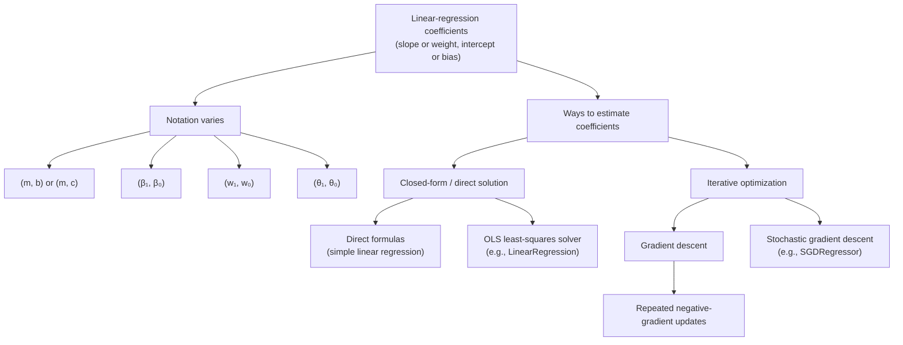
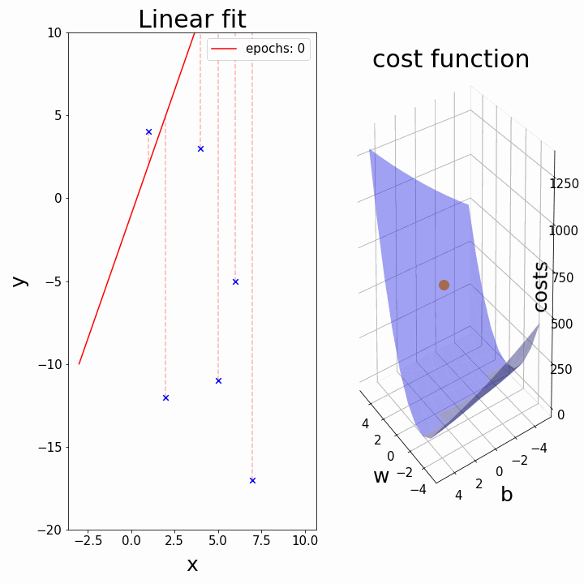
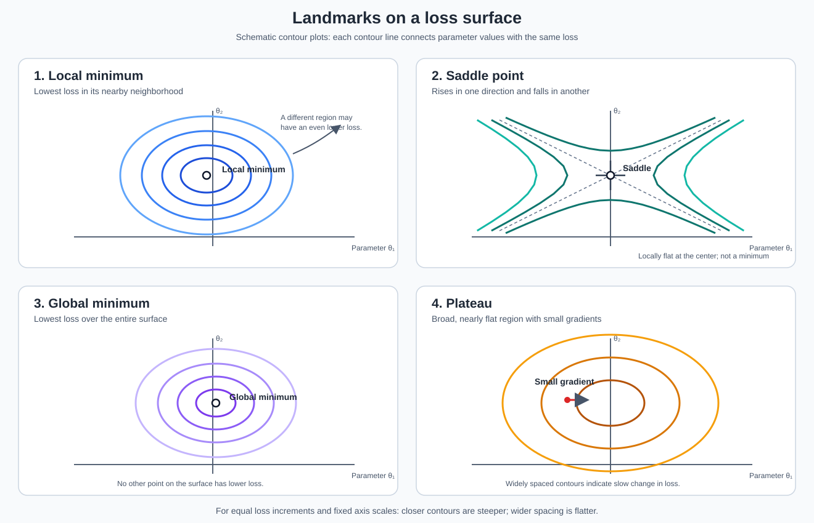
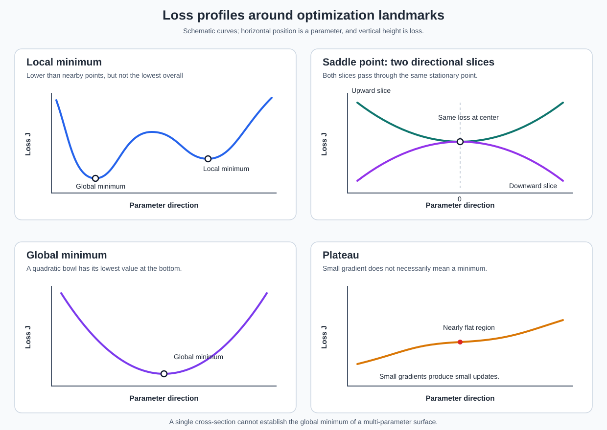
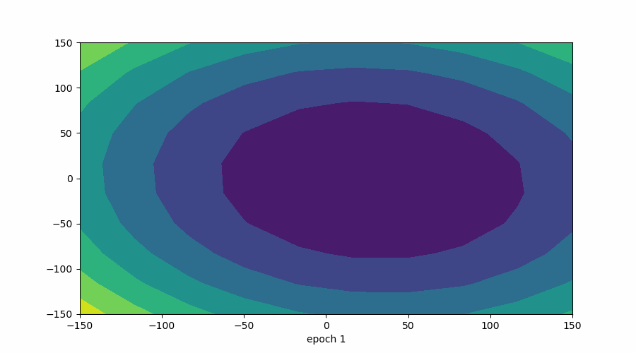

# What Is Gradient Descent?

## Table of Contents

- [Cost function and gradient descent](#cost-function-and-gradient-descent)
- [OLS and gradient descent: estimating linear-model coefficients](#ols-and-gradient-descent-two-ways-to-estimate-linear-model-coefficients)
- [Gradient descent overview](#gradient-descent-overview)
  - [Intuition](#intuition)
  - [Batch, stochastic, and mini-batch updates](#batch-stochastic-and-mini-batch-gradient-descent)
  - [Practical training and stopping](#practical-training-and-stopping)
  - [Positive and negative cost gradients](#positive-and-negative-cost-gradients-how-should-the-intercept-change)
  - [Learning rate and step size](#learning-rate-alpha-or-eta-step-size)
  - [Overshooting and convergence](./00_Gradient_descent_overshoot_convergence.md)
  - [Monitoring the loss](#monitor-the-loss-not-only-the-parameter-steps)
  - [Local and global minima](#local-minima-and-global-minima)
- [Step-by-step derivation of the update](#step-by-step-derivation-of-the-gradient-descent-update)
- [Apply the derivation to simple linear regression](#apply-the-derivation-to-simple-linear-regression)
  - [Model and notation](#model-and-notation)
  - [Half-MSE cost function](#cost-function-half-mean-squared-error)
  - [Partial derivatives](#step-by-step-partial-derivatives)
  - [Final parameter updates](#final-parameter-updates)
  - [Regression loss in 2D and 3D](#visualizing-the-regression-loss-over-slope-and-intercept)
  - [Animation: fitted line and cost](#animation-the-fitted-line-and-its-cost)
- [Challenges with gradient descent](#challenges-with-gradient-descent)
  - [Loss-versus-parameter profiles](#loss-versus-parameter-profiles)
  - [Vanishing and exploding gradients](#vanishing-and-exploding-gradients)
- [Contour plot of the loss surface](#contour-plot-of-loss-surface)
  - [3D bowl-shaped surface](#three-dimensional-bowl-shaped-loss-surface)
  - [Animated contour plot](#animated-contour-plot)
- [Linear regression: OLS and gradient descent](#linear-regression-ols-and-gradient-descent)
  - [Fit a line to data](#1-goal-fit-a-line-to-data)
  - [Model versus method](#2-ols-and-gradient-descent-model-versus-method)
  - [Gradient derivation](#3-detailed-gradient-derivation-for-simple-linear-regression)
  - [Gradient-descent updates](#4-derive-the-gradient-descent-updates)
  - [One iteration, step by step](#one-iteration-step-by-step)
  - [OLS solution for simple linear regression](#5-derive-the-ols-solution-for-simple-linear-regression)
  - [Matrix derivation for multiple features](#6-matrix-derivation-for-multiple-features)
  - [Why the least-squares minimum is global](#7-why-the-least-squares-minimum-is-global)
  - [OLS versus gradient descent](#8-ols-versus-gradient-descent)
  - [Key terms](#9-key-terms)
  - [Summary](#summary)

### Cost function and gradient descent:
A **cost function** assigns a numeric value to a model's prediction errors. For simple linear regression, the hypothesis (prediction rule) is

$$
\begin{aligned}
h_{\theta}(x) &= \theta_0+\theta_1x\\
               &= \beta_0+\beta_1x\\
               &= w_0+w_1x.
\end{aligned}
$$

**Coefficients are the model parameters learned from data.** They determine the position and slope of the fitted line:

| Equivalent coefficient symbols | Name | Meaning |
|---|---|---|
| $\theta_0=\beta_0=w_0$ | **Intercept** or **bias term** | The model's predicted value when $x=0$. Changing it shifts the line vertically. |
| $\theta_1=\beta_1=w_1$ | **Slope**, **weight**, or **feature coefficient** | The change in the predicted value for a one-unit increase in $x$. A positive value gives an upward-sloping line; a negative value gives a downward-sloping line. |

These are equivalent notations for the same linear model, not different sets of coefficients that must be learned separately. Simple linear regression has one feature coefficient and one intercept; multiple linear regression has a coefficient for each feature.

---- 
### OLS and Gradient Descent: Two Ways to Estimate Linear-Model Coefficients

**OLS defines a least-squares estimation objective; gradient descent is an algorithm that can optimize it.** This guide compares a direct least-squares solver with gradient-based optimization of the same objective. With the same data they target the same minimum squared error. When coefficients are not uniquely identifiable, different minimizing coefficient vectors can give the same fitted predictions; finite GD runs may only approximate the optimum.

- **Closed-form / direct solution:** For simple linear regression, the coefficients can be calculated with direct formulas. OLS implementations such as scikit-learn's `LinearRegression` solve the least-squares problem directly using a numerical solver.
- **Iterative / non-closed-form optimization:** Gradient descent repeatedly updates the coefficients using the negative gradient. Gradient-based methods are useful for large-scale or high-dimensional problems and objectives where a convenient direct solution is unavailable. Their results depend on the learning rate, initialization, and convergence.

Coefficient notation varies across textbooks and implementations. The following pairs use the order **(slope or weight, intercept or bias)**:

$$
(m,b),\qquad (m,c),\qquad (\beta_1,\beta_0),\qquad
(w_1,w_0),\qquad (\theta_1,\theta_0).
$$

These are alternative names for the same two model coefficients. In this document, $m$ denotes the slope and $b$ the intercept; $\beta_1$, $w_1$, and $\theta_1$ denote the slope, while $\beta_0$, $w_0$, and $\theta_0$ denote the intercept. The letter $O$ is not being used as a coefficient symbol.

**Important:** `LinearRegression` is an OLS estimator, whereas `SGDRegressor` uses stochastic gradient descent. By default, `SGDRegressor` also includes L2 regularization; matching an unregularized OLS objective requires settings such as `loss="squared_error"` and `penalty=None`. Its `alpha` parameter controls regularization strength, not the learning rate; `learning_rate` and `eta0` control its learning-rate schedule.

---
## Gradient Descent Overview

**Gradient Descent (GD)** is an optimization algorithm used to minimize a **cost function (loss function)** by iteratively updating model parameters in the direction of the **negative gradient**.

The method of steepest descent, the foundation of modern gradient descent, is generally credited to **Augustin-Louis Cauchy**, who proposed it in 1847. The method has been studied and developed further since then ([historical overview](https://en.wikipedia.org/wiki/Gradient_descent#History)).

### Intuition

- **Gradient:** points in the direction of the steepest local increase in the loss.
- **Negative gradient:** points in the direction of the steepest local decrease in the loss.
- **Update:** move the model parameters opposite to the gradient so that the loss decreases.
- **Repeat:** recalculate the gradient after each update and continue moving downhill toward a minimum.

Imagine standing on a hilly landscape in fog. The model parameters describe your current location, and the loss is the height of the landscape. You use the local slope to choose a downhill step, then check the slope again and repeat. In this analogy, gradient descent aims to reach a low point in the loss landscape.

### Batch, Stochastic, and Mini-Batch Gradient Descent

For an average objective $J(\boldsymbol{\theta})=\frac{1}{N}\sum_{i=1}^{N}\ell_i(\boldsymbol{\theta})$, let $\ell_i$ be the loss on example $i$. The variants differ in the examples used per update:

| Variant | Gradient used for one update | Updates per epoch | Main trade-off |
|---|---|---|---|
| **Batch** | $\frac{1}{N}\sum_i\nabla\ell_i$ | $1$ | Exact full-training gradient; expensive per update on large datasets. |
| **Stochastic (SGD)** | $\nabla\ell_i$ for one sampled example | $N$ in one shuffled pass | Frequent, inexpensive updates, but a noisy trajectory. |
| **Mini-batch** | $\frac{1}{B}\sum_{i\in\mathcal B}\nabla\ell_i$, for batch $\mathcal B$ of size $B$ | $\lceil N/B\rceil$ in one pass | Balances computational efficiency and gradient noise. |

- **Iteration:** one parameter update. **Epoch:** one full pass through the training data.
- The table assumes each example is processed once per epoch, including a possible smaller final batch. Random sampling with replacement need not form literal passes.
- Stochastic gradients do not guarantee that the full cost decreases after every update. Even near a minimum, a fixed learning rate can leave noisy fluctuations; a suitable decaying schedule can help.

### Practical Training and Stopping

- **Prepare the data:** split training and evaluation data first. Fit feature-scaling statistics on the training data only, then apply those same statistics to validation/test data. Scaling can improve conditioning and make a learning rate easier to choose.
- **Initialize parameters:** zeros are valid for linear regression; random initialization is not required for this convex problem. Neural networks have different symmetry considerations.
- **Choose the objective:** use SSE, MSE, or half-MSE consistently in both the gradient and cost monitoring.
- **Monitor progress:** check loss and gradient values for non-finite numbers. If they become non-finite or grow rapidly, stop and investigate the learning rate, feature scales, and calculations.
- **Stop using explicit criteria:** for batch GD, examples include $\|\nabla J\|_2\leq\varepsilon_g$ or $|J_t-J_{t-1}|\leq\varepsilon_J(1+|J_{t-1}|)$ over several updates, together with a maximum iteration limit. Here $\varepsilon_g,\varepsilon_J>0$ are chosen tolerances. A tiny change alone can also mean the rate is too small; it does not prove optimality.
- **Distinguish optimization from generalization:** lower training loss does not guarantee better performance on unseen data. Validation-based early stopping is separate from checking numerical convergence; reserve the test set for final evaluation.

*The update rule is applied to each parameter, such as the intercept $\theta_0$ and slope $\theta_1$.*

> [!NOTE]
> #### Learning Rate $\alpha>0$
> The learning rate determines how big a step we take in the direction opposite to the gradient. A small learning rate results in slow convergence, while a large learning rate can cause overshooting or divergence.
> Here, $\alpha>0$ is the **learning rate** (also written as $\eta$), which controls the size of each parameter update as gradient descent moves toward convergence.

*This reference shows $h_\theta(x)=\theta_0+\theta_1x$ and the half-MSE objective. The $m$ in the denominator of the image denotes the number of examples; this document uses $N$ for that count to distinguish it from the slope notation $m$.*

---
### Positive and Negative Cost Gradients: How Should the Intercept Change?

**Here, "slope" means the slope of the cost curve with respect to the intercept, $\partial J/\partial b$, not the fitted line's slope $m$.** The sign of $m$ alone does not tell us whether to increase or decrease $b=\theta_0=\beta_0=w_0$.

With learning rate $\eta>0$, the intercept update is

$$
\boxed{b_{\text{new}}=b_{\text{old}}-\eta\frac{\partial J}{\partial b}}.
$$

1. **Positive cost slope: decrease the intercept.** If $\partial J/\partial b>0$, subtracting a positive quantity makes $b_{\text{new}}<b_{\text{old}}$. Move left on the cost-versus-intercept curve; in the prediction model, decreasing $b$ shifts the fitted line downward.
2. **Negative cost slope: increase the intercept.** If $\partial J/\partial b<0$, subtracting a negative quantity makes $b_{\text{new}}>b_{\text{old}}$. Move right on the cost-versus-intercept curve; in the prediction model, increasing $b$ shifts the fitted line upward.

*This is a generic derivative illustration. To interpret it as intercept optimization, read the horizontal coordinate as $b$, the vertical coordinate as $J(b)$, and the derivative as $dJ/db$, with the regression slope $m$ held fixed.*

*On the left of the minimum, the cost gradient is negative, so increase $b$. On the right, the gradient is positive, so decrease $b$. The values in this image are illustrative, not calculated from this document's dataset.*

For the half-MSE objective defined below, the intercept gradient is the mean prediction error:

$$
\frac{\partial J}{\partial b}=\frac{1}{N}\sum_{i=1}^{N}(\hat y_i-y_i).
$$

Thus, predictions that are too high on average give a positive gradient and call for a smaller intercept; predictions that are too low on average give a negative gradient and call for a larger intercept. For example, with $\eta=0.1$ and $b_{\text{old}}=10$, a gradient of $+4$ gives $b_{\text{new}}=9.6$, while a gradient of $-4$ gives $b_{\text{new}}=10.4$.

| Cost gradient with respect to $b$ | Intercept update | Effect on predictions with $m$ fixed |
|---|---|---|
| Positive: $\partial J/\partial b>0$ | Decrease $b$ | Shift the line downward |
| Negative: $\partial J/\partial b<0$ | Increase $b$ | Shift the line upward |
| Zero: $\partial J/\partial b=0$ | No intercept change from this update | At the minimum along the intercept direction for this convex quadratic |

These are descent directions; a suitable learning rate is still necessary to reduce the actual cost without overshooting. If both $m$ and $b$ are being learned, a zero intercept gradient alone does not establish that both parameters are optimal: the slope gradient must also be zero.

For training example $i$, the hypothesis evaluated at its input is the predicted value:

$$
\boxed{h_{\theta}\!\left(x^{(i)}\right)=\hat y_i}.
$$

Thus, $h_{\theta}(x)$ names the prediction rule, while $\hat y_i$ names its prediction for the $i$-th example. Given $N$ training observations, one common objective is half the mean squared error:

$$
J(\theta_0,\theta_1)
=\frac{1}{2N}\sum_{i=1}^{N}
\left(h_{\theta}(x^{(i)})-y^{(i)}\right)^2.
$$

The optimization goal is to choose $\theta_0$ and $\theta_1$ that minimize $J$. Gradient descent does this by repeatedly updating the parameters opposite their partial derivatives. Batch, stochastic, and mini-batch gradient descent differ in how many training examples are used to estimate each update. The learning rate controls update size; poor choices can make learning slow or unstable.

----
### Learning Rate $\alpha$ or $\eta$ (Step Size)

> [!NOTE]
> The learning rate is also commonly written as **eta ($\eta$)** instead of **alpha ($\alpha$)**. Both symbols refer to the same learning-rate parameter here; only the notation differs.

- **Hyperparameter:** the learning rate controls how strongly the parameters move in the **negative-gradient direction**, affecting convergence speed and stability.
- **[Learning rate](https://www.ibm.com/think/topics/learning-rate):** also called the step-size parameter or alpha ($\alpha$), it scales the gradient to control how far the parameters move in each update.
- **Choosing a value:** a numerically small value is common, but an appropriate rate depends on feature scales and the cost definition. Monitor the cost during training to assess whether the rate is suitable.
- **High learning rate:** produces larger updates for the same gradient, which can speed up progress but risks overshooting, unstable oscillations, or divergence.
- **Low learning rate:** produces smaller updates for the same gradient, allowing finer adjustments but often requiring more iterations, time, and computation. A smaller rate does not automatically guarantee a more accurate final solution.
- **Adjusting the rate:** it can remain fixed or change according to a schedule or adaptive method; updating it at every iteration is not mandatory.

The negative gradient determines the direction of an update; the **learning rate** determines how strongly we move in that direction. The symbols $\alpha$ and $\eta$ both denote the learning rate:

$$
\boldsymbol{\theta}^{(t+1)}
=\boldsymbol{\theta}^{(t)}-\alpha\nabla J(\boldsymbol{\theta}^{(t)}),
\qquad
\|\Delta\boldsymbol{\theta}^{(t)}\|_2
=\alpha\|\nabla J(\boldsymbol{\theta}^{(t)})\|_2.
$$

The actual distance moved depends on **both** the learning rate and the gradient magnitude. A fixed learning rate therefore does not imply a fixed distance per update.

- **Too small:** updates make little progress, so reaching a useful solution may require many epochs.
- **Suitable:** updates reduce the objective efficiently without unstable jumps.
- **Moderately large but stable:** parameters can overshoot the minimum and alternate across it while getting closer.
- **Too large:** updates can oscillate without settling or diverge, moving farther from the minimum.

*Compare the lengths of the updates: small steps can be slow, appropriately sized steps can be efficient, and excessively large steps can move away from the minimum. The image's label “optimal” is illustrative, not a universal numerical learning rate.*

#### Derivation: when does overshooting still converge? [Detailed Explanation if you want to dive deeper](./00_Gradient_descent_overshoot_convergence.md)

> [!NOTE]
> For a detailed explanation and derivation of overshooting and convergence, see [00_Gradient_descent_overshoot_convergence.md](./00_Gradient_descent_overshoot_convergence.md).

The thresholds $1/C$ and $2/C$ have a precise interpretation for a **one-dimensional quadratic** with constant curvature $C>0$:

$$
J(\theta)=J^*+\frac{C}{2}(\theta-\theta^*)^2,
\qquad
J'(\theta)=C(\theta-\theta^*).
$$

Here $\theta^*$ minimizes the cost and $J^*$ is the minimum cost. Substituting this derivative into the GD update gives

$$
\begin{aligned}
\theta^{(t+1)}&=\theta^{(t)}-\alpha C(\theta^{(t)}-\theta^*),\\
\theta^{(t+1)}-\theta^*&=(1-\alpha C)(\theta^{(t)}-\theta^*).
\end{aligned}
$$

Thus the parameter error shrinks when $|1-\alpha C|<1$, or $0<\alpha<2/C$.

| Learning rate for this quadratic | Error multiplier $1-\alpha C$ | Behavior |
|---|---|---|
| $0<\alpha<1/C$ | Between 0 and 1 | Approaches the minimum without crossing it; very small rates are slow |
| $\alpha=1/C$ | Zero | Reaches the exact minimum in one update for this specific quadratic |
| $1/C<\alpha<2/C$ | Between -1 and 0 | Crosses the minimum repeatedly but converges as the error shrinks |
| $\alpha=2/C$ | -1 | Oscillates at constant distance unless already at the minimum |
| $\alpha>2/C$ | Less than -1 | Alternates with growing error and diverges unless already at the minimum |

> [!NOTE]
> These exact thresholds assume a scalar quadratic with constant curvature $C$. They are not universal rules for all objectives. For a positive-definite multivariable quadratic, $0<\alpha<2/\lambda_{\max}(H)$ ensures convergence, where $H$ is its Hessian. Different directions can have different curvature, so a single rate may be slow in some directions and unstable in others. Feature scaling and the choice of SSE versus MSE affect these scales.

*Crossing the minimum is not automatically divergence: in a stable run the distance to the minimum shrinks, even if consecutive parameter values lie on opposite sides.*

*This image provides another view of overshooting. Its path alone should not be treated as a general convergence guarantee.*

#### Monitor the loss, not only the parameter steps

Plot **iteration or epoch** on the horizontal axis and **cost** on the vertical axis. Compare candidate learning rates using the same loss definition and data:

- A slowly decreasing curve can indicate a learning rate that is too small, but poor feature scaling can also cause slow progress.
- A steadily decreasing curve that settles suggests progress; check the gradient and a stopping tolerance rather than assuming a flat-looking curve proves optimality.
- A rapidly increasing or non-finite loss is a warning of unstable updates.
- Batch GD with a suitable rate can decrease a smooth cost monotonically; stochastic and mini-batch losses can fluctuate because their gradients are estimated from subsets.

*These are schematic learning curves, not results measured from this document's examples. The depicted plateau for a high rate is not a behavior guaranteed for every loss function.*

> [!NOTE]
> As the gradient approaches zero near a smooth minimum, the update magnitude $\alpha\|\nabla J\|$ approaches zero even if $\alpha$ stays constant. The gradient need not decrease at every iteration for every problem. Learning-rate schedules can be useful, but a changing rate is not required for convergence on a well-conditioned quadratic with a suitable fixed rate.

### Local Minima and Global Minima

A **local minimum** has no lower-cost point in a sufficiently small neighborhood. A **global minimum** has no lower-cost point anywhere in the parameter space. Non-convex objectives can have several valleys, and gradient descent may reach different stationary points depending on initialization and its update settings.

*The horizontal axis represents a parameter $w$ and the vertical axis its cost $C(w)$. Different valleys illustrate why initialization can affect the outcome on a non-convex objective; this is not the squared-error linear-regression cost surface.*

- **Initialization matters for non-convex losses:** starting in different regions can lead toward different local minima.
- **A larger learning rate is not a reliable escape strategy:** it may cross a valley, but can also make optimization unstable.
- **A zero gradient is not always a minimum:** general objectives can also have stationary maxima or saddle points. Gradient descent does not guarantee a global solution for arbitrary differentiable functions.
- **For ordinary linear regression with squared error:** the objective is convex in the coefficients, so every local minimum is global. With independent design-matrix columns the coefficient solution is unique; otherwise several coefficient vectors can achieve the same minimum loss.

Convergence means approaching a stable solution, not necessarily driving the coefficients or loss to zero. At a least-squares minimum the gradient is zero, but the coefficients can be nonzero and noisy observations can leave positive residual cost.

----
## Step-by-Step Derivation of the Gradient Descent Update

### Step 1: Define the objective

Let the model parameters be

$$
\boldsymbol{\theta}=[\theta_0,\theta_1,\ldots,\theta_p]^T,
$$

and let $J(\boldsymbol{\theta})$ be the cost (loss) function. Our goal is to find parameter values that minimize the cost:

$$
\boxed{\min_{\boldsymbol{\theta}} J(\boldsymbol{\theta})}.
$$

### Step 2: Use a first-order Taylor approximation

For a small parameter change $\Delta\boldsymbol{\theta}$, the first-order Taylor approximation is

$$
J(\boldsymbol{\theta}+\Delta\boldsymbol{\theta})
\approx
J(\boldsymbol{\theta})+
\nabla J(\boldsymbol{\theta})^T\Delta\boldsymbol{\theta}.
$$

To make the approximate change in cost negative, we want

$$
\nabla J(\boldsymbol{\theta})^T\Delta\boldsymbol{\theta}<0.
$$

Choose the change opposite to the gradient:

$$
\Delta\boldsymbol{\theta}=-\eta\nabla J(\boldsymbol{\theta}),
$$

where $\eta>0$ is the learning rate. Then the first-order change is

$$
\nabla J(\boldsymbol{\theta})^T\Delta\boldsymbol{\theta}
=-\eta\left\|\nabla J(\boldsymbol{\theta})\right\|_2^2<0
$$

when the gradient is nonzero. This is a local approximation: the learning rate must be suitably small for the actual cost to decrease; an overly large step may overshoot.

### Step 3: Obtain the gradient-descent rule

Since the new parameters are the old parameters plus the change,

$$
\boldsymbol{\theta}_{\text{new}}
=\boldsymbol{\theta}_{\text{old}}+\Delta\boldsymbol{\theta},
$$

substituting the chosen change gives the gradient-descent update:

$$
\boxed{
\boldsymbol{\theta}^{(t+1)}
=\boldsymbol{\theta}^{(t)}
-\eta\nabla J\!\left(\boldsymbol{\theta}^{(t)}\right)
}.
$$

The superscript $t$ denotes the iteration. For multiple parameters, each component is updated using its corresponding partial derivative.

## Apply the Derivation to Simple Linear Regression

### Model and notation

For one input feature, write the model as

$$
\hat y_i=\theta_0+\theta_1x_i,
$$

where $\theta_0$ is the intercept (bias) and $\theta_1$ is the slope (weight). In the $m,b$ notation used below, $\theta_0=b$ and $\theta_1=m$. Here $N$ denotes the number of training examples; using $N$ avoids confusing the sample count with the slope symbol $m$.

### Cost function: half mean squared error

For $N$ examples, choose the half-MSE objective

$$
\begin{aligned}
J(\theta_0,\theta_1)
&=\frac{1}{2N}\sum_{i=1}^{N}(\hat y_i-y_i)^2\\
&=\frac{1}{2N}\sum_{i=1}^{N}(\theta_0+\theta_1x_i-y_i)^2.
\end{aligned}
$$

The factor $1/2$ is included because it cancels the $2$ produced by differentiating a square. This objective is half the MSE; it has the same minimizing parameters as MSE, but its gradient scale (and therefore a suitable learning rate) is different.

**Keep the cost normalization consistent**

| Objective | Formula | Gradient relative to SSE |
|---|---|---|
| SSE | $\sum_i(\hat y_i-y_i)^2$ | $\nabla J_{SSE}$ |
| MSE | $\frac{1}{N}\sum_i(\hat y_i-y_i)^2$ | $\frac{1}{N}\nabla J_{SSE}$ |
| Half-MSE | $\frac{1}{2N}\sum_i(\hat y_i-y_i)^2$ | $\frac{1}{2N}\nabla J_{SSE}$ |

For identical full-batch updates on the same data, the rates must satisfy $\eta_{MSE}=N\eta_{SSE}$ and $\eta_{\text{half-MSE}}=2N\eta_{SSE}$. This describes matching updates, not a universal recommended rate.

### Step-by-step partial derivatives

For each observation, define the prediction error in the cost as

$$
e_i=\hat y_i-y_i=\theta_0+\theta_1x_i-y_i.
$$

Then

$$
\frac{\partial e_i}{\partial\theta_0}=1,
\qquad
\frac{\partial e_i}{\partial\theta_1}=x_i.
$$

Apply the chain rule, $\frac{\partial(e_i^2)}{\partial\theta_j}=2e_i\frac{\partial e_i}{\partial\theta_j}$.

**Derivative with respect to the intercept $\theta_0$:**

$$
\begin{aligned}
\frac{\partial J}{\partial\theta_0}
&=\frac{1}{2N}\sum_{i=1}^{N}2e_i
  \frac{\partial e_i}{\partial\theta_0}\\
&=\frac{1}{2N}\sum_{i=1}^{N}2e_i(1)\\
&=\boxed{\frac{1}{N}\sum_{i=1}^{N}(\hat y_i-y_i)}\\
&=\frac{1}{N}\sum_{i=1}^{N}(\theta_0+\theta_1x_i-y_i).
\end{aligned}
$$

**Derivative with respect to the slope $\theta_1$:**

$$
\begin{aligned}
\frac{\partial J}{\partial\theta_1}
&=\frac{1}{2N}\sum_{i=1}^{N}2e_i
  \frac{\partial e_i}{\partial\theta_1}\\
&=\frac{1}{2N}\sum_{i=1}^{N}2e_i x_i\\
&=\boxed{\frac{1}{N}\sum_{i=1}^{N}(\hat y_i-y_i)x_i}\\
&=\frac{1}{N}\sum_{i=1}^{N}(\theta_0+\theta_1x_i-y_i)x_i.
\end{aligned}
$$

The slope derivative includes $x_i$ because changing $\theta_1$ changes prediction $i$ by $x_i$ times the parameter change.

### Final parameter updates

Apply the general rule $\theta_j\leftarrow\theta_j-\eta\frac{\partial J}{\partial\theta_j}$ to each parameter:

$$
\boxed{
\theta_0\leftarrow\theta_0
-\frac{\eta}{N}\sum_{i=1}^{N}(\hat y_i-y_i)
}
$$

$$
\boxed{
\theta_1\leftarrow\theta_1
-\frac{\eta}{N}\sum_{i=1}^{N}(\hat y_i-y_i)x_i
}.
$$

At each iteration, calculate both gradients using the same current $\theta_0$ and $\theta_1$, then update both parameters. Repeat until a chosen stopping condition is reached, such as a small change in loss or a maximum number of iterations.

#### Visualizing the regression loss over slope and intercept

The figure below connects the two parameter updates to the shape of the regression objective. The left panels show mean squared error (MSE) as a function of the slope $m$ and intercept $b$ separately, holding the other parameter fixed; the right panel combines both parameters into a three-dimensional loss surface. A minimum along one fixed-parameter slice is not necessarily the joint optimum. The bottom of the full bowl represents the parameter pair with the lowest MSE.

<em>Conceptual visualization of the regression loss as the slope and intercept vary. The plotted surface is not calculated from a specific dataset in this guide; the optimal slope and intercept depend on the data, and the optimal slope is not generally zero.</em>

> **Image notation:** “Slope = 0” at the bottom means the **cost derivatives are zero**, not that the fitted line must have $m=0$. MSE in this image and half-MSE in the derivation have the same minimizers, but different gradient magnitudes.

#### Animation: the fitted line and its cost

This animation pairs the changing linear fit on the left with its corresponding position on the cost surface on the right. As the model parameters update over epochs, the fitted line changes and the point on the surface moves to represent the associated cost.

<em>Left: the model's fit to the data. Right: the associated cost for parameter values as training proceeds.</em>

---

### Challenges with Gradient Descent

Gradient Descent is widely used, but the loss surface can make optimization difficult. The contour diagrams below are **conceptual illustrations** across two parameter dimensions, $\theta_1$ and $\theta_2$. Each contour line connects points with equal loss; they are not the exact loss surface for the linear-regression example in this guide.

- **Local minimum:** the loss is lower than nearby points, but a different region of the surface may have an even lower value.
- **Saddle point:** the surface curves upward in one direction and downward in another. At an exact stationary saddle, the gradient is zero, so first-order Gradient Descent can make little or no progress until it moves away from that point.
- **Global minimum:** the point has the lowest loss across the entire surface.
- **Plateau:** a broad, nearly flat region has a small gradient, so updates can make slow progress. For equal increments in loss and fixed axis scales, wider contour spacing indicates a flatter region; closer spacing indicates a steeper change. Spacing alone cannot compare gradients across plots with different contour levels or axis scales.

#### Loss-versus-parameter profiles

The contour diagrams above show the loss landscape from above. These ordinary two-dimensional graphs show example **cross-sections** of loss against a parameter direction, similar to viewing a curve on standard $x$-$y$ axes. The saddle-point panel compares two perpendicular cross-sections through the same point.

- **Local minimum:** the curve is lower than nearby points, but another point on the same curve has lower loss.
- **Saddle point:** along one direction the curve bends upward, while along a perpendicular direction it bends downward.
- **Global minimum:** the lowest point on the entire displayed loss curve.
- **Plateau:** the curve is almost flat over a range of parameter values, so the gradient and updates are small.

**A flat point in a single curve is not enough to identify a saddle.** A one-dimensional stationary inflection, such as $J(x)=x^3$ at $x=0$, can also have zero derivative without being a minimum. A saddle of a multi-parameter surface requires examining different directions. Likewise, a minimum in one displayed cross-section does not establish a global minimum of the full surface.

For a **convex** objective, every local minimum is also a global minimum. For a **non-convex** objective, Gradient Descent may converge to a local minimum or slow down near a saddle point or plateau; finding the global minimum is not guaranteed. Stochastic or mini-batch gradient noise can sometimes help an optimizer move away from flat or saddle regions, but it does not guarantee escape from every local minimum.

#### Vanishing and exploding gradients

Deep neural networks can also experience vanishing or exploding gradients during backpropagation, especially when gradients are repeatedly multiplied across many layers or time steps.

- **Vanishing gradients:** gradients become very small as they propagate backward, so earlier layers receive tiny updates and learn slowly.
- **Exploding gradients:** gradients become very large, producing unstable updates and potentially numerical overflow or `NaN` values.

Common mitigations include suitable weight initialization, normalization, residual connections, and (for exploding gradients) gradient clipping. Which technique helps depends on the model and the cause of the problem.

---

### Contour Plot of Loss Surface

<em>Conceptual illustration: contour lines represent equal loss, and the arrows show successive steps toward a lower-loss region. This is a general optimization illustration, not the exact loss surface for the regression example below.</em>

**Image source and license:** [“Gradient descent” by Zerodamage](https://commons.wikimedia.org/wiki/File:Gradient_descent.svg), Wikimedia Commons, public domain.

#### Three-dimensional bowl-shaped loss surface

A 3D surface plot shows loss as height above the parameter plane. This bowl-shaped illustration is a conceptual view of a smooth objective with a low point; unlike a contour plot, it shows the vertical loss dimension directly. Its $x$ and $y$ labels are generic parameter directions, not specifically the regression slope and intercept.

<em>Conceptual 3D bowl: moving downhill toward the bottom corresponds to reducing the loss.</em>

#### Animated contour plot

<em>Animation: the contour colors represent different loss values as the parameters are updated during training.</em>

**How to read this contour animation**

- **Horizontal coordinate:** the slope $m$ (also called weight $w$).
- **Vertical coordinate:** the intercept or bias $b$.
- **Contour colors and boundaries:** represent levels of the SSE cost function,

  $$
  J(m,b)=\sum_{i=1}^{N}\left[y_i-(mx_i+b)\right]^2.
  $$

- **Moving path:** shows the successive parameter pairs $(m,b)$ produced by Gradient Descent. Each point on the path is a candidate line, not an individual training observation.
- **Lowest-cost region:** for this bowl-shaped quadratic, the nested contours surround a global minimizer, toward which a stable GD path moves. The coarse shaded grid does not locate the exact minimizer precisely, and the plot's geometric center need not be the minimum. The whole contour plot represents the cost function, not just its lowest region.
- **Global minimum:** because this least-squares objective is convex, the minimum is global. The minimum SSE need not be zero: even the best-fitting line can have prediction errors.

*The coordinates here are model parameters, not the input feature and target values. If an animation frame labels the horizontal axis with an epoch number, that label indicates training progress; it does not change the horizontal coordinate from $m$ to time.*

For parameters collected in a vector $\boldsymbol{\theta}$, the update is

$$
\boldsymbol{\theta}^{(t+1)}=\boldsymbol{\theta}^{(t)}-\eta\,\nabla J\!\left(\boldsymbol{\theta}^{(t)}\right),
$$

where $J$ is the loss, $\nabla J$ is its gradient, $\eta>0$ is the learning rate (step size), and $t$ is the iteration. The gradient points toward the steepest local increase in loss, so subtracting it moves in the direction of decrease. The learning rate controls how far each step goes: too small can make progress slow, while too large can overshoot or diverge. For the squared-error linear-regression objective discussed below, the loss is convex, so its minimum is global; gradient descent still needs a suitable learning rate to converge.

---

# Linear Regression: OLS and Gradient Descent

## 1. Goal: fit a line to data

Linear regression models the relationship between input features and a numeric target. In simple linear regression, the prediction for observation $i$ is

$$
\boxed{\hat y_i = m x_i + b}
$$

where $x_i$ is the input, $y_i$ is the observed target, $\hat y_i$ is the predicted target, $m$ is the slope, and $b$ is the intercept.

In the sections below, $n=N$ denotes the number of training observations; it is unrelated to the slope $m$. The design matrix $X$ later has shape $n\times(p+1)$ for $p$ features and an intercept.

The same one-feature model is also commonly written as

$$
\begin{aligned}
\hat y_i &= m x_i+b\\
         &= \beta_0+\beta_1x_i\\
         &= w_0+w_1x_i\\
         &= \theta_0+\theta_1x_i.
\end{aligned}
$$

These are the **same model with different notation**: $b=\beta_0=w_0=\theta_0$ is the intercept (also called the bias), and $m=\beta_1=w_1=\theta_1$ is the slope or weight for feature $x_i$. The symbols vary among books and implementations; their roles and the prediction do not. This document uses $m$ and $b$ to match the simple-regression notation used below. The residual (prediction error) is

$$
r_i = y_i - \hat y_i = y_i - (m x_i+b).
$$

**Sign convention:** the earlier half-MSE derivation used $e_i=\hat y_i-y_i$, whereas this section uses $r_i=y_i-\hat y_i=-e_i$. Squaring gives $r_i^2=e_i^2$; the gradients agree when the derivative of the chosen residual is included consistently.

We choose $m$ and $b$ to make predictions close to observed targets. A common objective is the **sum of squared errors (SSE)**:

$$
J_{SSE}(m,b)=\sum_{i=1}^{n}\left[y_i-(m x_i+b)\right]^2=\sum_{i=1}^{n}r_i^2.
$$

Squaring prevents positive and negative residuals from cancelling and gives larger errors more weight. The **mean squared error (MSE)** is

$$
J_{MSE}(m,b)=\frac{1}{n}\sum_{i=1}^{n}\left[y_i-(m x_i+b)\right]^2=\frac{1}{n}J_{SSE}(m,b).
$$

For a fixed dataset, SSE and MSE have the same minimizing $m$ and $b$, because MSE is SSE multiplied by the positive constant $1/n$. Their gradients differ by the factor $n$, however, so a suitable learning rate depends on which objective is used.

## 2. OLS and gradient descent: model versus method

**Linear regression is the model, OLS specifies least-squares estimation, and gradient descent is an optimization algorithm.** Here we compare solving the OLS objective directly with optimizing it by GD.

- **OLS** solves the least-squares problem directly using a numerical least-squares solver. For simple linear regression, the solution can also be written as closed-form formulas.
- **Gradient descent** starts from initial coefficient values and repeatedly adjusts them using the loss gradient. It approaches a minimum over iterations.

For squared-error linear regression, the objective is a convex quadratic in the coefficients. Thus every local minimum is also global. With a suitable learning rate, gradient descent converges to a global least-squares solution. A finite run may only approximate the solution, so GD and OLS results may be close rather than exactly identical.

## 3. Detailed gradient derivation for simple linear regression

Use the SSE objective

$$
J(m,b)=\sum_{i=1}^{n}\left[y_i-(m x_i+b)\right]^2.
$$

For one observation define $r_i=y_i-(mx_i+b)$. The model prediction is $mx_i+b$, so

$$
\frac{\partial r_i}{\partial b}=-1,
\qquad
\frac{\partial r_i}{\partial m}=-x_i.
$$

By the chain rule, $\partial(r_i^2)/\partial q=2r_i(\partial r_i/\partial q)$ for parameter $q$. Sum the derivatives over all observations.

### Intercept gradient

$$
\begin{aligned}
\frac{\partial J}{\partial b}
&=\sum_{i=1}^{n}2r_i\frac{\partial r_i}{\partial b}\\
&=\sum_{i=1}^{n}2\left[y_i-(mx_i+b)\right](-1)\\
&=\boxed{-2\sum_{i=1}^{n}\left[y_i-(mx_i+b)\right]}\\
&=2\sum_{i=1}^{n}(mx_i+b-y_i).
\end{aligned}
$$

### Slope gradient

$$
\begin{aligned}
\frac{\partial J}{\partial m}
&=\sum_{i=1}^{n}2r_i\frac{\partial r_i}{\partial m}\\
&=\sum_{i=1}^{n}2\left[y_i-(mx_i+b)\right](-x_i)\\
&=\boxed{-2\sum_{i=1}^{n}x_i\left[y_i-(mx_i+b)\right]}\\
&=2\sum_{i=1}^{n}x_i(mx_i+b-y_i).
\end{aligned}
$$

The minus signs arise from differentiating the residual $y_i-(mx_i+b)$. Increasing $b$ changes each prediction by 1; increasing $m$ changes prediction $i$ by $x_i$. A gradient points toward the steepest local increase in loss, so gradient descent steps in the opposite direction.

For MSE, divide both SSE derivatives by $n$:

$$
\frac{\partial J_{MSE}}{\partial b}=-\frac{2}{n}\sum_i r_i,
\qquad
\frac{\partial J_{MSE}}{\partial m}=-\frac{2}{n}\sum_i x_i r_i.
$$

Some conventions minimize half-MSE, $\frac{1}{2n}\sum_i r_i^2$, removing the factor 2. These are equivalent scalings of the objective, but the selected gradient and learning rate must match the loss definition.

## 4. Derive the gradient-descent updates

For a parameter $\theta$, the general gradient-descent rule at iteration $t$ is

$$
\theta^{(t+1)}=\theta^{(t)}-\eta\frac{\partial J}{\partial\theta},
$$

where $\eta>0$ is the learning rate. Apply this rule separately to $b$ and $m$:

$$
b^{(t+1)}=b^{(t)}-\eta\frac{\partial J}{\partial b},
\qquad
m^{(t+1)}=m^{(t)}-\eta\frac{\partial J}{\partial m}.
$$

Substitute the SSE gradients derived above:

$$
\boxed{b^{(t+1)}=b^{(t)}+2\eta\sum_{i=1}^{n}\left[y_i-(m^{(t)}x_i+b^{(t)})\right]}
$$

$$
\boxed{m^{(t+1)}=m^{(t)}+2\eta\sum_{i=1}^{n}x_i\left[y_i-(m^{(t)}x_i+b^{(t)})\right]}.
$$

Both gradients must be calculated from the **same current** parameters $m^{(t)}$ and $b^{(t)}$ before either parameter is changed. These are **batch-SSE updates**: each update uses all $n$ training observations.

### One iteration, step by step

1. Choose initial values $m^{(0)}$ and $b^{(0)}$, and a learning rate $\eta$.
2. Predict each training target: $\hat y_i^{(t)}=m^{(t)}x_i+b^{(t)}$.
3. Calculate residuals: $r_i^{(t)}=y_i-\hat y_i^{(t)}$.
4. Calculate both gradients: $g_b^{(t)}=-2\sum_i r_i^{(t)}$ and $g_m^{(t)}=-2\sum_i x_i r_i^{(t)}$.
5. Update both parameters: $b^{(t+1)}=b^{(t)}-\eta g_b^{(t)}$ and $m^{(t+1)}=m^{(t)}-\eta g_m^{(t)}$.
6. Recalculate predictions, residuals, and gradients, then repeat until the stopping condition is met.

For example, if $\sum_i r_i>0$, then $g_b<0$, so subtracting $\eta g_b$ increases $b$. This shifts predictions upward, which tends to reduce the positive residuals. The slope gradient is weighted by $x_i$ because changing $m$ affects each prediction in proportion to its input.

**Numerical example (SSE):** take $(x_1,y_1)=(1,2)$ and $(x_2,y_2)=(2,3)$, start at $m=b=0$, and choose $\eta=0.05$.

- **Predictions:** $(0,0)$; residuals $(2,3)$; initial SSE $=2^2+3^2=13$.
- **Gradients:** $g_b=-2(2+3)=-10$ and $g_m=-2(1\cdot2+2\cdot3)=-16$.
- **Simultaneous update:** $b_{\text{new}}=0.5$ and $m_{\text{new}}=0.8$.
- **New predictions:** $(1.3,2.1)$; new SSE $=(2-1.3)^2+(3-2.1)^2=1.30$.
- **Interpretation:** one update reduced the cost but did not yet reach the exact fit $m=1,b=1$, whose SSE is zero for these two points.

## 5. Derive the OLS solution for simple linear regression

At a differentiable minimum, set both partial derivatives to zero. For SSE this gives the normal equations:

$$
\sum_i[y_i-(mx_i+b)]=0,
\qquad
\sum_i x_i[y_i-(mx_i+b)]=0.
$$

The first equation says the residuals sum to zero:

$$
\sum_i y_i-m\sum_i x_i-nb=0
\quad\Longrightarrow\quad
b=\bar y-m\bar x,
$$

where $\bar x=\frac{1}{n}\sum_i x_i$ and $\bar y=\frac{1}{n}\sum_i y_i$. Substitute $b=\bar y-m\bar x$ into the second equation. Since $y_i-b-mx_i=(y_i-\bar y)-m(x_i-\bar x)$, it becomes

$$
\sum_i(x_i-\bar x)(y_i-\bar y)-m\sum_i(x_i-\bar x)^2=0.
$$

Therefore the direct OLS coefficients are

$$
\boxed{m_{OLS}=\frac{\sum_i(x_i-\bar x)(y_i-\bar y)}{\sum_i(x_i-\bar x)^2}},
\qquad
\boxed{b_{OLS}=\bar y-m_{OLS}\bar x}.
$$

This slope formula applies when the input values are not all identical. At the OLS solution the residuals sum to zero, and their input-weighted sum is also zero. Gradient descent seeks the same zero-gradient conditions iteratively rather than solving them directly.

## 6. Matrix derivation for multiple features

For $p$ features, let $X$ be the design matrix (including a column of ones for the intercept), $\boldsymbol{\beta}$ the coefficient vector (including the intercept), and $\mathbf y$ the target vector. Then

$$
\hat{\mathbf y}=X\boldsymbol{\beta},
\qquad
J(\boldsymbol{\beta})=\|\mathbf y-X\boldsymbol{\beta}\|_2^2.
$$

Expanding the objective gives

$$
J= (\mathbf y-X\boldsymbol{\beta})^T(\mathbf y-X\boldsymbol{\beta})
=\mathbf y^T\mathbf y-2\boldsymbol{\beta}^TX^T\mathbf y+\boldsymbol{\beta}^TX^TX\boldsymbol{\beta}.
$$

Differentiate with respect to $\boldsymbol{\beta}$:

$$
\nabla_{\boldsymbol{\beta}}J=-2X^T\mathbf y+2X^TX\boldsymbol{\beta}
=-2X^T(\mathbf y-X\boldsymbol{\beta}).
$$

Set this gradient to zero to obtain the normal equations:

$$
X^TX\boldsymbol{\beta}=X^T\mathbf y.
$$

If $X^TX$ is invertible, this gives $\boldsymbol{\beta}_{OLS}=(X^TX)^{-1}X^T\mathbf y$. If it is singular, such as when features are redundant, a least-squares solver or pseudoinverse returns a least-squares solution. Numerically stable solvers are generally preferred to explicitly forming a matrix inverse.

For MSE, $J=\frac{1}{n}\|\mathbf y-X\boldsymbol{\beta}\|_2^2$, so

$$
\nabla_{\boldsymbol{\beta}}J=-\frac{2}{n}X^T(\mathbf y-X\boldsymbol{\beta}),
\qquad
\boxed{\boldsymbol{\beta}^{(t+1)}=\boldsymbol{\beta}^{(t)}+\frac{2\eta}{n}X^T(\mathbf y-X\boldsymbol{\beta}^{(t)})}.
$$

## 7. Why the least-squares minimum is global

The Hessian (matrix of second derivatives) of the SSE is

$$
\nabla^2 J=2X^TX.
$$

For any vector $\mathbf v$,

$$
\mathbf v^T(2X^TX)\mathbf v=2\|X\mathbf v\|_2^2\geq 0.
$$

Therefore the Hessian is positive semidefinite and squared-error linear regression is convex. If the columns of $X$ are linearly independent, the Hessian is positive definite and the solution is unique. If the columns are dependent, several coefficient vectors may produce the same predictions and minimum loss; the minimum loss is still global. There are no suboptimal local minima in ordinary squared-error linear regression.

Convexity guarantees the shape of the objective, but gradient descent still needs a suitable learning rate to converge. A rate that is too small makes progress slow; one that is too large can overshoot or diverge. Feature scales, dataset size, and whether the objective is SSE or MSE all affect the gradient magnitude. A rate chosen for SSE gradients should not be copied blindly into an MSE implementation.

For this quadratic, constant-rate batch GD converges from any starting coefficients when $0<\eta<2/\lambda_{\max}(H)$, where $H$ is the Hessian of the chosen objective. For SSE, $H=2X^TX$; for half-MSE, $H=X^TX/n$. If $X$ is rank deficient, zero-curvature directions retain their initial components, so GD can reach a global minimizer without selecting a unique coefficient vector.

## 8. OLS versus gradient descent

| Aspect | OLS | Gradient descent |
|---|---|---|
| What it is | Least-squares coefficient estimation | Iterative optimization algorithm |
| How coefficients are found | Solves the least-squares problem directly with a numerical solver | Takes repeated gradient steps from an initial guess |
| Objective in this example | SSE (equivalently MSE) | SSE in the later derivation; the earlier derivation uses half-MSE |
| Parameters | Slope and intercept, or all feature coefficients | Slope and intercept, or all feature coefficients |
| Main controls | Data and least-squares formulation | Initialization, learning rate, epochs, feature scaling, stopping rule |
| Result | Least-squares solution, up to numerical precision | Approaches the least-squares solution when it converges; a finite run may differ slightly |
| Typical use | Standard small/medium regression problems | Large-scale problems or objectives without a convenient direct solution |

**For a fair comparison:** fit the direct least-squares solver and GD on the same training split, with matching intercept treatment and no unmatched regularization. Evaluate both on the same held-out split. When GD converges, fitted predictions and loss should agree up to numerical tolerance; coefficients need not agree if the design matrix is rank deficient.

## 9. Key terms

- **Parameter / coefficient:** a learned value such as slope $m$ or intercept $b$.
- **Loss / objective / cost:** a numerical measure of error that an optimization algorithm tries to minimize.
- **Gradient:** the vector of partial derivatives of the loss; it points toward the steepest local increase.
- **Learning rate $\eta$:** controls the size of each gradient-descent update.
- **Iteration:** one parameter update. An epoch is commonly one complete pass over the training data; batch GD uses the whole dataset for each update.
- **Convergence:** parameters or loss approach a stable solution within a chosen tolerance.
- **Local minimum:** no nearby point has a lower value. **Global minimum:** no point anywhere has a lower value. For squared-error linear regression, convexity makes every local minimum global.

## Summary

| Quantity | Formula | Meaning |
|---|---|---|
| Prediction | $\hat y_i=mx_i+b$ | Linear model's estimate for observation $i$ |
| Residual | $r_i=y_i-\hat y_i$ | Observed target minus predicted target |
| SSE | $J=\sum_i r_i^2$ | Total squared error; used in the later derivation and contour animation |
| MSE | $J=\frac{1}{n}\sum_i r_i^2$ | Average squared error; same minimizer as SSE |
| Half-MSE | $J=\frac{1}{2n}\sum_i r_i^2$ | Same minimizer; gradients are SSE gradients divided by $2n$ |
| Intercept gradient (SSE) | $\frac{\partial J}{\partial b}=-2\sum_i r_i$ | How SSE changes as the intercept changes |
| Slope gradient (SSE) | $\frac{\partial J}{\partial m}=-2\sum_i x_i r_i$ | How SSE changes as the slope changes |
| GD update | $\theta^{(t+1)}=\theta^{(t)}-\eta\nabla J(\theta^{(t)})$ | Repeatedly move coefficients opposite to the gradient |
| OLS slope | $m=\frac{\sum_i(x_i-\bar x)(y_i-\bar y)}{\sum_i(x_i-\bar x)^2}$ | Direct simple-regression least-squares slope |
| OLS intercept | $b=\bar y-m\bar x$ | Direct simple-regression least-squares intercept |
| Matrix OLS condition | $X^TX\boldsymbol{\beta}=X^T\mathbf y$ | Normal equations for multiple linear regression |
| Loss geometry | Convex quadratic | A local minimum is global; GD needs a suitable learning rate to converge |