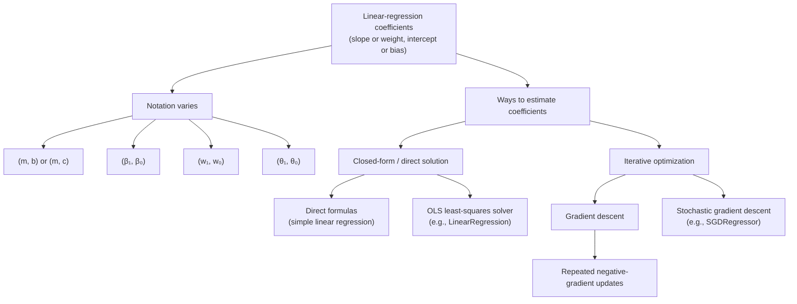

# What Is Gradient Descent?

### Cost function and gradient descent:
A **cost function** assigns a numeric value to a model's prediction errors. For simple linear regression, the hypothesis (prediction rule) is

$$
\begin{aligned}
h_{\theta}(x) &= \theta_0+\theta_1x\\
               &= \beta_0+\beta_1x\\
               &= w_0+w_1x.
\end{aligned}
$$

**Coefficients are the model parameters learned from data.** They determine the position and slope of the fitted line:

| Equivalent coefficient symbols | Name | Meaning |
|---|---|---|
| $\theta_0=\beta_0=w_0$ | **Intercept** or **bias term** | The model's predicted value when $x=0$. Changing it shifts the line vertically. |
| $\theta_1=\beta_1=w_1$ | **Slope**, **weight**, or **feature coefficient** | The change in the predicted value for a one-unit increase in $x$. A positive value gives an upward-sloping line; a negative value gives a downward-sloping line. |

These are equivalent notations for the same linear model, not different sets of coefficients that must be learned separately. Simple linear regression has one feature coefficient and one intercept; multiple linear regression has a coefficient for each feature.

---- 
### OLS and Gradient Descent: Two Ways to Estimate Linear-Model Coefficients

OLS and gradient descent are **two different methods for estimating the coefficients of a linear-regression model**. If they use the same data and squared-error objective, they target the same least-squares solution. OLS obtains that solution directly with a least-squares solver; gradient descent approaches it through repeated updates, so finite runs may only approximate the OLS coefficients.

- **Closed-form / direct solution:** For simple linear regression, the coefficients can be calculated with direct formulas. OLS implementations such as scikit-learn's `LinearRegression` solve the least-squares problem directly using a numerical solver.
- **Iterative / non-closed-form optimization:** Gradient descent repeatedly updates the coefficients using the negative gradient. Gradient-based methods are useful for large-scale or high-dimensional problems and objectives where a convenient direct solution is unavailable. Their results depend on the learning rate, initialization, and convergence.

Coefficient notation varies across textbooks and implementations. The following pairs use the order **(slope or weight, intercept or bias)**:

$$
(m,b),\qquad (m,c),\qquad (\beta_1,\beta_0),\qquad
(w_1,w_0),\qquad (\theta_1,\theta_0).
$$

These are alternative names for the same two model coefficients. In this document, $m$ denotes the slope and $b$ the intercept; $\beta_1$, $w_1$, and $\theta_1$ denote the slope, while $\beta_0$, $w_0$, and $\theta_0$ denote the intercept. The letter $O$ is not being used as a coefficient symbol.

**Important:** `LinearRegression` is an OLS estimator, whereas `SGDRegressor` uses stochastic gradient descent. They are different solvers, not two OLS implementations.

---
## What Is Gradient Descent?

**Gradient Descent (GD)** is an optimization algorithm used to minimize a **cost function (loss function)** by iteratively updating model parameters in the direction of the **negative gradient**.

The method of steepest descent, the foundation of modern gradient descent, is generally credited to **Augustin-Louis Cauchy**, who proposed it in 1847. The method has been studied and developed further since then ([historical overview](https://en.wikipedia.org/wiki/Gradient_descent#History)).

### Intuition

- **Gradient:** points in the direction of the steepest local increase in the loss.
- **Negative gradient:** points in the direction of the steepest local decrease in the loss.
- **Update:** move the model parameters opposite to the gradient so that the loss decreases.
- **Repeat:** recalculate the gradient after each update and continue moving downhill toward a minimum.

Imagine standing on a hilly landscape in fog. The model parameters describe your current location, and the loss is the height of the landscape. You use the local slope to choose a downhill step, then check the slope again and repeat. In this analogy, gradient descent aims to reach a low point in the loss landscape.

*The update rule is applied to each parameter, such as the intercept $\theta_0$ and slope $\theta_1$.*

> [!NOTE]
> #### Learning Rate $\alpha>0$
> The learning rate determines how big a step we take in the direction opposite to the gradient. A small learning rate results in slow convergence, while a large learning rate can cause overshooting or divergence.
> Here, $\alpha>0$ is the **learning rate** (also written as $\eta$), which controls the size of each parameter update as gradient descent moves toward convergence.

*This reference shows $h_\theta(x)=\theta_0+\theta_1x$ and the half-MSE objective. The $m$ in the denominator of the image denotes the number of examples; this document uses $N$ for that count to distinguish it from the slope notation $m$.*

---
### Positive and Negative Cost Gradients: How Should the Intercept Change?

**Here, "slope" means the slope of the cost curve with respect to the intercept, $\partial J/\partial b$, not the fitted line's slope $m$.** The sign of $m$ alone does not tell us whether to increase or decrease $b=\theta_0=\beta_0=w_0$.

With learning rate $\eta>0$, the intercept update is

$$
\boxed{b_{\text{new}}=b_{\text{old}}-\eta\frac{\partial J}{\partial b}}.
$$

1. **Positive cost slope: decrease the intercept.** If $\partial J/\partial b>0$, subtracting a positive quantity makes $b_{\text{new}}<b_{\text{old}}$. Move left on the cost-versus-intercept curve; in the prediction model, decreasing $b$ shifts the fitted line downward.
2. **Negative cost slope: increase the intercept.** If $\partial J/\partial b<0$, subtracting a negative quantity makes $b_{\text{new}}>b_{\text{old}}$. Move right on the cost-versus-intercept curve; in the prediction model, increasing $b$ shifts the fitted line upward.

*This is a generic derivative illustration. To interpret it as intercept optimization, read the horizontal coordinate as $b$, the vertical coordinate as $J(b)$, and the derivative as $dJ/db$, with the regression slope $m$ held fixed.*

*On the left of the minimum, the cost gradient is negative, so increase $b$. On the right, the gradient is positive, so decrease $b$. The values in this image are illustrative, not calculated from this document's dataset.*

For the half-MSE objective defined below, the intercept gradient is the mean prediction error:

$$
\frac{\partial J}{\partial b}=\frac{1}{N}\sum_{i=1}^{N}(\hat y_i-y_i).
$$

Thus, predictions that are too high on average give a positive gradient and call for a smaller intercept; predictions that are too low on average give a negative gradient and call for a larger intercept. For example, with $\eta=0.1$ and $b_{\text{old}}=10$, a gradient of $+4$ gives $b_{\text{new}}=9.6$, while a gradient of $-4$ gives $b_{\text{new}}=10.4$.

| Cost gradient with respect to $b$ | Intercept update | Effect on predictions with $m$ fixed |
|---|---|---|
| Positive: $\partial J/\partial b>0$ | Decrease $b$ | Shift the line downward |
| Negative: $\partial J/\partial b<0$ | Increase $b$ | Shift the line upward |
| Zero: $\partial J/\partial b=0$ | No intercept change from this update | At the minimum along the intercept direction for this convex quadratic |

These are descent directions; a suitable learning rate is still necessary to reduce the actual cost without overshooting. If both $m$ and $b$ are being learned, a zero intercept gradient alone does not establish that both parameters are optimal: the slope gradient must also be zero.

For training example $i$, the hypothesis evaluated at its input is the predicted value:

$$
\boxed{h_{\theta}\!\left(x^{(i)}\right)=\hat y_i}.
$$

Thus, $h_{\theta}(x)$ names the prediction rule, while $\hat y_i$ names its prediction for the $i$-th example. Given $N$ training observations, one common objective is half the mean squared error:

$$
J(\theta_0,\theta_1)
=\frac{1}{2N}\sum_{i=1}^{N}
\left(h_{\theta}(x^{(i)})-y^{(i)}\right)^2.
$$

The optimization goal is to choose $\theta_0$ and $\theta_1$ that minimize $J$. Gradient descent does this by repeatedly updating the parameters opposite their partial derivatives. Batch, stochastic, and mini-batch gradient descent differ in how many training examples are used to estimate each update. The learning rate controls update size; poor choices can make learning slow or unstable.

----
### Learning Rate $\alpha$ (Step Size)

---

### Contour Plot of Loss Surface

<em>Conceptual illustration: contour lines represent equal loss, and the arrows show successive steps toward a lower-loss region. This is a general optimization illustration, not the exact loss surface for the regression example below.</em>

**Image source and license:** [“Gradient descent” by Zerodamage](https://commons.wikimedia.org/wiki/File:Gradient_descent.svg), Wikimedia Commons, public domain.

For parameters collected in a vector $\boldsymbol{\theta}$, the update is

$$
\boldsymbol{\theta}^{(t+1)}=\boldsymbol{\theta}^{(t)}-\eta\,\nabla J\!\left(\boldsymbol{\theta}^{(t)}\right),
$$

where $J$ is the loss, $\nabla J$ is its gradient, $\eta>0$ is the learning rate (step size), and $t$ is the iteration. The gradient points toward the steepest local increase in loss, so subtracting it moves in the direction of decrease. The learning rate controls how far each step goes: too small can make progress slow, while too large can overshoot or diverge. For the squared-error linear-regression objective discussed below, the loss is convex, so its minimum is global; gradient descent still needs a suitable learning rate to converge.

----
## Step-by-Step Derivation of the Gradient Descent Update
## Gradient Descent Update: Step-by-Step Derivation

### Step 1: Define the objective

Let the model parameters be

$$
\boldsymbol{\theta}=[\theta_0,\theta_1,\ldots,\theta_p]^T,
$$

and let $J(\boldsymbol{\theta})$ be the cost (loss) function. Our goal is to find parameter values that minimize the cost:

$$
\boxed{\min_{\boldsymbol{\theta}} J(\boldsymbol{\theta})}.
$$

### Step 2: Use a first-order Taylor approximation

For a small parameter change $\Delta\boldsymbol{\theta}$, the first-order Taylor approximation is

$$
J(\boldsymbol{\theta}+\Delta\boldsymbol{\theta})
\approx
J(\boldsymbol{\theta})+
\nabla J(\boldsymbol{\theta})^T\Delta\boldsymbol{\theta}.
$$

To make the approximate change in cost negative, we want

$$
\nabla J(\boldsymbol{\theta})^T\Delta\boldsymbol{\theta}<0.
$$

Choose the change opposite to the gradient:

$$
\Delta\boldsymbol{\theta}=-\eta\nabla J(\boldsymbol{\theta}),
$$

where $\eta>0$ is the learning rate. Then the first-order change is

$$
\nabla J(\boldsymbol{\theta})^T\Delta\boldsymbol{\theta}
=-\eta\left\|\nabla J(\boldsymbol{\theta})\right\|_2^2<0
$$

when the gradient is nonzero. This is a local approximation: the learning rate must be suitably small for the actual cost to decrease; an overly large step may overshoot.

### Step 3: Obtain the gradient-descent rule

Since the new parameters are the old parameters plus the change,

$$
\boldsymbol{\theta}_{\text{new}}
=\boldsymbol{\theta}_{\text{old}}+\Delta\boldsymbol{\theta},
$$

substituting the chosen change gives the gradient-descent update:

$$
\boxed{
\boldsymbol{\theta}^{(t+1)}
=\boldsymbol{\theta}^{(t)}
-\eta\nabla J\!\left(\boldsymbol{\theta}^{(t)}\right)
}.
$$

The superscript $t$ denotes the iteration. For multiple parameters, each component is updated using its corresponding partial derivative.

## Apply the Derivation to Simple Linear Regression

### Model and notation

For one input feature, write the model as

$$
\hat y_i=\theta_0+\theta_1x_i,
$$

where $\theta_0$ is the intercept (bias) and $\theta_1$ is the slope (weight). In the $m,b$ notation used below, $\theta_0=b$ and $\theta_1=m$. Here $N$ denotes the number of training examples; using $N$ avoids confusing the sample count with the slope symbol $m$.

### Cost function: half mean squared error

For $N$ examples, choose the half-MSE objective

$$
\begin{aligned}
J(\theta_0,\theta_1)
&=\frac{1}{2N}\sum_{i=1}^{N}(\hat y_i-y_i)^2\\
&=\frac{1}{2N}\sum_{i=1}^{N}(\theta_0+\theta_1x_i-y_i)^2.
\end{aligned}
$$

The factor $1/2$ is included because it cancels the $2$ produced by differentiating a square. This objective is half the MSE; it has the same minimizing parameters as MSE, but its gradient scale (and therefore a suitable learning rate) is different.

### Step-by-step partial derivatives

For each observation, define the prediction error in the cost as

$$
e_i=\hat y_i-y_i=\theta_0+\theta_1x_i-y_i.
$$

Then

$$
\frac{\partial e_i}{\partial\theta_0}=1,
\qquad
\frac{\partial e_i}{\partial\theta_1}=x_i.
$$

Apply the chain rule, $\frac{\partial(e_i^2)}{\partial\theta_j}=2e_i\frac{\partial e_i}{\partial\theta_j}$.

**Derivative with respect to the intercept $\theta_0$:**

$$
\begin{aligned}
\frac{\partial J}{\partial\theta_0}
&=\frac{1}{2N}\sum_{i=1}^{N}2e_i
  \frac{\partial e_i}{\partial\theta_0}\\
&=\frac{1}{2N}\sum_{i=1}^{N}2e_i(1)\\
&=\boxed{\frac{1}{N}\sum_{i=1}^{N}(\hat y_i-y_i)}\\
&=\frac{1}{N}\sum_{i=1}^{N}(\theta_0+\theta_1x_i-y_i).
\end{aligned}
$$

**Derivative with respect to the slope $\theta_1$:**

$$
\begin{aligned}
\frac{\partial J}{\partial\theta_1}
&=\frac{1}{2N}\sum_{i=1}^{N}2e_i
  \frac{\partial e_i}{\partial\theta_1}\\
&=\frac{1}{2N}\sum_{i=1}^{N}2e_i x_i\\
&=\boxed{\frac{1}{N}\sum_{i=1}^{N}(\hat y_i-y_i)x_i}\\
&=\frac{1}{N}\sum_{i=1}^{N}(\theta_0+\theta_1x_i-y_i)x_i.
\end{aligned}
$$

The slope derivative includes $x_i$ because changing $\theta_1$ changes prediction $i$ by $x_i$ times the parameter change.

### Final parameter updates

Apply the general rule $\theta_j\leftarrow\theta_j-\eta\frac{\partial J}{\partial\theta_j}$ to each parameter:

$$
\boxed{
\theta_0\leftarrow\theta_0
-\frac{\eta}{N}\sum_{i=1}^{N}(\hat y_i-y_i)
}
$$

$$
\boxed{
\theta_1\leftarrow\theta_1
-\frac{\eta}{N}\sum_{i=1}^{N}(\hat y_i-y_i)x_i
}.
$$

At each iteration, calculate both gradients using the same current $\theta_0$ and $\theta_1$, then update both parameters. Repeat until a chosen stopping condition is reached, such as a small change in loss or a maximum number of iterations.

---

# Linear Regression: OLS and Gradient Descent

## 1. Goal: fit a line to data

Linear regression models the relationship between input features and a numeric target. In simple linear regression, the prediction for observation $i$ is

$$
\boxed{\hat y_i = m x_i + b}
$$

where $x_i$ is the input, $y_i$ is the observed target, $\hat y_i$ is the predicted target, $m$ is the slope, and $b$ is the intercept.

The same one-feature model is also commonly written as

$$
\begin{aligned}
\hat y_i &= m x_i+b\\
         &= \beta_0+\beta_1x_i\\
         &= w_0+w_1x_i\\
         &= \theta_0+\theta_1x_i.
\end{aligned}
$$

These are the **same model with different notation**: $b=\beta_0=w_0=\theta_0$ is the intercept (also called the bias), and $m=\beta_1=w_1=\theta_1$ is the slope or weight for feature $x_i$. The symbols vary among books and implementations; their roles and the prediction do not. This document uses $m$ and $b$ to match the simple-regression notation used below. The residual (prediction error) is

$$
r_i = y_i - \hat y_i = y_i - (m x_i+b).
$$

We choose $m$ and $b$ to make predictions close to observed targets. A common objective is the **sum of squared errors (SSE)**:

$$
J_{SSE}(m,b)=\sum_{i=1}^{n}\left[y_i-(m x_i+b)\right]^2=\sum_{i=1}^{n}r_i^2.
$$

Squaring prevents positive and negative residuals from cancelling and gives larger errors more weight. The **mean squared error (MSE)** is

$$
J_{MSE}(m,b)=\frac{1}{n}\sum_{i=1}^{n}\left[y_i-(m x_i+b)\right]^2=\frac{1}{n}J_{SSE}(m,b).
$$

For a fixed dataset, SSE and MSE have the same minimizing $m$ and $b$, because MSE is SSE multiplied by the positive constant $1/n$. Their gradients differ by the factor $n$, however, so a suitable learning rate depends on which objective is used.

## 2. OLS and gradient descent: model versus method

**Linear regression is the model. Ordinary least squares (OLS) and gradient descent (GD) are different methods for estimating its coefficients.** Both seek coefficients that minimize squared residuals.

- **OLS** solves the least-squares problem directly using a numerical least-squares solver. For simple linear regression, the solution can also be written as closed-form formulas.
- **Gradient descent** starts from initial coefficient values and repeatedly adjusts them using the loss gradient. It approaches a minimum over iterations.

For squared-error linear regression, the objective is a convex quadratic in the coefficients. Thus every local minimum is also global. With a suitable learning rate, gradient descent converges to a global least-squares solution. A finite run may only approximate the solution, so GD and OLS results may be close rather than exactly identical.

## 3. Detailed gradient derivation for simple linear regression

Use the SSE objective

$$
J(m,b)=\sum_{i=1}^{n}\left[y_i-(m x_i+b)\right]^2.
$$

For one observation define $r_i=y_i-(mx_i+b)$. The model prediction is $mx_i+b$, so

$$
\frac{\partial r_i}{\partial b}=-1,
\qquad
\frac{\partial r_i}{\partial m}=-x_i.
$$

By the chain rule, $\partial(r_i^2)/\partial q=2r_i(\partial r_i/\partial q)$ for parameter $q$. Sum the derivatives over all observations.

### Intercept gradient

$$
\begin{aligned}
\frac{\partial J}{\partial b}
&=\sum_{i=1}^{n}2r_i\frac{\partial r_i}{\partial b}\\
&=\sum_{i=1}^{n}2\left[y_i-(mx_i+b)\right](-1)\\
&=\boxed{-2\sum_{i=1}^{n}\left[y_i-(mx_i+b)\right]}\\
&=2\sum_{i=1}^{n}(mx_i+b-y_i).
\end{aligned}
$$

### Slope gradient

$$
\begin{aligned}
\frac{\partial J}{\partial m}
&=\sum_{i=1}^{n}2r_i\frac{\partial r_i}{\partial m}\\
&=\sum_{i=1}^{n}2\left[y_i-(mx_i+b)\right](-x_i)\\
&=\boxed{-2\sum_{i=1}^{n}x_i\left[y_i-(mx_i+b)\right]}\\
&=2\sum_{i=1}^{n}x_i(mx_i+b-y_i).
\end{aligned}
$$

The minus signs arise from differentiating the residual $y_i-(mx_i+b)$. Increasing $b$ changes each prediction by 1; increasing $m$ changes prediction $i$ by $x_i$. A gradient points toward the steepest local increase in loss, so gradient descent steps in the opposite direction.

For MSE, divide both SSE derivatives by $n$:

$$
\frac{\partial J_{MSE}}{\partial b}=-\frac{2}{n}\sum_i r_i,
\qquad
\frac{\partial J_{MSE}}{\partial m}=-\frac{2}{n}\sum_i x_i r_i.
$$

Some conventions minimize half-MSE, $\frac{1}{2n}\sum_i r_i^2$, removing the factor 2. These are equivalent scalings of the objective, but the selected gradient and learning rate must match the loss definition.

## 4. Derive the gradient-descent updates

For a parameter $\theta$, the general gradient-descent rule at iteration $t$ is

$$
\theta^{(t+1)}=\theta^{(t)}-\eta\frac{\partial J}{\partial\theta},
$$

where $\eta>0$ is the learning rate. Apply this rule separately to $b$ and $m$:

$$
b^{(t+1)}=b^{(t)}-\eta\frac{\partial J}{\partial b},
\qquad
m^{(t+1)}=m^{(t)}-\eta\frac{\partial J}{\partial m}.
$$

Substitute the SSE gradients derived above:

$$
\boxed{b^{(t+1)}=b^{(t)}+2\eta\sum_{i=1}^{n}\left[y_i-(m^{(t)}x_i+b^{(t)})\right]}
$$

$$
\boxed{m^{(t+1)}=m^{(t)}+2\eta\sum_{i=1}^{n}x_i\left[y_i-(m^{(t)}x_i+b^{(t)})\right]}.
$$

Both gradients must be calculated from the **same current** parameters $m^{(t)}$ and $b^{(t)}$ before either parameter is changed. These are the batch-SSE updates implemented in this notebook's custom `GDRegressor`. Each update uses all $n$ training observations, so this is **batch gradient descent**.

### One iteration, step by step

1. Choose initial values $m^{(0)}$ and $b^{(0)}$, and a learning rate $\eta$.
2. Predict each training target: $\hat y_i^{(t)}=m^{(t)}x_i+b^{(t)}$.
3. Calculate residuals: $r_i^{(t)}=y_i-\hat y_i^{(t)}$.
4. Calculate both gradients: $g_b^{(t)}=-2\sum_i r_i^{(t)}$ and $g_m^{(t)}=-2\sum_i x_i r_i^{(t)}$.
5. Update both parameters: $b^{(t+1)}=b^{(t)}-\eta g_b^{(t)}$ and $m^{(t+1)}=m^{(t)}-\eta g_m^{(t)}$.
6. Recalculate predictions, residuals, and gradients, then repeat until the stopping condition is met.

For example, if $\sum_i r_i>0$, then $g_b<0$, so subtracting $\eta g_b$ increases $b$. This shifts predictions upward, which tends to reduce the positive residuals. The slope gradient is weighted by $x_i$ because changing $m$ affects each prediction in proportion to its input.

## 5. Derive the OLS solution for simple linear regression

At a differentiable minimum, set both partial derivatives to zero. For SSE this gives the normal equations:

$$
\sum_i[y_i-(mx_i+b)]=0,
\qquad
\sum_i x_i[y_i-(mx_i+b)]=0.
$$

The first equation says the residuals sum to zero:

$$
\sum_i y_i-m\sum_i x_i-nb=0
\quad\Longrightarrow\quad
b=\bar y-m\bar x,
$$

where $\bar x=\frac{1}{n}\sum_i x_i$ and $\bar y=\frac{1}{n}\sum_i y_i$. Substitute $b=\bar y-m\bar x$ into the second equation. Since $y_i-b-mx_i=(y_i-\bar y)-m(x_i-\bar x)$, it becomes

$$
\sum_i(x_i-\bar x)(y_i-\bar y)-m\sum_i(x_i-\bar x)^2=0.
$$

Therefore the direct OLS coefficients are

$$
\boxed{m_{OLS}=\frac{\sum_i(x_i-\bar x)(y_i-\bar y)}{\sum_i(x_i-\bar x)^2}},
\qquad
\boxed{b_{OLS}=\bar y-m_{OLS}\bar x}.
$$

This slope formula applies when the input values are not all identical. At the OLS solution the residuals sum to zero, and their input-weighted sum is also zero. Gradient descent seeks the same zero-gradient conditions iteratively rather than solving them directly.

## 6. Matrix derivation for multiple features

For $p$ features, let $X$ be the design matrix (including a column of ones for the intercept), $\boldsymbol{\beta}$ the coefficient vector (including the intercept), and $\mathbf y$ the target vector. Then

$$
\hat{\mathbf y}=X\boldsymbol{\beta},
\qquad
J(\boldsymbol{\beta})=\|\mathbf y-X\boldsymbol{\beta}\|_2^2.
$$

Expanding the objective gives

$$
J= (\mathbf y-X\boldsymbol{\beta})^T(\mathbf y-X\boldsymbol{\beta})
=\mathbf y^T\mathbf y-2\boldsymbol{\beta}^TX^T\mathbf y+\boldsymbol{\beta}^TX^TX\boldsymbol{\beta}.
$$

Differentiate with respect to $\boldsymbol{\beta}$:

$$
\nabla_{\boldsymbol{\beta}}J=-2X^T\mathbf y+2X^TX\boldsymbol{\beta}
=-2X^T(\mathbf y-X\boldsymbol{\beta}).
$$

Set this gradient to zero to obtain the normal equations:

$$
X^TX\boldsymbol{\beta}=X^T\mathbf y.
$$

If $X^TX$ is invertible, this gives $\boldsymbol{\beta}_{OLS}=(X^TX)^{-1}X^T\mathbf y$. If it is singular, such as when features are redundant, a least-squares solver or pseudoinverse returns a least-squares solution. Numerically stable solvers are generally preferred to explicitly forming a matrix inverse.

For MSE, $J=\frac{1}{n}\|\mathbf y-X\boldsymbol{\beta}\|_2^2$, so

$$
\nabla_{\boldsymbol{\beta}}J=-\frac{2}{n}X^T(\mathbf y-X\boldsymbol{\beta}),
\qquad
\boxed{\boldsymbol{\beta}^{(t+1)}=\boldsymbol{\beta}^{(t)}+\frac{2\eta}{n}X^T(\mathbf y-X\boldsymbol{\beta}^{(t)})}.
$$

## 7. Why the least-squares minimum is global

The Hessian (matrix of second derivatives) of the SSE is

$$
\nabla^2 J=2X^TX.
$$

For any vector $\mathbf v$,

$$
\mathbf v^T(2X^TX)\mathbf v=2\|X\mathbf v\|_2^2\geq 0.
$$

Therefore the Hessian is positive semidefinite and squared-error linear regression is convex. If the columns of $X$ are linearly independent, the Hessian is positive definite and the solution is unique. If the columns are dependent, several coefficient vectors may produce the same predictions and minimum loss; the minimum loss is still global. There are no suboptimal local minima in ordinary squared-error linear regression.

Convexity guarantees the shape of the objective, but gradient descent still needs a suitable learning rate to converge. A rate that is too small makes progress slow; one that is too large can overshoot or diverge. Feature scales, dataset size, and whether the objective is SSE or MSE all affect the gradient magnitude. The custom implementation uses SSE gradients, so its learning rate should not be copied blindly into an MSE implementation.

## 8. OLS versus gradient descent

| Aspect | OLS | Gradient descent |
|---|---|---|
| What it is | Least-squares coefficient estimation | Iterative optimization algorithm |
| How coefficients are found | Solves the least-squares problem directly with a numerical solver | Takes repeated gradient steps from an initial guess |
| Objective in this example | SSE (equivalently MSE) | SSE in the custom regressor; MSE is also possible |
| Parameters | Slope and intercept, or all feature coefficients | Slope and intercept, or all feature coefficients |
| Main controls | Data and least-squares formulation | Initialization, learning rate, epochs, feature scaling, stopping rule |
| Result | Least-squares solution, up to numerical precision | Approaches the least-squares solution when it converges; a finite run may differ slightly |
| Typical use | Standard small/medium regression problems | Large-scale problems or objectives without a convenient direct solution |

**In this notebook:** scikit-learn's OLS model is the reference, and the custom `GDRegressor` learns both $m$ and $b$ from the training split. Both target squared error. They should give comparable fitted results when training data and objective match and GD converges. Their values may differ slightly because GD runs a finite number of updates and depends on its learning rate. Compare them on the same training and test splits for a fair evaluation.

## 9. Key terms

- **Parameter / coefficient:** a learned value such as slope $m$ or intercept $b$.
- **Loss / objective / cost:** a numerical measure of error that an optimization algorithm tries to minimize.
- **Gradient:** the vector of partial derivatives of the loss; it points toward the steepest local increase.
- **Learning rate $\eta$:** controls the size of each gradient-descent update.
- **Iteration:** one parameter update. An epoch is commonly one complete pass over the training data; batch GD uses the whole dataset for each update.
- **Convergence:** parameters or loss approach a stable solution within a chosen tolerance.
- **Local minimum:** no nearby point has a lower value. **Global minimum:** no point anywhere has a lower value. For squared-error linear regression, convexity makes every local minimum global.

## Summary

| Quantity | Formula | Meaning |
|---|---|---|
| Prediction | $\hat y_i=mx_i+b$ | Linear model's estimate for observation $i$ |
| Residual | $r_i=y_i-\hat y_i$ | Observed target minus predicted target |
| SSE | $J=\sum_i r_i^2$ | Total squared error; used by this custom GD implementation |
| MSE | $J=\frac{1}{n}\sum_i r_i^2$ | Average squared error; same minimizer as SSE |
| Intercept gradient (SSE) | $\frac{\partial J}{\partial b}=-2\sum_i r_i$ | How SSE changes as the intercept changes |
| Slope gradient (SSE) | $\frac{\partial J}{\partial m}=-2\sum_i x_i r_i$ | How SSE changes as the slope changes |
| GD update | $\theta^{(t+1)}=\theta^{(t)}-\eta\nabla J(\theta^{(t)})$ | Repeatedly move coefficients opposite to the gradient |
| OLS slope | $m=\frac{\sum_i(x_i-\bar x)(y_i-\bar y)}{\sum_i(x_i-\bar x)^2}$ | Direct simple-regression least-squares slope |
| OLS intercept | $b=\bar y-m\bar x$ | Direct simple-regression least-squares intercept |
| Matrix OLS condition | $X^TX\boldsymbol{\beta}=X^T\mathbf y$ | Normal equations for multiple linear regression |
| Loss geometry | Convex quadratic | A local minimum is global; GD needs a suitable learning rate to converge |