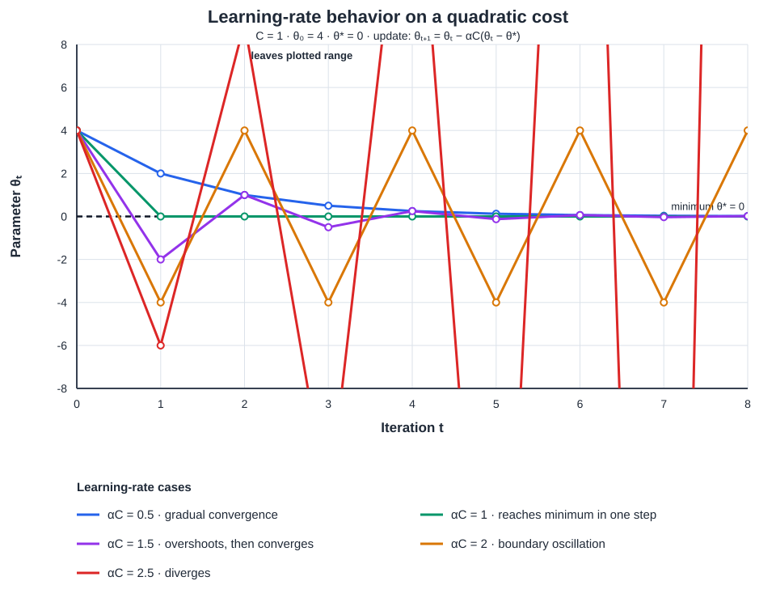
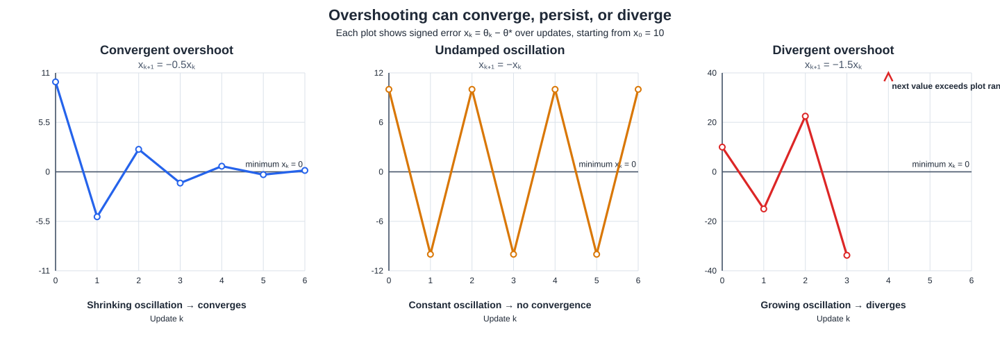
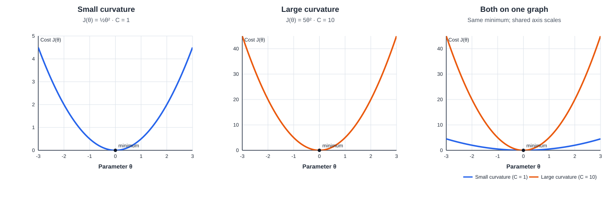

# Gradient Descent: Overshooting and Convergence

Gradient Descent: overshooting the minimum does not necessarily mean that Gradient Descent will diverge. It depends on how large the learning rate is relative to the curvature of the cost function.

## In this guide

- [Important notation and parameters](#important-notation-and-parameters)
- [Learning-rate trajectory graph](#visual-how-the-learning-rate-changes-the-parameter-path)
- [Quadratic cost function and minimum](#1-start-with-a-quadratic-cost-function)
- [Deriving the gradient](#2-derive-the-gradient)
- [Gradient Descent update rule](#3-substitute-into-the-gradient-descent-update)
- [Deriving the convergence condition](#4-why-is-the-error-multiplier-important)
- [Learning-rate cases](#5-understand-all-six-learning-rate-cases)
- [Why overshooting can still converge](#6-why-can-overshooting-still-converge)
- [Three outcomes when overshooting](#three-possible-outcomes-when-gradient-descent-overshoots)
- [Assumptions and multidimensional extension](#7-assumptions-and-multidimensional-extension)
- [Curvature explanation and comparison graphs](#understanding-the-curvature-constant)
  - [Curvature definition](#1-what-is-curvature)
  - [Constant curvature mathematically](#2-what-does-constant-curvature-mean-mathematically)
  - [Compare quadratic functions](#3-compare-two-quadratic-functions)
  - [Curvature and learning rate](#4-why-does-curvature-matter-in-gradient-descent)
  - [Curvature in real machine-learning costs](#5-what-about-real-machine-learning-cost-functions)

> **Main result:** For the one-dimensional quadratic $J(\theta)=J^*+\frac{C}{2}(\theta-\theta^*)^2$ with constant curvature $C>0$ and fixed learning rate $\alpha$, gradient descent converges when $0<\alpha<2/C$. It can overshoot and still converge when $1/C<\alpha<2/C$.

## Important notation and parameters

| Symbol | Meaning |
|---|---|
| $J(\theta)$ | Cost (objective) function evaluated at parameter $\theta$. |
| $\theta_t$ | Parameter value at iteration $t$. |
| $\theta^*$ | Parameter value at the minimum of the quadratic cost. |
| $J^*$ | Minimum cost value, equal to $J(\theta^*)$. |
| $C$ | Positive curvature constant of this quadratic; $J''(\theta)=C$. |
| $\alpha$ | Learning rate (step size); it controls how far each update moves. It is also sometimes written as $\eta$. |
| $t$ | Iteration index; $t+1$ denotes the next update. |
| $J'(\theta)$ | Gradient (derivative) of the cost with respect to $\theta$. |
| $e_t=\theta_t-\theta^*$ | Parameter error, or signed distance from the minimum, at iteration $t$. |
| $r=1-\alpha C$ | Error multiplier for one update; convergence requires $|r|<1$. |
| $H$ | Hessian matrix of a multi-parameter quadratic cost. |
| $\lambda_{\max}$ | Largest eigenvalue of $H$; it sets the strictest learning-rate bound for the positive-definite quadratic case. |

### Visual: how the learning rate changes the parameter path

The graph below uses $C=1$, initial value $\theta_0=4$, and minimum $\theta^*=0$. It shows that moderate overshooting can shrink the error, while the boundary rate keeps oscillating and a larger rate diverges.

**_How to read the graph_**

- The **_horizontal axis_** shows the iteration number $t$; the **_vertical axis_** shows the parameter value $\theta_t$ after each update.
- The **_dashed horizontal line_** marks the minimum, $\theta^*=0$. Each colored line shows how the parameter changes from the same starting value, $\theta_0=4$, for a different learning rate.
- Since this graph uses $C=1$, the product $\alpha C$ is equal to $\alpha$:

| **Curve** | **Behavior** | **Relative updates to converge** |
|---|---|---|
| **_Blue, $\alpha=0.5$_** | Moves toward the minimum without crossing it. It does **_not overshoot_**. | Converges gradually; it needs repeated updates. |
| **_Green, $\alpha=1$_** | Reaches the minimum exactly in one update for this particular quadratic. It does **_not overshoot_**. | Fewest updates in this idealized example: one. |
| **_Purple, $\alpha=1.5$_** | Crosses the minimum on each update, so it **_overshoots_**. The overshoots get smaller, and it converges. | Converges; in this example its error shrinks by the same factor per update as the blue curve, though it alternates sides. |
| **_Orange, $\alpha=2$_** | Overshoots and alternates between equal distances on either side of the minimum. | **_Does not converge_**, so additional updates/epochs do not solve the oscillation. |
| **_Red, $\alpha=2.5$_** | Overshoots by increasingly larger amounts and diverges. | **_Does not converge_**; continuing updates makes the error grow. |

**_Time and epochs:_** The graph compares the number of **_parameter updates_**, not wall-clock time. In full-batch Gradient Descent, one update typically follows one pass through the training data (**_one epoch_**), so the update counts also correspond to epochs. With mini-batch or stochastic Gradient Descent, an epoch usually contains multiple updates. Actual runtime per update depends on the dataset, batch size, and hardware. Here, $\alpha=1$ is fastest in update count only because this example is an exact one-dimensional quadratic with $C=1$; that special result should not be assumed for a general machine-learning problem.

**_Which rate is recommended?_** There is **_no single learning rate_** that is best for every problem. For this exact example, $\alpha=1$ reaches the minimum in one update. In practice, start with a **_moderate learning rate_** and monitor the cost during training: choose a value that makes the cost decrease reliably without persistent oscillation or divergence. The purple rate demonstrates that overshooting can still converge, but a non-overshooting rate is often easier to interpret and tune. **_Avoid the orange boundary rate and the red divergent rate._**

Let's derive it step by step and understand why the thresholds $1/C$ and $2/C$ matter.

---
## 1. Start with a quadratic cost function

You have defined the cost function as

$$
J(\theta)=J^*+\frac{C}{2}(\theta-\theta^*)^2
$$

This is correct, where:

- $\theta$ is the current model parameter.
- $\theta^*$ is the parameter value at the minimum.
- $J^*$ is the minimum cost value.
- $C>0$ is the constant curvature of the quadratic function.
- $\alpha>0$ is the learning rate.

The function is a parabola opening upward because $C>0$.

At $\theta=\theta^*$, the squared term becomes zero, so:

$$
J(\theta^*)=J^*
$$

Therefore, $\theta^*$ is the global minimum.

## 2. Derive the gradient

- **Differentiate the cost function** with respect to $\theta$:

  $$
  \frac{dJ}{d\theta} = \frac{d}{d\theta} \left[J^*+\frac{C}{2}(\theta-\theta^*)^2\right]
  $$

- **Treat $J^*$, $C$, and $\theta^*$ as constants** while differentiating:

  $$
  \frac{dJ}{d\theta} = \frac{C}{2}\cdot 2(\theta-\theta^*)
  $$

- **Simplify** to obtain the gradient:

  $$
  \boxed{J'(\theta)=C(\theta-\theta^*)}
  $$

The gradient tells how steep the cost function is at the current parameter value:

- If $\theta>\theta^*$, the gradient is **positive**, so Gradient Descent moves left.
- If $\theta<\theta^*$, the gradient is **negative**, so Gradient Descent moves right.
- If $\theta=\theta^*$, the gradient is **zero**, so the update is zero.

## 3. Substitute into the Gradient Descent update

- **Start with the standard update rule:**

  $$
  \theta_{t+1}=\theta_t-\alpha J'(\theta_t)
  $$

- **Substitute the derivative** $J'(\theta_t)=C(\theta_t-\theta^*)$:

  $$
  \theta_{t+1} = \theta_t-\alpha C(\theta_t-\theta^*)
  $$

- **Subtract $\theta^*$ from both sides:**

  $$
  \theta_{t+1}-\theta^* = \theta_t-\theta^*-\alpha C(\theta_t-\theta^*)
  $$

- **Factor out the common term** to express the parameter error:

  $$
  \boxed{ \theta_{t+1}-\theta^* = (1-\alpha C)(\theta_t-\theta^*) }
  $$

This is the **key update equation** in the derivation.

## 4. Why is the error multiplier important?

- **Define the parameter error** at iteration $t$:

  $$
  e_t=\theta_t-\theta^*
  $$

- **Rewrite the update in terms of error:**

  $$
  \boxed{e_{t+1}=(1-\alpha C)e_t}
  $$

- **Name the error multiplier:**

  $$
  r=1-\alpha C
  $$

- **Express the update using $r$:**

  $$
  e_{t+1}=re_t
  $$

- **Apply the update repeatedly** to obtain the error after $t$ iterations:

  $$
  e_t=(1-\alpha C)^t e_0
  $$

- **Convergence idea:** Gradient Descent converges to the minimum when the magnitude of the error multiplier is less than $1$:
  $$
  |1-\alpha C|<1
  $$

- **Expand the absolute-value inequality:**

  $$
  -1<1-\alpha C<1
  $$

- **Subtract 1 from all sides:**

  $$
  -2<-\alpha C<0
  $$

- **Multiply by $-1$** and reverse the inequality signs:

  $$
  0<\alpha C<2
  $$

- **Since $C>0$, divide by $C:**

  $$
  \boxed{0<\alpha<\frac{2}{C}}
  $$

This is the **convergence condition** for this one-dimensional quadratic with a constant learning rate.

## 5. Understand all six learning-rate cases

Let's use a numerical example to make the behavior clear:

- **Cost function:**
  $$
  J(\theta)=\frac{1}{2}\theta^2
  $$
- **Minimum and curvature:** $J^*=0$, $\theta^*=0$, and $C=1$.
- **Gradient:** Differentiating the cost gives $J'(\theta)=\theta$.
- **Gradient Descent update:**
  $$
  \theta_{t+1}=(1-\alpha)\theta_t
  $$
- **Starting value:** $\theta_0=4$.

---
## Learning-rate behavior

Each example starts at θ₀ = 4, with minimum at θ* = 0.

### Case 1: $0<\alpha<1/C$

- **Behavior:** converges **without crossing** the minimum.
- **Example:** $\alpha=0.5$, $C=1$.
- **Updates:** $4\rightarrow2\rightarrow1\rightarrow0.5\rightarrow0.25\rightarrow\cdots$
- **Interpretation:** the parameter approaches the minimum from one side.

### Case 2: $\alpha=1/C$

- **Behavior:** reaches the minimum in one update.
- **Example:** $\alpha=1$, $C=1$.
- **Update:** $4\rightarrow0$.
- **Interpretation:** for this particular quadratic, the parameter lands exactly on the minimum.

### Case 3: $1/C<\alpha<2/C$

- **Behavior:** crosses the minimum but still converges.
- **Example:** $\alpha=1.5$, $C=1$.
- **Updates:** $4\rightarrow-2\rightarrow1\rightarrow-0.5\rightarrow0.25\rightarrow\cdots$
- **Interpretation:** the parameter overshoots repeatedly, but each update gets closer to the minimum.

### Case 4: $\alpha=2/C$

- **Behavior:** does not converge; it oscillates at a constant distance.
- **Example:** $\alpha=2$, $C=1$.
- **Updates:** $4\rightarrow-4\rightarrow4\rightarrow-4\rightarrow\cdots$
- **Interpretation:** unless it starts at the minimum, the parameter oscillates forever without getting closer.

### Case 5: $\alpha>2/C$

- **Behavior:** diverges.
- **Example:** $\alpha=2.5$, $C=1$.
- **Updates:** $4\rightarrow-6\rightarrow9\rightarrow-13.5\rightarrow20.25\rightarrow\cdots$
- **Interpretation:** each update overshoots by an increasingly large amount.

**Additional boundary case:** if $\alpha=0$, the parameter never changes. It stays at its initial value, which might not be the minimum.

## 6. Why can overshooting still converge?

The key insight is that overshooting can still converge if the error shrinks. For example:

- **Current parameter:** $\theta_t=4$.
- **Minimum:** $\theta^*=0$.
- **Learning rate and curvature:** $\alpha=1.5$ and $C=1$.
- **Next parameter value:**

  $$
  \theta_{t+1}=(1-1.5)(4)=-2
  $$

- **The update crosses the minimum:** the parameter jumps from $4$ to $-2$.
- **New error magnitude:**

  $$
  |e_{t+1}|=|-2|=2
  $$

- **Original error magnitude:**

  $$
  |e_t|=|4|=4
  $$

- The error is cut in half even though the parameter crossed the minimum. At every iteration, its magnitude is multiplied by:

  $$
  |1-\alpha C|=0.5
  $$

- **Result:** the error keeps shrinking:

  $$
  4,\ 2,\ 1,\ 0.5,\ 0.25,\ldots\longrightarrow 0
  $$

**Overshooting is not a problem by itself.** It becomes a problem when the overshoot makes the error grow instead of shrink.

---

### Three possible outcomes when Gradient Descent overshoots

**Overshooting does not necessarily mean divergence to infinity.** Overshooting means that an update crosses the minimum to the other side. Whether the iterates converge or move farther away depends on how much the error changes at each update.

To match the notation used above, let $x_k=\theta_k-\theta^*$ be the signed error from the minimum. In the notation sometimes used for this same quadratic example, $\eta=\alpha$ is the learning rate and $L=C$ is the curvature. The update is therefore

$$
x_{k+1}=(1-\eta L)x_k
$$

Starting from $x_0=10$, the three overshooting outcomes are:

The horizontal axis shows the update number $k$, and the vertical axis shows the signed error $x_k$. The bold horizontal line at $x_k=0$ is the minimum: values alternating above and below it indicate overshooting. The vertical scales are different between panels to make each trajectory readable; compare each curve's change over time rather than its height across panels.

| Outcome | Error multiplier $1-\eta L$ | Error sequence | What happens |
|---|---:|---|---|
| **Convergent overshoot (damped oscillation)** | $-0.5$ | $10\rightarrow-5\rightarrow2.5\rightarrow-1.25\rightarrow0.625\rightarrow\cdots\rightarrow0$ | The sign flips, so each update crosses the minimum, but the error magnitude shrinks. |
| **Non-Convergent Oscillation (Undamped oscillation)** | $-1$ | $10\rightarrow-10\rightarrow10\rightarrow-10\rightarrow\cdots$ | The sign flips, but the error magnitude stays constant. It neither converges nor diverges to infinity. |
| **Divergent overshoot (Exploding / growing oscillation)** | $-1.5$ | $10\rightarrow-15\rightarrow22.5\rightarrow-33.75\rightarrow50.625\rightarrow\cdots$ | The sign flips and the error magnitude grows, so the iterates diverge. |

These correspond to $\eta L=1.5$, $\eta L=2$, and $\eta L=2.5$, respectively. The convergence condition is $|1-\eta L|<1$. Specifically, among overshooting updates:

- If $1<\eta L<2$, the error alternates sides and shrinks, so Gradient Descent **converges**.
- If $\eta L=2$, the error alternates sides at a constant magnitude, so it **does not converge**.
- If $\eta L>2$, the error alternates sides and grows, so Gradient Descent **diverges**.

Thus, overshooting means crossing the minimum; it does not by itself tell us whether the sequence converges. The size of the error multiplier determines whether the oscillations shrink, stay constant, or grow.

## 7. Assumptions and multidimensional extension

The derivation is mathematically correct under these assumptions:

- The cost function is a one-dimensional quadratic.
- Its curvature $C$ is constant and positive.
- Gradient Descent uses a fixed learning rate $\alpha$.
- Updates are calculated using the exact gradient.

**Additional observations**

- At $\alpha=2/C$, the algorithm does not converge to the minimum from a non-minimum starting point, but it also does not diverge to infinity. It oscillates at a constant distance.
- For a general quadratic, the same principle applies in each curvature direction, and the largest curvature imposes the strictest learning-rate constraint.

- **Convergence condition:** for a positive-definite quadratic with Hessian eigenvalues $\lambda_i$, ordinary Gradient Descent requires:

  $$
  0<\alpha<\frac{2}{\lambda_{\max}}
  $$

  where $\lambda_{\max}$ is the largest eigenvalue of the Hessian.

This is the multidimensional version of the condition $0<\alpha<2/C$.

**Final takeaway:** your derivation is correct, and it demonstrates precisely why a learning rate between $1/C$ and $2/C$ can overshoot the global minimum and still converge.

---

## Understanding the Curvature Constant

Curvature explains how quickly the slope of a cost function changes. Understanding it helps explain why Gradient Descent can cross (overshoot) a minimum and still converge, and why the learning rate must account for the shape of the cost function.

### 1. What is curvature?

For a simple quadratic function, curvature is related to how steep or narrow its bowl is:

| Curvature | Shape of the bowl | How the slope changes |
|---|---|---|
| **Small** | Wide and shallow | Changes slowly as you move along it. |
| **Large** | Narrow and steep | Changes rapidly as you move along it. |

The first graph shows the **small-curvature** function, $J(\theta)=\frac{1}{2}\theta^2$ with $C=1$, on its own. The second shows the **large-curvature** function, $J(\theta)=5\theta^2$ with $C=10$, on its own. The third overlays both functions on the **same horizontal and vertical scales** for direct comparison. All three show the shared minimum at $\theta=0$; the individual graphs use different vertical scales so each curve's shape is easy to see.

In machine learning, curvature helps describe how the cost function behaves around its minimum.

### 2. What does constant curvature mean mathematically?

Consider the quadratic cost function:

$$
J(\theta)=J^*+\frac{C}{2}(\theta-\theta^*)^2
$$

Here, **$C>0$ is the curvature constant**.

Differentiate the function once to find its slope (gradient):

$$
J'(\theta)=C(\theta-\theta^*)
$$

This gives the slope at any point.

Differentiate again:

$$
J''(\theta)=C
$$

The second derivative measures curvature for this one-dimensional quadratic. Since the result is always $C$, regardless of $\theta$, the curvature is **constant**.

For example, whether $\theta$ is far to the left of the minimum, close to it, or far to the right, the second derivative remains the same.

### 3. Compare two quadratic functions
Compare the following functions:

**Function A: small curvature**

$$
J(\theta)=\frac{1}{2}\theta^2
$$

First derivative (slope):

$$
J'(\theta)=\theta
$$

Second derivative (curvature):

$$
J''(\theta)=1
$$

Therefore, **$C=1$**.

**Function B: large curvature**

$$
J(\theta)=5\theta^2
$$

First derivative (slope):

$$
J'(\theta)=10\theta
$$

Second derivative (curvature):

$$
J''(\theta)=10
$$

Therefore, **$C=10$**.

Both functions have their minimum at $\theta=0$, but Function B has greater curvature, so it is much narrower and steeper.

### 4. Why does curvature matter in gradient descent?

The Gradient Descent update rule is:

$$
\theta_{t+1}=\theta_t-\alpha J'(\theta_t)
$$

For our quadratic function:

$$
\theta_{t+1}
=\theta_t-\alpha C(\theta_t-\theta^*)
$$

The convergence condition is:

$$
0<\alpha<\frac{2}{C}
$$

This means **the larger the curvature, the smaller the learning rate must be** to guarantee convergence for this quadratic.

The permitted learning-rate range shrinks as curvature increases:

| **Curvature $C$** | **Convergence range for $\alpha$** |
|---:|---|
| 1 | $0<\alpha<2$ |
| 2 | $0<\alpha<1$ |
| 10 | $0<\alpha<0.2$ |
| 100 | $0<\alpha<0.02$ |

A steep, narrow cost function can cause Gradient Descent to jump too far across the minimum if the learning rate is too large. A shallow, wide cost function allows a larger learning rate under this particular convergence condition.

### 5. What about real machine-learning cost functions?

The constant-curvature assumption is a mathematical simplification. For a general cost function, curvature may change at different points. For example, a neural network's loss surface can have different curvature in different directions and at different parameter values.

In multiple dimensions, curvature is studied using the **Hessian matrix**, which contains second-order derivatives.

For ordinary linear regression with MSE, the cost function is quadratic in its parameters, so its Hessian is constant. However, curvature can differ across parameter directions.

> **Key distinction**
>
> - **First derivative:** gives the slope and direction of change.
> - **Second derivative:** tells how the slope changes.
> - **Constant curvature:** means the second derivative stays the same everywhere for a one-dimensional quadratic.
>
> In this derivation, $C$ is exactly that constant second derivative.
