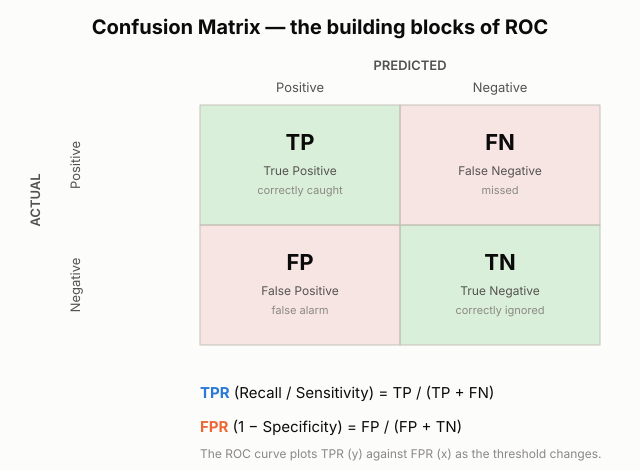
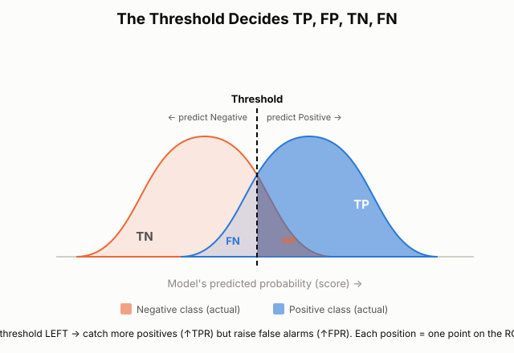
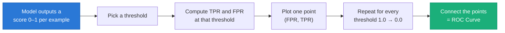
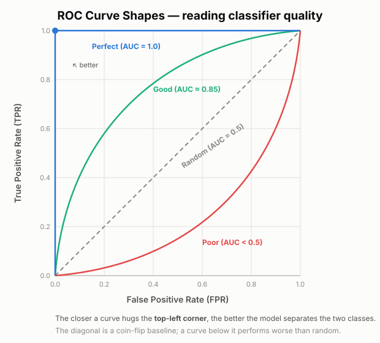
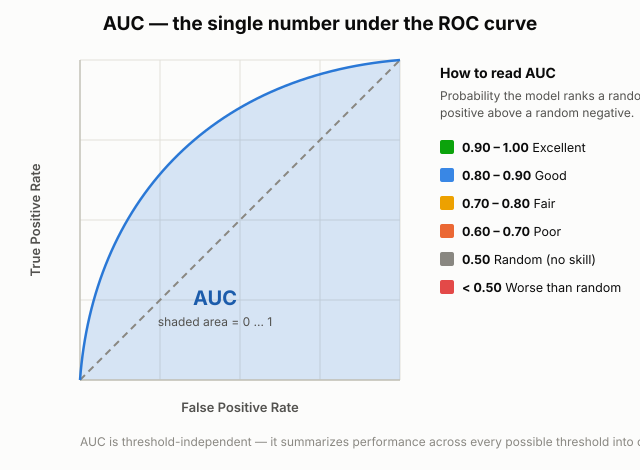
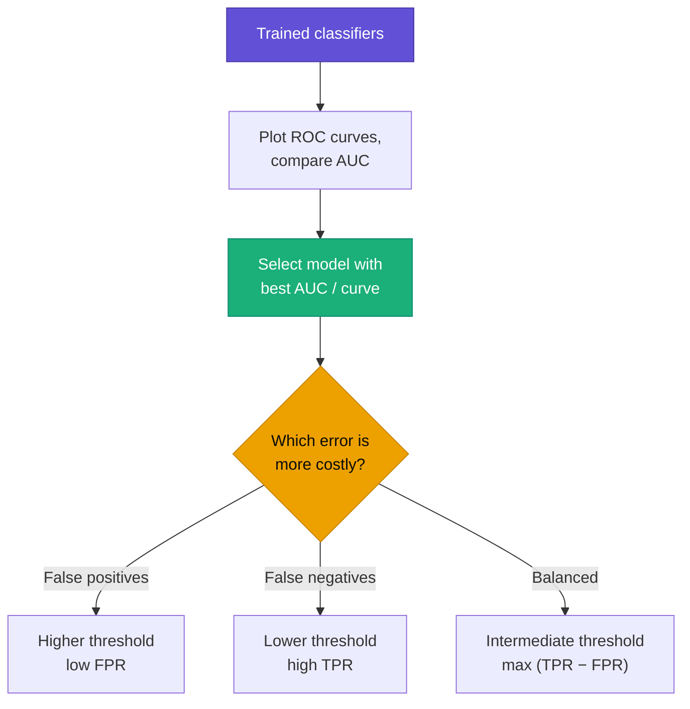

# ROC Curve and AUC in Machine Learning

**ROC** → **R**eceiver **O**perating **C**haracteristic.

A **ROC curve** is a graphical plot that shows how well a **binary classification** model separates two classes **across every possible decision threshold**. Instead of judging a model at one fixed cut-off, the ROC curve lets us see its behaviour at *all* cut-offs at once.

It plots the **True Positive Rate (TPR)** against the **False Positive Rate (FPR)** at each threshold setting. The **AUC** (Area Under the Curve) then collapses that whole curve into a single, threshold-independent score.

ROC analysis is most useful for **binary classification** problems — two possible outcomes:

| Problem | Positive class | Negative class |
|:---|:---|:---|
| Email classification | Spam | Not Spam |
| Fraud detection | Fraudulent | Legitimate |
| Medical diagnosis | Disease | No Disease |
| Customer churn | Churn | Not Churn |

---

## Table of Contents

- [What Is a ROC Curve?](#what-is-a-roc-curve)
- [Why Do We Need the ROC Curve?](#why-do-we-need-the-roc-curve)
- [The Building Blocks: TPR and FPR](#the-building-blocks-tpr-and-fpr)
  - [A. True Positive Rate (TPR)](#a-true-positive-rate-tpr)
  - [B. False Positive Rate (FPR)](#b-false-positive-rate-fpr)
- [The ROC Space (the Axes)](#the-roc-space-the-axes)
- [Threshold Selection — What and Why](#threshold-selection--what-and-why)
- [How Changing the Threshold Creates the ROC Curve](#how-changing-the-threshold-creates-the-roc-curve)
- [Reading ROC Curve Shapes](#reading-roc-curve-shapes)
- [AUC — Area Under the Curve](#auc--area-under-the-curve)
- [Choosing a Model and a Threshold with ROC / AUC](#choosing-a-model-and-a-threshold-with-roc--auc)
- [Key Takeaways](#key-takeaways)

---

## What Is a ROC Curve?

Most classifiers do not output a hard label directly. They output a **score** (a probability between 0 and 1) that an example belongs to the positive class. We turn that score into a label using a **threshold**:

- score **≥ threshold** → predict **Positive**
- score **< threshold** → predict **Negative**

The threshold is a *knob*. Turn it one way and the model becomes cautious (few positives); turn it the other way and it becomes aggressive (many positives). Every setting of the knob gives a different TPR and FPR.

The **ROC curve** is simply the trace of **(FPR, TPR)** points as the threshold sweeps from high to low. It answers one question: *how good is this model at separating the two classes, independent of the exact cut-off we pick?*

---

## Why Do We Need the ROC Curve?

**Accuracy alone can be dangerously misleading on imbalanced data.**

> **Example — Fraud detection.** Out of 10,000 transactions, only 100 are fraud (1%). A lazy model that predicts *"legitimate"* for every transaction scores **99% accuracy** — yet it catches **zero** fraud. Useless.

The ROC curve exposes this, because it is built from TPR and FPR — which are measured **per class** — rather than from overall accuracy. A model that ignores the rare positive class sits on the random diagonal no matter how high its accuracy looks.

The ROC curve is valuable because it:

- **Is threshold-independent** — shows performance across *all* cut-offs, not just one.
- **Handles class imbalance** better than accuracy.
- **Separates "ranking ability" from "threshold choice"** — first ask *can the model rank positives above negatives?* (the curve / AUC), then *where do we set the cut-off?* (a business decision).
- **Makes model comparison easy** — one curve per model on the same axes.

---

## The Building Blocks: TPR and FPR

Both rates come straight from the **confusion matrix**. Everything about ROC rests on these four counts.

| Term | Meaning |
|:---|:---|
| **TP** (True Positive) | Positive case correctly predicted positive |
| **FN** (False Negative) | Positive case missed (predicted negative) |
| **FP** (False Positive) | Negative case wrongly flagged as positive (false alarm) |
| **TN** (True Negative) | Negative case correctly predicted negative |

### A. True Positive Rate (TPR)

TPR measures the share of **actual positive** cases the model correctly identifies. Also called **Recall** or **Sensitivity**.

$$TPR = \frac{TP}{TP + FN}$$

**Example.** Suppose there are **100 fraudulent** transactions:

- Model correctly detects **80** (TP = 80)
- Model misses **20** (FN = 20)

$$TPR = \frac{80}{80 + 20} = 0.80 = 80\%$$

➡️ The model successfully detects **80%** of all fraudulent transactions.

### B. False Positive Rate (FPR)

FPR measures the share of **actual negative** cases the model **incorrectly** flags as positive. It equals **1 − Specificity**.

$$FPR = \frac{FP}{FP + TN}$$

**Example.** Suppose there are **900 legitimate** transactions:

- Model wrongly flags **90** as fraud (FP = 90)
- Model correctly clears **810** (TN = 810)

$$FPR = \frac{90}{90 + 810} = 0.10 = 10\%$$

➡️ The model raises a false alarm on **10%** of all legitimate transactions.

> **Goal:** push **TPR up** (catch more real positives) while keeping **FPR down** (fewer false alarms). These two usually pull against each other — which is exactly what the ROC curve visualises.

---

## The ROC Space (the Axes)

- **Y-axis → True Positive Rate (TPR)** — sensitivity / recall. *Higher is better.*
- **X-axis → False Positive Rate (FPR)** — 1 − specificity. *Lower is better.*
- **Each point** on the curve corresponds to **one threshold**.

This gives four meaningful corners of the ROC space:

| Point | (FPR, TPR) | Meaning |
|:---|:---|:---|
| Bottom-left | (0, 0) | Threshold so high nothing is predicted positive |
| **Top-left** | **(0, 1)** | **Perfect** — all positives caught, zero false alarms |
| Top-right | (1, 1) | Threshold so low everything is predicted positive |
| Diagonal | TPR = FPR | **Random guessing** (no skill) |

The ideal model's curve pushes toward the **top-left corner**.

---

## Threshold Selection — What and Why

A classifier's raw output is a score. The **threshold** converts that score into a Positive/Negative decision. Moving the threshold trades off the two kinds of error — and the picture below shows *why*.

The two humps are the model's score distributions for the **actual negative** (orange) and **actual positive** (blue) classes. The dashed line is the threshold:

- Everything **right** of the line is predicted **Positive** → splits into **TP** (blue) and **FP** (orange).
- Everything **left** of the line is predicted **Negative** → splits into **TN** (orange) and **FN** (blue).

**Why we tune the threshold — it depends on the cost of each mistake:**

| Situation | Preferred threshold | Effect |
|:---|:---|:---|
| **False positives are costly** (e.g. flagging a healthy patient for surgery) | **Higher** threshold | Lower FPR, but some positives missed |
| **False negatives are costly** (e.g. missing a cancer, letting fraud through) | **Lower** threshold | Higher TPR, but more false alarms |
| **Balanced costs** | **Intermediate** threshold | Reasonable trade-off between the two |

Because no single threshold is "correct" for every use-case, we evaluate the model over **all** thresholds — which is precisely the ROC curve.

---

## How Changing the Threshold Creates the ROC Curve

Sliding the threshold across the score distributions produces a *different* (FPR, TPR) pair at each position. Plot every pair and you trace out the ROC curve:

- **Very high threshold** → almost nothing flagged positive → point near **(0, 0)**.
- **Lowering the threshold** → catch more positives (TPR ↑) but also more false alarms (FPR ↑) → the point climbs up and to the right.
- **Very low threshold** → everything flagged positive → point near **(1, 1)**.

The order of the points never goes backward, so the curve is monotonically non-decreasing from (0, 0) to (1, 1).

---

## Reading ROC Curve Shapes

The *shape* of the curve tells you how well the model separates the classes.

| Curve | What it means |
|:---|:---|
| **Hugs the top-left corner** | Excellent separation — high TPR at low FPR |
| **Bowed toward top-left** | Good, useful model |
| **On the diagonal** | No skill — equivalent to random guessing |
| **Below the diagonal** | Worse than random (often a flipped-label bug — inverting predictions would help) |

**Rule of thumb:** the closer the curve bends toward the **top-left**, the better the classifier.

---

## AUC — Area Under the Curve

The ROC curve is a *picture*. **AUC** turns that picture into a **single number** — the area beneath the ROC curve, ranging from **0 to 1**.

**The intuitive meaning of AUC:**

> AUC is the **probability that the model ranks a randomly chosen positive example higher than a randomly chosen negative example.**

So an AUC of 0.90 means: pick one real positive and one real negative at random, and 90% of the time the model gives the positive the higher score.

| AUC | Interpretation |
|:---|:---|
| **1.0** | Perfect ranking |
| **0.9 – 1.0** | Excellent |
| **0.8 – 0.9** | Good |
| **0.7 – 0.8** | Fair |
| **0.6 – 0.7** | Poor |
| **0.5** | Random — no discriminative power |
| **< 0.5** | Worse than random (predictions are inverted) |

**Why AUC is so widely used:**

- **Threshold-independent** — it summarises performance over *all* thresholds, so you can compare models before committing to a cut-off.
- **Scale-invariant** — it measures how well predictions are *ranked*, not their absolute values.
- **Single number** — easy to report and compare across models.

> ⚠️ **Caveat:** On highly imbalanced data where false positives are a big concern, the **Precision-Recall AUC** can be more informative than ROC-AUC, because FPR stays small when negatives vastly outnumber positives.

---

## Choosing a Model and a Threshold with ROC / AUC

Use ROC/AUC in two stages:

1. **Compare models (use AUC).** Train several models, plot their ROC curves on the same axes, and prefer the one with the **higher AUC** / the curve nearer the top-left. This judges pure ranking ability, independent of threshold.

2. **Pick the operating threshold (use the curve + business cost).** Once a model is chosen, select the point on *its* curve that matches your tolerance for each error type:
   - Minimise false alarms → choose a point with **low FPR** (toward the left).
   - Catch as many positives as possible → choose a point with **high TPR** (toward the top).
   - Balanced → choose an intermediate point (a common heuristic is **Youden's J**, maximising `TPR − FPR`, i.e. the point farthest above the diagonal).

---

## Key Takeaways

- A **ROC curve** plots **TPR vs FPR** across **all thresholds** — it shows separating power, not a single-threshold snapshot.
- **TPR = TP / (TP + FN)** (recall / sensitivity); **FPR = FP / (FP + TN)** (1 − specificity).
- The **threshold** is a knob that trades TPR against FPR; the right setting depends on the **cost of each error**.
- **Top-left is best**; the **diagonal is random**; **below the diagonal is worse than random**.
- **AUC** = area under the curve = probability a random positive outranks a random negative. Higher is better; **0.5 = no skill**.
- Workflow: **compare models with AUC**, then **choose the threshold from the curve** using business costs.

---

*Reference: [Google Machine Learning Crash Course — ROC and AUC](https://developers.google.com/machine-learning/crash-course/classification/roc-and-auc)*
