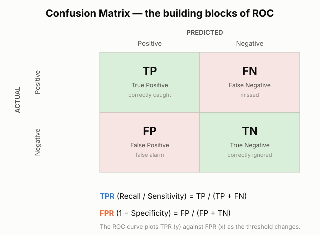
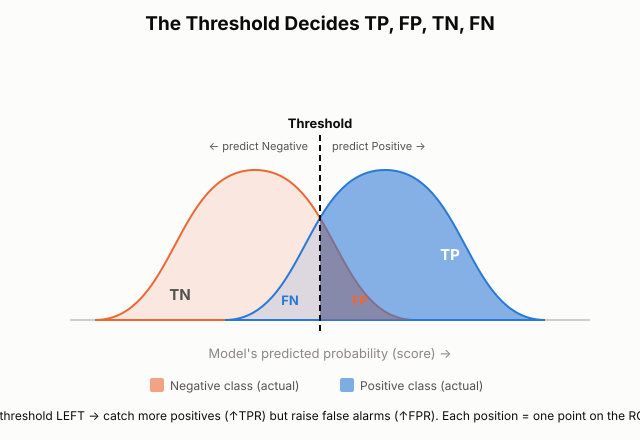
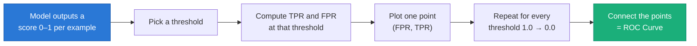
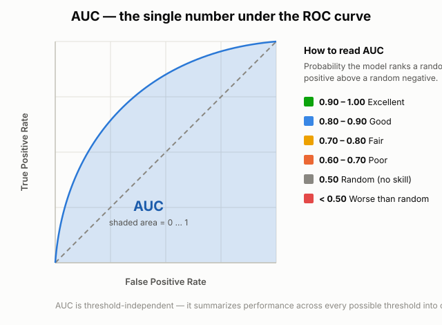
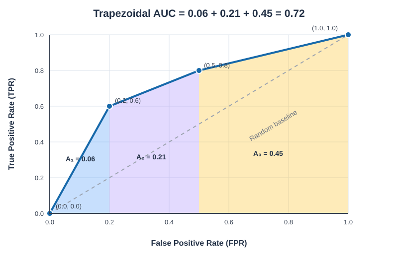
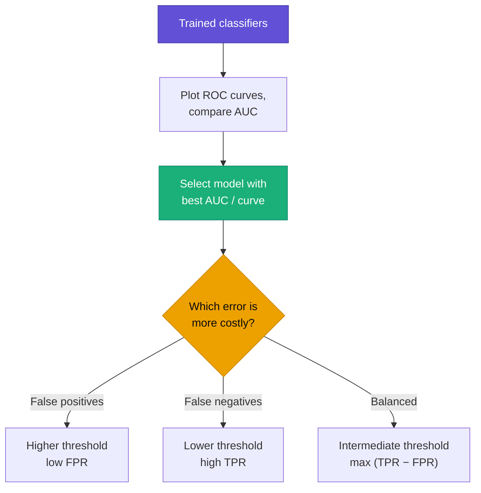

# ROC Curve and AUC in Machine Learning

**ROC** → **R**eceiver **O**perating **C**haracteristic.

- A **ROC curve** is a graphical plot that shows how well a **binary classification** model separates two classes **across every possible decision threshold**. Instead of judging a model at one fixed cut-off, the ROC curve lets us see its behaviour at *all* cut-offs at once.

- It plots the **True Positive Rate (TPR)** against the **False Positive Rate (FPR)** at each threshold setting. The **AUC** (Area Under the Curve) then collapses that whole curve into a single, threshold-independent score.

ROC analysis is most useful for **binary classification** problems — two possible outcomes:

| Problem | Positive class | Negative class |
|:---|:---|:---|
| Email classification | Spam | Not Spam |
| Fraud detection | Fraudulent | Legitimate |
| Medical diagnosis | Disease | No Disease |
| Customer churn | Churn | Not Churn |

---

## Table of Contents

- [What Is a ROC Curve?](#what-is-a-roc-curve)
- [Why Do We Need the ROC Curve?](#why-do-we-need-the-roc-curve)
- [The Building Blocks: TPR and FPR](#the-building-blocks-tpr-and-fpr)
  - [A. True Positive Rate (TPR)](#a-true-positive-rate-tpr)
  - [B. False Positive Rate (FPR)](#b-false-positive-rate-fpr)
- [The ROC Space (the Axes)](#the-roc-space-the-axes)
  - [Diagonal: the line of no discrimination](#diagonal-the-line-of-no-discrimination)
  - [ROC space vs. ROC curve](#roc-space-vs-roc-curve)
- [Threshold Selection — What and Why](#threshold-selection--what-and-why)
- [How Changing the Threshold Creates the ROC Curve](#how-changing-the-threshold-creates-the-roc-curve)
- [Reading ROC Curve Shapes](#reading-roc-curve-shapes)
  - [Comparing operating points and AUC](#comparing-operating-points-and-auc)
- [AUC — Area Under the Curve](#auc--area-under-the-curve)
  - [How AUC Is Calculated](#how-auc-is-calculated)
- [Choosing a Model and a Threshold with ROC / AUC](#choosing-a-model-and-a-threshold-with-roc--auc)
- [Key Takeaways](#key-takeaways)
- [Want to explore more Advanced concepts on ROC and AUC?](#want-to-explore-more-advanced-concepts-on-roc-and-auc)
  - [Advanced Topic: ROC Curve & AUC: Important Concepts](<02 Advanced Topic- ROC Curve & AUC Important Concepts.md>)
  - [Advanced Topic — Threshold Selection and Optimization](<01 Advanced Topic- Threshold Selection and Optimization.md>)
- [Future Advanced Topics (Coming Soon)](#future-advanced-topics-coming-soon)

---

## What Is a ROC Curve?

- Most classifiers do not output a hard label directly. 
- They output a **score** (a probability between 0 and 1) that an example belongs to the positive class. We turn that score into a label using a **threshold**:

    - score **≥ threshold** → predict **Positive**
    - score **< threshold** → predict **Negative**

- As you ***change the threshold, the predictions change, producing different TPR and FPR values.***
- The ***ROC curve collects*** these operating points to ***show the trade-off between detecting real positives and raising false alarms.***

**Example — Disease prediction.** A model assigns a patient a disease probability of **0.70**. The predicted class depends on the threshold:

- At a threshold of **0.50**, the patient is classified as **positive**.
- At a threshold of **0.80**, the patient is classified as **negative**.

The threshold is a **_knob_**. Turn it one way and the model becomes cautious (few positives); turn it the other way and it becomes aggressive (many positives). Every setting of the knob gives a different TPR and FPR.

The **ROC curve** is simply the trace of **(FPR, TPR)** points as the threshold sweeps from high to low. It answers one question: *how good is this model at separating the two classes, independent of the exact cut-off we pick?*

---

## Why Do We Need the ROC Curve?

**Accuracy alone can be dangerously misleading on imbalanced data.**
ROC Curve is useful when:
- You want to compare different classification models.
- You want to understand how changing the threshold affects predictions.
- You want to balance false positives and true positives.
- You want to evaluate a binary classification model.

> [!WARNING]
> **Fraud detection example:** Out of 10,000 transactions, only 100 are fraud (1%). A model that predicts *"legitimate"* for every transaction scores **99% accuracy**, yet it catches **zero** fraud. High accuracy alone can therefore be dangerously misleading.

The ROC curve helps reveal why accuracy is misleading here:

- It uses **TPR and FPR**, which measure performance for each class, rather than overall accuracy.
- The all-legitimate model has a **TPR of 0** and an **FPR of 0**, so it appears at **(0, 0)**, the starting point on the ROC diagonal. This single point does not describe the model's performance across thresholds.

For a model that produces a fraud score:

- Choose a threshold above which transactions are flagged as fraud.
- **Raise the threshold** to reduce legitimate transactions incorrectly flagged as fraud (**false positives**).
- A higher threshold can also let more fraud through (**false negatives**).
- The ROC curve shows this trade-off across thresholds. The all-legitimate model is just one operating point, not a threshold-tunable model.

#### The ROC curve is valuable because it:

- **Is threshold-independent** — shows performance across *all* cut-offs, not just one.
- **Evaluates each actual class separately** through TPR and FPR, rather than letting the majority class dominate the metric as it can with accuracy. With extreme imbalance, a low FPR can still mean many false alarms, so also consider precision-recall metrics and the expected number of false positives.
- **Separates "ranking ability" from "threshold choice"** — first ask *can the model rank positives above negatives?* (the curve / AUC), then *where do we set the cut-off?* (a business decision).
- **Makes model comparison easy** — one curve per model on the same axes.

---

## The Building Blocks: TPR and FPR

Both rates come straight from the **confusion matrix**. Everything about ROC rests on these four counts.

| Term | Meaning |
|:---|:---|
| **TP** (True Positive) | Positive case correctly predicted positive |
| **FN** (False Negative) | Positive case missed (predicted negative) |
| **FP** (False Positive) | Negative case wrongly flagged as positive (false alarm) |
| **TN** (True Negative) | Negative case correctly predicted negative |

### A. True Positive Rate (TPR)

TPR measures the share of **actual positive** cases the model correctly identifies. Also called **Recall** or **Sensitivity**.

$$TPR (\text{threshold}) = \frac{TP}{TP + FN}$$

- A higher TPR is desirable because it means fewer positives are missed.
- Its ***complement*** is the ***False Negative Rate***:
$$FNR = \frac{FN}{TP + FN} = 1 - TPR$$

**Example.** Suppose there are **100 fraudulent** transactions:

- Model correctly detects **80** (TP = 80)
- Model misses **20** (FN = 20)

$$TPR = \frac{80}{80 + 20} = 0.80 = 80\%$$

➡️ The model successfully detects **80%** of all fraudulent transactions.

### B. False Positive Rate (FPR)

- **FPR** measures the share of **actual negative** cases the model **incorrectly** flags as positive. 
- It equals **1 − Specificity**.

$$FPR = \frac{FP}{FP + TN}$$

- The denominator, **FP + TN**, is the total number of actual negatives.
- A lower FPR is desirable because it means fewer false alarms.
- FPR is related to ***specificity***, which ***measures how well the model correctly identifies negatives***:

$$\text{Specificity} = \frac{TN}{TN + FP}$$

$$\text{FPR} = 1 - \text{Specificity}$$

> [!TIP]
> For a detailed explanation, examples, and diagrams, see [Sensitivity and specificity](<../Statistics for Machine Learning/Sensitivity and specificity/Sensitivity and specificity.md>).

**Example.** Suppose there are **900 legitimate** transactions:

- Model wrongly flags **90** as fraud (FP = 90)
- Model correctly clears **810** (TN = 810)

$$FPR = \frac{90}{90 + 810} = 0.10 = 10\%$$

➡️ The model raises a false alarm on **10%** of all legitimate transactions.

**Churn example.** If **churn** is the positive class, an FPR of **10%** means the model incorrectly flags **10% of customers who would stay** as likely to churn. If the business offers those customers retention discounts, those false positives can lead to unnecessary costs.

> [!IMPORTANT]
> **Goal:** Achieve a high **TPR** (catch more real positives) and a low **FPR** (raise fewer false alarms). The ROC curve visualises the trade-off as the classification threshold changes.

---

## The ROC Space (the Axes)

- **Y-axis → True Positive Rate (TPR)** — sensitivity / recall. *Higher is better.*
- **X-axis → False Positive Rate (FPR)** — 1 − specificity. *Lower is better.*
- **Each point** on the curve corresponds to **one threshold**.

- For the same model, **lowering the threshold usually increases both TPR and FPR**: more actual positives are caught, but more actual negatives are incorrectly flagged.
- **Raising the threshold usually decreases both TPR and FPR.**
- Therefore, **a decrease in FPR does not automatically mean an increase in TPR**.
- A better-performing model can achieve a **higher TPR at the same FPR**; its ROC curve is closer to the top-left.

This gives four meaningful corners of the ROC space:

| Point | (FPR, TPR) | Meaning |
|:---|:---|:---|
| Bottom-left | (0, 0) | Threshold so high nothing is predicted positive |
| **Top-left** | **(0, 1)** | **Perfect** — all positives caught, zero false alarms |
| Top-right | (1, 1) | Threshold so low everything is predicted positive |
| Diagonal | TPR = FPR | **Random guessing** (no skill) |

The ideal model's curve pushes toward the **top-left corner**.

### Diagonal: the line of no discrimination

- **Path:** The diagonal runs from **(0, 0)** to **(1, 1)**.
- It is called the **line of no discrimination**.
- **Meaning:** It ***represents a classifier that cannot distinguish positive cases from negative cases; its predictions are no better than random.***
- **Churn example:** If churn is the positive class, this is like guessing at random which customers will leave, without useful information about them.
- **Rates along the line:** At each point:

  $$\text{TPR} = \text{FPR}$$

  For example:
  - At **FPR = 0.20**, **TPR = 0.20**.
  - The model flags 20% of customers who would stay and identifies 20% of those who would churn. These percentages refer to different groups.

- **AUC:** A random classifier has an expected **AUC of 0.5**.
- **Compare curves:** A curve above the diagonal indicates better-than-random ranking. A curve below it indicates worse-than-random ranking and may suggest reversed scores or class labels.

### ROC space vs. ROC curve

| ROC space | ROC curve |
|:---|:---|
| A coordinate system | A curve plotted inside ROC space |
| Contains possible classifier operating points | Connects the points generated as a classifier's threshold changes |
| Shows individual operating points | Shows performance across thresholds |
| Uses FPR and TPR axes | Uses the same FPR and TPR axes |

---

## Threshold Selection — What and Why

A classifier's raw output is a score. The **threshold** converts that score into a Positive/Negative decision. Moving the threshold trades off the two kinds of error — and the picture below shows *why*.

The two humps are the model's score distributions for the **actual negative** (orange) and **actual positive** (blue) classes. The dashed line is the threshold:

- Everything **right** of the line is predicted **Positive** → splits into **TP** (blue) and **FP** (orange).
- Everything **left** of the line is predicted **Negative** → splits into **TN** (orange) and **FN** (blue).

**Why we tune the threshold — it depends on the cost of each mistake:**

| Situation | Preferred threshold | Effect |
|:---|:---|:---|
| **False positives are costly** (e.g. flagging a healthy patient for surgery) | **Higher** threshold | Lower FPR, but some positives missed |
| **False negatives are costly** (e.g. missing a cancer, letting fraud through) | **Lower** threshold | Higher TPR, but more false alarms |
| **Balanced costs** | **Intermediate** threshold | Reasonable trade-off between the two |

Because no single threshold is "correct" for every use-case, we evaluate the model over **all** thresholds — which is precisely the ROC curve.

---

## How Changing the Threshold Creates the ROC Curve

Sliding the threshold across the score distributions produces a *different* (FPR, TPR) pair at each position. Plot every pair and you trace out the ROC curve:

- **Very high threshold** → almost nothing flagged positive → point near **(0, 0)**.
- **Lowering the threshold** → catch more positives (TPR ↑) but also more false alarms (FPR ↑) → the point climbs up and to the right.
- **Very low threshold** → everything flagged positive → point near **(1, 1)**.

The order of the points never goes backward, so the curve is monotonically non-decreasing from (0, 0) to (1, 1).

---

## Reading ROC Curve Shapes

The *shape* of the curve tells you how well the model separates the classes.

| Curve | What it means |
|:---|:---|
| **Hugs the top-left corner** | Excellent separation — high TPR at low FPR |
| **Bowed toward top-left** | Good, useful model |
| **On the diagonal** | No skill — equivalent to random guessing |
| **Below the diagonal** | Worse than random (often a flipped-label bug — inverting predictions would help) |

**Rule of thumb:** the closer the curve bends toward the **top-left**, the better the classifier.

### Comparing operating points and AUC

Points **A**, **B**, and **C** are operating points on the same ROC curve, each corresponding to a different classification threshold:

- **A** has a lower FPR than B or C, so it raises fewer false alarms, but its TPR is also lower, so it misses more actual positives.
- **C** has the highest TPR of the three, so it detects more actual positives, but it also has the highest FPR and raises more false alarms.
- **B** lies between A and C, trading off detection against false alarms.

For the Google MCQ's use case, **Point A is the correct choice**: minimizing false positives is the priority, so it is acceptable for the TPR to decrease too. More generally, there is no universally best point among A, B, and C; choose based on the relative cost of false positives and false negatives. The **top-left corner (FPR = 0, TPR = 1)** is ideal because it detects every positive without any false alarms.

The shaded area summarizes the curve across thresholds: **AUC = 0.84** indicates good overall ranking ability. It does not mean that point A, B, or C has 84% accuracy, nor does it select the best threshold by itself.

---

## AUC — Area Under the Curve

**The intuitive meaning of AUC:**

> [!NOTE]
> AUC is the **probability that the model ranks a randomly chosen positive example higher than a randomly chosen negative example.**

- AUC, in this context, means the area under the ROC curve, also written **ROC-AUC**.
- AUC = area under the ROC curve; ***summarizes performance across the ROC space rather than at one selected threshold.***
- It ***measures how well a classification model can distinguish between two classes.***

**Mathematically:**

$$
\boxed{\text{AUC} = \int_0^1 \text{TPR}(u)\,du}
$$

Here,
***$u$ = FPR (false positive rate).***

> [!NOTE]
> The ROC curve is a *picture*. **AUC** turns that picture into a **single number**—the area beneath the ROC curve, ranging from **0 to 1**.

So an AUC of 0.90 means: pick one real positive and one real negative at random, and the model achieves 90% ranking credit—higher scores count as correct, ties as half credit, and lower scores as incorrect.

| AUC | Interpretation |
|:---|:---|
| **1.0** | Perfect ranking |
| **0.9 – 1.0** | Excellent |
| **0.8 – 0.9** | Good |
| **0.7 – 0.8** | Fair |
| **0.6 – 0.7** | Poor |
| **0.5** | Random — no discriminative power |
| **< 0.5** | Worse than random (predictions are inverted) |

> [!IMPORTANT]
> An **AUC of 0.8 does not mean 80% accuracy**. It means the model has approximately an **80% probability of ranking a randomly selected positive example higher than a randomly selected negative example**.

**Why AUC is so widely used:**

- **Threshold-independent** — it summarises performance over *all* thresholds, so you can compare models before committing to a cut-off.
- **Scale-invariant** — it measures how well predictions are *ranked*, not their absolute values.
- **Ranking-based** — a strictly increasing transformation of the scores leaves their ranking, and therefore AUC, unchanged.
- **Single number** — easy to report and compare across models.

> [!WARNING]
> On highly imbalanced data where false positives are a major concern, **Precision-Recall AUC** can be more informative than ROC-AUC because FPR can remain small when negatives vastly outnumber positives.

---
### How AUC Is Calculated

In practice, AUC is usually calculated from the ROC points using the **trapezoidal rule**. For example, suppose a ROC curve has these points:

| FPR (x-axis) | TPR (y-axis) |
|:---:|:---:|
| 0.0 | 0.0 |
| 0.2 | 0.6 |
| 0.5 | 0.8 |
| 1.0 | 1.0 |

For each pair of consecutive ROC points, calculate the trapezoid's area, then add the areas:

$$
\text{AUC} = \sum_{i=1}^{n-1}
\frac{\text{TPR}_i + \text{TPR}_{i+1}}{2}
\left(\text{FPR}_{i+1} - \text{FPR}_i\right)
$$

Each interval forms a trapezoid; adding their areas gives the total AUC. With the example points above, the total area is **0.72**.

You generally do not need to calculate AUC manually; Scikit-learn provides functions to do this.

---
## Choosing a Model and a Threshold with ROC / AUC

Use ROC/AUC in two stages:

1. **Compare models (use AUC).** Train several models, plot their ROC curves on the same axes, and prefer the one with the **higher AUC** / the curve nearer the top-left. This judges pure ranking ability, independent of threshold.

2. **Pick the operating threshold (use the curve + business cost).** Once a model is chosen, select the point on *its* curve that matches your tolerance for each error type:
   - Minimise false alarms → choose a point with **low FPR** (toward the left).
   - Catch as many positives as possible → choose a point with **high TPR** (toward the top).
   - Balanced → choose an intermediate point (a common heuristic is **Youden's J**, maximising `TPR − FPR`, i.e. the point farthest above the diagonal).

---

## Key Takeaways

- A **ROC curve** plots **TPR vs FPR** across **all thresholds** — it shows separating power, not a single-threshold snapshot.
- **TPR = TP / (TP + FN)** (recall / sensitivity); **FPR = FP / (FP + TN)** (1 − specificity).
- The **threshold** is a knob that trades TPR against FPR; the right setting depends on the **cost of each error**.
- **Top-left is best**; the **diagonal is random**; **below the diagonal is worse than random**.
- **AUC** = area under the curve = probability a random positive outranks a random negative. Higher is better; **0.5 = no skill**.
- Workflow: **compare models with AUC**, then **choose the threshold from the curve** using business costs.

---

## **Want to explore more Advanced concepts on ROC and AUC?**

### Advanced Topic: ROC Curve & AUC: Important Concepts
> [!TIP]
> See [ROC Curve & AUC: Important Concepts](<02 Advanced Topic- ROC Curve & AUC Important Concepts.md>) for additional topics.

- [ROC-AUC Does Not Measure Probability Calibration](<02 Advanced Topic- ROC Curve & AUC Important Concepts.md#1-roc-auc-does-not-measure-probability-calibration>)
- [ROC-AUC Is Independent of Classification Threshold](<02 Advanced Topic- ROC Curve & AUC Important Concepts.md#2-roc-auc-is-independent-of-classification-threshold>)
- [ROC-AUC Is Invariant to Monotonic Transformations](<02 Advanced Topic- ROC Curve & AUC Important Concepts.md#3-roc-auc-is-invariant-to-monotonic-transformations>)
- [ROC-AUC and Class Imbalance](<02 Advanced Topic- ROC Curve & AUC Important Concepts.md#4-roc-auc-and-class-imbalance>)
- [ROC Curve vs. Precision-Recall Curve](<02 Advanced Topic- ROC Curve & AUC Important Concepts.md#5-roc-curve-vs-precision-recall-curve-pr-curve>)
- [AUC Can Be Misleading When Comparing Models](<02 Advanced Topic- ROC Curve & AUC Important Concepts.md#6-auc-can-be-misleading-when-comparing-models>)
  - [What Is a Confidence Interval?](<02 Advanced Topic- ROC Curve & AUC Important Concepts.md#what-is-a-confidence-interval>)
- [What Happens When AUC Is Below 0.5?](<02 Advanced Topic- ROC Curve & AUC Important Concepts.md#7-what-happens-when-auc-is-below-05>)
- [ROC-AUC for Multiclass Classification](<02 Advanced Topic- ROC Curve & AUC Important Concepts.md#8-roc-auc-for-multiclass-classification>)
  - [One-vs-Rest (OvR)](<02 Advanced Topic- ROC Curve & AUC Important Concepts.md#a-one-vs-rest-ovr>)
  - [One-vs-One (OvO)](<02 Advanced Topic- ROC Curve & AUC Important Concepts.md#b-one-vs-one-ovo>)
- [Use Prediction Scores, Not Just Predicted Labels, for ROC-AUC](<02 Advanced Topic- ROC Curve & AUC Important Concepts.md#9-use-prediction-scores-not-just-predicted-labels-for-roc-auc>)
- [Partial AUC (pAUC) and Operating Regions](<02 Advanced Topic- ROC Curve & AUC Important Concepts.md#10-partial-auc-pauc-and-operating-regions>)
- [ROC-AUC Does Not Guarantee Good Production Performance](<02 Advanced Topic- ROC Curve & AUC Important Concepts.md#11-roc-auc-does-not-guarantee-good-production-performance>)
- [Complete ROC & AUC Learning Checklist](<02 Advanced Topic- ROC Curve & AUC Important Concepts.md#12-complete-roc--auc-learning-checklist>)
  - [Fundamentals](<02 Advanced Topic- ROC Curve & AUC Important Concepts.md#fundamentals>)
  - [AUC Concepts](<02 Advanced Topic- ROC Curve & AUC Important Concepts.md#auc-concepts>)
  - [Threshold Optimization](<02 Advanced Topic- ROC Curve & AUC Important Concepts.md#threshold-optimization>)
  - [Advanced Concepts](<02 Advanced Topic- ROC Curve & AUC Important Concepts.md#advanced-concepts>)
  - [Practical Implementation](<02 Advanced Topic- ROC Curve & AUC Important Concepts.md#practical-implementation>)
- [What Should You Study Next?](<02 Advanced Topic- ROC Curve & AUC Important Concepts.md#13-what-should-you-study-next>)

---

### Advanced Topic — Threshold Selection and Optimization

> [!TIP]
> See [Advanced Topic — Threshold Selection and Optimization](<01 Advanced Topic- Threshold Selection and Optimization.md>) for additional topics.

- [Choosing the Best Classification Threshold](<01 Advanced Topic- Threshold Selection and Optimization.md#choosing-the-best-classification-threshold>)
  - [AUC values and what they mean](<01 Advanced Topic- Threshold Selection and Optimization.md#auc-values-and-what-they-mean>)
  - [Understand the threshold trade-off](<01 Advanced Topic- Threshold Selection and Optimization.md#understand-the-threshold-trade-off>)
  - [Threshold-selection approaches](<01 Advanced Topic- Threshold Selection and Optimization.md#threshold-selection-approaches>)
    - [A. Require a minimum sensitivity](<01 Advanced Topic- Threshold Selection and Optimization.md#a-require-a-minimum-sensitivity>)
    - [B. Limit the false positive rate](<01 Advanced Topic- Threshold Selection and Optimization.md#b-limit-the-false-positive-rate>)
    - [Partial AUC](<01 Advanced Topic- Threshold Selection and Optimization.md#partial-auc>)
      - [What does pAUC measure?](<01 Advanced Topic- Threshold Selection and Optimization.md#what-does-pauc-measure>)
      - [Why can full AUC be misleading?](<01 Advanced Topic- Threshold Selection and Optimization.md#why-can-full-auc-be-misleading>)
      - [Does pAUC select a threshold?](<01 Advanced Topic- Threshold Selection and Optimization.md#does-pauc-select-a-threshold>)
      - [Raw versus normalized pAUC](<01 Advanced Topic- Threshold Selection and Optimization.md#raw-versus-normalized-pauc>)
      - [Main limitation](<01 Advanced Topic- Threshold Selection and Optimization.md#main-limitation>)
    - [C. Minimize the costs of errors](<01 Advanced Topic- Threshold Selection and Optimization.md#c-minimize-the-costs-of-errors>)
    - [D. Maximize Youden's J statistic](<01 Advanced Topic- Threshold Selection and Optimization.md#d-maximize-youdens-j-statistic>)
    - [E. Choose the point closest to the top-left corner](<01 Advanced Topic- Threshold Selection and Optimization.md#e-choose-the-point-closest-to-the-top-left-corner>)
  - [Compare the threshold-selection approaches](<01 Advanced Topic- Threshold Selection and Optimization.md#compare-the-threshold-selection-approaches>)
  - [Recommendation: Match the method to your priority](<01 Advanced Topic- Threshold Selection and Optimization.md#recommendation-match-the-method-to-your-priority>)
- [Threshold Optimization in Practice](<01 Advanced Topic- Threshold Selection and Optimization.md#threshold-optimization-in-practice>)

---
- ***Google Course Reference:*** [Google Machine Learning Crash Course — ROC and AUC](https://developers.google.com/machine-learning/crash-course/classification/roc-and-auc)
- ***Wikipedia reference:*** [Receiver operating characteristic](https://en.wikipedia.org/wiki/Receiver_operating_characteristic)
- ***Statistics reference:*** [Sensitivity and specificity](<../Statistics for Machine Learning/Sensitivity and specificity/Sensitivity and specificity.md>)

---

## Future Advanced Topics (Coming Soon)

- **Probabilistic interpretation**
- **Detection error tradeoff (DET) graph**
