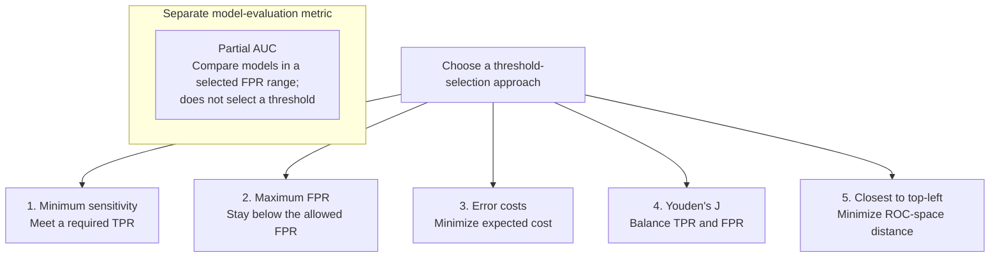

# Advanced ROC and AUC Topic: Threshold Selection and Optimization
### Table of Contents

- [Choosing the Best Classification Threshold](#choosing-the-best-classification-threshold)
  - [AUC values and what they mean](#auc-values-and-what-they-mean)
  - [Understand the threshold trade-off](#understand-the-threshold-trade-off)
  - [Threshold-selection approaches](#threshold-selection-approaches)
    - [A. Require a minimum sensitivity](#a-require-a-minimum-sensitivity)
    - [B. Limit the false positive rate](#b-limit-the-false-positive-rate)
    - [Partial AUC](#partial-auc)
      - [What does pAUC measure?](#what-does-pauc-measure)
      - [Why can full AUC be misleading?](#why-can-full-auc-be-misleading)
      - [Does pAUC select a threshold?](#does-pauc-select-a-threshold)
      - [Raw versus normalized pAUC](#raw-versus-normalized-pauc)
      - [Main limitation](#main-limitation)
    - [C. Minimize the costs of errors](#c-minimize-the-costs-of-errors)
    - [D. Maximize Youden's J statistic](#d-maximize-youdens-j-statistic)
    - [E. Choose the point closest to the top-left corner](#e-choose-the-point-closest-to-the-top-left-corner)
  - [Compare the threshold-selection approaches](#compare-the-threshold-selection-approaches)
  - [Recommendation: Match the method to your priority](#recommendation-match-the-method-to-your-priority)
- [Threshold Optimization in Practice](#threshold-optimization-in-practice)

---
## Choosing the Best Classification Threshold
Choosing a classification threshold is one of the most important practical tasks in machine learning.

So far, we've learned:

1. Logistic Regression predicts probabilities.
2. A classification threshold converts probabilities into class labels.
3. The ROC curve evaluates model performance across different thresholds.
4. AUC measures how well the model distinguishes between positive and negative classes.

### AUC values and what they mean

AUC summarizes the model's **ranking performance across all classification thresholds**. It is not accuracy and does not describe performance at one particular threshold.

- **AUC = 1.0:** Perfect ranking. Every positive example receives a higher score than every negative example.
- **AUC = 0.5:** No ranking ability on average; this is the random-ranking baseline.
- **AUC = 0:** Perfectly reversed ranking. Every positive example receives a lower score than every negative example. Reversing the score direction would give an AUC of 1.0.

An AUC below 0.5 indicates worse-than-random ranking and may mean the score direction or positive-class label needs checking. AUC values in practice often fall between 0.5 and 1.0.

> ***Important:*** AUC describes the ranking of scores across thresholds. It does not tell you which threshold to use; choose that based on the costs or requirements of the application.

There is **no universally best threshold**. The right choice depends on the application's goals, error costs, and operational constraints.

### Understand the threshold trade-off

Suppose a model predicts the probability that each patient has cancer. Among 1,000 patients, 100 actually have cancer and 900 do not.

| Threshold | TPR (sensitivity) | FPR |
|---:|---:|---:|
| 0.8 | 70% | 2% |
| 0.5 | 85% | 8% |
| 0.2 | 98% | 25% |

As the threshold decreases, the model catches more actual positive cases, but also incorrectly flags more actual negative cases:

- At a threshold of **0.8**, it detects 70% of cancer patients.
- At a threshold of **0.5**, it detects 85%.
- At a threshold of **0.2**, it detects 98%.

> **At a threshold of 0.00, every patient is predicted positive, so TPR = 100% and FPR = 100%.** The example's AUROC of 0.85 summarizes the entire ROC curve across thresholds; it is not the score for this single operating point.

## Threshold-selection approaches

The notes cover **five threshold-selection approaches**. Choose the one that matches the application's goal:

### A. Require a minimum sensitivity

**Example: medical disease screening**

In cancer screening, missing a cancer patient (a false negative) may be more dangerous than sending a healthy person for additional tests (a false positive). The application can therefore require the model to identify at least 95% of patients who have cancer:

$$\text{TPR} \geq 0.95$$

| Threshold | TPR | FPR | Meets requirement? |
|---:|---:|---:|:---:|
| 0.8 | 70% | 2% | No |
| 0.5 | 85% | 8% | No |
| 0.2 | 98% | 25% | Yes |

Only the threshold of **0.2** meets the requirement. In practice:

1. Generate ROC points for all thresholds.
2. Keep the thresholds where TPR is at least 0.95.
3. From those candidates, choose the threshold with the lowest FPR.

This approach is useful in:

- Cancer screening and disease detection.
- Safety monitoring.
- Security threat detection.

### B. Limit the false positive rate

**Example: automated fraud detection**

A bank may limit false alarms to avoid blocking legitimate payments, overloading investigators, or harming customer experience. For example, it may require:

$$\text{FPR} \leq 0.01$$

This means:

The model must incorrectly flag no more than 1% of actual legitimate transactions.

| Threshold | TPR | FPR | Meets requirement? |
|---:|---:|---:|:---:|
| 0.2 | 98% | 15% | No |
| 0.4 | 90% | 5% | No |
| 0.6 | 75% | 1% | Yes |
| 0.8 | 55% | 0.3% | Yes |

Both thresholds **0.6** and **0.8** meet the FPR requirement. Choose **0.6**, because it detects more fraudulent transactions while staying within the limit.

| Approach A | Approach B |
|:---|:---|
| Set a minimum TPR | Set a maximum FPR |
| Prioritize catching positives | Prioritize avoiding false alarms |
| Minimize FPR within the constraint | Maximize TPR within the constraint |

---

### Partial AUC

Full ROC AUC summarizes the curve across the entire FPR range:

$$
\text{AUC} = \int_0^1 \text{TPR}(u)\,du
$$

Here, $u$ denotes the false positive rate (FPR). However, not every part of this range is necessarily useful. For example:

> Our system is usable only when the FPR is below 5%.

If so, model performance at FPR values of 40% or 80% may have little operational relevance. **Partial AUC (pAUC)** focuses on a selected region:

$$
\boxed{
\text{pAUC}_{[0,\alpha]} =
\int_0^\alpha \text{TPR}(u)\,du
}
$$

For a maximum relevant FPR of 5%:

$$\alpha = 0.05$$

#### What does pAUC measure?

It measures the area under the ROC curve **within the selected FPR range**. A larger pAUC means the model generally achieves better sensitivity in that operating region.

#### Why can full AUC be misleading?

Consider two models:

- **Model A** has excellent sensitivity at very low FPR.
- **Model B** becomes strong only when much more false-positive activity is allowed.

Model B could have a higher full AUC, while Model A is more useful for a system restricted to FPR below 5%. Partial AUC focuses the comparison on the region that matters to that system.

#### Does pAUC select a threshold?

No. pAUC summarizes performance across multiple thresholds; it does not select one specific threshold. A sensible workflow is:

1. Compare models using pAUC over the relevant FPR range.
2. For the selected model, choose a specific threshold using an operating rule—for example, maximize sensitivity subject to $\text{FPR} \leq 5\%$.

These answer different questions:

- **pAUC:** Which model performs better across the useful region?
- **Threshold selection:** Which specific decision rule should we deploy?

#### Raw versus normalized pAUC

For the interval $[0,\alpha]$, the maximum possible raw pAUC is:

$$\alpha$$

Therefore, a raw pAUC of 0.04 can be strong when its maximum possible value is only 0.05. One simple normalization is:

$$\frac{\text{pAUC}}{\alpha}$$

This is the average TPR across the selected FPR interval, with equal weighting over FPR. Software may use a different standardization. For example, scikit-learn's ROC AUC calculation with `max_fpr` returns a standardized partial AUC, where a diagonal chance curve maps to 0.5 and perfect performance maps to 1.

Always check the FPR interval and normalization before comparing reported pAUC values.

#### Main limitation

pAUC still summarizes a region. If ROC curves cross, a model with a higher pAUC can have lower sensitivity at the exact FPR limit you intend to use. If one specific operating point matters, compare performance at that point too.

--- 
### C. Minimize the costs of errors

In real-world applications, false positives and false negatives can have different consequences. Consider a bank that wants to minimize its financial losses from fraudulent transactions:

1. **False negative (FN):** A fraudulent transaction is classified as legitimate, potentially costing the bank money.
2. **False positive (FP):** A legitimate transaction is classified as fraudulent, inconveniencing the customer and requiring investigation.

#### Step 1: Define the error costs

Suppose:

| Error | Cost |
|:---|---:|
| False negative | ₹10,000 |
| False positive | ₹200 |

Thus, missing a fraudulent transaction costs more than incorrectly flagging a legitimate one:

$$C_{FN} = 10{,}000 \qquad C_{FP} = 200$$

#### Step 2: Calculate expected cost

The expected cost per transaction is:

$$
\text{Expected Cost} =
C_{FN}\pi(1-\text{TPR}) +
C_{FP}(1-\pi)\text{FPR}
$$

| Symbol | Meaning |
|:---|:---|
| $C_{FN}$ | Cost of missing an actual positive |
| $C_{FP}$ | Cost of incorrectly flagging an actual negative |
| $\pi$ | Proportion of actual positive cases |
| $1-\text{TPR}$ | False negative rate |
| $\text{FPR}$ | False positive rate |
| $1-\pi$ | Proportion of actual negative cases |

Each error rate is weighted by its class prevalence and its cost, giving an expected cost per transaction.

For example, suppose 10% of transactions are fraudulent, 90% are legitimate, a false negative costs ₹10,000, and a false positive costs ₹200. Then:

$$
\text{EC}(t) =
10{,}000(0.10)(1-\text{TPR}) +
200(0.90)(\text{FPR})
$$

#### Step 3: Compare two thresholds

Suppose the model gives:

| Metric | Threshold 0.3 | Threshold 0.7 |
|:---|---:|---:|
| TPR | 95% | 70% |
| FPR | 20% | 2% |

For threshold 0.3:

$$
\begin{aligned}
\text{EC} &= 10{,}000(0.10)(1-0.95) + 200(0.90)(0.20) \\
&= 50 + 36 \\
&= \text{₹86 per transaction}
\end{aligned}
$$

For threshold 0.7:

$$
\begin{aligned}
\text{EC} &= 10{,}000(0.10)(1-0.70) + 200(0.90)(0.02) \\
&= 300 + 3.6 \\
&= \text{₹303.60 per transaction}
\end{aligned}
$$

| Threshold | Expected cost per transaction |
|---:|---:|
| 0.3 | ₹86 |
| 0.7 | ₹303.60 |

Choose threshold **0.3** because it has the lower expected cost. Although it produces more false positives, missing fraud is much more expensive in this example.

> The best threshold depends on the consequences of the errors, not just ROC-AUC. This example assumes the costs are per error, correct decisions have zero cost, and prevalence and error costs remain constant.

### D. Maximize Youden's J statistic

Youden's J selects the threshold with a strong combined sensitivity and specificity. At threshold $t$:

$$
J(t) = \text{Sensitivity}(t) + \text{Specificity}(t) - 1
$$

Since $\text{Specificity} = 1 - \text{FPR}$, this is equivalently:

$$
\boxed{J(t) = \text{TPR}(t) - \text{FPR}(t)}
$$

Choose the threshold that maximizes $J(t)$:

$$
t^* = \arg\max_t J(t)
$$

#### Example

| Threshold | TPR | FPR | $J = \text{TPR} - \text{FPR}$ |
|---:|---:|---:|---:|
| 0.90 | 0.35 | 0.01 | 0.34 |
| 0.70 | 0.60 | 0.03 | 0.57 |
| 0.50 | 0.85 | 0.10 | 0.75 |
| **0.30** | **0.97** | **0.20** | **0.77** |
| 0.10 | 0.98 | 0.40 | 0.58 |

Threshold **0.30** maximizes Youden's J in this example, with $J = 0.77$.

#### Interpretation on the ROC curve

An ROC curve plots **FPR on the horizontal axis** and **TPR on the vertical axis**. Its diagonal reference line represents $\text{TPR} = \text{FPR}$.

Youden's J is the **vertical distance above the diagonal**:

$$J(t) = \text{TPR}(t) - \text{FPR}(t)$$

Maximizing J selects the point with the greatest vertical separation from that line.

#### Relationship to balanced accuracy

Balanced accuracy is:

$$
\begin{aligned}
\text{Balanced accuracy}
&= \frac{\text{Sensitivity} + \text{Specificity}}{2} \\
&= \frac{J + 1}{2}
\end{aligned}
$$

Therefore, maximizing Youden's J is equivalent to maximizing balanced accuracy, giving sensitivity and specificity equal weight.

#### When to use it

Youden's J is a useful general criterion when sensitivity and specificity deserve equal emphasis and no explicit operational requirement is available.

#### Main limitation

Youden's J does not directly incorporate deployment prevalence or error costs. Equal weighting of sensitivity and specificity does **not** mean equal total numbers or total costs of mistakes, especially in an imbalanced population.

### E. Choose the point closest to the top-left corner

The ideal ROC point is:

$$\left(\text{FPR}, \text{TPR}\right) = (0,1)$$

This represents zero false positives and 100% true positives. One heuristic is to select the ROC point with the shortest Euclidean distance from this ideal point:

$$d = \sqrt{\text{FPR}^2 + (1-\text{TPR})^2}$$

Choose the threshold that minimizes this distance. For example:

| Threshold | FPR | TPR | Distance |
|---:|---:|---:|---:|
| 0.2 | 0.40 | 0.95 | 0.403 |
| 0.4 | 0.20 | 0.85 | 0.250 |
| 0.5 | 0.10 | 0.80 | **0.224** |
| 0.7 | 0.05 | 0.65 | 0.354 |
| 0.9 | 0.02 | 0.40 | 0.600 |

Threshold **0.5** is closest to the top-left corner in this example.

This differs from Youden's J:

- Youden's J maximizes the vertical distance above the diagonal.
- Euclidean distance minimizes the straight-line distance to the top-left corner.
- The two methods can select different thresholds.

### Compare the threshold-selection approaches

| Approach | Objective | Typical application |
|:---|:---|:---|
| Minimum sensitivity | Meet a required minimum TPR | Medical screening |
| Maximum FPR | Stay below an allowed FPR | Fraud detection |
| Error costs | Minimize expected cost | Banking, insurance |
| Youden's J | Maximize TPR − FPR | General classification |
| Closest to top-left | Minimize Euclidean distance | General threshold selection |

### Recommendation: Match the method to your priority

Ask what matters most for the application:

| Priority | Suggested approach |
|:---|:---|
| I cannot afford to miss positive cases. | Set a minimum sensitivity requirement. |
| I cannot afford too many false alarms. | Set a maximum FPR requirement. |
| Different mistakes have different financial consequences. | Minimize expected error cost. |
| I want to balance sensitivity and specificity. | Maximize Youden's J. |
| I want a geometrically balanced ROC operating point. | Minimize distance to the top-left corner. |

> ***Key distinction:*** AUC helps evaluate and compare models. Threshold selection helps decide how to use a model in the real world.

A model with excellent AUC can still have a poor operational threshold if the application's requirements are not considered.

## Threshold Optimization in Practice

- [x] Minimum sensitivity requirement
- [x] Maximum FPR constraint
- [x] Expected cost minimization
- [x] Youden's J statistic
- [x] Closest point to the top-left corner

**Related ROC evaluation topic:**

- [x] Partial AUC (covered above; this evaluates a selected FPR range rather than choosing a threshold)
