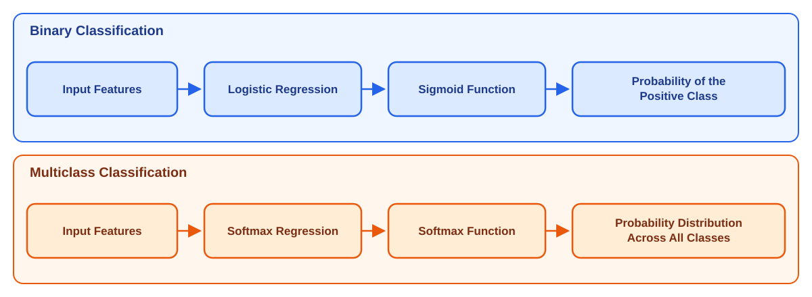
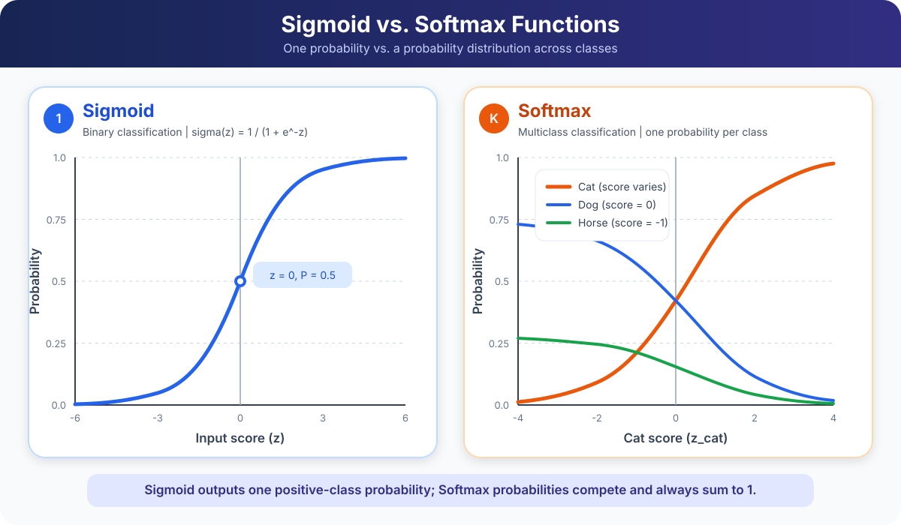

# Softmax Function and its Mathematical Derivation

The **Softmax function** is the core building block of multiclass classification. It converts a vector of raw scores — called **logits** — into a valid probability distribution over $K$ mutually exclusive classes. This document covers the definition, properties, worked numerical example, matrix form, and full mathematical derivation from first principles.

---

## Table of Contents

1. [What Is the Softmax Function?](#1-what-is-the-softmax-function)
2. [What Are Logits?](#2-what-are-logits)
3. [Binary vs. Multiclass Classification](#3-binary-vs-multiclass-classification)
4. [Softmax Formula — Full Form](#4-softmax-formula--full-form)
   - [4.1 Why the Denominator Contains All Classes](#41-why-the-denominator-contains-all-classes)
   - [4.2 Numerical Example (Cat, Dog, Horse)](#42-numerical-example-cat-dog-horse)
   - [4.3 Softmax Preserves Ranking](#43-softmax-preserves-ranking)
   - [4.4 Prediction Rule](#44-prediction-rule)
5. [Sigmoid vs. Softmax](#5-sigmoid-vs-softmax)
6. [Matrix Representation](#6-matrix-representation)
7. [Mathematical Derivation: Softmax from Log-Odds](#7-mathematical-derivation-softmax-from-log-odds)
   - [7.1 Binary Logistic Regression — Starting Point](#71-binary-logistic-regression--starting-point)
   - [7.2 Extending to Multiple Classes — Choose a Reference Class](#72-extending-to-multiple-classes--choose-a-reference-class)
   - [7.3 Exponentiate the Log-Odds](#73-exponentiate-the-log-odds)
   - [7.4 Enforce Probability Normalization](#74-enforce-probability-normalization)
   - [7.5 Write the Symmetric Softmax Formula](#75-write-the-symmetric-softmax-formula)
8. [Deriving Sigmoid as a Special Case of Softmax](#8-deriving-sigmoid-as-a-special-case-of-softmax)
9. [Key Properties Summary](#9-key-properties-summary)

---

## 1. What Is the Softmax Function?

**Softmax** takes a vector of $K$ real-valued logits and produces a probability for every class:

```math
\boxed{
\sigma(\mathbf{z})_k
= P(Y = k \mid X)
= \frac{e^{z_k}}{\displaystyle\sum_{j=1}^{K} e^{z_j}}
}
```

where:

| Symbol | Meaning |
|---|---|
| $K$ | Total number of classes |
| $z_k$ | Logit (raw score) for class $k$ |
| $e$ | Base of the natural exponential |
| $\sigma(\mathbf{z})_k$ | Probability that the input belongs to class $k$ |

Three properties hold for every input:

1. Every output is strictly between 0 and 1: $\quad 0 < \sigma(\mathbf{z})_k < 1$
2. All outputs sum to exactly 1: $\quad \displaystyle\sum_{k=1}^{K} \sigma(\mathbf{z})_k = 1$
3. Ranking is preserved: $\quad z_i > z_j \Longleftrightarrow \sigma(\mathbf{z})_i > \sigma(\mathbf{z})_j$

> [!NOTE]
> In many textbooks and documentation, the Softmax function is also denoted by
> the lowercase Greek letter **sigma** $\sigma$. The same symbol is used for
> the Sigmoid function — its meaning depends on context.

---

## 2. What Are Logits?

**Logits** are the raw numerical scores produced by a linear layer before any activation function is applied.

For a feature vector $\mathbf{x} \in \mathbb{R}^d$, the logit for class $k$ is:

```math
z_k = \mathbf{w}_k^{\top}\mathbf{x} + b_k = \sum_{i=1}^{d} w_{ki} x_i + b_k
```

where $\mathbf{w}_k$ is the weight vector and $b_k$ the bias for class $k$.

For example, with logits:

```math
\mathbf{z} =
\begin{bmatrix}
2.0 \\
1.0 \\
0.1
\end{bmatrix}
\quad
\begin{aligned}
&\leftarrow \text{Cat} \\
&\leftarrow \text{Dog} \\
&\leftarrow \text{Horse}
\end{aligned}
```

> [!WARNING]
> **Logits are neither probabilities nor final predictions.** They are
> unrestricted real numbers (positive, negative, zero, greater than 1) and
> should not be interpreted as confidence values before applying Softmax.

---

## 3. Binary vs. Multiclass Classification



The key difference:

| | Binary Classification | Multiclass Classification |
|---|---|---|
| **Activation** | Sigmoid | Softmax |
| **Classes** | 2 | $K \geq 3$ |
| **Outputs** | 1 probability | $K$ probabilities summing to 1 |
| **Loss** | Binary Cross-Entropy | Categorical Cross-Entropy |

---

## 4. Softmax Formula — Full Form

For $n$ classes and $d$ input features, compute one logit per class:

```math
\begin{aligned}
z_1 &= \mathbf{w}_1^{\top}\mathbf{x} + b_1 \\
z_2 &= \mathbf{w}_2^{\top}\mathbf{x} + b_2 \\
\vdots \\
z_n &= \mathbf{w}_n^{\top}\mathbf{x} + b_n
\end{aligned}
```

Define the shared normalisation denominator:

```math
D = e^{z_1} + e^{z_2} + \cdots + e^{z_n}
```

Then the Softmax probabilities are:

```math
\begin{aligned}
\sigma(\mathbf{z})_1 &= P(Y=1 \mid X) = \frac{e^{z_1}}{D} \\[6pt]
\sigma(\mathbf{z})_2 &= P(Y=2 \mid X) = \frac{e^{z_2}}{D} \\[6pt]
\vdots \\
\sigma(\mathbf{z})_n &= P(Y=n \mid X) = \frac{e^{z_n}}{D}
\end{aligned}
```

These form the output probability vector:

```math
\sigma(\mathbf{z})
=
\begin{bmatrix}
P(Y=1 \mid X) \\
P(Y=2 \mid X) \\
\vdots \\
P(Y=n \mid X)
\end{bmatrix},
\qquad
\sum_{k=1}^{n} P(Y=k \mid X) = 1
```

### 4.1 Why the Denominator Contains All Classes?

We first compute an unnormalised positive score for each class:

```math
s_k = e^{z_k}
```

These scores are all positive, but they do not sum to 1. For example:

```math
s = [7.389,\ 2.718,\ 1.105], \quad \text{sum} = 11.212
```

To convert them into probabilities, divide every score by the total:

```math
p_k = \frac{s_k}{\sum_j s_j} = \frac{e^{z_k}}{\sum_j e^{z_j}}
```

The denominator is simply the normalisation term that forces all probabilities to sum to 1.

### 4.2 Numerical Example (Cat, Dog, Horse)

**Logits:**

```math
z_{\text{Cat}} = 2.0, \qquad z_{\text{Dog}} = 1.0, \qquad z_{\text{Horse}} = 0.1
```

**Step 1 — Exponentiate:**

```math
e^{2.0} \approx 7.389, \qquad e^{1.0} \approx 2.718, \qquad e^{0.1} \approx 1.105
```

**Step 2 — Compute denominator:**

```math
D = 7.389 + 2.718 + 1.105 = 11.212
```

**Step 3 — Compute probabilities:**

```math
\sigma(\mathbf{z})_{\text{Cat}} = \frac{7.389}{11.212} \approx 0.659
\qquad
\sigma(\mathbf{z})_{\text{Dog}} = \frac{2.718}{11.212} \approx 0.242
\qquad
\sigma(\mathbf{z})_{\text{Horse}} = \frac{1.105}{11.212} \approx 0.099
```

**Result:**

| Class | Logit | Softmax Probability |
|---|---:|---:|
| Cat | 2.0 | 65.9% |
| Dog | 1.0 | 24.2% |
| Horse | 0.1 | 9.9% |
| **Total** | — | **100.0%** |

> [!TIP]
> The model predicts **Cat** because it has the highest Softmax probability.
> Since Softmax preserves ranking, the class with the highest logit always
> receives the highest probability.

### 4.3 Softmax Preserves Ranking

Because the exponential function is strictly increasing and all classes share the same positive denominator:

```math
z_i > z_j
\quad \Longrightarrow \quad
e^{z_i} > e^{z_j}
\quad \Longrightarrow \quad
\frac{e^{z_i}}{\sum_k e^{z_k}} > \frac{e^{z_j}}{\sum_k e^{z_k}}
\quad \Longrightarrow \quad
\sigma(\mathbf{z})_i > \sigma(\mathbf{z})_j
```

> [!IMPORTANT]
> Softmax changes logits into probabilities but does **not** change their
> order. The largest logit and the largest Softmax probability always identify
> the **same predicted class**.

### 4.4 Prediction Rule

The predicted class is the one with the highest Softmax probability:

```math
\boxed{
\hat{y}
= \arg\max_{k \in \{1,\ldots,n\}} \sigma(\mathbf{z})_k
= \arg\max_{k \in \{1,\ldots,n\}} z_k
}
```

Because ranking is preserved, both forms give the identical result.

---

## 5. Sigmoid vs. Softmax



| Feature | Sigmoid | Softmax |
|---|---|---|
| **Formula** | $\displaystyle \sigma(z) = \frac{1}{1 + e^{-z}}$ | $\displaystyle \sigma(\mathbf{z})_k = \frac{e^{z_k}}{\sum_{j=1}^{K} e^{z_j}}$ |
| **Primary use** | Binary classification | Multiclass classification |
| **Number of classes** | 2 | $K \geq 3$ |
| **Input** | One logit $z$ | A vector of logits $\mathbf{z}$ |
| **Output** | One probability for the positive class | One probability per class |
| **Sum of outputs** | Not constrained to 1 | Always sums to 1 |
| **Class relationship** | Independent | Classes compete within a shared distribution |
| **Prediction rule** | Threshold (usually 0.5) | $\arg\max$ |
| **Loss function** | Binary Cross-Entropy | Categorical Cross-Entropy |

> [!IMPORTANT]
> Use **Sigmoid** when classes are binary or independent. Use **Softmax** when
> exactly one class must be selected from several **mutually exclusive** classes.

---

## 6. Matrix Representation

For $m$ training samples, $d$ features, and $n$ classes, the entire computation is expressed in matrix form.

**Symbols:**

| Symbol | Shape | Meaning |
|---|---|---|
| $X_b$ | $m \times (d+1)$ | Bias-augmented feature matrix (first column all ones) |
| $W$ | $(d+1) \times n$ | Weight matrix (first row = biases) |
| $Z$ | $m \times n$ | Logit matrix |
| $\widehat{Y}$ | $m \times n$ | Predicted probability matrix |

**Forward pass:**

```math
\boxed{Z = X_b W}
```

**Apply Softmax row-wise** (each row is one sample's probability distribution):

```math
\boxed{
\widehat{Y} = \mathrm{Softmax}_{\text{row}}(Z),
\qquad
\widehat{Y}_{ik} = \frac{e^{Z_{ik}}}{\displaystyle\sum_{j=1}^{n} e^{Z_{ij}}}
}
```

**Single-sample example** — 1 sample, 3 features, 3 classes:

```math
X_b =
\begin{bmatrix}
1 & x_1 & x_2 & x_3
\end{bmatrix},
\qquad
W =
\begin{bmatrix}
w_{10} & w_{20} & w_{30} \\
w_{11} & w_{21} & w_{31} \\
w_{12} & w_{22} & w_{32} \\
w_{13} & w_{23} & w_{33}
\end{bmatrix}
```

```math
Z = X_b W =
\begin{bmatrix}
z_1 & z_2 & z_3
\end{bmatrix}
```

> [!IMPORTANT]
> Softmax normalisation is performed **across the class columns of each row**,
> not across different samples.

---

## 7. Mathematical Derivation: Softmax from Log-Odds

This section derives the Softmax formula from the **linear log-odds assumption** that underlies Multinomial Logistic Regression.

### 7.1 Binary Logistic Regression — Starting Point

For a binary target $y \in \{0, 1\}$, logistic regression assumes the **log-odds are linear**:

```math
\log \frac{p}{1 - p} = \mathbf{w}^{\top}\mathbf{x} + b = z
```

Exponentiating and rearranging:

```math
\frac{p}{1-p} = e^z
\qquad \Longrightarrow \qquad
p(1 + e^z) = e^z
\qquad \Longrightarrow \qquad
\boxed{p = \frac{e^z}{1 + e^z} = \frac{1}{1 + e^{-z}} = \sigma(z)}
```

This is the **Sigmoid function**, which converts the single logit $z$ into $P(Y=1 \mid X)$.

For multiple classes, assign each class an affine score $z_k = \mathbf{w}_k^{\top}\mathbf{x} + b_k$. Applying independent Sigmoid functions does **not** guarantee that outputs sum to 1. Softmax uses a **shared denominator** so all classes compete within one probability distribution.

### 7.2 Extending to Multiple Classes — Choose a Reference Class

Let class $n$ be the **reference class**. Assume every other class has linear log-odds **relative to class $n$**:

```math
\log \frac{P(Y=k \mid \mathbf{x})}{P(Y=n \mid \mathbf{x})}
= \boldsymbol{\beta}_k^{\top}\mathbf{x} + \alpha_k
= a_k,
\qquad k = 1, \ldots, n-1
```

> [!NOTE]
> This **linear log-odds assumption** is the defining property of Multinomial
> Logistic Regression. Positivity and normalization alone do not uniquely
> produce Softmax — other probability mappings can also satisfy those constraints.

### 7.3 Exponentiate the Log-Odds

Exponentiating both sides:

```math
\frac{P(Y=k \mid \mathbf{x})}{P(Y=n \mid \mathbf{x})} = e^{a_k}
\qquad \Longrightarrow \qquad
P(Y=k \mid \mathbf{x}) = P(Y=n \mid \mathbf{x}) \cdot e^{a_k}
```

### 7.4 Enforce Probability Normalization

All class probabilities must sum to 1:

```math
P(Y=n \mid \mathbf{x}) + \sum_{k=1}^{n-1} P(Y=k \mid \mathbf{x}) = 1
```

Substituting $P(Y=k \mid \mathbf{x}) = P(Y=n \mid \mathbf{x}) \cdot e^{a_k}$:

```math
P(Y=n \mid \mathbf{x})
\left(1 + \sum_{k=1}^{n-1} e^{a_k}\right) = 1
```

Therefore the reference-class probability is:

```math
\boxed{
P(Y=n \mid \mathbf{x})
= \frac{1}{1 + \displaystyle\sum_{j=1}^{n-1} e^{a_j}}
}
```

And for every non-reference class $k < n$:

```math
\boxed{
P(Y=k \mid \mathbf{x})
= \frac{e^{a_k}}{1 + \displaystyle\sum_{j=1}^{n-1} e^{a_j}}
}
```

### 7.5 Write the Symmetric Softmax Formula

Define $a_n = 0$, so $e^{a_n} = 1$. Every class now uses the same formula:

```math
P(Y=k \mid \mathbf{x})
= \frac{e^{a_k}}{\displaystyle\sum_{j=1}^{n} e^{a_j}},
\qquad k = 1, \ldots, n
```

Replacing each $a_k$ with the full affine logit $z_k = \mathbf{w}_k^{\top}\mathbf{x} + b_k$ gives the **final Softmax formula**:

```math
\boxed{
\sigma(\mathbf{z})_k
= P(Y=k \mid \mathbf{x};\, W, \mathbf{b})
= \frac{\exp(z_k)}{\displaystyle\sum_{j=1}^{n} \exp(z_j)}
= \frac{\exp(\mathbf{w}_k^{\top}\mathbf{x} + b_k)}{\displaystyle\sum_{j=1}^{n} \exp(\mathbf{w}_j^{\top}\mathbf{x} + b_j)}
}
```

> [!IMPORTANT]
> The reference-class and symmetric formulations describe the **same
> probability model**. The symmetric form is preferred for matrix operations
> because every class is handled identically.

---

## 8. Deriving Sigmoid as a Special Case of Softmax

**Softmax reduces to Sigmoid when there are exactly two classes.**

For $K = 2$, apply Softmax to class 1:

```math
P(y = 1 \mid X) = \frac{e^{z_1}}{e^{z_0} + e^{z_1}}
```

Divide numerator and denominator by $e^{z_1}$:

```math
P(y = 1 \mid X) = \frac{1}{1 + e^{z_0 - z_1}}
```

Since $z_0 - z_1 = -(z_1 - z_0)$, this is the Sigmoid function applied to the score difference:

```math
\boxed{
P(y = 1 \mid X) = \sigma(z_1 - z_0) = \frac{1}{1 + e^{-(z_1 - z_0)}}
}
```

> [!IMPORTANT]
> **Binary Logistic Regression** and **two-class Softmax Regression** are
> mathematically equivalent under the corresponding parameterisation.

---

## 9. Key Properties Summary

| Property | Statement |
|---|---|
| **Valid probability distribution** | $0 < \sigma(\mathbf{z})_k < 1$ and $\sum_k \sigma(\mathbf{z})_k = 1$ |
| **Preserves ranking** | $z_i > z_j \Leftrightarrow \sigma(\mathbf{z})_i > \sigma(\mathbf{z})_j$ |
| **Shift invariance** | $\sigma(\mathbf{z}) = \sigma(\mathbf{z} - c)$ for any constant $c$ (used for numerical stability) |
| **Reduces to Sigmoid** | For $K=2$, Softmax $\equiv$ Sigmoid applied to the logit difference |
| **Derived from log-odds** | Follows from the linear log-odds assumption + normalization |
| **Differentiable everywhere** | Enables gradient-based training (see file 02 for gradient derivation) |

> [!TIP]
> For the full Multinomial Logistic Regression pipeline — including loss
> functions, gradient derivation, regularization, and training — see
> [02 Multinomial Logistic Regression - Softmax Regression](./02%20Multinomial%20Logistic%20Regression%20-%20Softmax%20Regression.md).
