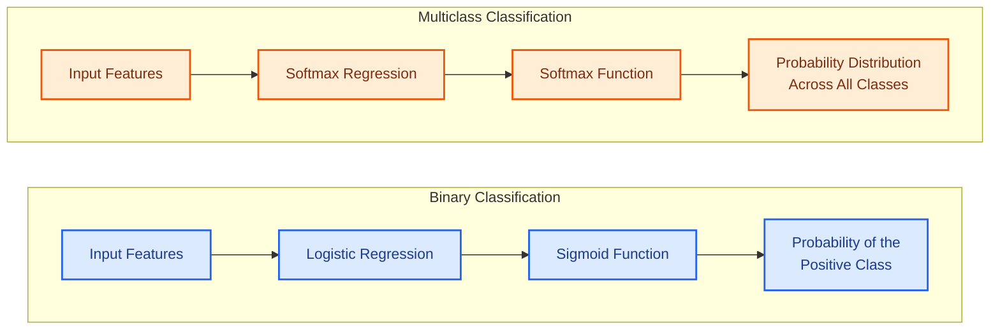
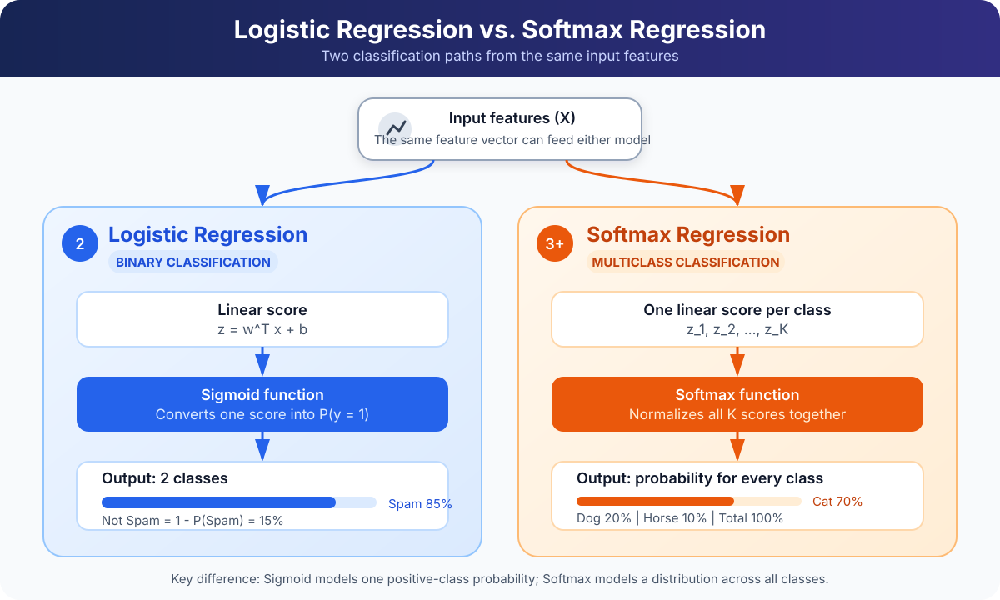

# Multinomial Logistic Regression (Softmax Regression)

- **Softmax Regression** is a generalisation of **Logistic Regression** for
  *multiclass classification*.
- It is also known as **Multinomial Logistic Regression**.
- It extends Logistic Regression from **binary classification** *(two classes)*
  to **multiclass classification** *(three or more classes)*.

> [!NOTE]
> **Softmax Regression** and **Multinomial Logistic Regression** refer to the
> same **classification algorithm**.

## Table of Contents

- [1. Logistic Regression vs. Softmax Regression](#1-logistic-regression-vs-softmax-regression)
  - [Logistic Regression (Binary Classification)](#logistic-regression-binary-classification)
- [What Is Multinomial Logistic Regression - Softmax Regression?](#what-is-multinomial-logistic-regression---softmax-regression)
- [Softmax Function](#softmax-function)
  - [What Are Logits?](#what-are-logits)
  - [Softmax Preserves Ranking](#softmax-preserves-ranking)
  - [Prediction Rule](#prediction-rule)
  - [What Is Softmax Function?](#what-is-softmax-function)
  - [Softmax Function Features](#softmax-function-features)
    - [General Formula](#general-formula)
    - [General Formula for Classes 1 to n](#general-formula-for-classes-1-to-n)
  - [Prediction Rule Using Softmax Function](#prediction-rule-using-softmax-function)
    - [Example: Three Features and Three Classes](#example-three-features-and-three-classes)
  - [Applying the Softmax Formula: Numerical Example](#applying-the-softmax-formula-numerical-example)
    - [Step 1: Apply the Exponential Function](#step-1-apply-the-exponential-function)
    - [Step 2: Calculate the Denominator](#step-2-calculate-the-denominator)
    - [Step 3: Calculate Each Class Probability](#step-3-calculate-each-class-probability)
    - [Final Result](#final-result)
- [Binary Classification vs. Multiclass Classification](#binary-classification-vs-multiclass-classification)
  - [Sigmoid vs. Softmax Graph](#sigmoid-vs-softmax-graph)
  - [Sigmoid vs. Softmax Comparison](#sigmoid-vs-softmax-comparison)
- [How Softmax Regression Works](#how-softmax-regression-works)
  - [Step 1: Compute the Logits](#step-1-compute-the-logits)
  - [Step 2: Apply the Softmax Function](#step-2-apply-the-softmax-function)
  - [Step 3: Make a Prediction](#step-3-make-a-prediction)
- [Deriving Sigmoid from Two-Class Softmax](#deriving-sigmoid-from-two-class-softmax)
  - [Important Relationship: Softmax and Sigmoid](#important-relationship-softmax-and-sigmoid)
- [Deriving Softmax from Linear Log-Odds](#deriving-softmax-from-linear-log-odds)
  - [Step 1: Starting with Binary Logistic Regression](#step-1-starting-with-binary-logistic-regression)
- [Where Does Softmax Regression Fit in Machine Learning?](#where-does-softmax-regression-fit-in-machine-learning)
- [Multiclass ROC-AUC](#multiclass-roc-auc)
  - [Can We Use ROC-AUC with Softmax Regression?](#can-we-use-roc-auc-with-softmax-regression)

---
## 1. Logistic Regression vs. Softmax Regression

The **main difference** is the number of classes they predict.

| Logistic Regression | Softmax Regression |
|---|---|
| **Binary classification** | **Multiclass classification** |
| *Two classes* | *Three or more classes* |
| Uses the **Sigmoid function** | Uses the **Softmax function** |
| Predicts the probability of the positive class | Predicts a probability for every class |

### Logistic Regression (Binary Classification)

Suppose you want to predict whether an email is:

- **Spam (1)**
- **Not Spam (0)**

**Logistic Regression** uses the **Sigmoid function**:

\[
\sigma(z) = \frac{1}{1 + e^{-z}}
\]

**Example output:**

| Class | Probability |
|---|---:|
| Spam | 0.85 |
| Not Spam | 0.15 |

---

## What Is Multinomial Logistic Regression - Softmax Regression?
- **Multinomial logistic regression is a probabilistic classifier for mutually exclusive classes.** 
- It generalizes binary logistic regression to a target with $K$ possible categories. 
- Its usual machine learning name is **softmax regression**.

- **Algorithm type:** A *supervised machine learning* algorithm.
- **Purpose:** Solves classification problems with **three or more classes**.
- **Class relationship:** The target classes are **mutually exclusive**, meaning each input belongs to only one class.
- **Model output:** A probability for every possible class.

## Softmax Function

**Softmax Regression**:

- Calculates a **score for each class**.
- Converts all class scores into a **probability distribution**.
- Ensures that all class probabilities **sum to 1**.

The **Softmax formula** is:

\[
\boxed{
\sigma(\mathbf{z})_k = P(Y = k \mid X) = \frac{e^{z_k}}{\sum_{j=1}^{K} e^{z_j}}
}
\]

where:

- **\(K\):** Number of classes.
- **\(z_k\):** Score for class \(k\) or Logits (raw model output before applying Softmax).
- **\(e\):** Exponential function.

> [!NOTE]
> In many *textbooks and documentation*, the **Softmax function** is also
> denoted by the lowercase Greek letter **sigma** \(\sigma\). The
> **probability for class \(k\)** may therefore be written as:
>
> \[
> \sigma(\mathbf{z})_k
> = \frac{e^{z_k}}{\sum_{j=1}^{K} e^{z_j}}.
> \]
>
> The symbol \(\sigma\) is also commonly used for the **Sigmoid function**, so
> its meaning *depends on context*. Do not confuse lowercase \(\sigma\), used
> here as a **function name**, with \(\sum\), the **summation symbol**.

### What Are Logits?

- **Logits** are the ***raw numerical scores produced by a model.***
- Logits are **not probabilities** and are **not final class predictions**.
- The **Softmax function** transforms logits into class probabilities.
- The model applies \(\arg\max\) to select the class with the highest
  probability as the **final prediction**.

For example, suppose the model produces the following logits:

\[
\mathbf{z} =
\begin{bmatrix}
2.0 \\
1.0 \\
0.1
\end{bmatrix}
\]

Each logit represents the model's score for one class:

- **Cat:** \(2.0\)
- **Dog:** \(1.0\)
- **Horse:** \(0.1\)

> [!WARNING]
> **Logits are neither probabilities nor final predictions.** They are
> *unrestricted scores* and should not be interpreted as **confidence values**
> before applying **Softmax**.

> [!NOTE]
> Softmax preserves the order of the logits, so
> \(\arg\max_k z_k = \arg\max_k \sigma(\mathbf{z})_k\). Therefore, the largest
> logit identifies the same winning class as the largest Softmax probability,
> but the logit itself remains a **score**, not a probability or prediction.

Unlike probabilities, logits can be:

- **Positive**
- **Negative**
- **Zero**
- **Greater than 1**

The **Softmax function** transforms these logits into a valid probability
distribution in which:

- Every probability is between **0 and 1**.
- The probabilities of all classes **sum to 1**.
- The class with the highest logit receives the highest probability.

### Softmax Preserves Ranking

Softmax preserves the ranking of the logits. If:

\[
z_1 > z_2 > z_3,
\]

then the corresponding Softmax probabilities satisfy:

\[
\sigma(\mathbf{z})_1
>
\sigma(\mathbf{z})_2
>
\sigma(\mathbf{z})_3,
\]

where \(\sigma(\mathbf{z})_k = P(Y = k \mid X)\) is the Softmax probability
for class \(k\).

This happens because the exponential function is strictly increasing and every
class probability uses the same positive denominator:

\[
z_i > z_j
\quad \Longrightarrow \quad
e^{z_i} > e^{z_j}
\quad \Longrightarrow \quad
\sigma(\mathbf{z})_i
= \frac{e^{z_i}}{\sum_{k=1}^{n} e^{z_k}}
>
\frac{e^{z_j}}{\sum_{k=1}^{n} e^{z_k}}
= \sigma(\mathbf{z})_j.
\]

> [!IMPORTANT]
> Softmax changes the logits into probabilities, but it does **not** change
> their order. Therefore, the largest logit and the largest Softmax probability
> identify the same predicted class.

### Prediction Rule

Mathematically, the predicted class is:

\[
\hat{y}
= \arg\max_k P(Y = k \mid X)
= \arg\max_k \sigma(\mathbf{z})_k
\]

where:

- **\(X\):** Input features.
- **\(Y\):** Target class.
- **\(k\):** Class index.
- **\(P(Y = k \mid X)\):** Probability that the input belongs to class \(k\).
- **\(\sigma(\mathbf{z})_k\):** Alternative notation for
  \(P(Y = k \mid X)\), representing the Softmax probability of class \(k\).
- **\(\arg\max\):** Operation that returns the class with the highest
  probability.

For example, suppose we want to classify an image as a **cat**, **dog**, or **horse**:

- **Input:** An image represented by numerical features.
- **Output:** The probability that the image belongs to each class.

**Example output:**

| Class | Predicted Probability |
|---|---:|
| Cat | 0.70 |
| Dog | 0.20 |
| Horse | 0.10 |
| **Total** | **1.00** |

- **Final prediction:** The model selects **Cat** because it has the highest probability.

✦ ✦ ✦

### What is Softmax Function

**Softmax Regression**:

- Calculates a **score for each class**.
- Converts all class scores into a **probability distribution**.
- Ensures that all class probabilities **sum to 1**.

The **Softmax formula** is:

\[
\boxed{
\sigma(\mathbf{z})_k
= P(Y = k \mid X)
= \frac{e^{z_k}}{\sum_{j=1}^{K} e^{z_j}}
}
\]

where:

- **\(K\):** Number of classes.
- **\(z_k\):** Score for class \(k\) or Logits (raw model output before applying Softmax).
- **\(e\):** Exponential function.

### Softmax function Features

The number of **input features** determines how each class logit is calculated.
For class \(k\), the general logit formula is:

\[
z_k = \sum_{i=1}^{d} w_{ki}x_i + b_k
\]

where:

- **\(d\):** Number of input features.
- **\(x_i\):** Value of input feature \(i\).
- **\(w_{ki}\):** Weight connecting feature \(i\) to class \(k\).
- **\(b_k\):** Bias for class \(k\).
- **\(z_k\):** Resulting logit for class \(k\).

The logit expands as follows from one feature to an arbitrary number \(d\) of
features:

| Number of Features | Input Vector | Logit for Class \(k\) |
|---:|---|---|
| 1 | \(X = [x_1]\) | \(z_k = w_{k1}x_1 + b_k\) |
| 2 | \(X = [x_1, x_2]\) | \(z_k = w_{k1}x_1 + w_{k2}x_2 + b_k\) |
| 3 | \(X = [x_1, x_2, x_3]\) | \(z_k = w_{k1}x_1 + w_{k2}x_2 + w_{k3}x_3 + b_k\) |
| \(\vdots\) | \(\vdots\) | \(\vdots\) |
| \(d\) | \(X = [x_1, x_2, \ldots, x_d]\) | \(z_k = w_{k1}x_1 + w_{k2}x_2 + \cdots + w_{kd}x_d + b_k = \sum_{i=1}^{d} w_{ki}x_i + b_k\) |

> [!NOTE]
> Here, \(d\) represents the **number of input features**, while \(n\) represents
> the **number of classes** elsewhere in this lesson. Using different symbols
> prevents the two quantities from being confused.

After calculating one logit for each class, Softmax converts the logits into
probabilities:

\[
\sigma(\mathbf{z})_k
= P(Y = k \mid X)
= \frac{e^{z_k}}{\sum_{j=1}^{K} e^{z_j}}
\]

#### General Formula

For \(d\) input features and \(K\) classes, define:

\[
\mathbf{x} \in \mathbb{R}^{d}, \qquad
W \in \mathbb{R}^{K \times d}, \qquad
\mathbf{b} \in \mathbb{R}^{K}.
\]

The model calculates all \(K\) logits simultaneously:

\[
\boxed{\mathbf{z} = W\mathbf{x} + \mathbf{b}}
\]

The \(k\)-th logit and its corresponding Softmax probability are:

\[
\boxed{
z_k = \mathbf{w}_k^{\top}\mathbf{x} + b_k
\qquad \Longrightarrow \qquad
\sigma(\mathbf{z})_k
= P(Y = k \mid X)
= \frac{e^{z_k}}{\sum_{j=1}^{K} e^{z_j}}
}
\]

Therefore, the complete Softmax output vector is:

\[
\boxed{
\operatorname{Softmax}(\mathbf{z})
=
\begin{bmatrix}
\dfrac{e^{z_1}}{\sum_{j=1}^{K} e^{z_j}} \\
\dfrac{e^{z_2}}{\sum_{j=1}^{K} e^{z_j}} \\
\vdots \\
\dfrac{e^{z_K}}{\sum_{j=1}^{K} e^{z_j}}
\end{bmatrix}
}
\]

#### General Formula for Classes 1 to n

For \(n\) classes and \(d\) input features, the model calculates one logit for
each class:

\[
\begin{aligned}
z_1 &= \sum_{i=1}^{d} w_{1i}x_i + b_1
     = \mathbf{w}_1^{\top}\mathbf{x} + b_1, \\
z_2 &= \sum_{i=1}^{d} w_{2i}x_i + b_2
     = \mathbf{w}_2^{\top}\mathbf{x} + b_2, \\
z_3 &= \sum_{i=1}^{d} w_{3i}x_i + b_3
     = \mathbf{w}_3^{\top}\mathbf{x} + b_3. \\
\vdots \\
z_n &= \sum_{i=1}^{d} w_{ni}x_i + b_n
     = \mathbf{w}_n^{\top}\mathbf{x} + b_n.
\end{aligned}
\]

The shared Softmax denominator is:

\[
D = e^{z_1} + e^{z_2} + \dots + e^{z_n}.
\]

> [!NOTE]
> Using the **Softmax function**, we convert the logits
> \(z_1, z_2, \ldots, z_n\) into a **probability distribution** over all \(n\)
> classes.

\[
\begin{aligned}
\sigma(\mathbf{z})_1
&= P(Y = 1 \mid X)
 = \frac{e^{z_1}}{D}
 = \frac{e^{z_1}}{e^{z_1} + e^{z_2} + \dots + e^{z_n}}, \\[6pt]
\sigma(\mathbf{z})_2
&= P(Y = 2 \mid X)
 = \frac{e^{z_2}}{D}
 = \frac{e^{z_2}}{e^{z_1} + e^{z_2} + \dots + e^{z_n}}, \\[6pt]
\sigma(\mathbf{z})_3
&= P(Y = 3 \mid X)
 = \frac{e^{z_3}}{D}
 = \frac{e^{z_3}}{e^{z_1} + e^{z_2} + \dots + e^{z_n}}, \\
\vdots \\
\sigma(\mathbf{z})_n
&= P(Y = n \mid X)
 = \frac{e^{z_n}}{D}
 = \frac{e^{z_n}}{e^{z_1} + e^{z_2} + \dots + e^{z_n}}.
\end{aligned}
\]

The n probabilities form the output vector:

\[
\sigma(\mathbf{z}) = \operatorname{Softmax}(\mathbf{z})
=
\begin{bmatrix}
P(Y = 1 \mid X) \\
P(Y = 2 \mid X) \\
P(Y = 3 \mid X) \\
\vdots \\
P(Y = n \mid X)
\end{bmatrix},
\qquad
\sum_{k=1}^{n} P(Y = k \mid X) = 1.
\]

> [!NOTE]
> **Softmax preserves ranking.** For any two classes \(i\) and \(j\):
>
> \[
> z_i > z_j
> \quad \Longleftrightarrow \quad
> \sigma(\mathbf{z})_i > \sigma(\mathbf{z})_j.
> \]
>
> Therefore, applying Softmax changes the logits into probabilities but does
> **not** change their order.

### Prediction Rule using Softmax Function

For \(n\) classes, the model predicts the class with the highest Softmax
probability:

\[
\boxed{
\hat{y}
= \arg\max_{k \in \{1,2,\ldots,n\}} P(Y = k \mid X)
= \arg\max_{k \in \{1,2,\ldots,n\}} \sigma(\mathbf{z})_k
}
\]

Because Softmax preserves the ordering of the logits, the same class can be
selected directly from the logits:

\[
\boxed{
\hat{y}
= \arg\max_{k \in \{1,2,\ldots,n\}} z_k
}
\]

where:

- **\(X\):** Input features.
- **\(Y\):** Target class.
- **\(k\):** Class index, from \(1\) to \(n\).
- **\(n\):** Total number of classes.
- **\(z_k\):** Logit for class \(k\).
- **\(\sigma(\mathbf{z})_k\):** Softmax probability for class \(k\).
- **\(P(Y = k \mid X)\):** Probability that the input belongs to class \(k\).
- **\(\arg\max\):** Operation that returns the class index with the largest
  value.

> [!IMPORTANT]
> A **logit is not a prediction or probability**. However, the largest logit
> and the largest Softmax probability identify the same predicted class.

✦ ✦ ✦

#### Example: Three Features and Three Classes

Suppose the input is \(X = [x_1, x_2, x_3]\), and the possible classes are
**Cat**, **Dog**, and **Horse**. The model calculates:

\[
\begin{aligned}
z_{\text{Cat}} &= w_{\text{Cat},1}x_1 + w_{\text{Cat},2}x_2
                  + w_{\text{Cat},3}x_3 + b_{\text{Cat}} \\
z_{\text{Dog}} &= w_{\text{Dog},1}x_1 + w_{\text{Dog},2}x_2
                  + w_{\text{Dog},3}x_3 + b_{\text{Dog}} \\
z_{\text{Horse}} &= w_{\text{Horse},1}x_1 + w_{\text{Horse},2}x_2
                    + w_{\text{Horse},3}x_3 + b_{\text{Horse}}
\end{aligned}
\]

Let

\[
D = e^{z_{\text{Cat}}} + e^{z_{\text{Dog}}} + e^{z_{\text{Horse}}}.
\]

The corresponding Softmax probabilities are:

\[
\sigma(\mathbf{z})_{\text{Cat}} = P(\text{Cat} \mid X)
= \frac{e^{z_{\text{Cat}}}}{D}, \qquad
\sigma(\mathbf{z})_{\text{Dog}} = P(\text{Dog} \mid X)
= \frac{e^{z_{\text{Dog}}}}{D}, \qquad
\sigma(\mathbf{z})_{\text{Horse}} = P(\text{Horse} \mid X)
= \frac{e^{z_{\text{Horse}}}}{D}.
\]

Replacing \(D\) with its full value:

\[
\begin{aligned}
\sigma(\mathbf{z})_{\text{Cat}}
&= P(\text{Cat} \mid X)
 = \frac{e^{z_{\text{Cat}}}}
{e^{z_{\text{Cat}}} + e^{z_{\text{Dog}}} + e^{z_{\text{Horse}}}}, \\[6pt]
\sigma(\mathbf{z})_{\text{Dog}}
&= P(\text{Dog} \mid X)
 = \frac{e^{z_{\text{Dog}}}}
{e^{z_{\text{Cat}}} + e^{z_{\text{Dog}}} + e^{z_{\text{Horse}}}}, \\[6pt]
\sigma(\mathbf{z})_{\text{Horse}}
&= P(\text{Horse} \mid X)
 = \frac{e^{z_{\text{Horse}}}}
{e^{z_{\text{Cat}}} + e^{z_{\text{Dog}}} + e^{z_{\text{Horse}}}}.
\end{aligned}
\]

> [!IMPORTANT]
> The number of **features** and the number of **classes** are different:
> **features** are used to calculate each **logit**, while **classes** determine
> how many **logits and Softmax probabilities** the model produces.

### Applying the Softmax Formula: Numerical Example

Consider the logits from the previous example:

\[
z_1 = 2.0, \qquad z_2 = 1.0, \qquad z_3 = 0.1
\]

#### Step 1: Apply the Exponential Function

- Calculate the exponential of each logit:

\[
e^{z_1} = e^{2.0} \approx 7.389
\]

\[
e^{z_2} = e^{1.0} \approx 2.718
\]

\[
e^{z_3} = e^{0.1} \approx 1.105
\]

#### Step 2: Calculate the Denominator
- Add all the exponential values:

\[
\begin{aligned}
D &= e^{z_1} + e^{z_2} + e^{z_3} \\
  &= 7.389 + 2.718 + 1.105 \\
  &= 11.212
\end{aligned}
\]

#### Step 3: Calculate Each Class Probability
**Cat:**

\[
\sigma(\mathbf{z})_{\text{Cat}} = P(\text{Cat} \mid X)
= \frac{7.389}{11.212}
\approx 0.659
\]

**Dog:**
\[
\sigma(\mathbf{z})_{\text{Dog}} = P(\text{Dog} \mid X)
= \frac{2.718}{11.212}
\approx 0.242
\]

**Horse:**
\[
\sigma(\mathbf{z})_{\text{Horse}} = P(\text{Horse} \mid X)
= \frac{1.105}{11.212}
\approx 0.099
\]

#### Final Result
| Class | Logit | Softmax Probability |
|---|---:|---:|
| Cat | 2.0 | 65.9% |
| Dog | 1.0 | 24.2% |
| Horse | 0.1 | 9.9% |
| **Total** | — | **100.0%** |

> [!TIP]
> The model predicts **Cat** because it has the **highest Softmax probability**.
> *Softmax preserves score order*, so the class with the **highest logit** also
> has the **highest probability**.

---
## Binary Classification vs. Multiclass Classification

### Sigmoid vs. Softmax Graph

### Sigmoid vs. Softmax Comparison

| Feature | Sigmoid Function | Softmax Function |
|---|---|---|
| **Formula** | \(\displaystyle \sigma(z) = \frac{1}{1 + e^{-z}}\) | \(\displaystyle \sigma(\mathbf{z})_k = P(Y = k \mid X) = \frac{e^{z_k}}{\sum_{j=1}^{K} e^{z_j}}\) |
| **Primary use** | Binary classification | Multiclass classification |
| **Number of classes** | Usually two classes | Three or more mutually exclusive classes |
| **Input** | One logit \(z\) | A vector of logits \(z_1, z_2, \ldots, z_K\) |
| **Output** | One probability for the positive class | One probability for every class |
| **Probability range** | Each output is between \(0\) and \(1\) | Every output is between \(0\) and \(1\) |
| **Sum of outputs** | Not inherently constrained across multiple Sigmoid outputs | All class probabilities sum to \(1\) |
| **Class relationship** | Outputs can be treated independently | Class probabilities compete with one another |
| **Prediction rule** | Apply a threshold, commonly \(0.5\) | Select the class with the highest probability using \(\arg\max\) |
| **Typical loss function** | Binary Cross-Entropy | Categorical Cross-Entropy |

> [!IMPORTANT]
> Use **Sigmoid** when classes are *binary or independent*. Use **Softmax** when
> exactly **one class** must be selected from several *mutually exclusive
> classes*.

---
## How Softmax Regression Works

**Softmax Regression** processes an input in **three main steps**:

### Step 1: Compute the Logits

- **Input:** A feature vector \(\mathbf{x}\in\mathbb{R}^{d}\).
- **Operation:** Calculate one *raw score*, or **logit**, for each class
  \(k\in\{1,2,\ldots,n\}\).
- **Class-specific formula:**

\[
z_k
= \mathbf{w}_k^{\top}\mathbf{x}+b_k
= \sum_{i=1}^{d}w_{ki}x_i+b_k.
\]

- **Vectorized calculation:** Compute all \(n\) logits *simultaneously*:

\[
\mathbf{z}=W\mathbf{x}+\mathbf{b}.
\]

### Step 2: Apply the Softmax Function

- **Exponentiate:** Apply the exponential function to each logit.
- **Normalize:** Divide each exponentiated logit by the sum of all
  exponentiated logits.
- **Result:** Produce one **probability for each class**:

\[
\sigma(\mathbf{z})_k
=P(Y=k\mid X)
=\frac{e^{z_k}}{\sum_{j=1}^{n}e^{z_j}}.
\]

- **Probability properties:** Every probability is between \(0\) and \(1\),
  and all class probabilities sum to \(1\):

\[
0<\sigma(\mathbf{z})_k<1,
\qquad
\sum_{k=1}^{n}\sigma(\mathbf{z})_k=1.
\]

### Step 3: Make a Prediction

- **Selection rule:** Choose the class with the **highest Softmax
  probability**:

\[
\hat{y}
=\arg\max_{k\in\{1,2,\ldots,n\}}\sigma(\mathbf{z})_k
=\arg\max_{k\in\{1,2,\ldots,n\}}P(Y=k\mid X).
\]

- **Equivalent rule:** Because **Softmax preserves ranking**, the prediction
  can also be selected directly from the logits:

\[
\hat{y}
=\arg\max_{k\in\{1,2,\ldots,n\}}z_k.
\]

---
## Deriving Sigmoid from Two-Class Softmax

To show how **Sigmoid** arises from **Softmax**, start with the Softmax
probability for one class in a two-class problem.

### Important Relationship: Softmax and Sigmoid

**Softmax** can be reduced to **Sigmoid** when there are exactly *two classes*.

For two classes:

\[
P(y = 1 \mid X) = \frac{e^{z_1}}{e^{z_0} + e^{z_1}}
\]

Dividing the numerator and denominator by \(e^{z_1}\):

\[
P(y = 1 \mid X) = \frac{1}{1 + e^{z_0-z_1}}
\]

Since \(z_0-z_1=-(z_1-z_0)\), this is the **Sigmoid function** applied to the
difference between the two class scores:

\[
P(y = 1 \mid X)
= \sigma(z_1-z_0).
\]

> [!IMPORTANT]
> **Binary Logistic Regression** and **two-class Softmax Regression** are
> *mathematically equivalent* under the corresponding parameterisation.

---
## Deriving softmax from linear log-odds
### Step 1: Starting with binary logistic regression

For a binary target $y\in\{0,1\}$, logistic regression assumes that the log-odds are linear:

$$
\log\frac{p}{1-p}=\mathbf{w}^\top\mathbf{x}+b=z.
$$

Exponentiating and rearranging,

$$
\frac{p}{1-p}=e^z,
\qquad p=e^z(1-p),
\qquad p(1+e^z)=e^z.
$$

Therefore,

$$
\boxed{p=\frac{e^z}{1+e^z}=\frac{1}{1+e^{-z}}=\sigma(z).}
$$

For multiple classes, assign each class an affine score:

$$
z_k=\mathbf{w}_k^\top\mathbf{x}+b_k.
$$

A score is a real number, not yet a probability. Applying separate sigmoid functions does not generally give outputs that sum to one. Softmax uses a **shared denominator** so all classes compete within a single probability distribution.

---
## Where Does Softmax Regression Fit in Machine Learning?

---
## Multiclass ROC-AUC

**ROC-AUC** can also evaluate the performance of a Softmax Regression model.

> [!NOTE]
> **Multiclass ROC-AUC** requires a strategy such as **One-vs-Rest (OvR)** or
> **One-vs-One (OvO)** because a standard ROC curve compares *two classes*.

### Can We Use ROC-AUC with Softmax Regression?

**Yes.** For *multiclass classification*, we commonly use:

- **One-vs-Rest (OvR)**
- **One-vs-One (OvO)**

For example, with Cat, Dog, and Horse, OvR evaluates:

1. Cat vs. (Dog + Horse)
2. Dog vs. (Cat + Horse)
3. Horse vs. (Cat + Dog)

- Calculate an individual **ROC-AUC value** for each comparison.
- Aggregate the results using **macro averaging** or **weighted averaging**.
