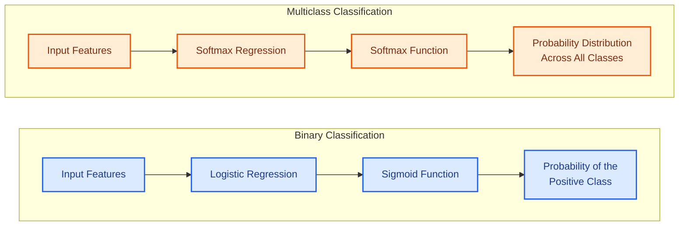

# Multinomial Logistic Regression (Softmax Regression)

- **Softmax Regression** is a generalisation of **Logistic Regression** for
  *multiclass classification*.
- It is also known as **Multinomial Logistic Regression**.
- It extends Logistic Regression from **binary classification** *(two classes)*
  to **multiclass classification** *(three or more classes)*.

> [!NOTE]
> **Softmax Regression** and **Multinomial Logistic Regression** refer to the
> same **classification algorithm**.

## Table of Contents

- **[1. Logistic Regression vs. Softmax Regression](#1-logistic-regression-vs-softmax-regression)**
  - [Logistic Regression (Binary Classification)](#logistic-regression-binary-classification)
- **[What Is Multinomial Logistic Regression - Softmax Regression?](#what-is-multinomial-logistic-regression---softmax-regression)**
- **[Softmax Function](#softmax-function)**
  - [What Are Logits?](#what-are-logits)
  - [Softmax Preserves Ranking](#softmax-preserves-ranking)
  - [Prediction Rule](#prediction-rule)
  - [What Is Softmax Function?](#what-is-softmax-function)
  - [Softmax Function Features](#softmax-function-features)
    - [General Formula](#general-formula)
    - [General Formula for Classes 1 to n](#general-formula-for-classes-1-to-n)
  - [Prediction Rule Using Softmax Function](#prediction-rule-using-softmax-function)
    - [Example: Three Features and Three Classes](#example-three-features-and-three-classes)
  - [Applying the Softmax Formula: Numerical Example](#applying-the-softmax-formula-numerical-example)
    - [Step 1: Apply the Exponential Function](#step-1-apply-the-exponential-function)
    - [Step 2: Calculate the Denominator](#step-2-calculate-the-denominator)
    - [Step 3: Calculate Each Class Probability](#step-3-calculate-each-class-probability)
    - [Final Result](#final-result)
- **[Matrix Representation of the Softmax Function and Softmax Regression](#matrix-representation-of-the-softmax-function-and-softmax-regression)**
  - [Matrix Dimensions](#matrix-dimensions)
  - [Single-Sample Example](#single-sample-example)
  - [Probability Matrix](#probability-matrix)
- **[Binary Classification vs. Multiclass Classification](#binary-classification-vs-multiclass-classification)**
  - [Sigmoid vs. Softmax Graph](#sigmoid-vs-softmax-graph)
  - [Sigmoid vs. Softmax Comparison](#sigmoid-vs-softmax-comparison)
- **[How Softmax Regression Works](#how-softmax-regression-works)**
  - [Softmax Regression Pipeline](#softmax-regression-pipeline)
  - [Step 1: Compute the Logits](#step-1-compute-the-logits)
  - [Step 2: Apply the Softmax Function](#step-2-apply-the-softmax-function)
  - [Step 3: Make a Prediction](#step-3-make-a-prediction)
- **[Deriving Sigmoid from Two-Class Softmax](#deriving-sigmoid-from-two-class-softmax)**
  - [Important Relationship: Softmax and Sigmoid](#important-relationship-softmax-and-sigmoid)
- **[Loss Functions: Binary and Categorical Cross-Entropy](#loss-functions-binary-and-categorical-cross-entropy)**
  - [Binary Logistic Regression Loss](#binary-logistic-regression-loss)
  - [Softmax Log-Loss / Categorical Cross-Entropy / Multiclass Log Loss](#softmax-log-loss--categorical-cross-entropy--multiclass-log-loss)
    - [Dataset-Level Example with Three Samples](#dataset-level-example-with-three-samples)
      - [Step 1: Calculate the Logits](#step-1-calculate-the-logits)
      - [Step 2: Apply Softmax Row-Wise](#step-2-apply-softmax-row-wise)
- **[Deriving Softmax from Linear Log-Odds](#deriving-softmax-from-linear-log-odds)**
  - [Step 1: Starting with Binary Logistic Regression](#step-1-starting-with-binary-logistic-regression)
  - [Step 2: Derive Softmax from Linear Log-Odds](#step-2-derive-softmax-from-linear-log-odds)
    - [Choose a Reference Class](#choose-a-reference-class)
    - [Exponentiate the Log-Odds](#exponentiate-the-log-odds)
    - [Enforce Probability Normalization](#enforce-probability-normalization)
    - [Write the Symmetric Softmax Formula](#write-the-symmetric-softmax-formula)
- **[Deriving Categorical Cross-Entropy from Maximum Likelihood Estimation](#deriving-categorical-cross-entropy-from-maximum-likelihood-estimation)**
  - [Likelihood of One Training Example](#likelihood-of-one-training-example)
  - [Likelihood of the Dataset](#likelihood-of-the-dataset)
    - [Numerical Likelihood Example](#numerical-likelihood-example)
  - [From Log-Likelihood to Cross-Entropy](#from-log-likelihood-to-cross-entropy)
    - [Log-Likelihood (Maximize)](#log-likelihood-maximize)
    - [Categorical Cross-Entropy (Minimize)](#categorical-cross-entropy-minimize)
  - [How the True-Class Probability Affects Loss](#how-the-true-class-probability-affects-loss)
  - [Expressing Cross-Entropy in Terms of Logits](#expressing-cross-entropy-in-terms-of-logits)
  - [Information-Theoretic Interpretation](#information-theoretic-interpretation)
  - [Derivation Summary](#derivation-summary)
- **[Where Does Softmax Regression Fit in Machine Learning?](#where-does-softmax-regression-fit-in-machine-learning)**
- **[Multiclass ROC-AUC](#multiclass-roc-auc)**
  - [Can We Use ROC-AUC with Softmax Regression?](#can-we-use-roc-auc-with-softmax-regression)

---
## 1. Logistic Regression vs. Softmax Regression

The **main difference** is the number of classes they predict.

| Logistic Regression | Softmax Regression |
|---|---|
| **Binary classification** | **Multiclass classification** |
| *Two classes* | *Three or more classes* |
| Uses the **Sigmoid function** | Uses the **Softmax function** |
| Predicts the probability of the positive class | Predicts a probability for every class |

### Logistic Regression (Binary Classification)

Suppose you want to predict whether an email is:

- **Spam (1)**
- **Not Spam (0)**

**Logistic Regression** uses the **Sigmoid function**:

\[
\sigma(z) = \frac{1}{1 + e^{-z}}
\]

**Example output:**

| Class | Probability |
|---|---:|
| Spam | 0.85 |
| Not Spam | 0.15 |

---

## What Is Multinomial Logistic Regression - Softmax Regression?
- **Multinomial logistic regression is a probabilistic classifier for mutually exclusive classes.** 
- It generalizes binary logistic regression to a target with $K$ possible categories. 
- Its usual machine learning name is **softmax regression**.

- **Algorithm type:** A *supervised machine learning* algorithm.
- **Purpose:** Solves classification problems with **three or more classes**.
- **Class relationship:** The target classes are **mutually exclusive**, meaning each input belongs to only one class.
- **Model output:** A probability for every possible class.

## Softmax Function

**Softmax Regression**:

- Calculates a **score for each class**.
- Converts all class scores into a **probability distribution**.
- Ensures that all class probabilities **sum to 1**.

The **Softmax formula** is:

\[
\boxed{
\sigma(\mathbf{z})_k = P(Y = k \mid X) = \frac{e^{z_k}}{\sum_{j=1}^{K} e^{z_j}}
}
\]

where:

- **\(K\):** Number of classes.
- **\(z_k\):** Score for class \(k\) or Logits (raw model output before applying Softmax).
- **\(e\):** Exponential function.

> [!NOTE]
> In many *textbooks and documentation*, the **Softmax function** is also
> denoted by the lowercase Greek letter **sigma** \(\sigma\). The
> **probability for class \(k\)** may therefore be written as:
>
> \[
> \sigma(\mathbf{z})_k
> = \frac{e^{z_k}}{\sum_{j=1}^{K} e^{z_j}}.
> \]
>
> The symbol \(\sigma\) is also commonly used for the **Sigmoid function**, so
> its meaning *depends on context*. Do not confuse lowercase \(\sigma\), used
> here as a **function name**, with \(\sum\), the **summation symbol**.

### What Are Logits?

- **Logits** are the ***raw numerical scores produced by a model.***
- Logits are **not probabilities** and are **not final class predictions**.
- The **Softmax function** transforms logits into class probabilities.
- The model applies \(\arg\max\) to select the class with the highest
  probability as the **final prediction**.

For example, suppose the model produces the following logits:

\[
\mathbf{z} =
\begin{bmatrix}
2.0 \\
1.0 \\
0.1
\end{bmatrix}
\]

Each logit represents the model's score for one class:

- **Cat:** \(2.0\)
- **Dog:** \(1.0\)
- **Horse:** \(0.1\)

> [!WARNING]
> **Logits are neither probabilities nor final predictions.** They are
> *unrestricted scores* and should not be interpreted as **confidence values**
> before applying **Softmax**.

> [!NOTE]
> Softmax preserves the order of the logits, so
> \(\arg\max_k z_k = \arg\max_k \sigma(\mathbf{z})_k\). Therefore, the largest
> logit identifies the same winning class as the largest Softmax probability,
> but the logit itself remains a **score**, not a probability or prediction.

Unlike probabilities, logits can be:

- **Positive**
- **Negative**
- **Zero**
- **Greater than 1**

The **Softmax function** transforms these logits into a valid probability
distribution in which:

- Every probability is between **0 and 1**.
- The probabilities of all classes **sum to 1**.
- The class with the highest logit receives the highest probability.

### Softmax Preserves Ranking

Softmax preserves the ranking of the logits. If:

\[
z_1 > z_2 > z_3,
\]

then the corresponding Softmax probabilities satisfy:

\[
\sigma(\mathbf{z})_1
>
\sigma(\mathbf{z})_2
>
\sigma(\mathbf{z})_3,
\]

where \(\sigma(\mathbf{z})_k = P(Y = k \mid X)\) is the Softmax probability
for class \(k\).

This happens because the exponential function is strictly increasing and every
class probability uses the same positive denominator:

\[
z_i > z_j
\quad \Longrightarrow \quad
e^{z_i} > e^{z_j}
\quad \Longrightarrow \quad
\sigma(\mathbf{z})_i
= \frac{e^{z_i}}{\sum_{k=1}^{n} e^{z_k}}
>
\frac{e^{z_j}}{\sum_{k=1}^{n} e^{z_k}}
= \sigma(\mathbf{z})_j.
\]

> [!IMPORTANT]
> Softmax changes the logits into probabilities, but it does **not** change
> their order. Therefore, the largest logit and the largest Softmax probability
> identify the same predicted class.

### Prediction Rule

Mathematically, the predicted class is:

\[
\hat{y}
= \arg\max_k P(Y = k \mid X)
= \arg\max_k \sigma(\mathbf{z})_k
\]

where:

- **\(X\):** Input features.
- **\(Y\):** Target class.
- **\(k\):** Class index.
- **\(P(Y = k \mid X)\):** Probability that the input belongs to class \(k\).
- **\(\sigma(\mathbf{z})_k\):** Alternative notation for
  \(P(Y = k \mid X)\), representing the Softmax probability of class \(k\).
- **\(\arg\max\):** Operation that returns the class with the highest
  probability.

For example, suppose we want to classify an image as a **cat**, **dog**, or **horse**:

- **Input:** An image represented by numerical features.
- **Output:** The probability that the image belongs to each class.

**Example output:**

| Class | Predicted Probability |
|---|---:|
| Cat | 0.70 |
| Dog | 0.20 |
| Horse | 0.10 |
| **Total** | **1.00** |

- **Final prediction:** The model selects **Cat** because it has the highest probability.

✦ ✦ ✦

### What is Softmax Function

**Softmax Regression**:

- Calculates a **score for each class**.
- Converts all class scores into a **probability distribution**.
- Ensures that all class probabilities **sum to 1**.

The **Softmax formula** is:

\[
\boxed{
\sigma(\mathbf{z})_k
= P(Y = k \mid X)
= \frac{e^{z_k}}{\sum_{j=1}^{K} e^{z_j}}
}
\]

where:

- **\(K\):** Number of classes.
- **\(z_k\):** Score for class \(k\) or Logits (raw model output before applying Softmax).
- **\(e\):** Exponential function.

### Softmax function Features

The number of **input features** determines how each class logit is calculated.
For class \(k\), the general logit formula is:

\[
z_k = \sum_{i=1}^{d} w_{ki}x_i + b_k
\]

where:

- **\(d\):** Number of input features.
- **\(x_i\):** Value of input feature \(i\).
- **\(w_{ki}\):** Weight connecting feature \(i\) to class \(k\).
- **\(b_k\):** Bias for class \(k\).
- **\(z_k\):** Resulting logit for class \(k\).

The logit expands as follows from one feature to an arbitrary number \(d\) of
features:

| Number of Features | Input Vector | Logit for Class \(k\) |
|---:|---|---|
| 1 | \(X = [x_1]\) | \(z_k = w_{k1}x_1 + b_k\) |
| 2 | \(X = [x_1, x_2]\) | \(z_k = w_{k1}x_1 + w_{k2}x_2 + b_k\) |
| 3 | \(X = [x_1, x_2, x_3]\) | \(z_k = w_{k1}x_1 + w_{k2}x_2 + w_{k3}x_3 + b_k\) |
| \(\vdots\) | \(\vdots\) | \(\vdots\) |
| \(d\) | \(X = [x_1, x_2, \ldots, x_d]\) | \(z_k = w_{k1}x_1 + w_{k2}x_2 + \cdots + w_{kd}x_d + b_k = \sum_{i=1}^{d} w_{ki}x_i + b_k\) |

> [!NOTE]
> Here, \(d\) represents the **number of input features**, while \(n\) represents
> the **number of classes** elsewhere in this lesson. Using different symbols
> prevents the two quantities from being confused.

After calculating one logit for each class, Softmax converts the logits into
probabilities:

\[
\sigma(\mathbf{z})_k
= P(Y = k \mid X)
= \frac{e^{z_k}}{\sum_{j=1}^{K} e^{z_j}}
\]

#### General Formula

For \(d\) input features and \(K\) classes, define:

\[
\mathbf{x} \in \mathbb{R}^{d}, \qquad
W \in \mathbb{R}^{K \times d}, \qquad
\mathbf{b} \in \mathbb{R}^{K}.
\]

The model calculates all \(K\) logits simultaneously:

\[
\boxed{\mathbf{z} = W\mathbf{x} + \mathbf{b}}
\]

The \(k\)-th logit and its corresponding Softmax probability are:

\[
\boxed{
z_k = \mathbf{w}_k^{\top}\mathbf{x} + b_k
\qquad \Longrightarrow \qquad
\sigma(\mathbf{z})_k
= P(Y = k \mid X)
= \frac{e^{z_k}}{\sum_{j=1}^{K} e^{z_j}}
}
\]

Therefore, the complete Softmax output vector is:

\[
\boxed{
\operatorname{Softmax}(\mathbf{z})
=
\begin{bmatrix}
\dfrac{e^{z_1}}{\sum_{j=1}^{K} e^{z_j}} \\
\dfrac{e^{z_2}}{\sum_{j=1}^{K} e^{z_j}} \\
\vdots \\
\dfrac{e^{z_K}}{\sum_{j=1}^{K} e^{z_j}}
\end{bmatrix}
}
\]

#### General Formula for Classes 1 to n

For \(n\) classes and \(d\) input features, the model calculates one logit for
each class:

\[
\begin{aligned}
z_1 &= \sum_{i=1}^{d} w_{1i}x_i + b_1
     = \mathbf{w}_1^{\top}\mathbf{x} + b_1, \\
z_2 &= \sum_{i=1}^{d} w_{2i}x_i + b_2
     = \mathbf{w}_2^{\top}\mathbf{x} + b_2, \\
z_3 &= \sum_{i=1}^{d} w_{3i}x_i + b_3
     = \mathbf{w}_3^{\top}\mathbf{x} + b_3. \\
\vdots \\
z_n &= \sum_{i=1}^{d} w_{ni}x_i + b_n
     = \mathbf{w}_n^{\top}\mathbf{x} + b_n.
\end{aligned}
\]

The shared Softmax denominator is:

\[
D = e^{z_1} + e^{z_2} + \dots + e^{z_n}.
\]

> [!NOTE]
> Using the **Softmax function**, we convert the logits
> \(z_1, z_2, \ldots, z_n\) into a **probability distribution** over all \(n\)
> classes.

\[
\begin{aligned}
\sigma(\mathbf{z})_1
&= P(Y = 1 \mid X)
 = \frac{e^{z_1}}{D}
 = \frac{e^{z_1}}{e^{z_1} + e^{z_2} + \dots + e^{z_n}}, \\[6pt]
\sigma(\mathbf{z})_2
&= P(Y = 2 \mid X)
 = \frac{e^{z_2}}{D}
 = \frac{e^{z_2}}{e^{z_1} + e^{z_2} + \dots + e^{z_n}}, \\[6pt]
\sigma(\mathbf{z})_3
&= P(Y = 3 \mid X)
 = \frac{e^{z_3}}{D}
 = \frac{e^{z_3}}{e^{z_1} + e^{z_2} + \dots + e^{z_n}}, \\
\vdots \\
\sigma(\mathbf{z})_n
&= P(Y = n \mid X)
 = \frac{e^{z_n}}{D}
 = \frac{e^{z_n}}{e^{z_1} + e^{z_2} + \dots + e^{z_n}}.
\end{aligned}
\]

The n probabilities form the output vector:

\[
\sigma(\mathbf{z}) = \operatorname{Softmax}(\mathbf{z})
=
\begin{bmatrix}
P(Y = 1 \mid X) \\
P(Y = 2 \mid X) \\
P(Y = 3 \mid X) \\
\vdots \\
P(Y = n \mid X)
\end{bmatrix},
\qquad
\sum_{k=1}^{n} P(Y = k \mid X) = 1.
\]

> [!NOTE]
> **Softmax preserves ranking.** For any two classes \(i\) and \(j\):
>
> \[
> z_i > z_j
> \quad \Longleftrightarrow \quad
> \sigma(\mathbf{z})_i > \sigma(\mathbf{z})_j.
> \]
>
> Therefore, applying Softmax changes the logits into probabilities but does
> **not** change their order.

### Prediction Rule using Softmax Function

For \(n\) classes, the model predicts the class with the highest Softmax
probability:

\[
\boxed{
\hat{y}
= \arg\max_{k \in \{1,2,\ldots,n\}} P(Y = k \mid X)
= \arg\max_{k \in \{1,2,\ldots,n\}} \sigma(\mathbf{z})_k
}
\]

Because Softmax preserves the ordering of the logits, the same class can be
selected directly from the logits:

\[
\boxed{
\hat{y}
= \arg\max_{k \in \{1,2,\ldots,n\}} z_k
}
\]

where:

- **\(X\):** Input features.
- **\(Y\):** Target class.
- **\(k\):** Class index, from \(1\) to \(n\).
- **\(n\):** Total number of classes.
- **\(z_k\):** Logit for class \(k\).
- **\(\sigma(\mathbf{z})_k\):** Softmax probability for class \(k\).
- **\(P(Y = k \mid X)\):** Probability that the input belongs to class \(k\).
- **\(\arg\max\):** Operation that returns the class index with the largest
  value.

> [!IMPORTANT]
> A **logit is not a prediction or probability**. However, the largest logit
> and the largest Softmax probability identify the same predicted class.

✦ ✦ ✦

#### Example: Three Features and Three Classes

Suppose the input is \(X = [x_1, x_2, x_3]\), and the possible classes are
**Cat**, **Dog**, and **Horse**. The model calculates:

\[
\begin{aligned}
z_{\text{Cat}} &= w_{\text{Cat},1}x_1 + w_{\text{Cat},2}x_2
                  + w_{\text{Cat},3}x_3 + b_{\text{Cat}} \\
z_{\text{Dog}} &= w_{\text{Dog},1}x_1 + w_{\text{Dog},2}x_2
                  + w_{\text{Dog},3}x_3 + b_{\text{Dog}} \\
z_{\text{Horse}} &= w_{\text{Horse},1}x_1 + w_{\text{Horse},2}x_2
                    + w_{\text{Horse},3}x_3 + b_{\text{Horse}}
\end{aligned}
\]

Let

\[
D = e^{z_{\text{Cat}}} + e^{z_{\text{Dog}}} + e^{z_{\text{Horse}}}.
\]

The corresponding Softmax probabilities are:

\[
\sigma(\mathbf{z})_{\text{Cat}} = P(\text{Cat} \mid X)
= \frac{e^{z_{\text{Cat}}}}{D}, \qquad
\sigma(\mathbf{z})_{\text{Dog}} = P(\text{Dog} \mid X)
= \frac{e^{z_{\text{Dog}}}}{D}, \qquad
\sigma(\mathbf{z})_{\text{Horse}} = P(\text{Horse} \mid X)
= \frac{e^{z_{\text{Horse}}}}{D}.
\]

Replacing \(D\) with its full value:

\[
\begin{aligned}
\sigma(\mathbf{z})_{\text{Cat}}
&= P(\text{Cat} \mid X)
 = \frac{e^{z_{\text{Cat}}}}
{e^{z_{\text{Cat}}} + e^{z_{\text{Dog}}} + e^{z_{\text{Horse}}}}, \\[6pt]
\sigma(\mathbf{z})_{\text{Dog}}
&= P(\text{Dog} \mid X)
 = \frac{e^{z_{\text{Dog}}}}
{e^{z_{\text{Cat}}} + e^{z_{\text{Dog}}} + e^{z_{\text{Horse}}}}, \\[6pt]
\sigma(\mathbf{z})_{\text{Horse}}
&= P(\text{Horse} \mid X)
 = \frac{e^{z_{\text{Horse}}}}
{e^{z_{\text{Cat}}} + e^{z_{\text{Dog}}} + e^{z_{\text{Horse}}}}.
\end{aligned}
\]

> [!IMPORTANT]
> The number of **features** and the number of **classes** are different:
> **features** are used to calculate each **logit**, while **classes** determine
> how many **logits and Softmax probabilities** the model produces.

### Applying the Softmax Formula: Numerical Example

Consider the logits from the previous example:

\[
z_1 = 2.0, \qquad z_2 = 1.0, \qquad z_3 = 0.1
\]

#### Step 1: Apply the Exponential Function

- Calculate the exponential of each logit:

\[
e^{z_1} = e^{2.0} \approx 7.389
\]

\[
e^{z_2} = e^{1.0} \approx 2.718
\]

\[
e^{z_3} = e^{0.1} \approx 1.105
\]

#### Step 2: Calculate the Denominator
- Add all the exponential values:

\[
\begin{aligned}
D &= e^{z_1} + e^{z_2} + e^{z_3} \\
  &= 7.389 + 2.718 + 1.105 \\
  &= 11.212
\end{aligned}
\]

#### Step 3: Calculate Each Class Probability
**Cat:**

\[
\sigma(\mathbf{z})_{\text{Cat}} = P(\text{Cat} \mid X)
= \frac{7.389}{11.212}
\approx 0.659
\]

**Dog:**
\[
\sigma(\mathbf{z})_{\text{Dog}} = P(\text{Dog} \mid X)
= \frac{2.718}{11.212}
\approx 0.242
\]

**Horse:**
\[
\sigma(\mathbf{z})_{\text{Horse}} = P(\text{Horse} \mid X)
= \frac{1.105}{11.212}
\approx 0.099
\]

#### Final Result
| Class | Logit | Softmax Probability |
|---|---:|---:|
| Cat | 2.0 | 65.9% |
| Dog | 1.0 | 24.2% |
| Horse | 0.1 | 9.9% |
| **Total** | — | **100.0%** |

> [!TIP]
> The model predicts **Cat** because it has the **highest Softmax probability**.
> *Softmax preserves score order*, so the class with the **highest logit** also
> has the **highest probability**.

---
## Matrix Representation of the Softmax Function and Softmax Regression

Instead of writing a separate equation for every sample and class, we can
represent the complete Softmax Regression calculation using **matrices**.

> [!NOTE]
> This lesson uses \(m\) for the **number of samples**, \(d\) for the **number
> of input features**, and \(n\) for the **number of classes**.

### Matrix Dimensions

Suppose:

- **\(X\in\mathbb{R}^{m\times d}\):** Original feature matrix containing \(m\)
  samples and \(d\) features.
- **\(X_b\in\mathbb{R}^{m\times(d+1)}\):** Bias-augmented feature matrix whose
  first column contains ones.
- **\(W\in\mathbb{R}^{(d+1)\times n}\):** Weight matrix, including one bias
  weight and \(d\) feature weights for each of the \(n\) classes.
- **\(Z\in\mathbb{R}^{m\times n}\):** Logit matrix containing one row per
  sample and one column per class.

The logits for all samples and classes are calculated simultaneously:

\[
\boxed{Z=X_bW}
\]

The first column of \(X_b\) contains ones, so the first row of \(W\) supplies
the bias term for every class.

### Single-Sample Example

For one sample with three input features, the bias-augmented feature vector is:

\[
X_b=
\begin{bmatrix}
1 & x_1 & x_2 & x_3
\end{bmatrix}.
\]

For three classes, the weight matrix is:

\[
W=
\begin{bmatrix}
w_{10} & w_{20} & w_{30} \\
w_{11} & w_{21} & w_{31} \\
w_{12} & w_{22} & w_{32} \\
w_{13} & w_{23} & w_{33}
\end{bmatrix},
\]

where:

- The **columns** correspond to classes \(1\), \(2\), and \(3\).
- The **first row** contains the class-specific bias weights.
- The remaining rows contain the weights for features \(x_1\), \(x_2\), and
  \(x_3\).

The resulting logits are:

\[
Z=X_bW=
\begin{bmatrix}
z_1 & z_2 & z_3
\end{bmatrix}.
\]

### Probability Matrix

Softmax is applied **row-wise** to \(Z\), so each sample receives its own
probability distribution across the \(n\) classes:

\[
\boxed{
\widehat{Y}
=\operatorname{Softmax}_{\text{row}}(Z)
=\operatorname{Softmax}_{\text{row}}(X_bW)
}
\]

For sample \(i\) and class \(k\):

\[
\widehat{Y}_{ik}
=\sigma(\mathbf{z}_i)_k
=\frac{e^{Z_{ik}}}{\sum_{j=1}^{n}e^{Z_{ij}}}.
\]

The predicted probability matrix has dimensions:

\[
\widehat{Y}\in\mathbb{R}^{m\times n},
\qquad
\sum_{k=1}^{n}\widehat{Y}_{ik}=1
\quad\text{for every sample }i.
\]

> [!IMPORTANT]
> Softmax normalization is performed **across the class columns of each row**,
> not across different samples.

---
## Binary Classification vs. Multiclass Classification

### Sigmoid vs. Softmax Graph

### Sigmoid vs. Softmax Comparison

| Feature | Sigmoid Function | Softmax Function |
|---|---|---|
| **Formula** | \(\displaystyle \sigma(z) = \frac{1}{1 + e^{-z}}\) | \(\displaystyle \sigma(\mathbf{z})_k = P(Y = k \mid X) = \frac{e^{z_k}}{\sum_{j=1}^{K} e^{z_j}}\) |
| **Primary use** | Binary classification | Multiclass classification |
| **Number of classes** | Usually two classes | Three or more mutually exclusive classes |
| **Input** | One logit \(z\) | A vector of logits \(z_1, z_2, \ldots, z_K\) |
| **Output** | One probability for the positive class | One probability for every class |
| **Probability range** | Each output is between \(0\) and \(1\) | Every output is between \(0\) and \(1\) |
| **Sum of outputs** | Not inherently constrained across multiple Sigmoid outputs | All class probabilities sum to \(1\) |
| **Class relationship** | Outputs can be treated independently | Class probabilities compete with one another |
| **Prediction rule** | Apply a threshold, commonly \(0.5\) | Select the class with the highest probability using \(\arg\max\) |
| **Typical loss function** | Binary Cross-Entropy | Categorical Cross-Entropy |

> [!IMPORTANT]
> Use **Sigmoid** when classes are *binary or independent*. Use **Softmax** when
> exactly **one class** must be selected from several *mutually exclusive
> classes*.

---
## How Softmax Regression Works

**Softmax Regression** processes an input in **three main steps**:

### Softmax Regression Pipeline

```mermaid
flowchart LR
    A["Input Features<br/>X = [x₁, x₂, x₃, ..., x_d]"]
    B["Linear Transformation<br/>Z = XW + b"]
    C["Class Logits<br/>One score for each class"]
    D["Softmax Function<br/>Ŷ = Softmax(Z)"]
    E["Class Probabilities<br/>One probability for each class"]
    F["Select Highest Probability<br/>ŷ = argmax_k Ŷ_k"]
    G["Predicted Class"]

    A --> B --> C --> D --> E --> F --> G

    classDef input fill:#e0f2fe,stroke:#0284c7,color:#0c4a6e,stroke-width:2px;
    classDef logits fill:#fef3c7,stroke:#d97706,color:#78350f,stroke-width:2px;
    classDef softmax fill:#ffedd5,stroke:#ea580c,color:#7c2d12,stroke-width:2px;
    classDef output fill:#dcfce7,stroke:#16a34a,color:#14532d,stroke-width:2px;
    classDef prediction fill:#ede9fe,stroke:#7c3aed,color:#4c1d95,stroke-width:2px;

    class A input;
    class B,C logits;
    class D softmax;
    class E output;
    class F,G prediction;
```

The pipeline follows:

\[
\text{Input features}
\rightarrow
\text{logits}
\rightarrow
\text{Softmax probabilities}
\rightarrow
\text{predicted class}.
\]

### Step 1: Compute the Logits

- **Input:** A feature vector \(\mathbf{x}\in\mathbb{R}^{d}\).
- **Operation:** Calculate one *raw score*, or **logit**, for each class
  \(k\in\{1,2,\ldots,n\}\).
- **Class-specific formula:**

\[
z_k
= \mathbf{w}_k^{\top}\mathbf{x}+b_k
= \sum_{i=1}^{d}w_{ki}x_i+b_k.
\]

- **Vectorized calculation:** Compute all \(n\) logits *simultaneously*:

\[
\mathbf{z}=W\mathbf{x}+\mathbf{b}.
\]

### Step 2: Apply the Softmax Function

- **Exponentiate:** Apply the exponential function to each logit.
- **Normalize:** Divide each exponentiated logit by the sum of all
  exponentiated logits.
- **Result:** Produce one **probability for each class**:

\[
\sigma(\mathbf{z})_k
=P(Y=k\mid X)
=\frac{e^{z_k}}{\sum_{j=1}^{n}e^{z_j}}.
\]

- **Probability properties:** Every probability is between \(0\) and \(1\),
  and all class probabilities sum to \(1\):

\[
0<\sigma(\mathbf{z})_k<1,
\qquad
\sum_{k=1}^{n}\sigma(\mathbf{z})_k=1.
\]

### Step 3: Make a Prediction

- **Selection rule:** Choose the class with the **highest Softmax
  probability**:

\[
\hat{y}
=\arg\max_{k\in\{1,2,\ldots,n\}}\sigma(\mathbf{z})_k
=\arg\max_{k\in\{1,2,\ldots,n\}}P(Y=k\mid X).
\]

- **Equivalent rule:** Because **Softmax preserves ranking**, the prediction
  can also be selected directly from the logits:

\[
\hat{y}
=\arg\max_{k\in\{1,2,\ldots,n\}}z_k.
\]

---
## Deriving Sigmoid from Two-Class Softmax

To show how **Sigmoid** arises from **Softmax**, start with the Softmax
probability for one class in a two-class problem.

### Important Relationship: Softmax and Sigmoid

**Softmax** can be reduced to **Sigmoid** when there are exactly *two classes*.

For two classes:

\[
P(y = 1 \mid X) = \frac{e^{z_1}}{e^{z_0} + e^{z_1}}
\]

Dividing the numerator and denominator by \(e^{z_1}\):

\[
P(y = 1 \mid X) = \frac{1}{1 + e^{z_0-z_1}}
\]

Since \(z_0-z_1=-(z_1-z_0)\), this is the **Sigmoid function** applied to the
difference between the two class scores:

\[
P(y = 1 \mid X)
= \sigma(z_1-z_0).
\]

> [!IMPORTANT]
> **Binary Logistic Regression** and **two-class Softmax Regression** are
> *mathematically equivalent* under the corresponding parameterisation.

---

## Loss Functions: Binary and Categorical Cross-Entropy

The model is trained by comparing its **predicted probabilities** with the
**actual class labels**. Logistic Regression and Softmax Regression use closely related log-loss functions.

### Binary Logistic Regression Loss

For binary classification, let:

- \(y\in\{0,1\}\) be the actual label.
- \(\hat{y}=p=\sigma(z)=P(Y=1\mid X)\) be the predicted probability of class
  \(1\).
- \(1-\hat{y}=P(Y=0\mid X)\) be the predicted probability of class \(0\).

> [!NOTE]
> In this loss formula, \(p\) and \(\hat{y}\) mean the same thing: the model's
> **predicted probability** for class \(1\). Here, \(\hat{y}\) is a probability
> before applying a classification threshold, not the final \(0\) or \(1\)
> class label.

The **Binary Cross-Entropy**, also called **binary log loss**, for one sample is:

\[
\boxed{
\mathcal{L}_{\text{binary}}
=-\left[y\log(\hat{y})+(1-y)\log(1-\hat{y})\right]
}
\]

This ***formula selects the negative logarithm of the probability assigned to the correct class***:

\[
\mathcal{L}_{\text{binary}}
=
\begin{cases}
-\log(\hat{y}), & y=1,\\
-\log(1-\hat{y}), & y=0.
\end{cases}
\]

For \(m\) samples,
- The ***average Binary Cross-Entropy loss***, also called the
  ***average binary log loss***, is:

\[
\boxed{
J_{\text{binary}}
=-\frac{1}{m}
\sum_{i=1}^{m}
\left[
y^{(i)}\log\left(\hat{y}^{(i)}\right)
+\left(1-y^{(i)}\right)\log\left(1-\hat{y}^{(i)}\right)
\right]
}
\]

### Softmax log-Loss / Categorical Cross-Entropy / Multiclass Log Loss

For \(n\) mutually exclusive classes, let:

- \(y_k\in\{0,1\}\) be the one-hot encoded actual label for class \(k\).
- \(\hat{y}_k=p_k=\sigma(\mathbf{z})_k=P(Y=k\mid X)\) be the predicted
  Softmax probability for class \(k\).

> [!NOTE]
> - The symbols ***\(\hat{y}_k\), \(p_k\), \(\sigma(\mathbf{z})_k\)***, and ***\(P(Y=k\mid X)\)*** use different notation but serve the same purpose: each represents the model's **predicted probability for class \(k\)**. 
> - Different textbooks, libraries, and derivations may prefer different symbols.

The **Categorical Cross-Entropy**, also called **multiclass log loss**, for ***one sample*** is:

\[
\boxed{
\mathcal{L}_{\text{softmax}}
=-\sum_{k=1}^{n}y_k\log(\hat{y}_k)
=-\sum_{k=1}^{n}y_k\log(p_k)
=-\sum_{k=1}^{n}y_k\log\left(\sigma(\mathbf{z})_k\right)
=-\sum_{k=1}^{n}y_k\log\left(P(Y=k\mid X)\right)
}
\]

Because ***only the correct class \(c\) has \(y_c=1\)***, this simplifies to:

\[
\boxed{
\mathcal{L}_{\text{softmax}}
=-\log(\hat{y}_c)
=-\log(p_c)
=-\log\left(\sigma(\mathbf{z})_c\right)
=-\log\left(P(Y=c\mid X)\right)
}
\]

For ***\(m\) samples and \(n\) classes***, the ***average categorical loss*** is:

- The ***average categorical loss*** is also called the ***multiclass log loss*** , ***categorical cross-entropy*** and ***softmax log-loss***.
\[
\boxed{
J_{\text{softmax}}
=-\frac{1}{m}
\sum_{i=1}^{m}
\sum_{k=1}^{n}
y_k^{(i)}\log\left(\hat{y}_k^{(i)}\right)
=-\frac{1}{m}
\sum_{i=1}^{m}
\sum_{k=1}^{n}
y_k^{(i)}\log\left(p_k^{(i)}\right)
=-\frac{1}{m}
\sum_{i=1}^{m}
\sum_{k=1}^{n}
y_k^{(i)}\log\left(\sigma(\mathbf{z}^{(i)})_k\right)
=-\frac{1}{m}
\sum_{i=1}^{m}
\sum_{k=1}^{n}
y_k^{(i)}\log\left(P(Y=k\mid X^{(i)})\right)
}
\]

> [!IMPORTANT]
> Both losses penalize the model when it assigns a low probability to the correct class.
> **Binary Cross-Entropy** is used for a binary Sigmoid output,
> while **Categorical Cross-Entropy** is used for mutually exclusive Softmax outputs.

#### Dataset-Level Example with Three Samples

Now consider \(m=3\) samples, two input features
\((X_1,X_2)\), and three classes \(k\in\{0,1,2\}\):

| Sample \(i\) | \(X_1^{(i)}\) | \(X_2^{(i)}\) | Actual Class \(Y^{(i)}\) | \(y_0^{(i)}\) | \(y_1^{(i)}\) | \(y_2^{(i)}\) |
|---:|---:|---:|---:|---:|---:|---:|
| 1 | 1.0 | 2.0 | 0 | 1 | 0 | 0 |
| 2 | 2.0 | 1.0 | 1 | 0 | 1 | 0 |
| 3 | 1.5 | 2.5 | 2 | 0 | 0 | 1 |

The feature matrix is:

\[
X=
\begin{bmatrix}
1.0 & 2.0\\
2.0 & 1.0\\
1.5 & 2.5
\end{bmatrix}
\in\mathbb{R}^{3\times2}.
\]

Add a column of ones to include the bias:

\[
\widetilde{X}
=
\begin{bmatrix}
1.0 & 2.0 & 1\\
2.0 & 1.0 & 1\\
1.5 & 2.5 & 1
\end{bmatrix}
\in\mathbb{R}^{3\times3}.
\]

For three classes, let
\(\widetilde{W}\in\mathbb{R}^{3\times3}\) contain one class's two feature
weights and bias in each row.

##### Step 1: Calculate the Logits

For sample \(i\), class \(k\), and \(d\) input features, the class logit is:

\[
z_k^{(i)}
=\mathbf{w}_k^\top\mathbf{x}^{(i)}+b_k
=\sum_{r=1}^{d}w_{kr}X_r^{(i)}+b_k.
\]

Here, \(r\) indexes the input features, while \(k\) indexes the output classes.
For this example, \(d=2\), so:

\[
\boxed{
z_k^{(i)}
=w_{k1}X_1^{(i)}+w_{k2}X_2^{(i)}+b_k
}
\]

For the three classes \(k\in\{0,1,2\}\), the two-feature formula expands to:

\[
\begin{aligned}
z_0^{(i)}
&=w_{01}X_1^{(i)}+w_{02}X_2^{(i)}+b_0,\\
z_1^{(i)}
&=w_{11}X_1^{(i)}+w_{12}X_2^{(i)}+b_1,\\
z_2^{(i)}
&=w_{21}X_1^{(i)}+w_{22}X_2^{(i)}+b_2.
\end{aligned}
\]

In matrix form, all three class logits for sample \(i\) are calculated
simultaneously:

\[
\boxed{
\underbrace{
\begin{bmatrix}
z_0^{(i)}\\
z_1^{(i)}\\
z_2^{(i)}
\end{bmatrix}
}_{3\times1}
=
\underbrace{
\begin{bmatrix}
 w_{01} & w_{02} & b_0\\
 w_{11} & w_{12} & b_1\\
 w_{21} & w_{22} & b_2
\end{bmatrix}
}_{3\times3}
\underbrace{
\begin{bmatrix}
X_1^{(i)}\\
X_2^{(i)}\\
1
\end{bmatrix}
}_{3\times1}
}
\]

Using compact vector notation:

\[
\mathbf{z}^{(i)}
=\widetilde{W}\widetilde{\mathbf{x}}^{(i)}
=
\begin{bmatrix}
z_0^{(i)}\\
z_1^{(i)}\\
z_2^{(i)}
\end{bmatrix}.
\]

> [!NOTE]
> An equivalent convention places one class's weights in each **column** and
> keeps the bias separate:
>
> \[
> \begin{bmatrix}
> z_0^{(i)} & z_1^{(i)} & z_2^{(i)}
> \end{bmatrix}
> =
> \begin{bmatrix}
> X_1^{(i)} & X_2^{(i)}
> \end{bmatrix}
> \begin{bmatrix}
> w_{01} & w_{11} & w_{21}\\
> w_{02} & w_{12} & w_{22}
> \end{bmatrix}
> +
> \begin{bmatrix}
> b_0 & b_1 & b_2
> \end{bmatrix}.
> \]
>
> This is equivalent to the convention used above. The **feature-weight
> submatrices** are transposes of one another. The augmented convention stores
> the bias inside \(\widetilde{W}\), while the alternative convention keeps the
> bias in a separate vector.

For all three samples, the logit matrix is calculated simultaneously:

\[
\boxed{
Z=\widetilde{X}\widetilde{W}^{\top}
}
\]

where \(Z\in\mathbb{R}^{3\times3}\), and \(Z_{ik}=z_k^{(i)}\) is the logit for
sample \(i\) and class \(k\).

##### Step 2: Apply Softmax Row-Wise

Softmax converts each row of logits into a probability distribution:

\[
\boxed{
\widehat{Y}_{ik}
=\sigma(\mathbf{z}^{(i)})_k
=P(Y=k\mid X^{(i)})
=\frac{e^{Z_{ik}}}{\sum_{j=0}^{2}e^{Z_{ij}}}
}
\]

For classes \(0\), \(1\), and \(2\), the probabilities are:

\[
\begin{aligned}
\hat{y}_0^{(i)}
&=\sigma(\mathbf{z}^{(i)})_0
=\frac{e^{z_0^{(i)}}}
{e^{z_0^{(i)}}+e^{z_1^{(i)}}+e^{z_2^{(i)}}},\\[6pt]
\hat{y}_1^{(i)}
&=\sigma(\mathbf{z}^{(i)})_1
=\frac{e^{z_1^{(i)}}}
{e^{z_0^{(i)}}+e^{z_1^{(i)}}+e^{z_2^{(i)}}},\\[6pt]
\hat{y}_2^{(i)}
&=\sigma(\mathbf{z}^{(i)})_2
=\frac{e^{z_2^{(i)}}}
{e^{z_0^{(i)}}+e^{z_1^{(i)}}+e^{z_2^{(i)}}}.
\end{aligned}
\]

The predicted probability vector for sample \(i\) is:

\[
\hat{\mathbf{y}}^{(i)}
=
\begin{bmatrix}
\hat{y}_0^{(i)} & \hat{y}_1^{(i)} & \hat{y}_2^{(i)}
\end{bmatrix},
\qquad
\hat{y}_0^{(i)}+\hat{y}_1^{(i)}+\hat{y}_2^{(i)}=1.
\]

Therefore:

\[
\boxed{
\widehat{Y}
=\operatorname{Softmax}_{\text{row}}(Z)
=\operatorname{Softmax}_{\text{row}}
\left(\widetilde{X}\widetilde{W}^{\top}\right)
}
\]

The corresponding one-hot target matrix is:

\[
Y=
\begin{bmatrix}
1 & 0 & 0\\
0 & 1 & 0\\
0 & 0 & 1
\end{bmatrix}.
\]

For this example, assume the logit and Softmax calculations produce the
following probability matrix:

\[
\widehat{Y}
=
\begin{bmatrix}
0.70 & 0.20 & 0.10\\
0.10 & 0.80 & 0.10\\
0.20 & 0.30 & 0.50
\end{bmatrix}.
\]

Each row contains one sample's predicted probabilities, and every row sums to \(1\).

The average Categorical Cross-Entropy is:

\[
\boxed{
J_{\text{softmax}}
=-\frac{1}{m}
\sum_{i=1}^{m}
\sum_{k=0}^{2}
y_k^{(i)}\log\left(\hat{y}_k^{(i)}\right)
}
\]

For three samples and three classes, the summations expand to:

\[
\begin{aligned}
J_{\text{softmax}}
=-\frac{1}{3}\Big[&
y_0^{(1)}\log\left(\hat{y}_0^{(1)}\right)
+y_1^{(1)}\log\left(\hat{y}_1^{(1)}\right)
+y_2^{(1)}\log\left(\hat{y}_2^{(1)}\right)\\
&+y_0^{(2)}\log\left(\hat{y}_0^{(2)}\right)
+y_1^{(2)}\log\left(\hat{y}_1^{(2)}\right)
+y_2^{(2)}\log\left(\hat{y}_2^{(2)}\right)\\
&+y_0^{(3)}\log\left(\hat{y}_0^{(3)}\right)
+y_1^{(3)}\log\left(\hat{y}_1^{(3)}\right)
+y_2^{(3)}\log\left(\hat{y}_2^{(3)}\right)
\Big].
\end{aligned}
\]

Substituting all three samples:

\[
\begin{aligned}
J_{\text{softmax}}
=-\frac{1}{3}\Big[&
1\log(0.70)+0\log(0.20)+0\log(0.10)\\
&+0\log(0.10)+1\log(0.80)+0\log(0.10)\\
&+0\log(0.20)+0\log(0.30)+1\log(0.50)
\Big].
\end{aligned}
\]

The one-hot targets select one correct-class probability from each row:

\[
\hat{y}_0^{(1)}=0.70,
\qquad
\hat{y}_1^{(2)}=0.80,
\qquad
\hat{y}_2^{(3)}=0.50.
\]

These are the only probabilities that remain in the loss because:

- Sample \(1\) has actual class \(0\).
- Sample \(2\) has actual class \(1\).
- Sample \(3\) has actual class \(2\).

Because the zero-valued one-hot terms disappear:

\[
\begin{aligned}
J_{\text{softmax}}
&=-\frac{1}{3}
\left[
\log(0.70)+\log(0.80)+\log(0.50)
\right]\\
&=\frac{
-\log(0.70)-\log(0.80)-\log(0.50)
}{3}\\
&\approx\frac{0.357+0.223+0.693}{3}\\
&\approx 0.424.
\end{aligned}
\]

> [!IMPORTANT]
> For each sample, one-hot encoding selects the logarithm of the probability
> assigned to its correct class. The dataset loss is the average of those
> individual negative log-probabilities.

---
## Deriving softmax from linear log-odds
### Step 1: Starting with binary logistic regression

For a binary target $y\in\{0,1\}$, logistic regression assumes that the log-odds are linear:

$$
\log\frac{p}{1-p}=\mathbf{w}^\top\mathbf{x}+b=z.
$$

Exponentiating and rearranging,

$$
\frac{p}{1-p}=e^z,
\qquad p=e^z(1-p),
\qquad p(1+e^z)=e^z.
$$

Therefore,

$$
\boxed{p=\frac{e^z}{1+e^z}=\frac{1}{1+e^{-z}}=\sigma(z).}
$$

This is the **Sigmoid function**:

$$
\boxed{\sigma(z)=\frac{1}{1+e^{-z}}.}
$$

It converts the binary-classification logit \(z\) into the probability
\(p=P(Y=1\mid X)\).

For multiple classes, assign each class an affine score:

$$
z_k=\mathbf{w}_k^\top\mathbf{x}+b_k.
$$

A score is a real number, not yet a probability. Applying separate sigmoid functions does not generally give outputs that sum to one. Softmax uses a **shared denominator** so all classes compete within a single probability distribution.

### Step 2: Derive Softmax from Linear Log-Odds

#### Choose a Reference Class

Let class \(n\) be the **reference class**. Assume that every other class has
linear log-odds relative to class \(n\):

\[
\log\frac{P(Y=k\mid\mathbf{x})}{P(Y=n\mid\mathbf{x})}
=\boldsymbol{\beta}_k^\top\mathbf{x}+\alpha_k
=a_k,
\qquad k=1,\ldots,n-1.
\]

> [!NOTE]
> The **linear log-odds assumption** defines Multinomial Logistic Regression.
> Positivity and normalization alone do not uniquely produce Softmax; other
> probability mappings can also satisfy those constraints.

#### Exponentiate the Log-Odds

Exponentiating both sides gives:

\[
\frac{P(Y=k\mid\mathbf{x})}{P(Y=n\mid\mathbf{x})}
=e^{a_k}.
\]

Therefore:

\[
P(Y=k\mid\mathbf{x})
=P(Y=n\mid\mathbf{x})e^{a_k}.
\]

#### Enforce Probability Normalization

All class probabilities must sum to \(1\):

\[
P(Y=n\mid\mathbf{x})
+\sum_{k=1}^{n-1}P(Y=k\mid\mathbf{x})
=1.
\]

Substituting
\(P(Y=k\mid\mathbf{x})=P(Y=n\mid\mathbf{x})e^{a_k}\) gives:

\[
P(Y=n\mid\mathbf{x})
\left(1+\sum_{k=1}^{n-1}e^{a_k}\right)
=1.
\]

Thus, the reference-class probability is:

\[
\boxed{
P(Y=n\mid\mathbf{x})
=\frac{1}{1+\sum_{j=1}^{n-1}e^{a_j}}
}
\]

For every non-reference class \(k<n\):

\[
\boxed{
P(Y=k\mid\mathbf{x})
=\frac{e^{a_k}}{1+\sum_{j=1}^{n-1}e^{a_j}}
}
\]

#### Write the Symmetric Softmax Formula

Define \(a_n=0\), so \(e^{a_n}=1\). Every class can then use the same formula:

\[
P(Y=k\mid\mathbf{x})
=\frac{e^{a_k}}{\sum_{j=1}^{n}e^{a_j}},
\qquad k=1,\ldots,n.
\]

More generally, assign every class an affine logit:

\[
z_k=\mathbf{w}_k^\top\mathbf{x}+b_k.
\]

The resulting **Softmax Regression formula** is:

\[
\boxed{
\sigma(\mathbf{z})_k
=P(Y=k\mid\mathbf{x};W,\mathbf{b})
=\frac{\exp(z_k)}{\sum_{j=1}^{n}\exp(z_j)}
=\frac{\exp(\mathbf{w}_k^\top\mathbf{x}+b_k)}
{\sum_{j=1}^{n}\exp(\mathbf{w}_j^\top\mathbf{x}+b_j)}
}
\]

Subtracting the reference-class logit \(z_n\) from every score recovers the
reference-class representation:

\[
a_k
=z_k-z_n
=(\mathbf{w}_k-\mathbf{w}_n)^\top\mathbf{x}
+(b_k-b_n),
\qquad a_n=0.
\]

> [!IMPORTANT]
> The reference-class and symmetric formulations describe the same probability
> model. The symmetric Softmax form is usually preferred for matrix operations
> because every class is handled identically.

---
## Deriving Categorical Cross-Entropy from Maximum Likelihood Estimation

- **Goal:** Find model parameters \(W\) and \(\mathbf{b}\) that make the
  observed training labels *as probable as possible*.
- **Principle:** This method is called **Maximum Likelihood Estimation (MLE)**.
- **Result:** The derivation shows why **Categorical Cross-Entropy** is the
  natural loss function for **Softmax Regression**.

**Notation used in this derivation:**

- **\(m\):** Number of training samples.
- **\(n\):** Number of classes.
- **\(y_k^{(i)}\in\{0,1\}\):** One-hot target for sample \(i\) and class \(k\).
- **\(p_k^{(i)}=\hat{y}_k^{(i)}=P(Y=k\mid X^{(i)})\):** Predicted probability
  for sample \(i\) and class \(k\).
- **\(c_i\):** Correct class index for sample \(i\).

### Likelihood of One Training Example

For one sample \(i\), the probability assigned to its observed label is:

\[
\boxed{
P\left(Y=c_i\mid X^{(i)};W,\mathbf{b}\right)
=\prod_{k=1}^{n}
\left(p_k^{(i)}\right)^{y_k^{(i)}}
=p_{c_i}^{(i)}
}
\]

**Why this works:** One-hot encoding automatically selects the
**correct-class probability** because:

\[
p^1=p,
\qquad
p^0=1.
\]

**Example:** If class \(2\) is correct:

\[
\mathbf{y}^{(i)}
=
\begin{bmatrix}
0&1&0
\end{bmatrix},
\]

then:

\[
\left(p_1^{(i)}\right)^0
\left(p_2^{(i)}\right)^1
\left(p_3^{(i)}\right)^0
=p_2^{(i)}.
\]

### Likelihood of the Dataset

- **Assumption:** Labels are **conditionally independent** across samples,
  given their inputs and the shared parameters.
- **Dataset likelihood:** Multiply the probabilities assigned to all observed
  labels:

\[
\boxed{
\mathcal{L}(W,\mathbf{b})
=\prod_{i=1}^{m}
\prod_{k=1}^{n}
\left(p_k^{(i)}\right)^{y_k^{(i)}}
}
\]

> [!NOTE]
> Here, \(\mathcal{L}(W,\mathbf{b})\) denotes the **likelihood function**, not
> the loss. It measures how probable the observed training labels are under the
> model parameters \(W\) and \(\mathbf{b}\). Maximum Likelihood Estimation
> chooses the parameters that maximize \(\mathcal{L}(W,\mathbf{b})\).

#### Numerical Likelihood Example

- Suppose the model assigns these **correct-class probabilities** to three
training samples:

\[
p_{c_1}^{(1)}=0.70,
\qquad
p_{c_2}^{(2)}=0.80,
\qquad
p_{c_3}^{(3)}=0.50.
\]

The **dataset likelihood** is:

\[
\begin{aligned}
\mathcal{L}(W,\mathbf{b})
&=0.70\times0.80\times0.50\\
&=0.28.
\end{aligned}
\]

- **Interpretation:** Parameters that assign higher probabilities to the
  correct classes produce a larger likelihood.
- **MLE objective:** Find the parameters that maximize this value over the
  complete training dataset.

- ***Maximum Likelihood Estimation*** chooses the ***parameters*** that ***maximize this likelihood***:

\[
\max_{W,\mathbf{b}}\mathcal{L}(W,\mathbf{b}).
\]

### From Log-Likelihood to Cross-Entropy

- **Problem:** Products of many probabilities can become *extremely small*.
- **Solution:** Take the logarithm to convert the product into a sum.

#### Log-Likelihood (Maximize)

\[
\boxed{
\begin{aligned}
\ell(W,\mathbf{b})
&=\log\mathcal{L}(W,\mathbf{b})\\
&=\sum_{i=1}^{m}
\sum_{k=1}^{n}
y_k^{(i)}\log\left(p_k^{(i)}\right).
\end{aligned}
}
\]

- **Meaning:** \(\ell(W,\mathbf{b})\) is the **log-likelihood**.
- **Objective:** Like the original likelihood, it must be **maximized**.

- The ***logarithm is strictly increasing***, so ***maximizing the log-likelihood*** gives the ***same parameters as maximizing the original likelihood***:

\[
\max_{W,\mathbf{b}}\mathcal{L}(W,\mathbf{b})
\quad\Longleftrightarrow\quad
\max_{W,\mathbf{b}}\ell(W,\mathbf{b}).
\]

#### Categorical Cross-Entropy (Minimize)

- **Training convention:** Machine learning objectives are usually written as
  minimization problems.
- **Conversion:** Negate and average the log-likelihood:

\[
\boxed{
J_{\mathrm{CE}}(W,\mathbf{b})
=-\frac{1}{m}\ell(W,\mathbf{b})
=-\frac{1}{m}
\sum_{i=1}^{m}
\sum_{k=1}^{n}
y_k^{(i)}\log\left(p_k^{(i)}\right)
}
\]

- This is the **Categorical Cross-Entropy loss**, also called **multiclass log loss**. 
- **Unlike likelihood and log-likelihood**, it must be **minimized**.

For a **one-hot target**, the loss for sample \(i\) simplifies to:

\[
\boxed{
J_{\mathrm{CE}}^{(i)}
=-\log\left(p_{c_i}^{(i)}\right)
}
\]

> [!IMPORTANT]
> - \(\mathcal{L}(W,\mathbf{b})\) is the **likelihood** — maximize it.
> - \(\ell(W,\mathbf{b})=\log\mathcal{L}(W,\mathbf{b})\) is the **log-likelihood** — maximize it.
> - \(J_{\mathrm{CE}}(W,\mathbf{b})=-\ell(W,\mathbf{b})/m\) is the **Categorical Cross-Entropy loss** — minimize it.

> [!NOTE]
> Averaging instead of summing changes the scale of the unregularized loss and
> gradients, but it does not change the parameter values that minimize the
> objective.

### How the True-Class Probability Affects Loss

| Probability assigned to the true class | Loss \(-\log(p)\) |
|---:|---:|
| 0.99 | 0.0101 |
| 0.80 | 0.2231 |
| 0.50 | 0.6931 |
| 0.10 | 2.3026 |
| 0.01 | 4.6052 |

- A **high probability** for the correct class produces a low loss.
- A **confident incorrect prediction** produces a large loss.
- A **uniform prediction** over \(n\) classes has loss \(\log(n)\).
- For finite logits, **one-hot cross-entropy** approaches \(0\) as the
  correct-class probability approaches \(1\).

### Expressing Cross-Entropy in Terms of Logits

**Step 1 — Define the Softmax denominator for sample \(i\):**

\[
S_i=\sum_{j=1}^{n}e^{z_j^{(i)}}.
\]

**Step 2 — Write the Softmax probability:**

\[
p_k^{(i)}
=\frac{e^{z_k^{(i)}}}{S_i},
\]

**Step 3 — Take its logarithm:**

\[
\log p_k^{(i)}
=z_k^{(i)}-\log S_i.
\]

**Step 4 — Substitute the log-probability into the per-sample
cross-entropy:**

\[
\begin{aligned}
J_{\mathrm{CE}}^{(i)}
&=-\sum_{k=1}^{n}
y_k^{(i)}
\left(z_k^{(i)}-\log S_i\right)\\
&=-\sum_{k=1}^{n}y_k^{(i)}z_k^{(i)}
+\left(\sum_{k=1}^{n}y_k^{(i)}\right)\log S_i\\
&=\log\left(\sum_{j=1}^{n}e^{z_j^{(i)}}\right)
-\sum_{k=1}^{n}y_k^{(i)}z_k^{(i)}.
\end{aligned}
\]

**Step 5 — Simplify using the correct class.** Since a one-hot target selects
class \(c_i\):

\[
\boxed{
J_{\mathrm{CE}}^{(i)}
=\operatorname{logsumexp}\left(\mathbf{z}^{(i)}\right)
-z_{c_i}^{(i)}
}
\]

- **Differentiation:** The logit form is convenient for deriving gradients.
- **Numerical stability:** If \(a_i=\max_j z_j^{(i)}\), compute log-sum-exp as:

\[
\operatorname{logsumexp}\left(\mathbf{z}^{(i)}\right)
=a_i+\log\left(
\sum_{j=1}^{n}e^{z_j^{(i)}-a_i}
\right).
\]

### Information-Theoretic Interpretation

Let:

- **\(\mathbf{q}\):** Target probability distribution.
- **\(\mathbf{p}\):** Predicted probability distribution.

Their **cross-entropy** is:

\[
\boxed{
H(\mathbf{q},\mathbf{p})
=-\sum_{k=1}^{n}q_k\log p_k
=H(\mathbf{q})
+D_{\mathrm{KL}}\left(\mathbf{q}\Vert\mathbf{p}\right)
}
\]

- **Target entropy:** \(H(\mathbf{q})\) is fixed with respect to the model.
- **KL divergence:** Minimizing cross-entropy therefore minimizes
  \(D_{\mathrm{KL}}(\mathbf{q}\Vert\mathbf{p})\), the divergence from the target
  distribution to the prediction.

For a **one-hot target**:

\[
H(\mathbf{q})=0.
\]

- **Statistical interpretation:** At a fixed input, expected cross-entropy is
  minimized when the model predicts the true conditional class distribution,
  provided that distribution can be represented by the model.

> [!IMPORTANT]
> This provides the statistical reason for training Softmax Regression with
> Categorical Cross-Entropy: it is equivalent to Maximum Likelihood Estimation
> and encourages the model to learn calibrated class probabilities rather than
> optimizing classification accuracy directly.

### Derivation Summary

The complete derivation follows three objectives:

- **Likelihood:** Maximize the probability of the observed labels.
- **Log-likelihood:** Maximize an equivalent and easier-to-compute sum.
- **Categorical Cross-Entropy:** Minimize the average negative log-likelihood.

\[
\boxed{
\begin{aligned}
\text{Likelihood:}\qquad
\mathcal{L}(W,\mathbf{b})
&=\prod_{i=1}^{m}
\prod_{k=1}^{n}
\left(p_k^{(i)}\right)^{y_k^{(i)}}\\[6pt]
\text{Log-likelihood:}\qquad
\ell(W,\mathbf{b})
&=\log\mathcal{L}(W,\mathbf{b})\\
&=\sum_{i=1}^{m}
\sum_{k=1}^{n}
y_k^{(i)}\log\left(p_k^{(i)}\right)\\[6pt]
\text{Categorical Cross-Entropy:}\qquad
J_{\mathrm{CE}}(W,\mathbf{b})
&=-\frac{1}{m}\ell(W,\mathbf{b})\\
&=-\frac{1}{m}
\sum_{i=1}^{m}
\sum_{k=1}^{n}
y_k^{(i)}\log\left(p_k^{(i)}\right)
\end{aligned}
}
\]

Therefore:

\[
\boxed{
\text{Maximum Likelihood}
\Longleftrightarrow
\text{Maximum Log-Likelihood}
\Longleftrightarrow
\text{Minimum Categorical Cross-Entropy}
}
\]

---
## Where Does Softmax Regression Fit in Machine Learning?

---
## Multiclass ROC-AUC

**ROC-AUC** can also evaluate the performance of a Softmax Regression model.

> [!NOTE]
> **Multiclass ROC-AUC** requires a strategy such as **One-vs-Rest (OvR)** or
> **One-vs-One (OvO)** because a standard ROC curve compares *two classes*.

### Can We Use ROC-AUC with Softmax Regression?

**Yes.** For *multiclass classification*, we commonly use:

- **One-vs-Rest (OvR)**
- **One-vs-One (OvO)**

For example, with Cat, Dog, and Horse, OvR evaluates:

1. Cat vs. (Dog + Horse)
2. Dog vs. (Cat + Horse)
3. Horse vs. (Cat + Dog)

- Calculate an individual **ROC-AUC value** for each comparison.
- Aggregate the results using **macro averaging** or **weighted averaging**.
