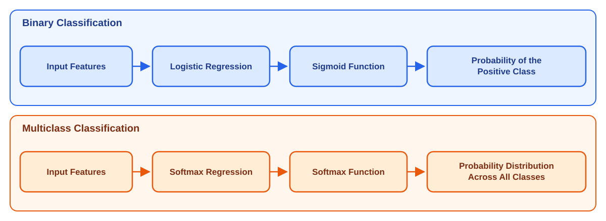
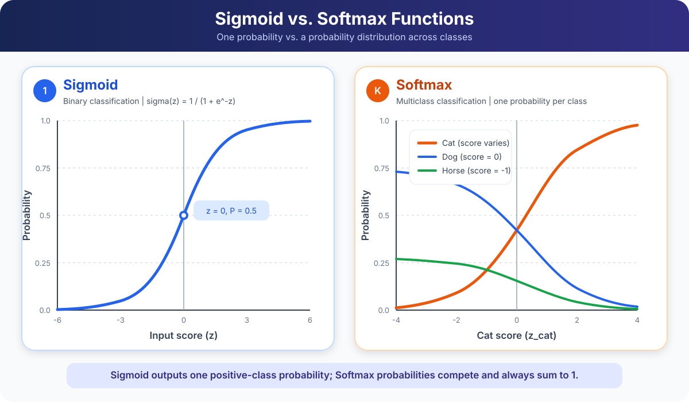
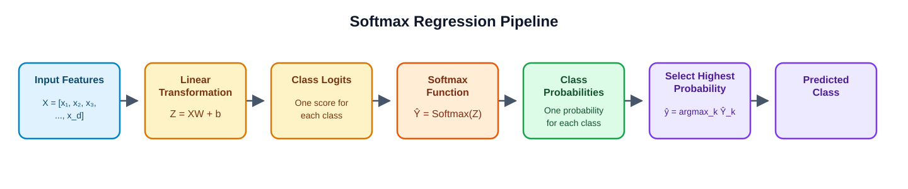
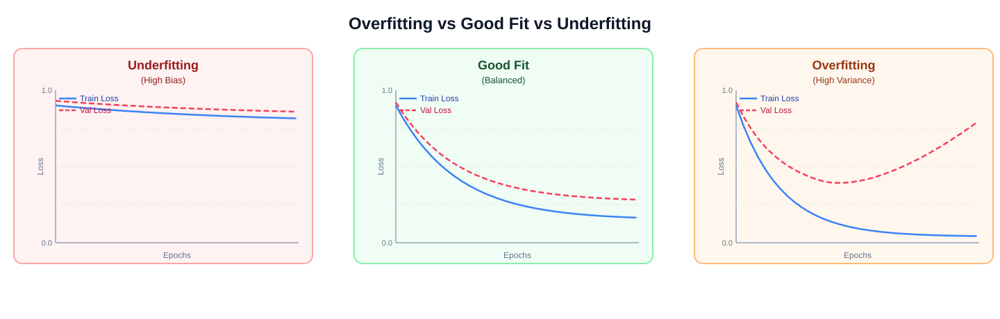
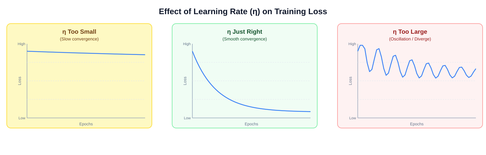
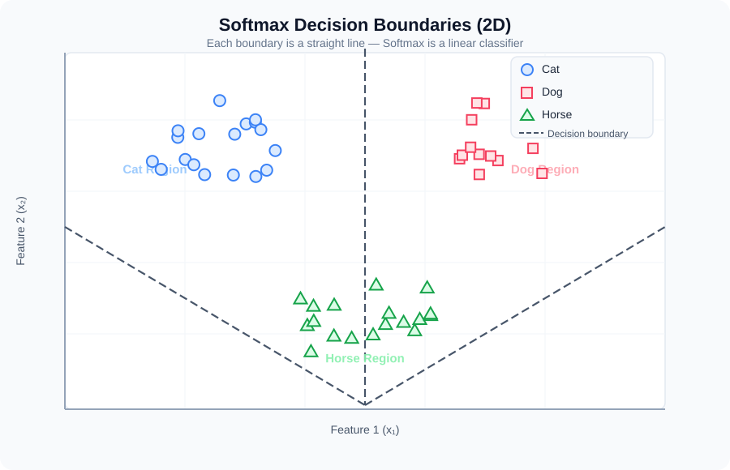
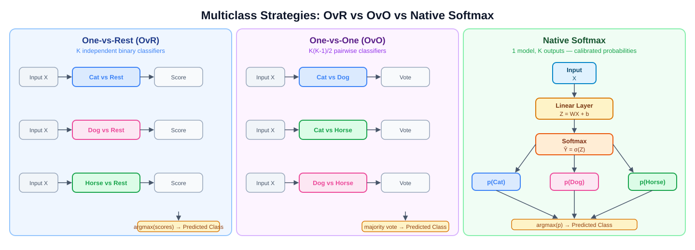

# Multinomial Logistic Regression (Softmax Regression)

- **Softmax Regression** is a generalisation of **Logistic Regression** for
  *multiclass classification*.
- It is also known as **Multinomial Logistic Regression**.
- It extends Logistic Regression from **binary classification** *(two classes)*
  to **multiclass classification** *(three or more classes)*.

> [!NOTE]
> **Softmax Regression** and **Multinomial Logistic Regression** refer to the
> same **classification algorithm**.

## Table of Contents

- **[1. Logistic Regression vs. Softmax Regression](#1-logistic-regression-vs-softmax-regression)**
  - [Logistic Regression (Binary Classification)](#logistic-regression-binary-classification)
- **[What Is Multinomial Logistic Regression - Softmax Regression?](#what-is-multinomial-logistic-regression---softmax-regression)**
- **[Where Does Softmax Regression Fit in Machine Learning?](#where-does-softmax-regression-fit-in-machine-learning)**
- **[Binary Classification vs. Multiclass Classification](#binary-classification-vs-multiclass-classification)**
  - [Sigmoid vs. Softmax Graph](#sigmoid-vs-softmax-graph)
  - [Sigmoid vs. Softmax Comparison](#sigmoid-vs-softmax-comparison)
- **[How Softmax Regression Works](#how-softmax-regression-works)**
  - [Softmax Regression Pipeline](#softmax-regression-pipeline)
  - [Step 1: Compute the Logits](#step-1-compute-the-logits)
  - [Step 2: Apply the Softmax Function](#step-2-apply-the-softmax-function)
  - [Step 3: Make a Prediction](#step-3-make-a-prediction)
- **[Softmax Function](#softmax-function)**
  - [What Are Logits?](#what-are-logits)
  - [What Is Softmax Function?](#what-is-softmax-function)
  - [Softmax Function Features](#softmax-function-features)
    - [General Formula](#general-formula)
    - [General Formula for Classes 1 to n](#general-formula-for-classes-1-to-n)
  - [Why Does the Denominator Contain All Classes?](#why-does-the-denominator-contain-all-classes)
  - [Applying the Softmax Formula: Numerical Example](#applying-the-softmax-formula-numerical-example)
    - [Step 1: Apply the Exponential Function](#step-1-apply-the-exponential-function)
    - [Step 2: Calculate the Denominator](#step-2-calculate-the-denominator)
    - [Step 3: Calculate Each Class Probability](#step-3-calculate-each-class-probability)
    - [Final Result](#final-result)
  - [Softmax Preserves Ranking](#softmax-preserves-ranking)
  - [Prediction Rule](#prediction-rule)
  - [Prediction Rule Using Softmax Function](#prediction-rule-using-softmax-function)
    - [Example: Three Features and Three Classes](#example-three-features-and-three-classes)
- **[Matrix Representation of the Softmax Function and Softmax Regression](#matrix-representation-of-the-softmax-function-and-softmax-regression)**
  - [Matrix Dimensions](#matrix-dimensions)
  - [Single-Sample Example](#single-sample-example)
  - [Probability Matrix](#probability-matrix)
- **[Loss Functions: Binary and Categorical Cross-Entropy](#loss-functions-binary-and-categorical-cross-entropy)**
  - [Binary Logistic Regression Loss](#binary-logistic-regression-loss)
  - [Softmax Log-Loss / Categorical Cross-Entropy / Multiclass Log Loss](#softmax-log-loss--categorical-cross-entropy--multiclass-log-loss)
    - [Dataset-Level Example with Three Samples](#dataset-level-example-with-three-samples)
      - [Step 1: Calculate the Logits](#step-1-calculate-the-logits)
      - [Step 2: Apply Softmax Row-Wise](#step-2-apply-softmax-row-wise)
- **[Deriving Softmax from Linear Log-Odds](#deriving-softmax-from-linear-log-odds)**
  - [Step 1: Starting with Binary Logistic Regression](#step-1-starting-with-binary-logistic-regression)
  - [Step 2: Derive Softmax from Linear Log-Odds](#step-2-derive-softmax-from-linear-log-odds)
    - [Choose a Reference Class](#choose-a-reference-class)
    - [Exponentiate the Log-Odds](#exponentiate-the-log-odds)
    - [Enforce Probability Normalization](#enforce-probability-normalization)
    - [Write the Symmetric Softmax Formula](#write-the-symmetric-softmax-formula)
- **[Deriving Sigmoid from Two-Class Softmax](#deriving-sigmoid-from-two-class-softmax)**
  - [Important Relationship: Softmax and Sigmoid](#important-relationship-softmax-and-sigmoid)
- **[Deriving Categorical Cross-Entropy from Maximum Likelihood Estimation](#deriving-categorical-cross-entropy-from-maximum-likelihood-estimation)**
  - [Likelihood of One Training Example](#likelihood-of-one-training-example)
  - [Likelihood of the Dataset](#likelihood-of-the-dataset)
    - [Numerical Likelihood Example](#numerical-likelihood-example)
  - [From Log-Likelihood to Cross-Entropy](#from-log-likelihood-to-cross-entropy)
    - [Log-Likelihood (Maximize)](#log-likelihood-maximize)
    - [Categorical Cross-Entropy (Minimize)](#categorical-cross-entropy-minimize)
  - [How the True-Class Probability Affects Loss](#how-the-true-class-probability-affects-loss)
  - [Expressing Cross-Entropy in Terms of Logits](#expressing-cross-entropy-in-terms-of-logits)
  - [Information-Theoretic Interpretation](#information-theoretic-interpretation)
  - [Derivation Summary](#derivation-summary)
- **[Gradient Derivation: How Does the Model Learn?](#gradient-derivation-how-does-the-model-learn)**
  - [The Softmax Jacobian](#the-softmax-jacobian)
  - [Gradient of the Loss with Respect to Logits](#gradient-of-the-loss-with-respect-to-logits)
    - [Direct Derivation (via Logit Form)](#direct-derivation-via-logit-form)
    - [Chain Rule Derivation](#chain-rule-derivation)
    - [What the Gradient Means](#what-the-gradient-means)
    - [Component-Wise Weight Update (The Loop View)](#component-wise-weight-update-the-loop-view)
  - [Complete Numerical Example of Gradient Descent](#complete-numerical-example-of-gradient-descent)
  - [Weight and Bias Gradients](#weight-and-bias-gradients)
- **[Vectorized Training](#vectorized-training)**
  - [Forward Pass](#forward-pass-1)
  - [Backward Pass](#backward-pass)
  - [Gradient Descent Update Rule](#gradient-descent-update-rule)
- **[Hessian, Convexity, and Regularization](#hessian-convexity-and-regularization)**
  - [Hessian with Respect to Logits](#hessian-with-respect-to-logits)
  - [Parameter Hessian Blocks](#parameter-hessian-blocks)
  - [Convexity Does Not Guarantee a Unique Finite Estimate](#convexity-does-not-guarantee-a-unique-finite-estimate)
  - [L2 Regularization (Ridge)](#l2-regularization-ridge)
  - [L1 Regularization and Parameterization](#l1-regularization-and-parameterization)
- **[Numerical Stability: The Log-Sum-Exp Trick](#numerical-stability-the-log-sum-exp-trick)**
- **[Complete End-to-End Numerical Example](#complete-end-to-end-numerical-example)**
  - [Step 1: Compute Logits](#step-1-compute-logits)
  - [Step 2: Compute Probabilities](#step-2-compute-probabilities)
  - [Step 3: Compute Cross-Entropy](#step-3-compute-cross-entropy)
  - [Step 4: Compute Gradients](#step-4-compute-gradients)
  - [Step 5: Update with Learning Rate 0.1](#step-5-update-with-learning-rate-01)
  - [Step 6: Re-evaluate the Same Example](#step-6-re-evaluate-the-same-example)
- **[Overfitting and Underfitting](#overfitting-and-underfitting)**
  - [Underfitting](#underfitting)
  - [Overfitting](#overfitting)
  - [How Regularization Fixes Overfitting](#how-regularization-fixes-overfitting)
  - [Bias-Variance Trade-off Summary](#bias-variance-trade-off-summary)
- **[Hyperparameter Tuning](#hyperparameter-tuning)**
  - [Learning Rate η](#learning-rate-η)
  - [Regularization Strength λ](#regularization-strength-λ)
  - [Number of Epochs](#number-of-epochs)
  - [Cross-Validation Strategy](#cross-validation-strategy)
- **[Decision Boundaries](#decision-boundaries)**
  - [Why Softmax Boundaries Are Linear](#why-softmax-boundaries-are-linear)
  - [Geometric Interpretation](#geometric-interpretation)
  - [What Happens in Higher Dimensions](#what-happens-in-higher-dimensions)
- **[Comparison with Other Multiclass Methods](#comparison-with-other-multiclass-methods)**
  - [One-vs-Rest (OvR)](#one-vs-rest-ovr)
  - [One-vs-One (OvO)](#one-vs-one-ovo)
  - [Native Softmax](#native-softmax)
  - [When to Use Which](#when-to-use-which)
- **[Softmax Temperature](#softmax-temperature)**
  - [What Does Temperature Do?](#what-does-temperature-do)
  - [Example: The Same Scores at Different Temperatures](#example-the-same-scores-at-different-temperatures)
  - [Why Does This Happen? A Formula Derivation](#why-does-this-happen-a-formula-derivation)
  - [Does Temperature Change the Predicted Class?](#does-temperature-change-the-predicted-class)
  - [What Happens at Extreme Temperatures?](#what-happens-at-extreme-temperatures)
  - [Why Use Temperature After Training?](#why-use-temperature-after-training)
- **[Online References](#online-references)**

---
## 1. Logistic Regression vs. Softmax Regression

The **main difference** is the number of classes they predict.

| Logistic Regression | Softmax Regression |
|---|---|
| **Binary classification** | **Multiclass classification** |
| *Two classes* | *Three or more classes* |
| Uses the **Sigmoid function** | Uses the **Softmax function** |
| Predicts the probability of the positive class | Predicts a probability for every class |

### Logistic Regression (Binary Classification)

Suppose you want to predict whether an email is:

- **Spam (1)**
- **Not Spam (0)**

**Logistic Regression** uses the **Sigmoid function**:

```math
\sigma(z) = \frac{1}{1 + e^{-z}}
```

**Example output:**

| Class | Probability |
|---|---:|
| Spam | 0.85 |
| Not Spam | 0.15 |

---

## What Is Multinomial Logistic Regression - Softmax Regression?
- **Multinomial logistic regression is a probabilistic classifier for mutually exclusive classes.** 
- It generalizes binary logistic regression to a target with $K$ possible categories. 
- Its usual machine learning name is **softmax regression**.

- **Algorithm type:** A *supervised machine learning* algorithm.
- **Purpose:** Solves classification problems with **three or more classes**.
- **Class relationship:** The target classes are **mutually exclusive**, meaning each input belongs to only one class.
- **Model output:** A probability for every possible class.

## Where Does Softmax Regression Fit in Machine Learning?


---
## Binary Classification vs. Multiclass Classification



### Sigmoid vs. Softmax Graph



### Sigmoid vs. Softmax Comparison

| Feature | Sigmoid Function | Softmax Function |
|---|---|---|
| **Formula** | $\displaystyle \sigma(z) = \frac{1}{1 + e^{-z}}$ | $\displaystyle \sigma(\mathbf{z})_k = P(Y = k \mid X) = \frac{e^{z_k}}{\sum_{j=1}^{K} e^{z_j}}$ |
| **Primary use** | Binary classification | Multiclass classification |
| **Number of classes** | Usually two classes | Three or more mutually exclusive classes |
| **Input** | One logit $z$ | A vector of logits $z_1, z_2, \ldots, z_K$ |
| **Output** | One probability for the positive class | One probability for every class |
| **Probability range** | Each output is between $0$ and $1$ | Every output is between $0$ and $1$ |
| **Sum of outputs** | Not inherently constrained across multiple Sigmoid outputs | All class probabilities sum to $1$ |
| **Class relationship** | Outputs can be treated independently | Class probabilities compete with one another |
| **Prediction rule** | Apply a threshold, commonly $0.5$ | Select the class with the highest probability using $\arg\max$ |
| **Typical loss function** | Binary Cross-Entropy | Categorical Cross-Entropy |

The **Softmax equation** gives the probability that the input belongs to class $k$:

```math
\sigma(\mathbf{z})_k
= P(Y = k \mid X)
= \frac{e^{z_k}}{\sum_{j=1}^{K} e^{z_j}}.
```

> [!IMPORTANT]
> Use **Sigmoid** when classes are *binary or independent*. Use **Softmax** when
> exactly **one class** must be selected from several *mutually exclusive
> classes*.

---
## How Softmax Regression Works

**Softmax Regression** processes an input in **three main steps**:

### Softmax Regression Pipeline



The pipeline follows:

```math
\text{Input features}
\rightarrow
\text{logits}
\rightarrow
\text{Softmax probabilities}
\rightarrow
\text{predicted class}.
```

### Step 1: Compute the Logits

- **Input:** A feature vector $\mathbf{x}\in\mathbb{R}^{d}$.
- **Operation:** Calculate one *raw score*, or **logit**, for each class
  $k\in\{1,2,\ldots,n\}$.
- **Class-specific formula:**

```math
z_k
= \mathbf{w}_k^{\top}\mathbf{x}+b_k
= \sum_{i=1}^{d}w_{ki}x_i+b_k.
```

- **Vectorized calculation:** Compute all $n$ logits *simultaneously*:

```math
\mathbf{z}=W\mathbf{x}+\mathbf{b}.
```

### Step 2: Apply the Softmax Function

- **Exponentiate:** Apply the exponential function to each logit.
- **Normalize:** Divide each exponentiated logit by the sum of all
  exponentiated logits.
- **Result:** Produce one **probability for each class**:

```math
\sigma(\mathbf{z})_k
=P(Y=k\mid X)
=\frac{e^{z_k}}{\sum_{j=1}^{n}e^{z_j}}.
```

- **Probability properties:** Every probability is between $0$ and $1$,
  and all class probabilities sum to $1$:

```math
0<\sigma(\mathbf{z})_k<1,
\qquad
\sum_{k=1}^{n}\sigma(\mathbf{z})_k=1.
```

### Step 3: Make a Prediction

- **Selection rule:** Choose the class with the **highest Softmax
  probability**:

```math
\hat{y}
=\arg\max_{k\in\{1,2,\ldots,n\}}\sigma(\mathbf{z})_k
=\arg\max_{k\in\{1,2,\ldots,n\}}P(Y=k\mid X).
```

- **Equivalent rule:** Because **Softmax preserves ranking**, the prediction
  can also be selected directly from the logits:

```math
\hat{y}
=\arg\max_{k\in\{1,2,\ldots,n\}}z_k.
```

---
## Softmax Function

**Softmax Regression**:

- Calculates a **score for each class**.
- Converts all class scores into a **probability distribution**.
- Ensures that all class probabilities **sum to 1**.

The **Softmax formula** is:

```math
\boxed{
\sigma(\mathbf{z})_k = P(Y = k \mid X) = \frac{e^{z_k}}{\sum_{j=1}^{K} e^{z_j}}
}
```

where:

- **$K$:** Number of classes.
- **$z_k$:** Score for class $k$ or Logits (raw model output before applying Softmax).
- **$e$:** Exponential function.

> [!NOTE]
> In many *textbooks and documentation*, the **Softmax function** is also
> denoted by the lowercase Greek letter **sigma** $\sigma$. The
> **probability for class $k$** may therefore be written as:
>
> ```math
> \sigma(\mathbf{z})_k
> = \frac{e^{z_k}}{\sum_{j=1}^{K} e^{z_j}}.
> ```
>
> The symbol $\sigma$ is also commonly used for the **Sigmoid function**, so
> its meaning *depends on context*. Do not confuse lowercase $\sigma$, used
> here as a **function name**, with $\sum$, the **summation symbol**.

### What Are Logits?

- **Logits** are the ***raw numerical scores produced by a model.***
- Logits are **not probabilities** and are **not final class predictions**.
- The **Softmax function** transforms logits into class probabilities.
- The model applies $\arg\max$ to select the class with the highest
  probability as the **final prediction**.

For example, suppose the model produces the following logits:

```math
\mathbf{z} =
\begin{bmatrix}
2.0 \\
1.0 \\
0.1
\end{bmatrix}
```

Each logit represents the model's score for one class:

- **Cat:** $2.0$
- **Dog:** $1.0$
- **Horse:** $0.1$

> [!WARNING]
> **Logits are neither probabilities nor final predictions.** They are
> *unrestricted scores* and should not be interpreted as **confidence values**
> before applying **Softmax**.

> [!NOTE]
> **Softmax preserves the order of the logits**, so
> $\arg\max_k z_k = \arg\max_k \sigma(\mathbf{z})_k$. Therefore, the largest
> **logit** identifies the **same winning class** as the **largest Softmax
> probability**, but the logit itself remains a **score**, *not a probability
> or prediction*.

Unlike probabilities, logits can be:

- **Positive**
- **Negative**
- **Zero**
- **Greater than 1**

The **Softmax function** transforms these logits into a valid probability
distribution in which:

- Every probability is between **0 and 1**.
- The probabilities of all classes **sum to 1**.
- The class with the highest logit receives the highest probability.

### What is Softmax Function

**Softmax Regression**:

- Calculates a **score for each class**.
- Converts all class scores into a **probability distribution**.
- Ensures that all class probabilities **sum to 1**.

The **Softmax formula** is:

```math
\boxed{
\sigma(\mathbf{z})_k
= P(Y = k \mid X)
= \frac{e^{z_k}}{\sum_{j=1}^{K} e^{z_j}}
}
```

where:

- **$K$:** Number of classes.
- **$z_k$:** Score for class $k$ or Logits (raw model output before applying Softmax).
- **$e$:** Exponential function.

### Softmax function Features

The number of **input features** determines how each class logit is calculated.
For class $k$, the general logit formula is:

```math
z_k = \sum_{i=1}^{d} w_{ki}x_i + b_k
```

where:

- **$d$:** Number of input features.
- **$x_i$:** Value of input feature $i$.
- **$w_{ki}$:** Weight connecting feature $i$ to class $k$.
- **$b_k$:** Bias for class $k$.
- **$z_k$:** Resulting logit for class $k$.

The logit expands as follows from one feature to an arbitrary number $d$ of
features:

| Number of Features | Input Vector | Logit for Class $k$ |
|---:|---|---|
| 1 | $X = [x_1]$ | $z_k = w_{k1}x_1 + b_k$ |
| 2 | $X = [x_1, x_2]$ | $z_k = w_{k1}x_1 + w_{k2}x_2 + b_k$ |
| 3 | $X = [x_1, x_2, x_3]$ | $z_k = w_{k1}x_1 + w_{k2}x_2 + w_{k3}x_3 + b_k$ |
| $\vdots$ | $\vdots$ | $\vdots$ |
| $d$ | $X = [x_1, x_2, \ldots, x_d]$ | $z_k = w_{k1}x_1 + w_{k2}x_2 + \cdots + w_{kd}x_d + b_k = \sum_{i=1}^{d} w_{ki}x_i + b_k$ |

> [!NOTE]
> Here, **$d$ represents the number of input features**, while **$n$ represents
> the number of classes** elsewhere in this lesson. Using different symbols
> prevents these *two distinct quantities* from being confused.

After calculating one logit for each class, Softmax converts the logits into
probabilities:

```math
\sigma(\mathbf{z})_k
= P(Y = k \mid X)
= \frac{e^{z_k}}{\sum_{j=1}^{K} e^{z_j}}
```

#### General Formula

For $d$ input features and $K$ classes, define:

```math
\mathbf{x} \in \mathbb{R}^{d}, \qquad
W \in \mathbb{R}^{K \times d}, \qquad
\mathbf{b} \in \mathbb{R}^{K}.
```

The model calculates all $K$ logits simultaneously:

```math
\boxed{\mathbf{z} = W\mathbf{x} + \mathbf{b}}
```

The $k$-th logit and its corresponding Softmax probability are:

```math
\boxed{
z_k = \mathbf{w}_k^{\top}\mathbf{x} + b_k
\qquad \Longrightarrow \qquad
\sigma(\mathbf{z})_k
= P(Y = k \mid X)
= \frac{e^{z_k}}{\sum_{j=1}^{K} e^{z_j}}
}
```

Therefore, the complete Softmax output vector is:

```math
\boxed{
\mathrm{Softmax}(\mathbf{z})
=
\begin{bmatrix}
\dfrac{e^{z_1}}{\sum_{j=1}^{K} e^{z_j}} \\
\dfrac{e^{z_2}}{\sum_{j=1}^{K} e^{z_j}} \\
\vdots \\
\dfrac{e^{z_K}}{\sum_{j=1}^{K} e^{z_j}}
\end{bmatrix}
}
```

#### General Formula for Classes 1 to n

For **$n$ classes** and **$d$ input features**, the model calculates **one logit
for each class**:

```math
\begin{aligned}
z_1 &= \sum_{i=1}^{d} w_{1i}x_i + b_1
     = \mathbf{w}_1^{\top}\mathbf{x} + b_1, \\
z_2 &= \sum_{i=1}^{d} w_{2i}x_i + b_2
     = \mathbf{w}_2^{\top}\mathbf{x} + b_2, \\
z_3 &= \sum_{i=1}^{d} w_{3i}x_i + b_3
     = \mathbf{w}_3^{\top}\mathbf{x} + b_3. \\
\vdots \\
z_n &= \sum_{i=1}^{d} w_{ni}x_i + b_n
     = \mathbf{w}_n^{\top}\mathbf{x} + b_n.
\end{aligned}
```

The shared Softmax denominator is:

```math
D = e^{z_1} + e^{z_2} + \dots + e^{z_n}.
```

> [!NOTE]
> Using the **Softmax function**, we convert the logits
> $z_1, z_2, \ldots, z_n$ into a **probability distribution** over all $n$
> classes.

```math
\begin{aligned}
\sigma(\mathbf{z})_1
&= P(Y = 1 \mid X)
 = \frac{e^{z_1}}{D}
 = \frac{e^{z_1}}{e^{z_1} + e^{z_2} + \dots + e^{z_n}}, \\[6pt]
\sigma(\mathbf{z})_2
&= P(Y = 2 \mid X)
 = \frac{e^{z_2}}{D}
 = \frac{e^{z_2}}{e^{z_1} + e^{z_2} + \dots + e^{z_n}}, \\[6pt]
\sigma(\mathbf{z})_3
&= P(Y = 3 \mid X)
 = \frac{e^{z_3}}{D}
 = \frac{e^{z_3}}{e^{z_1} + e^{z_2} + \dots + e^{z_n}}, \\
\vdots \\
\sigma(\mathbf{z})_n
&= P(Y = n \mid X)
 = \frac{e^{z_n}}{D}
 = \frac{e^{z_n}}{e^{z_1} + e^{z_2} + \dots + e^{z_n}}.
\end{aligned}
```

The n probabilities form the output vector:

```math
\sigma(\mathbf{z}) = \mathrm{Softmax}(\mathbf{z})
=
\begin{bmatrix}
P(Y = 1 \mid X) \\
P(Y = 2 \mid X) \\
P(Y = 3 \mid X) \\
\vdots \\
P(Y = n \mid X)
\end{bmatrix},
\qquad
\sum_{k=1}^{n} P(Y = k \mid X) = 1.
```

> [!NOTE]
> **Softmax preserves ranking.** For any two classes $i$ and $j$:
>
> ```math
> z_i > z_j
> \quad \Longleftrightarrow \quad
> \sigma(\mathbf{z})_i > \sigma(\mathbf{z})_j.
> ```
>
> Therefore, applying Softmax changes the logits into probabilities but does
> **not** change their order.

### Why Does the Denominator Contain All Classes?

Think about the requirement that probabilities must sum to one.

We first calculate an unnormalised positive score for each class:

```math
s_k = e^{z_k}
```

But these scores do not necessarily sum to one.

For example:

```math
s = [7.389,\ 2.718,\ 1.105]
```

To convert them into probabilities, we divide every score by the total score:

```math
p_k = \frac{s_k}{\sum_j s_j}
```

Substituting $s_k = e^{z_k}$:

```math
\boxed{
p_k = \frac{e^{z_k}}{\sum_j e^{z_j}}
}
```

So the denominator is simply the normalisation term that makes all probabilities sum to one.

### Applying the Softmax Formula: Numerical Example

Using the previous **Cat, Dog, and Horse** example, the logits correspond to
the classes in that order:

```math
z_1 = 2.0, \qquad z_2 = 1.0, \qquad z_3 = 0.1
```

#### Step 1: Apply the Exponential Function

- Calculate the exponential of each logit:

```math
e^{z_1} = e^{2.0} \approx 7.389
```

```math
e^{z_2} = e^{1.0} \approx 2.718
```

```math
e^{z_3} = e^{0.1} \approx 1.105
```

#### Step 2: Calculate the Denominator
- Add all the exponential values:

```math
\begin{aligned}
D &= e^{z_1} + e^{z_2} + e^{z_3} \\
  &= 7.389 + 2.718 + 1.105 \\
  &= 11.212
\end{aligned}
```

#### Step 3: Calculate Each Class Probability
**Cat:**

```math
\sigma(\mathbf{z})_{\text{Cat}} = P(\text{Cat} \mid X)
= \frac{7.389}{11.212}
\approx 0.659
```

**Dog:**

```math
\sigma(\mathbf{z})_{\text{Dog}} = P(\text{Dog} \mid X)
= \frac{2.718}{11.212}
\approx 0.242
```

**Horse:**

```math
\sigma(\mathbf{z})_{\text{Horse}} = P(\text{Horse} \mid X)
= \frac{1.105}{11.212}
\approx 0.099
```

#### Final Result
| Class | Logit | Softmax Probability |
|---|---:|---:|
| Cat | 2.0 | 65.9% |
| Dog | 1.0 | 24.2% |
| Horse | 0.1 | 9.9% |
| **Total** | — | **100.0%** |

> [!TIP]
> The model predicts **Cat** because it has the **highest Softmax probability**.
> *Softmax preserves score order*, so the class with the **highest logit** also
> has the **highest probability**.
### Softmax Preserves Ranking

- **Ranking property:** Softmax preserves the **ranking of the logits**.
- **Example:** If the logits are ordered as follows:

```math
z_1 > z_2 > z_3,
```

- **Result:** The corresponding Softmax probabilities have the **same order**:

```math
\sigma(\mathbf{z})_1
>
\sigma(\mathbf{z})_2
>
\sigma(\mathbf{z})_3,
```

- **Notation:** $\sigma(\mathbf{z})_k = P(Y = k \mid X)$ is the Softmax
  probability for class $k$.

- **Why this happens:**
  - The **exponential function is strictly increasing**.
  - Every class probability uses the **same positive denominator**.

```math
z_i > z_j
\quad \Longrightarrow \quad
e^{z_i} > e^{z_j}
\quad \Longrightarrow \quad
\sigma(\mathbf{z})_i
= \frac{e^{z_i}}{\sum_{k=1}^{n} e^{z_k}}
>
\frac{e^{z_j}}{\sum_{k=1}^{n} e^{z_k}}
= \sigma(\mathbf{z})_j.
```

> [!IMPORTANT]
> Softmax changes the logits into probabilities, but it does **not** change
> their **order**. Therefore, the **largest logit** and the **largest Softmax
> probability** identify the **same predicted class**.

### Prediction Rule

Mathematically, the predicted class is:

```math
\hat{y}
= \arg\max_k P(Y = k \mid X)
= \arg\max_k \sigma(\mathbf{z})_k
```

where:

- **$X$:** Input features.
- **$Y$:** Target class.
- **$k$:** Class index.
- **$P(Y = k \mid X)$:** Probability that the input belongs to class $k$.
- **$\sigma(\mathbf{z})_k$:** Alternative notation for
  $P(Y = k \mid X)$, representing the Softmax probability of class $k$.
- **$\arg\max$:** Operation that returns the class with the highest
  probability.

For example, suppose we want to classify an image as a **cat**, **dog**, or **horse**:

- **Input:** An image represented by numerical features.
- **Output:** The probability that the image belongs to each class.

**Example output:**

| Class | Predicted Probability |
|---|---:|
| Cat | 0.70 |
| Dog | 0.20 |
| Horse | 0.10 |
| **Total** | **1.00** |

- **Final prediction:** The model selects **Cat** because it has the highest probability.

<p align="center">✦ ✦ ✦</p>

### Prediction Rule using Softmax Function

For $n$ classes, the model predicts the class with the highest Softmax
probability:

```math
\boxed{
\hat{y}
= \arg\max_{k \in \{1,2,\ldots,n\}} P(Y = k \mid X)
= \arg\max_{k \in \{1,2,\ldots,n\}} \sigma(\mathbf{z})_k
}
```

Because Softmax preserves the ordering of the logits, the same class can be
selected directly from the logits:

```math
\boxed{
\hat{y}
= \arg\max_{k \in \{1,2,\ldots,n\}} z_k
}
```

where:

- **$X$:** Input features.
- **$Y$:** Target class.
- **$k$:** Class index, from $1$ to $n$.
- **$n$:** Total number of classes.
- **$z_k$:** Logit for class $k$.
- **$\sigma(\mathbf{z})_k$:** Softmax probability for class $k$.
- **$P(Y = k \mid X)$:** Probability that the input belongs to class $k$.
- **$\arg\max$:** Operation that returns the class index with the largest
  value.

> [!IMPORTANT]
> A **logit is not a prediction or probability**. However, the largest logit
> and the largest Softmax probability identify the same predicted class.

<p align="center">✦ ✦ ✦</p>

#### Example: Three Features and Three Classes

Suppose the input is $X = [x_1, x_2, x_3]$, and the possible classes are
**Cat**, **Dog**, and **Horse**. The model calculates:

```math
\begin{aligned}
z_{\text{Cat}} &= w_{\text{Cat},1}x_1 + w_{\text{Cat},2}x_2
                  + w_{\text{Cat},3}x_3 + b_{\text{Cat}} \\
z_{\text{Dog}} &= w_{\text{Dog},1}x_1 + w_{\text{Dog},2}x_2
                  + w_{\text{Dog},3}x_3 + b_{\text{Dog}} \\
z_{\text{Horse}} &= w_{\text{Horse},1}x_1 + w_{\text{Horse},2}x_2
                    + w_{\text{Horse},3}x_3 + b_{\text{Horse}}
\end{aligned}
```

Let

```math
D = e^{z_{\text{Cat}}} + e^{z_{\text{Dog}}} + e^{z_{\text{Horse}}}.
```

The corresponding Softmax probabilities are:

```math
\sigma(\mathbf{z})_{\text{Cat}} = P(\text{Cat} \mid X)
= \frac{e^{z_{\text{Cat}}}}{D}, \qquad
\sigma(\mathbf{z})_{\text{Dog}} = P(\text{Dog} \mid X)
= \frac{e^{z_{\text{Dog}}}}{D}, \qquad
\sigma(\mathbf{z})_{\text{Horse}} = P(\text{Horse} \mid X)
= \frac{e^{z_{\text{Horse}}}}{D}.
```

Replacing $D$ with its full value:

```math
\begin{aligned}
\sigma(\mathbf{z})_{\text{Cat}}
&= P(\text{Cat} \mid X)
 = \frac{e^{z_{\text{Cat}}}}
{e^{z_{\text{Cat}}} + e^{z_{\text{Dog}}} + e^{z_{\text{Horse}}}}, \\[6pt]
\sigma(\mathbf{z})_{\text{Dog}}
&= P(\text{Dog} \mid X)
 = \frac{e^{z_{\text{Dog}}}}
{e^{z_{\text{Cat}}} + e^{z_{\text{Dog}}} + e^{z_{\text{Horse}}}}, \\[6pt]
\sigma(\mathbf{z})_{\text{Horse}}
&= P(\text{Horse} \mid X)
 = \frac{e^{z_{\text{Horse}}}}
{e^{z_{\text{Cat}}} + e^{z_{\text{Dog}}} + e^{z_{\text{Horse}}}}.
\end{aligned}
```

> [!IMPORTANT]
> The number of **features** and the number of **classes** are different:
> **features** are used to calculate each **logit**, while **classes** determine
> how many **logits and Softmax probabilities** the model produces.


---
## Matrix Representation of the Softmax Function and Softmax Regression

Instead of writing a separate equation for every sample and class, we can
represent the complete Softmax Regression calculation using **matrices**.

> [!NOTE]
> This lesson uses $m$ for the **number of samples**, $d$ for the **number
> of input features**, and $n$ for the **number of classes**.

### Matrix Dimensions

Suppose:

- **$X\in\mathbb{R}^{m\times d}$:** Original **feature matrix** containing $m$ **samples** and $d$ **features**.
- **$X_b\in\mathbb{R}^{m\times(d+1)}$:** **Bias-augmented feature matrix** whose first column contains ones.
- **$W\in\mathbb{R}^{(d+1)\times n}$:** **Weight matrix**, including one **bias weight** and $d$ **feature weights** for each of the $n$ classes.
- **$Z\in\mathbb{R}^{m\times n}$:** **Logit matrix** containing one row per sample and one column per class.

The logits for all samples and classes are calculated simultaneously:

```math
\boxed{Z=X_bW}
```

The first column of $X_b$ contains ones, so the first row of $W$ supplies
the bias term for every class.

### Single-Sample Example

For one sample with three input features, the bias-augmented feature vector is:

```math
X_b=
\begin{bmatrix}
1 & x_1 & x_2 & x_3
\end{bmatrix}.
```

For three classes, the weight matrix is:

```math
W=
\begin{bmatrix}
w_{10} & w_{20} & w_{30} \\
w_{11} & w_{21} & w_{31} \\
w_{12} & w_{22} & w_{32} \\
w_{13} & w_{23} & w_{33}
\end{bmatrix},
```

where:

- The **columns** correspond to classes $1$, $2$, and $3$.
- The **first row** contains the class-specific bias weights.
- The remaining rows contain the weights for features $x_1$, $x_2$, and
  $x_3$.

The resulting logits are:

```math
Z=X_bW=
\begin{bmatrix}
z_1 & z_2 & z_3
\end{bmatrix}.
```

### Probability Matrix

Softmax is applied **row-wise** to $Z$, so each sample receives its own
probability distribution across the $n$ classes:

```math
\boxed{
\widehat{Y}
=\mathrm{Softmax}_{\text{row}}(Z)
=\mathrm{Softmax}_{\text{row}}(X_bW)
}
```

For sample $i$ and class $k$:

```math
\widehat{Y}_{ik}
=\sigma(\mathbf{z}_i)_k
=\frac{e^{Z_{ik}}}{\sum_{j=1}^{n}e^{Z_{ij}}}.
```

The predicted probability matrix has dimensions:

```math
\widehat{Y}\in\mathbb{R}^{m\times n},
\qquad
\sum_{k=1}^{n}\widehat{Y}_{ik}=1
\quad\text{for every sample }i.
```

> [!IMPORTANT]
> Softmax normalization is performed **across the class columns of each row**,
> not across different samples.

---
## Loss Functions: Binary and Categorical Cross-Entropy

The model is trained by comparing its **predicted probabilities** with the
**actual class labels**. Logistic Regression and Softmax Regression use closely related log-loss functions.

### Binary Logistic Regression Loss

For binary classification, let:

- $y\in\{0,1\}$ be the actual label.
- $\hat{y}=p=\sigma(z)=P(Y=1\mid X)$ be the predicted probability of class
  $1$.
- $1-\hat{y}=P(Y=0\mid X)$ be the predicted probability of class $0$.

> [!NOTE]
> In this loss formula, **$p$ and $\hat{y}$ mean the same thing**: the model's
> **predicted probability for class $1$**. Here, $\hat{y}$ is a probability
> *before applying a classification threshold*, not the final **$0$ or $1$
> class label**.

The **Binary Cross-Entropy**, also called **binary log loss**, for one sample is:

```math
\boxed{
\mathcal{L}_{\text{binary}}
=-\left[y\log(\hat{y})+(1-y)\log(1-\hat{y})\right]
}
```

This ***formula selects the negative logarithm of the probability assigned to the correct class***:

```math
\mathcal{L}_{\text{binary}}
=
\begin{cases}
-\log(\hat{y}), & y=1,\\
-\log(1-\hat{y}), & y=0.
\end{cases}
```

For $m$ samples,
- The ***average Binary Cross-Entropy loss***, also called the
  ***average binary log loss***, is:

```math
\boxed{
J_{\text{binary}}
=-\frac{1}{m}
\sum_{i=1}^{m}
\left[
y^{(i)}\log\left(\hat{y}^{(i)}\right)
+\left(1-y^{(i)}\right)\log\left(1-\hat{y}^{(i)}\right)
\right]
}
```

### Softmax log-Loss / Categorical Cross-Entropy / Multiclass Log Loss

For $n$ mutually exclusive classes, let:

- $y_k\in\{0,1\}$ be the one-hot encoded actual label for class $k$.
- $\hat{y}_k=p_k=\sigma(\mathbf{z})_k=P(Y=k\mid X)$ be the predicted
  Softmax probability for class $k$.

> [!NOTE]
> - The symbols $\hat{y}_k$, $p_k$, $\sigma(\mathbf{z})_k$, and $P(Y=k\mid X)$ use different notation but serve the same purpose: each represents the model's **predicted probability for class $k$**.
> - Different textbooks, libraries, and derivations may prefer different symbols.

The **Categorical Cross-Entropy**, also called **multiclass log loss**, for ***one sample*** is:

```math
\boxed{
\mathcal{L}_{\text{softmax}}
=-\sum_{k=1}^{n}y_k\log(\hat{y}_k)
=-\sum_{k=1}^{n}y_k\log(p_k)
=-\sum_{k=1}^{n}y_k\log\left(\sigma(\mathbf{z})_k\right)
=-\sum_{k=1}^{n}y_k\log\left(P(Y=k\mid X)\right)
}
```

Because ***only the correct class $c$ has $y_c=1$***, this simplifies to:

```math
\boxed{
\mathcal{L}_{\text{softmax}}
=-\log(\hat{y}_c)
=-\log(p_c)
=-\log\left(\sigma(\mathbf{z})_c\right)
=-\log\left(P(Y=c\mid X)\right)
}
```

For ***$m$ samples and $n$ classes***, the ***average categorical loss*** is:

- The ***average categorical loss*** is also called the ***multiclass log loss*** , ***categorical cross-entropy*** and ***softmax log-loss***.

```math
\boxed{
J_{\text{softmax}}
=-\frac{1}{m}
\sum_{i=1}^{m}
\sum_{k=1}^{n}
y_k^{(i)}\log\left(\hat{y}_k^{(i)}\right)
=-\frac{1}{m}
\sum_{i=1}^{m}
\sum_{k=1}^{n}
y_k^{(i)}\log\left(p_k^{(i)}\right)
=-\frac{1}{m}
\sum_{i=1}^{m}
\sum_{k=1}^{n}
y_k^{(i)}\log\left(\sigma(\mathbf{z}^{(i)})_k\right)
=-\frac{1}{m}
\sum_{i=1}^{m}
\sum_{k=1}^{n}
y_k^{(i)}\log\left(P(Y=k\mid X^{(i)})\right)
}
```

> [!IMPORTANT]
> Both losses penalize the model when it assigns a low probability to the correct class.
> **Binary Cross-Entropy** is used for a binary Sigmoid output,
> while **Categorical Cross-Entropy** is used for mutually exclusive Softmax outputs.

#### Dataset-Level Example with Three Samples

Now consider $m=3$ samples, two input features
$(X_1,X_2)$, and three classes $k\in\{0,1,2\}$:

| Sample $i$ | $X_1^{(i)}$ | $X_2^{(i)}$ | Actual Class $Y^{(i)}$ | $y_0^{(i)}$ | $y_1^{(i)}$ | $y_2^{(i)}$ |
|---:|---:|---:|---:|---:|---:|---:|
| 1 | 1.0 | 2.0 | 0 | 1 | 0 | 0 |
| 2 | 2.0 | 1.0 | 1 | 0 | 1 | 0 |
| 3 | 1.5 | 2.5 | 2 | 0 | 0 | 1 |

The feature matrix is:

```math
X=
\begin{bmatrix}
1.0 & 2.0\\
2.0 & 1.0\\
1.5 & 2.5
\end{bmatrix}
\in\mathbb{R}^{3\times2}.
```

Add a column of ones to include the bias:

```math
\widetilde{X}
=
\begin{bmatrix}
1.0 & 2.0 & 1\\
2.0 & 1.0 & 1\\
1.5 & 2.5 & 1
\end{bmatrix}
\in\mathbb{R}^{3\times3}.
```

For three classes, let
$\widetilde{W}\in\mathbb{R}^{3\times3}$ contain one class's two feature
weights and bias in each row.

##### Step 1: Calculate the Logits

For sample $i$, class $k$, and $d$ input features, the class logit is:

```math
z_k^{(i)}
=\mathbf{w}_k^\top\mathbf{x}^{(i)}+b_k
=\sum_{r=1}^{d}w_{kr}X_r^{(i)}+b_k.
```

Here, $r$ indexes the input features, while $k$ indexes the output classes.
For this example, $d=2$, so:

```math
\boxed{
z_k^{(i)}
=w_{k1}X_1^{(i)}+w_{k2}X_2^{(i)}+b_k
}
```

For the three classes $k\in\{0,1,2\}$, the two-feature formula expands to:

```math
\begin{aligned}
z_0^{(i)}
&=w_{01}X_1^{(i)}+w_{02}X_2^{(i)}+b_0,\\
z_1^{(i)}
&=w_{11}X_1^{(i)}+w_{12}X_2^{(i)}+b_1,\\
z_2^{(i)}
&=w_{21}X_1^{(i)}+w_{22}X_2^{(i)}+b_2.
\end{aligned}
```

In matrix form, all three class logits for sample $i$ are calculated
simultaneously:

```math
\boxed{
\underbrace{
\begin{bmatrix}
z_0^{(i)}\\
z_1^{(i)}\\
z_2^{(i)}
\end{bmatrix}
}_{3\times1}
=
\underbrace{
\begin{bmatrix}
 w_{01} & w_{02} & b_0\\
 w_{11} & w_{12} & b_1\\
 w_{21} & w_{22} & b_2
\end{bmatrix}
}_{3\times3}
\underbrace{
\begin{bmatrix}
X_1^{(i)}\\
X_2^{(i)}\\
1
\end{bmatrix}
}_{3\times1}
}
```

Using compact vector notation:

```math
\mathbf{z}^{(i)}
=\widetilde{W}\widetilde{\mathbf{x}}^{(i)}
=
\begin{bmatrix}
z_0^{(i)}\\
z_1^{(i)}\\
z_2^{(i)}
\end{bmatrix}.
```

> [!NOTE]
> An **equivalent convention** places one class's weights in each **column**
> and keeps the **bias separate**:
>
> ```math
> \begin{bmatrix}
> z_0^{(i)} & z_1^{(i)} & z_2^{(i)}
> \end{bmatrix}
> =
> \begin{bmatrix}
> X_1^{(i)} & X_2^{(i)}
> \end{bmatrix}
> \begin{bmatrix}
> w_{01} & w_{11} & w_{21}\\
> w_{02} & w_{12} & w_{22}
> \end{bmatrix}
> +
> \begin{bmatrix}
> b_0 & b_1 & b_2
> \end{bmatrix}.
> ```
>
> This is equivalent to the convention used above. The **feature-weight
> submatrices** are **transposes of one another**. The **augmented convention**
> stores the bias inside $\widetilde{W}$, while the **alternative convention**
> keeps the bias in a separate vector.

For all three samples, the logit matrix is calculated simultaneously:

```math
\boxed{
Z=\widetilde{X}\widetilde{W}^{\top}
}
```

where $Z\in\mathbb{R}^{3\times3}$, and $Z_{ik}=z_k^{(i)}$ is the logit for
sample $i$ and class $k$.

##### Step 2: Apply Softmax Row-Wise

Softmax converts each row of logits into a probability distribution:

```math
\boxed{
\widehat{Y}_{ik}
=\sigma(\mathbf{z}^{(i)})_k
=P(Y=k\mid X^{(i)})
=\frac{e^{Z_{ik}}}{\sum_{j=0}^{2}e^{Z_{ij}}}
}
```

For classes $0$, $1$, and $2$, the probabilities are:

```math
\begin{aligned}
\hat{y}_0^{(i)}
&=\sigma(\mathbf{z}^{(i)})_0
=\frac{e^{z_0^{(i)}}}
{e^{z_0^{(i)}}+e^{z_1^{(i)}}+e^{z_2^{(i)}}},\\[6pt]
\hat{y}_1^{(i)}
&=\sigma(\mathbf{z}^{(i)})_1
=\frac{e^{z_1^{(i)}}}
{e^{z_0^{(i)}}+e^{z_1^{(i)}}+e^{z_2^{(i)}}},\\[6pt]
\hat{y}_2^{(i)}
&=\sigma(\mathbf{z}^{(i)})_2
=\frac{e^{z_2^{(i)}}}
{e^{z_0^{(i)}}+e^{z_1^{(i)}}+e^{z_2^{(i)}}}.
\end{aligned}
```

The predicted probability vector for sample $i$ is:

```math
\hat{\mathbf{y}}^{(i)}
=
\begin{bmatrix}
\hat{y}_0^{(i)} & \hat{y}_1^{(i)} & \hat{y}_2^{(i)}
\end{bmatrix},
\qquad
\hat{y}_0^{(i)}+\hat{y}_1^{(i)}+\hat{y}_2^{(i)}=1.
```

Therefore:

```math
\boxed{
\widehat{Y}
=\mathrm{Softmax}_{\text{row}}(Z)
=\mathrm{Softmax}_{\text{row}}
\left(\widetilde{X}\widetilde{W}^{\top}\right)
}
```

The corresponding one-hot target matrix is:

```math
Y=
\begin{bmatrix}
1 & 0 & 0\\
0 & 1 & 0\\
0 & 0 & 1
\end{bmatrix}.
```

For this example, assume the logit and Softmax calculations produce the
following probability matrix:

```math
\widehat{Y}
=
\begin{bmatrix}
0.70 & 0.20 & 0.10\\
0.10 & 0.80 & 0.10\\
0.20 & 0.30 & 0.50
\end{bmatrix}.
```

Each row contains one sample's predicted probabilities, and every row sums to $1$.

The average Categorical Cross-Entropy is:

```math
\boxed{
J_{\text{softmax}}
=-\frac{1}{m}
\sum_{i=1}^{m}
\sum_{k=0}^{2}
y_k^{(i)}\log\left(\hat{y}_k^{(i)}\right)
}
```

For three samples and three classes, the summations expand to:

```math
\begin{aligned}
J_{\text{softmax}}
=-\frac{1}{3}\Big[&
y_0^{(1)}\log\left(\hat{y}_0^{(1)}\right)
+y_1^{(1)}\log\left(\hat{y}_1^{(1)}\right)
+y_2^{(1)}\log\left(\hat{y}_2^{(1)}\right)\\
&+y_0^{(2)}\log\left(\hat{y}_0^{(2)}\right)
+y_1^{(2)}\log\left(\hat{y}_1^{(2)}\right)
+y_2^{(2)}\log\left(\hat{y}_2^{(2)}\right)\\
&+y_0^{(3)}\log\left(\hat{y}_0^{(3)}\right)
+y_1^{(3)}\log\left(\hat{y}_1^{(3)}\right)
+y_2^{(3)}\log\left(\hat{y}_2^{(3)}\right)
\Big].
\end{aligned}
```

Substituting all three samples:

```math
\begin{aligned}
J_{\text{softmax}}
=-\frac{1}{3}\Big[&
1\log(0.70)+0\log(0.20)+0\log(0.10)\\
&+0\log(0.10)+1\log(0.80)+0\log(0.10)\\
&+0\log(0.20)+0\log(0.30)+1\log(0.50)
\Big].
\end{aligned}
```

The one-hot targets select one correct-class probability from each row:

```math
\hat{y}_0^{(1)}=0.70,
\qquad
\hat{y}_1^{(2)}=0.80,
\qquad
\hat{y}_2^{(3)}=0.50.
```

These are the only probabilities that remain in the loss because:

- Sample $1$ has actual class $0$.
- Sample $2$ has actual class $1$.
- Sample $3$ has actual class $2$.

Because the zero-valued one-hot terms disappear:

```math
\begin{aligned}
J_{\text{softmax}}
&=-\frac{1}{3}
\left[
\log(0.70)+\log(0.80)+\log(0.50)
\right]\\
&=\frac{
-\log(0.70)-\log(0.80)-\log(0.50)
}{3}\\
&\approx\frac{0.357+0.223+0.693}{3}\\
&\approx 0.424.
\end{aligned}
```

> [!IMPORTANT]
> For each sample, **one-hot encoding selects the logarithm of the probability**
> assigned to its **correct class**. The **dataset loss** is the average of
> those individual *negative log-probabilities*.

---
## Deriving softmax from linear log-odds
### Step 1: Starting with binary logistic regression

For a binary target $y\in\{0,1\}$, logistic regression assumes that the log-odds are linear:

```math
\log\frac{p}{1-p}=\mathbf{w}^\top\mathbf{x}+b=z.
```

Exponentiating and rearranging,

```math
\frac{p}{1-p}=e^z,
\qquad p=e^z(1-p),
\qquad p(1+e^z)=e^z.
```

Therefore,

```math
\boxed{p=\frac{e^z}{1+e^z}=\frac{1}{1+e^{-z}}=\sigma(z).}
```

This is the **Sigmoid function**:

```math
\boxed{\sigma(z)=\frac{1}{1+e^{-z}}.}
```

It converts the binary-classification logit $z$ into the probability
$p=P(Y=1\mid X)$.

For multiple classes, assign each class an affine score:

```math
z_k=\mathbf{w}_k^\top\mathbf{x}+b_k.
```

A score is a real number, not yet a probability. Applying separate sigmoid functions does not generally give outputs that sum to one. Softmax uses a **shared denominator** so all classes compete within a single probability distribution.

### Step 2: Derive Softmax from Linear Log-Odds

#### Choose a Reference Class

Let class $n$ be the **reference class**. Assume that every other class has
linear log-odds relative to class $n$:

```math
\log\frac{P(Y=k\mid\mathbf{x})}{P(Y=n\mid\mathbf{x})}
=\mathbf{\beta}_k^\top\mathbf{x}+\alpha_k
=a_k,
\qquad k=1,\ldots,n-1.
```

> [!NOTE]
> The **linear log-odds assumption** defines Multinomial Logistic Regression.
> **Positivity and normalization alone do not uniquely produce Softmax**;
> other probability mappings can also satisfy those constraints.

#### Exponentiate the Log-Odds

Exponentiating both sides gives:

```math
\frac{P(Y=k\mid\mathbf{x})}{P(Y=n\mid\mathbf{x})}
=e^{a_k}.
```

Therefore:

```math
P(Y=k\mid\mathbf{x})
=P(Y=n\mid\mathbf{x})e^{a_k}.
```

#### Enforce Probability Normalization

All class probabilities must sum to $1$:

```math
P(Y=n\mid\mathbf{x})
+\sum_{k=1}^{n-1}P(Y=k\mid\mathbf{x})
=1.
```

Substituting
$P(Y=k\mid\mathbf{x})=P(Y=n\mid\mathbf{x})e^{a_k}$ gives:

```math
P(Y=n\mid\mathbf{x})
\left(1+\sum_{k=1}^{n-1}e^{a_k}\right)
=1.
```

Thus, the reference-class probability is:

```math
\boxed{
P(Y=n\mid\mathbf{x})
=\frac{1}{1+\sum_{j=1}^{n-1}e^{a_j}}
}
```

For every non-reference class $k<n$:

```math
\boxed{
P(Y=k\mid\mathbf{x})
=\frac{e^{a_k}}{1+\sum_{j=1}^{n-1}e^{a_j}}
}
```

#### Write the Symmetric Softmax Formula

Define $a_n=0$, so $e^{a_n}=1$. Every class can then use the same formula:

```math
P(Y=k\mid\mathbf{x})
=\frac{e^{a_k}}{\sum_{j=1}^{n}e^{a_j}},
\qquad k=1,\ldots,n.
```

More generally, assign every class an affine logit:

```math
z_k=\mathbf{w}_k^\top\mathbf{x}+b_k.
```

The resulting **Softmax Regression formula** is:

```math
\boxed{
\sigma(\mathbf{z})_k
=P(Y=k\mid\mathbf{x};W,\mathbf{b})
=\frac{\exp(z_k)}{\sum_{j=1}^{n}\exp(z_j)}
=\frac{\exp(\mathbf{w}_k^\top\mathbf{x}+b_k)}
{\sum_{j=1}^{n}\exp(\mathbf{w}_j^\top\mathbf{x}+b_j)}
}
```

Subtracting the reference-class logit $z_n$ from every score recovers the
reference-class representation:

```math
a_k
=z_k-z_n
=(\mathbf{w}_k-\mathbf{w}_n)^\top\mathbf{x}
+(b_k-b_n),
\qquad a_n=0.
```

> [!IMPORTANT]
> The **reference-class and symmetric formulations** describe the **same
> probability model**. The **symmetric Softmax form** is usually preferred for
> **matrix operations** because every class is handled *identically*.


---
## Deriving Sigmoid from Two-Class Softmax

To show how **Sigmoid** arises from **Softmax**, start with the Softmax
probability for one class in a two-class problem.


### Important Relationship: Softmax and Sigmoid

**Softmax** can be reduced to **Sigmoid** when there are exactly *two classes*.

For two classes:

```math
P(y = 1 \mid X) = \frac{e^{z_1}}{e^{z_0} + e^{z_1}}
```

Dividing the numerator and denominator by $e^{z_1}$:

```math
P(y = 1 \mid X) = \frac{1}{1 + e^{z_0-z_1}}
```

Since $z_0-z_1=-(z_1-z_0)$, this is the **Sigmoid function** applied to the
difference between the two class scores:

```math
P(y = 1 \mid X)
= \sigma(z_1-z_0).
```

> [!IMPORTANT]
> **Binary Logistic Regression** and **two-class Softmax Regression** are
> *mathematically equivalent* under the corresponding parameterisation.

---

## Deriving Categorical Cross-Entropy from Maximum Likelihood Estimation

- **Goal:** Find model parameters $W$ and $\mathbf{b}$ that make the
  observed training labels *as probable as possible*.
- **Principle:** This method is called **Maximum Likelihood Estimation (MLE)**.
- **Result:** The derivation shows why **Categorical Cross-Entropy** is the
  natural loss function for **Softmax Regression**.

**Notation used in this derivation:**

- **$m$:** Number of training samples.
- **$n$:** Number of classes.
- **$y_k^{(i)}\in\{0,1\}$:** One-hot target for sample $i$ and class $k$.
- **$p_k^{(i)}=\hat{y}_k^{(i)}=P(Y=k\mid X^{(i)})$:** Predicted probability
  for sample $i$ and class $k$.
- **$c_i$:** Correct class index for sample $i$.

### Likelihood of One Training Example

For one sample $i$, the probability assigned to its observed label is:

```math
\boxed{
P\left(Y=c_i\mid X^{(i)};W,\mathbf{b}\right)
=\prod_{k=1}^{n}
\left(p_k^{(i)}\right)^{y_k^{(i)}}
=p_{c_i}^{(i)}
}
```

**Why this works:** One-hot encoding automatically selects the
**correct-class probability** because:

```math
p^1=p,
\qquad
p^0=1.
```

**Example:** If class $2$ is correct:

```math
\mathbf{y}^{(i)}
=
\begin{bmatrix}
0&1&0
\end{bmatrix},
```

then:

```math
\left(p_1^{(i)}\right)^0
\left(p_2^{(i)}\right)^1
\left(p_3^{(i)}\right)^0
=p_2^{(i)}.
```

### Likelihood of the Dataset

- **Assumption:** Labels are **conditionally independent** across samples,
  given their inputs and the shared parameters.
- **Dataset likelihood:** Multiply the probabilities assigned to all observed
  labels:

```math
\boxed{
\mathcal{L}(W,\mathbf{b})
=\prod_{i=1}^{m}
\prod_{k=1}^{n}
\left(p_k^{(i)}\right)^{y_k^{(i)}}
}
```

> [!NOTE]
> Here, $\mathcal{L}(W,\mathbf{b})$ denotes the **likelihood function**, not
> the loss. It measures how probable the observed training labels are under the
> model parameters $W$ and $\mathbf{b}$. Maximum Likelihood Estimation
> chooses the parameters that maximize $\mathcal{L}(W,\mathbf{b})$.

#### Numerical Likelihood Example

- Suppose the model assigns these **correct-class probabilities** to three
training samples:

```math
p_{c_1}^{(1)}=0.70,
\qquad
p_{c_2}^{(2)}=0.80,
\qquad
p_{c_3}^{(3)}=0.50.
```

The **dataset likelihood** is:

```math
\begin{aligned}
\mathcal{L}(W,\mathbf{b})
&=0.70\times0.80\times0.50\\
&=0.28.
\end{aligned}
```

- **Interpretation:** Parameters that assign higher probabilities to the
  correct classes produce a larger likelihood.
- **MLE objective:** Find the parameters that maximize this value over the
  complete training dataset.

- ***Maximum Likelihood Estimation*** chooses the ***parameters*** that ***maximize this likelihood***:

```math
\max_{W,\mathbf{b}}\mathcal{L}(W,\mathbf{b}).
```

### From Log-Likelihood to Cross-Entropy

- **Problem:** Products of many probabilities can become *extremely small*.
- **Solution:** Take the logarithm to convert the product into a sum.

#### Log-Likelihood (Maximize)

```math
\boxed{
\begin{aligned}
\ell(W,\mathbf{b})
&=\log\mathcal{L}(W,\mathbf{b})\\
&=\sum_{i=1}^{m}
\sum_{k=1}^{n}
y_k^{(i)}\log\left(p_k^{(i)}\right).
\end{aligned}
}
```

- **Meaning:** $\ell(W,\mathbf{b})$ is the **log-likelihood**.
- **Objective:** Like the original likelihood, it must be **maximized**.

- The ***logarithm is strictly increasing***, so ***maximizing the log-likelihood*** gives the ***same parameters as maximizing the original likelihood***:

```math
\max_{W,\mathbf{b}}\mathcal{L}(W,\mathbf{b})
\quad\Longleftrightarrow\quad
\max_{W,\mathbf{b}}\ell(W,\mathbf{b}).
```

#### Categorical Cross-Entropy (Minimize)

- **Training convention:** Machine learning objectives are usually written as
  minimization problems.
- **Conversion:** Negate and average the log-likelihood:

```math
\boxed{
J_{\mathrm{CE}}(W,\mathbf{b})
=-\frac{1}{m}\ell(W,\mathbf{b})
=-\frac{1}{m}
\sum_{i=1}^{m}
\sum_{k=1}^{n}
y_k^{(i)}\log\left(p_k^{(i)}\right)
}
```

- This is the **Categorical Cross-Entropy loss**, also called **multiclass log loss**. 
- **Unlike likelihood and log-likelihood**, it must be **minimized**.

For a **one-hot target**, the loss for sample $i$ simplifies to:

```math
\boxed{
J_{\mathrm{CE}}^{(i)}
=-\log\left(p_{c_i}^{(i)}\right)
}
```

> [!IMPORTANT]
> - $\mathcal{L}(W,\mathbf{b})$ is the **likelihood** — maximize it.
> - $\ell(W,\mathbf{b})=\log\mathcal{L}(W,\mathbf{b})$ is the **log-likelihood** — maximize it.
> - $J_{\mathrm{CE}}(W,\mathbf{b})=-\ell(W,\mathbf{b})/m$ is the **Categorical Cross-Entropy loss** — minimize it.

> [!NOTE]
> **Averaging instead of summing** changes the scale of the **unregularized
> loss and gradients**, but it does **not** change the parameter values that
> **minimize the objective**.

### How the True-Class Probability Affects Loss

| Probability assigned to the true class | Loss $-\log(p)$ |
|---:|---:|
| 0.99 | 0.0101 |
| 0.80 | 0.2231 |
| 0.50 | 0.6931 |
| 0.10 | 2.3026 |
| 0.01 | 4.6052 |

- A **high probability** for the correct class produces a low loss.
- A **confident incorrect prediction** produces a large loss.
- A **uniform prediction** over $n$ classes has loss $\log(n)$.
- For finite logits, **one-hot cross-entropy** approaches $0$ as the
  correct-class probability approaches $1$.

### Expressing Cross-Entropy in Terms of Logits

**Step 1 — Define the Softmax denominator for sample $i$:**

```math
S_i=\sum_{j=1}^{n}e^{z_j^{(i)}}.
```

**Step 2 — Write the Softmax probability:**

```math
p_k^{(i)}
=\frac{e^{z_k^{(i)}}}{S_i},
```

**Step 3 — Take its logarithm:**

```math
\log p_k^{(i)}
=z_k^{(i)}-\log S_i.
```

**Step 4 — Substitute the log-probability into the per-sample
cross-entropy:**

```math
\begin{aligned}
J_{\mathrm{CE}}^{(i)}
&=-\sum_{k=1}^{n}
y_k^{(i)}
\left(z_k^{(i)}-\log S_i\right)\\
&=-\sum_{k=1}^{n}y_k^{(i)}z_k^{(i)}
+\left(\sum_{k=1}^{n}y_k^{(i)}\right)\log S_i\\
&=\log\left(\sum_{j=1}^{n}e^{z_j^{(i)}}\right)
-\sum_{k=1}^{n}y_k^{(i)}z_k^{(i)}.
\end{aligned}
```

**Step 5 — Simplify using the correct class.** Since a one-hot target selects
class $c_i$:

```math
\boxed{
J_{\mathrm{CE}}^{(i)}
=\mathrm{logsumexp}\left(\mathbf{z}^{(i)}\right)
-z_{c_i}^{(i)}
}
```

- **Differentiation:** The logit form is convenient for deriving gradients.
- **Numerical stability:** If $a_i=\max_j z_j^{(i)}$, compute log-sum-exp as:

```math
\mathrm{logsumexp}\left(\mathbf{z}^{(i)}\right)
=a_i+\log\left(
\sum_{j=1}^{n}e^{z_j^{(i)}-a_i}
\right).
```

### Information-Theoretic Interpretation

Let:

- **$\mathbf{q}$:** Target probability distribution.
- **$\mathbf{p}$:** Predicted probability distribution.

Their **cross-entropy** is:

```math
\boxed{
H(\mathbf{q},\mathbf{p})
=-\sum_{k=1}^{n}q_k\log p_k
=H(\mathbf{q})
+D_{\mathrm{KL}}\left(\mathbf{q}\Vert\mathbf{p}\right)
}
```

- **Target entropy:** $H(\mathbf{q})$ is fixed with respect to the model.
- **KL divergence:** Minimizing cross-entropy therefore minimizes
  $D_{\mathrm{KL}}(\mathbf{q}\Vert\mathbf{p})$, the divergence from the target
  distribution to the prediction.

For a **one-hot target**:

```math
H(\mathbf{q})=0.
```

- **Statistical interpretation:** At a fixed input, expected cross-entropy is
  minimized when the model predicts the true conditional class distribution,
  provided that distribution can be represented by the model.

> [!IMPORTANT]
> This provides the **statistical reason** for training Softmax Regression
> with **Categorical Cross-Entropy**: it is equivalent to **Maximum Likelihood
> Estimation** and encourages the model to learn **calibrated class
> probabilities** rather than optimizing *classification accuracy directly*.

### Derivation Summary

The complete derivation follows three objectives:

- **Likelihood:** Maximize the probability of the observed labels.
- **Log-likelihood:** Maximize an equivalent and easier-to-compute sum.
- **Categorical Cross-Entropy:** Minimize the average negative log-likelihood.

```math
\boxed{
\begin{aligned}
\text{Likelihood:}\qquad
\mathcal{L}(W,\mathbf{b})
&=\prod_{i=1}^{m}
\prod_{k=1}^{n}
\left(p_k^{(i)}\right)^{y_k^{(i)}}\\[6pt]
\text{Log-likelihood:}\qquad
\ell(W,\mathbf{b})
&=\log\mathcal{L}(W,\mathbf{b})\\
&=\sum_{i=1}^{m}
\sum_{k=1}^{n}
y_k^{(i)}\log\left(p_k^{(i)}\right)\\[6pt]
\text{Categorical Cross-Entropy:}\qquad
J_{\mathrm{CE}}(W,\mathbf{b})
&=-\frac{1}{m}\ell(W,\mathbf{b})\\
&=-\frac{1}{m}
\sum_{i=1}^{m}
\sum_{k=1}^{n}
y_k^{(i)}\log\left(p_k^{(i)}\right)
\end{aligned}
}
```

Therefore:

```math
\boxed{
\text{Maximum Likelihood}
\Longleftrightarrow
\text{Maximum Log-Likelihood}
\Longleftrightarrow
\text{Minimum Categorical Cross-Entropy}
}
```

---

## Gradient Derivation: How Does the Model Learn?

This is the most important mathematical section. We have the three-step forward pass:

1. **Linear transformation:** $Z = XW$
2. **Softmax:** $\hat{Y} = \mathrm{Softmax}(Z)$
3. **Cross-Entropy loss:** $J(W)$

We need the gradient:

```math
\frac{\partial J}{\partial W}
```

Because gradient descent uses this gradient to update the model's weights.

### The Softmax Jacobian

Suppress the example index and write:

```math
p_k = \frac{e^{z_k}}{S}, \qquad S = \sum_r e^{z_r}
```

We need $\frac{\partial p_k}{\partial z_j}$. There are two cases.

**Case 1: $k = j$ — differentiating a probability with respect to its own logit**

Using the quotient rule:

```math
\frac{\partial p_k}{\partial z_k}
= \frac{e^{z_k} S - e^{z_k} e^{z_k}}{S^2}
= \frac{e^{z_k}}{S}\left(1 - \frac{e^{z_k}}{S}\right)
```

Therefore:

```math
\frac{\partial p_k}{\partial z_k} = p_k(1 - p_k) > 0
```

**Case 2: $k \neq j$ — differentiating one class's probability with respect to another class's logit**

```math
\frac{\partial p_k}{\partial z_j}
= -\frac{e^{z_k} e^{z_j}}{S^2} = -p_k p_j < 0
```

Both cases combine using the Kronecker delta $\delta_{kj}$:

```math
\boxed{
\frac{\partial p_k}{\partial z_j} = p_k(\delta_{kj} - p_j)
}
```

Where $\delta_{kj} = 1$ when $k = j$ and $0$ otherwise.

Increasing a class logit increases its probability and decreases every other class's probability. The full Jacobian matrix is:

```math
\boxed{
\frac{\partial \mathbf{p}}{\partial \mathbf{z}} = \mathrm{diag}(\mathbf{p}) - \mathbf{p}\mathbf{p}^\top
}
```

The Jacobian is not diagonal — outputs are coupled. Its rows and columns sum to zero, consistent with the normalisation constraint.

> [!NOTE]
> **Softmax outputs compete.** Increasing one class logit increases that class's probability and simultaneously **decreases every other class's probability**. Classes must share a probability budget that sums to one — this is why the model learns to distinguish between classes.

### Gradient of the Loss with Respect to Logits

#### Direct Derivation (via Logit Form)

Recall the loss expressed directly in logits for one example:

```math
L = \log \sum_j e^{z_j} - \sum_k t_k z_k
```

Differentiate with respect to $z_\ell$:

```math
\frac{\partial L}{\partial z_\ell}
= \frac{e^{z_\ell}}{\sum_j e^{z_j}} - t_\ell
= p_\ell - t_\ell
```

#### Chain Rule Derivation

From $L = -\sum_k y_k \log p_k$:

```math
\frac{\partial L}{\partial p_k} = -\frac{y_k}{p_k}
```

Combining with the Softmax Jacobian via the chain rule:

```math
\begin{aligned}
\frac{\partial L}{\partial z_j}
&= \sum_k \frac{\partial L}{\partial p_k} \frac{\partial p_k}{\partial z_j} \\
&= \sum_k \left(-\frac{y_k}{p_k}\right) p_k(\delta_{kj} - p_j) \\
&= -\sum_k y_k(\delta_{kj} - p_j) \\
&= -y_j + p_j \sum_k y_k
\end{aligned}
```

Since one-hot labels sum to one ($\sum_k y_k = 1$):

```math
\boxed{
\frac{\partial L}{\partial z_j} = p_j - y_j
}
```

Both derivations agree.

> [!IMPORTANT]
> **Key result — Softmax + Cross-Entropy gradient:** The gradient with respect to each logit simplifies to $p_j - y_j$ (predicted probability minus actual target). The complex Softmax and Cross-Entropy derivatives cancel to this clean expression. This is one of the main reasons Softmax + Cross-Entropy is the standard combination for multiclass classification.

#### What the Gradient Means

For the correct class, $y_k = 1$, so $p_k - y_k < 0$ — gradient descent increases that logit. For incorrect classes, $y_k = 0$, so $p_k - y_k > 0$ — gradient descent decreases those logits.

Breaking this down into two cases:

- **Correct class** ($y_k = 1$): error is $p_k - 1 < 0$ → weight **increases** → logit **rises**
- **Incorrect class** ($y_k = 0$): error is $p_k - 0 > 0$ → weight **decreases** → logit **falls**

For a single-example update, each logit changes by:

```math
\boxed{
\Delta z_k = -\eta(p_k - y_k)({\lVert\mathbf{x}\rVert}^2 + 1)
}
```

Where $\eta$ is the **learning rate** — a small positive value that controls the step size.

The correct-class logit rises; incorrect-class logits fall. In a batch update, contributions from different examples combine.

#### Component-Wise Weight Update (The Loop View)

The matrix formula $W \leftarrow W - \eta \nabla_W J$ is compact, but it is easier to understand by "unrolling" it into individual weight updates.

Suppose the model has $q$ weights per class: $w_1^{(k)}, w_2^{(k)}, \ldots, w_q^{(k)}$ (plus a bias $w_0^{(k)}$). The gradient of the loss with respect to each individual weight is:

```math
\frac{\partial L}{\partial w_1^{(1)}}, \quad \frac{\partial L}{\partial w_2^{(1)}}, \quad \frac{\partial L}{\partial w_0^{(s)}}, \quad \ldots \quad (q \text{ gradients total})
```

**Initialization:** set all weights to some starting value (e.g. 1, 0, or small random numbers).

**Training loop** — repeat for $T$ epochs (e.g. $T = 1000$):

```math
\boxed{
\begin{aligned}
w_1^{(1)} &\leftarrow w_1^{(1)} - \eta \, \frac{\partial L}{\partial w_1^{(1)}} \\[6pt]
w_2^{(1)} &\leftarrow w_2^{(1)} - \eta \, \frac{\partial L}{\partial w_2^{(1)}} \\[6pt]
&\vdots \\[6pt]
w_q^{(k)} &\leftarrow w_q^{(k)} - \eta \, \frac{\partial L}{\partial w_q^{(k)}}
\end{aligned}
}
```

Each weight moves a small step $\eta$ in the direction that *decreases* the loss. After $T$ loops, all weights have been nudged toward values that minimize the Cross-Entropy.

> [!NOTE]
> This element-by-element loop is **exactly** what the matrix update $W \leftarrow W - \eta \nabla_W J$ does — just written out explicitly for every single weight. In practice, the matrix form is used because it runs in parallel on hardware (GPU/CPU SIMD), but the logic is identical.

**Key variables at a glance:**

| Symbol | Meaning |
|---|---|
| $w_j^{(k)}$ | $j$-th weight for class $k$ |
| $\eta$ | **Learning rate** — controls step size |
| $\frac{\partial L}{\partial w_j^{(k)}}$ | Gradient — direction of steepest *increase* |
| $T$ | Number of epochs (full passes through data) |

### Complete Numerical Example of Gradient Descent

Let us connect the equations with the Cat, Dog, and Horse example used earlier.

**Actual class:** Dog

```math
Y = [0,\ 1,\ 0]
```

**Predicted probabilities (from the Softmax numerical example):**

```math
\hat{Y} = [0.659,\ 0.242,\ 0.099]
```

We derived:

```math
\frac{\partial L}{\partial Z} = \hat{Y} - Y
```

Substituting:

```math
\frac{\partial L}{\partial Z}
= [0.659,\ 0.242,\ 0.099] - [0,\ 1,\ 0]
```

```math
\boxed{
\frac{\partial L}{\partial Z} = [0.659,\ -0.758,\ 0.099]
}
```

**Interpreting the gradients:**

| Class | Gradient | Interpretation |
|---|---:|---|
| Cat | +0.659 | Predicted probability is too high — weight decreases |
| Dog | −0.758 | Predicted probability needs to increase — weight increases |
| Horse | +0.099 | Predicted probability is too high — weight decreases |

Recall the Gradient Descent update:

```math
\boxed{
W_{\text{new}} = W_{\text{old}} - \alpha \nabla W
}
```

A **positive gradient** decreases the corresponding weight; a **negative gradient** increases it. The model therefore adjusts its weights to:

- **Raise** the probability of *Dog* (negative gradient → weight increases)
- **Lower** the probabilities of *Cat* and *Horse* (positive gradient → weight decreases)

This is how the model learns from its mistakes.

### Weight and Bias Gradients

Since $z_k = \mathbf{w}_k^\top \mathbf{x} + b_k$:

```math
\frac{\partial z_k}{\partial \mathbf{w}_k} = \mathbf{x}, \qquad \frac{\partial z_k}{\partial b_k} = 1
```

For one example:

```math
\boxed{
\frac{\partial L}{\partial \mathbf{w}_k} = (p_k - y_k)\mathbf{x}, \qquad \frac{\partial L}{\partial b_k} = p_k - y_k
}
```

For the average dataset loss $J$ over $N$ examples:

```math
\boxed{
\frac{\partial J}{\partial \mathbf{w}_k} = \frac{1}{N} \sum_i (p_{ik} - y_{ik})\mathbf{x}_i
}
```

```math
\boxed{
\frac{\partial J}{\partial b_k} = \frac{1}{N} \sum_i (p_{ik} - y_{ik})
}
```

In matrix form:

```math
\boxed{
\nabla_W J = \frac{1}{N} X^\top (\hat{Y} - Y)
}
```

This is the main gradient formula used to train Softmax Regression.

> [!IMPORTANT]
> **Core training formula:** The weight gradient is the average outer product of input features and prediction errors across all $N$ training examples — computed in a single matrix multiplication. This one formula is all you need to implement Softmax Regression from scratch with gradient descent.

---

## Vectorized Training

### Forward Pass {#forward-pass-1}

Let $\mathbf{1}_N$ be a column of $N$ ones:

```math
Z = XW + \mathbf{1}_N \mathbf{b}^\top, \qquad P = \mathrm{Softmax}_{\text{row}}(Z)
```

Softmax is applied **row-wise**, normalising across the $K$ classes independently for each example. Normalising across examples would give the wrong probability meaning.

> [!WARNING]
> Always apply Softmax **row-wise** (across the $K$ classes for each example). Applying it column-wise (across examples) would not produce valid per-example probability distributions and is a common implementation mistake.

### Backward Pass

The matrix gradients are:

```math
\boxed{
\nabla_W J = \frac{1}{N} X^\top (P - Y)
}
```

```math
\boxed{
\nabla_{\mathbf{b}} J = \frac{1}{N} (P - Y)^\top \mathbf{1}_N
}
```

Shape check: $(d \times N)(N \times K) = d \times K$ for *weights*; $(K \times N)(N \times 1) = K \times 1$ for *biases*.

### Gradient Descent Update Rule

```math
\boxed{
W \leftarrow W - \alpha \nabla_W J = W - \frac{\alpha}{N} X^\top(\hat{Y} - Y)
}
```

```math
\boxed{
\mathbf{b} \leftarrow \mathbf{b} - \alpha \nabla_{\mathbf{b}} J
}
```

Where:

- $W$: Model weight matrix.
- $\mathbf{b}$: Bias vector.
- $\alpha$: Learning rate.
- $N$: Number of training examples.
- $X$: Input feature matrix.
- $\hat{Y}$: Predicted probability matrix.
- $Y$: Actual one-hot label matrix.

Each training iteration:

1. Compute logits $Z = XW + \mathbf{1}_N \mathbf{b}^\top$
2. Apply Softmax row-wise to get $P$
3. Compute Cross-Entropy loss $J$
4. Compute gradients $\nabla_W J$ and $\nabla_{\mathbf{b}} J$
5. Update $W$ and $\mathbf{b}$
6. Repeat until a stopping criterion is met

A fixed learning rate must be **suitably small**; convexity alone does not make arbitrary step sizes safe.

Practical libraries also support alternative optimizers:

- ***L-BFGS*** — quasi-Newton method, efficient for small datasets
- ***SAG / SAGA*** — stochastic average gradient, efficient for large datasets
- ***Newton methods*** — second-order updates, faster convergence but expensive per step

---

## Hessian, Convexity, and Regularization

### Hessian with Respect to Logits

Differentiate $\nabla_{\mathbf{z}} L = \mathbf{p} - \mathbf{t}$:

```math
H_z = \nabla^2_{\mathbf{z}} L = \mathrm{diag}(\mathbf{p}) - \mathbf{p}\mathbf{p}^\top
```

For any vector $\mathbf{v}$:

```math
\begin{aligned}
\mathbf{v}^\top H_z \mathbf{v}
&= \sum_k p_k v_k^2 - \left(\sum_k p_k v_k\right)^2 \\
&= \mathrm{Var}_{k \sim \mathbf{p}}(v_k) \geq 0
\end{aligned}
```

The Hessian is **positive semidefinite**, so the loss is **convex in logits**. Since logits are affine in weights and biases, the loss is also convex in these parameters. Averaging losses preserves convexity.

> [!NOTE]
> Softmax Regression has a **convex loss function** in its parameters. Gradient descent is therefore guaranteed to find the global minimum — there are no local minima to get stuck in, unlike deep neural networks where the objective is generally non-convex.

### Parameter Hessian Blocks

Include biases in augmented vectors:

```math
\tilde{\mathbf{x}}_i = \begin{bmatrix} \mathbf{x}_i \\ 1 \end{bmatrix}, \qquad
\mathbf{\theta}_k = \begin{bmatrix} \mathbf{w}_k \\ b_k \end{bmatrix}
```

The Hessian block for classes $k, \ell$ is:

```math
\boxed{
\frac{\partial^2 J}{\partial \mathbf{\theta}_k \partial \mathbf{\theta}_\ell^\top}
= \frac{1}{N} \sum_i p_{ik}(\delta_{k\ell} - p_{i\ell}) \tilde{\mathbf{x}}_i \tilde{\mathbf{x}}_i^\top
}
```

For parameter perturbations $\mathbf{u}_k$, put $v_{ik} = \tilde{\mathbf{x}}_i^\top \mathbf{u}_k$. The full Hessian quadratic form is an average of $\mathrm{Var}_{k \sim \mathbf{p}_i}(v_{ik})$, which is nonnegative.

### Convexity Does Not Guarantee a Unique Finite Estimate

Three separate issues matter:

1. **Redundancy:** Common parameter shifts leave probabilities unchanged, so the unregularized Hessian has flat directions.
2. **Feature dependence:** Collinear features introduce further non-identifiability.
3. **Separation:** If parameters give every observed class a strictly larger score than every incorrect class, scaling those parameters upward drives loss toward zero while their norm grows without bound. There is no finite unregularized maximum likelihood estimate.

A finite stationary point of a differentiable convex objective is a global minimum, but this does not assert that such a point exists or is unique. Regularization (e.g., L2 penalty) addresses the flat directions and separation issues.

If a neural network learns input features jointly with the softmax layer, the overall objective is generally **non-convex**. The convexity result applies to affine softmax regression with fixed features.

### L2 Regularization (Ridge)

We add a penalty proportional to the squared weights to the Cross-Entropy loss:

```math
\boxed{
J_\lambda(W)
= -\frac{1}{N}\sum_{i=1}^{N}\sum_{k=1}^{K} y_{ik}\log(p_{ik})
+ \frac{\lambda}{2}{\lVert W \rVert}_F^2
}
```

Where:

- $\lambda$: Regularization strength — larger $\lambda$ means stronger penalty.
- ${\lVert W \rVert}_F^2 = \sum_{r,k} w_{rk}^2$: Frobenius norm — sum of all squared weight values.

Bias parameters are typically excluded from the penalty. The gradient becomes:

In **matrix form**, the regularized gradient is:

```math
\boxed{
\nabla_W J_\lambda = \frac{1}{N} X^\top (\hat{Y} - Y) + \lambda W
}
```

The gradient descent update in **matrix form** is:

```math
\boxed{
W \leftarrow W - \eta \nabla_W J_\lambda
= (1 - \eta\lambda) W - \frac{\eta}{N} X^\top (\hat{Y} - Y)
}
```

The factor $(1 - \eta\lambda)$ shrinks all weights toward zero at each step — this is the ***weight decay*** interpretation of L2.

**What L2 regularization does:**

- ***Penalizes*** large weights and encourages smaller weight values.
- ***Reduces*** model complexity and helps prevent overfitting.
- ***Improves*** curvature in weight directions, helping optimization.
- Corresponds to a **Gaussian-prior MAP estimate** — equivalent to placing a $\mathcal{N}(0,\, 1/\lambda)$ prior on each weight.

**Finite minimizer guarantee:** Weight-only L2 leaves the common bias-shift redundancy unpenalized. If a class is absent from training, its bias can drift to $-\infty$. Applying L2 to **all** parameters makes the objective strongly convex and coercive, giving a **unique finite minimizer**.

> [!IMPORTANT]
> Without regularization, Softmax parameters can grow without bound when classes are perfectly separable — the *separation problem*. L2 regularization applied to **all** parameters prevents this by making the objective strongly convex, ensuring a unique finite solution exists.

### L1 Regularization and Parameterization

L1 adds the sum of absolute weight values:

```math
\boxed{
J_\lambda(W) = J_{\text{CE}}(W) + \lambda \sum_{r,k} |W_{rk}|
}
```

At nonzero weights the derivative is $\lambda \mathrm{sign}(w_{rk})$. At zero the subgradient is $[-\lambda,\, \lambda]$, so optimization requires algorithms that handle non-smoothness (proximal methods, coordinate descent).

**What L1 regularization does:**

- ***Encourages sparsity*** — some weights become **exactly zero**, producing a *sparse model*.
- ***Feature selection*** — zero weights correspond to features the model ignores entirely.
- ***Harder to optimize*** than L2 due to non-differentiability at zero.

**Parameterization note:** Applying L2 to $K$ symmetric weight vectors is not equivalent to applying it to $K-1$ reference-class vectors, even though those parameterizations represent the same probability family. In scikit-learn, smaller values of the inverse-regularization parameter **C** correspond to stronger regularization; the exact mapping to $\lambda$ depends on the objective's loss normalization and sample weights.

---

## Numerical Stability: The Log-Sum-Exp Trick

There is an important implementation detail about Softmax.

Recall the Softmax formula:

```math
p_k = \frac{e^{z_k}}{\sum_j e^{z_j}}
```

Imagine the logits are:

```math
z = [1000,\ 999,\ 998]
```

Computing $e^{1000}$, $e^{999}$, $e^{998}$ causes **numerical overflow** — these values exceed the floating-point range of any computer.

To avoid this, we use the **Log-Sum-Exp trick**: subtract the maximum logit from every logit before computing the exponentials.

```math
z'_k = z_k - \max_j(z_j)
```

For our example:

```math
z' = [0,\ -1,\ -2]
```

Now compute Softmax using the shifted logits:

```math
p_k = \frac{e^{z_k - \max(z)}}{\sum_j e^{z_j - \max(z)}}
```

The probabilities are **mathematically identical** to the original because the common factor cancels:

```math
\frac{e^{z_k - c}}{\sum_j e^{z_j - c}}
= \frac{e^{-c} \cdot e^{z_k}}{e^{-c} \cdot \sum_j e^{z_j}}
= \frac{e^{z_k}}{\sum_j e^{z_j}}
```

The shifted logits provide two guarantees:

- **No overflow:** the largest exponential is exactly $e^0 = 1$
- **Identical probabilities:** the common factor $e^{-c}$ cancels in numerator and denominator

The same trick applies to the *Cross-Entropy loss* in logit form:

```math
\boxed{
\mathrm{logsumexp}(\mathbf{z}) = \max(\mathbf{z}) + \log \sum_j e^{z_j - \max(\mathbf{z})}
}
```

> [!TIP]
> Always use the Log-Sum-Exp trick when implementing Softmax. Numerically stable Softmax is built into every production library — `scipy.special.softmax`, `torch.nn.functional.softmax`, and `tf.nn.softmax` all apply this internally.

---

## Complete End-to-End Numerical Example

This example traces all six steps for a single training sample, connecting logits, probabilities, loss, gradients, and the weight update.

**Setup:** Three classes, two features.

```math
\mathbf{x} = \begin{bmatrix} 1 \\ 2 \end{bmatrix}, \quad
W = \begin{bmatrix} 1 & 0 & -1 \\ 0 & 0.5 & 0 \end{bmatrix}, \quad
\mathbf{b} = \begin{bmatrix} 1 \\ 0 \\ 1 \end{bmatrix}
```

Columns of $W$ represent classes. The observed class is class 2:

```math
\mathbf{t} = \begin{bmatrix} 0 \\ 1 \\ 0 \end{bmatrix}
```

### Step 1: Compute Logits

```math
\mathbf{z} = W^\top \mathbf{x} + \mathbf{b}
= \begin{bmatrix} 1 \cdot 1 + 0 \cdot 2 + 1 \\ 0 \cdot 1 + 0.5 \cdot 2 + 0 \\ -1 \cdot 1 + 0 \cdot 2 + 1 \end{bmatrix}
= \begin{bmatrix} 2 \\ 1 \\ 0 \end{bmatrix}
```

### Step 2: Compute Probabilities

```math
e^2 \approx 7.389, \qquad e^1 \approx 2.718, \qquad e^0 = 1
```

```math
S \approx 11.107, \qquad
\mathbf{p} \approx \begin{bmatrix} 0.665 \\ 0.245 \\ 0.090 \end{bmatrix}
```

The model predicts **class 1** (highest probability), so this example is ***misclassified*** — the true class is **class 2**.

### Step 3: Compute Cross-Entropy

```math
L = -\log p_2 \approx -\log(0.245) \approx 1.408
= \log(e^2 + e^1 + 1) - 1
```

### Step 4: Compute Gradients

```math
\mathbf{p} - \mathbf{t} \approx
\begin{bmatrix} 0.665 \\ -0.755 \\ 0.090 \end{bmatrix}
```

The weight gradient is the outer product $\nabla_W L = \mathbf{x}(\mathbf{p} - \mathbf{t})^\top$:

```math
\nabla_W L
\approx \begin{bmatrix}
0.665 & -0.755 & 0.090 \\
1.330 & -1.511 & 0.180
\end{bmatrix}
```

The bias gradient is $\nabla_{\mathbf{b}} L = \mathbf{p} - \mathbf{t}$. Its components sum to zero, consistent with shift invariance.

### Step 5: Update with Learning Rate 0.1

For one unregularized gradient descent step ($\eta = 0.1$):

```math
W_{\text{new}} \approx \begin{bmatrix}
0.934 & 0.076 & -1.009 \\
-0.133 & 0.651 & -0.018
\end{bmatrix}
```

```math
\mathbf{b}_{\text{new}} \approx \begin{bmatrix} 0.934 \\ 0.076 \\ 0.991 \end{bmatrix}
```

### Step 6: Re-evaluate the Same Example

Since ${\lVert\mathbf{x}\rVert}^2 + 1 = 6$, the logit change per class is $-0.6(\mathbf{p} - \mathbf{t})$:

```math
\mathbf{z}_{\text{new}} = \mathbf{z} - 0.6(\mathbf{p} - \mathbf{t})
\approx \begin{bmatrix} 1.601 \\ 1.453 \\ -0.054 \end{bmatrix}
```

| | Before update | After update |
|---|---:|---:|
| $p_{\text{class 2}}$ | 0.245 | 0.420 |
| Loss | 1.408 | 0.867 |

The observed-class probability rises from 0.245 to 0.420 and the loss falls from 1.408 to 0.867. Class 1 is still slightly more likely after this single step — more iterations would continue improving it.

> **Note:** A gradient step can improve probability estimates before it changes the predicted class label.

---

<a id="overfitting-and-underfitting"></a>

## Overfitting and Underfitting

Every supervised model sits somewhere on a spectrum between **underfitting** (too simple) and **overfitting** (too complex). Softmax Regression is no exception.



<a id="underfitting"></a>

### Underfitting

***Underfitting*** occurs when the model is **too simple** to capture the true pattern in the data.

**Causes in Softmax Regression:**

- Too few training epochs — weights have not converged
- Learning rate too small — updates are negligible
- **Over-regularization** ($\lambda$ too large) — weights are forced toward zero regardless of the data
- Features are genuinely insufficient to separate the classes

**Symptoms:**

- High training loss *and* high validation loss
- Model predicts near-uniform probabilities ($p_k \approx 1/K$) for all inputs
- Accuracy barely above random chance

> [!NOTE]
> Softmax Regression is a **linear model** — it can only underfit when classes are not linearly separable. No amount of training will help if the data requires a curved decision boundary. Use neural networks or kernel methods in that case.

<a id="overfitting"></a>

### Overfitting the training data and fails to generalise to new examples.

**Causes in Softmax Regression:**

- Too many training epochs without early stopping
- **Under-regularization** ($\lambda$ too small or zero)
- Very high-dimensional feature space with few training examples
- **Perfect linear separability** — unregularized weights grow without bound (the separation problem)

**Symptoms:**

- Low training loss but **high validation loss**
- Predicted probabilities are extremely confident (near 0 or 1) even on borderline examples
- Large weight magnitudes (${\lVert W \rVert}_F \gg 0$)

> [!WARNING]
> When classes are **perfectly linearly separable**, the unregularized Cross-Entropy loss has no finite minimum — the weights grow indefinitely and the model becomes pathologically overconfident. L2 regularization is the standard fix.

<a id="how-regularization-fixes-overfitting"></a>

### How Regularization Fixes Overfitting

| Regularization | Effect on Weights | Effect on Decision Boundary |
|---|---|---|
| **None** | Can grow unbounded | Sharp, overconfident |
| **L2 (Ridge)** | Shrinks all weights smoothly | Softer, more generalised |
| **L1 (Lasso)** | Drives some weights to exactly zero | Sparse — ignores irrelevant features |

The regularization term $\lambda {\lVert W \rVert}_F^2$ acts as a **penalty on complexity** — it forces the model to explain the data with smaller weights, which smooths the decision boundary and improves generalisation.

<a id="bias-variance-trade-off-summary"></a>

### Bias-Variance Trade-off Summary

```math
\boxed{
\text{Total Error} = \underbrace{\text{Bias}^2}_{\text{underfitting}} + \underbrace{\text{Variance}}_{\text{overfitting}} + \text{Irreducible Noise}
}
```

- **High bias** → underfit → increase model capacity or reduce $\lambda$
- **High variance** → overfit → increase $\lambda$, add more data, or reduce epochs

---

<a id="hyperparameter-tuning"></a>

## Hyperparameter Tuning

Softmax Regression has three main hyperparameters. None of them are learned from data — they must be set before training.

<a id="learning-rate-η"></a>

### Learning Rate $\eta$

The ***learning rate*** $\eta$ controls how large each gradient descent step is.

```math
W \leftarrow W - \eta \nabla_W J
```

| $\eta$ value | Effect |
|---|---|
| **Too large** | Loss oscillates or diverges — overshoots the minimum |
| **Too small** | Convergence is extremely slow — wastes computation |
| **Just right** | Loss decreases smoothly and converges |

**Practical starting points:**

- Start with $\eta = 0.1$ and monitor the loss curve
- If loss oscillates → halve $\eta$
- If loss decreases but very slowly → double $\eta$
- Common range: $10^{-4}$ to $10^{-1}$

> [!TIP]
> Use a **learning rate schedule** — start larger and decay over time (e.g. step decay, exponential decay, cosine annealing). Most production libraries support this out of the box.



<a id="regularization-strength-λ"></a>

### Regularization Strength $\lambda$

The ***regularization strength*** $\lambda$ controls the trade-off between fitting the data and keeping weights small.

```math
J_\lambda = J_{\text{CE}} + \frac{\lambda}{2}{\lVert W \rVert}_F^2
```

| $\lambda$ value | Effect |
|---|---|
| $\lambda = 0$ | No regularization — risk of overfitting / separation problem |
| **Too large** | Weights collapse to near-zero — underfitting |
| **Just right** | Balances fit and generalization |

**Practical starting points:**

- Try $\lambda \in \{0.001,\ 0.01,\ 0.1,\ 1.0\}$ on a log scale
- Use **cross-validation** to select the best value (see below)

<a id="number-of-epochs"></a>

### Number of Epochs

One ***epoch*** is one full pass through the entire training dataset.

**Choosing the right number:**

- Too few → weights haven't converged (underfitting)
- Too many → model memorises noise (overfitting)

**Best practice — early stopping:**

- Monitor **validation loss** after each epoch
- Stop training when validation loss stops decreasing (or starts rising)
- Save the weights from the epoch with the lowest validation loss

| Epoch count | Typical use case |
|---|---|
| 100–500 | Small datasets, simple features |
| 1 000–5 000 | Medium datasets |
| 10 000+ | Large datasets or slow convergence |

<a id="cross-validation-strategy"></a>

### Cross-Validation Strategy

***Cross-validation*** estimates how well a hyperparameter choice will generalise, without touching the test set.

**Standard approach — $k$-fold cross-validation:**

1. Split training data into $k$ equal folds (typically $k = 5$ or $k = 10$)
2. For each candidate hyperparameter combination:
   - Train on $k-1$ folds, validate on the remaining fold
   - Repeat $k$ times, rotating the validation fold
   - Average the $k$ validation losses
3. Select the combination with the lowest average validation loss
4. Re-train on **all** training data with the chosen hyperparameters
5. Evaluate once on the held-out **test set**

> [!IMPORTANT]
> Never use the test set to pick hyperparameters — that leaks information and gives an over-optimistic estimate of generalisation. The test set is used **exactly once**, at the very end.

**In scikit-learn:**

```python
from sklearn.linear_model import LogisticRegression
from sklearn.model_selection import GridSearchCV

param_grid = {'C': [0.001, 0.01, 0.1, 1, 10]}  # C = 1/λ
model = LogisticRegression(multi_class='multinomial', solver='lbfgs')
gs = GridSearchCV(model, param_grid, cv=5, scoring='neg_log_loss')
gs.fit(X_train, y_train)
print(gs.best_params_)
```

---

<a id="decision-boundaries"></a>

## Decision Boundaries



<a id="why-softmax-boundaries-are-linear"></a>

### Why Softmax Boundaries Are Linear

The predicted class for an input $\mathbf{x}$ is:

```math
\hat{y} = \arg\max_k \, z_k = \arg\max_k \, (\mathbf{w}_k^\top \mathbf{x} + b_k)
```

The **boundary between class $j$ and class $k$** is the set of points where $z_j = z_k$:

```math
\boxed{
\mathbf{w}_j^\top \mathbf{x} + b_j = \mathbf{w}_k^\top \mathbf{x} + b_k
\quad \Longleftrightarrow \quad
(\mathbf{w}_j - \mathbf{w}_k)^\top \mathbf{x} + (b_j - b_k) = 0
}
```

This is the equation of a **hyperplane** — a linear surface in $d$-dimensional input space. Softmax Regression always produces **piecewise-linear** decision boundaries.

<a id="geometric-interpretation"></a>

### Geometric Interpretation

- In **2D** ($d = 2$): the boundary between any two classes is a **straight line**
- In **3D** ($d = 3$): the boundary is a **flat plane**
- In **$d$ dimensions**: the boundary is a **$(d-1)$-dimensional hyperplane**

For $K$ classes, there are $\binom{K}{2}$ pairwise boundaries. The input space is divided into at most $K$ convex regions — one per class.

**What the weight vectors mean geometrically:**

- $\mathbf{w}_k$ points in the direction of **increasing logit for class $k$**
- The boundary between class $j$ and class $k$ is **perpendicular** to $\mathbf{w}_j - \mathbf{w}_k$
- Larger $\lVert\mathbf{w}_j - \mathbf{w}_k\rVert$ → sharper, more confident boundary

<a id="what-happens-in-higher-dimensions"></a>

### What Happens in Higher Dimensions

- **Linearly separable data:** Softmax finds a perfect boundary; without regularization weights grow unbounded
- **Non-linearly separable data:** Softmax cannot separate the classes regardless of training time — the linear boundary is a fundamental limitation
- **Fix:** Apply a nonlinear feature transformation (polynomial features, RBF kernel) or use a neural network

> [!IMPORTANT]
> If you observe that training accuracy plateaus well below 100% despite long training, the data is likely **not linearly separable**. A richer model is needed — not more epochs or a smaller learning rate.

---

<a id="comparison-with-other-multiclass-methods"></a>

## Comparison with Other Multiclass Methods

When faced with a $K$-class problem, there are three main strategies.



<a id="one-vs-rest-ovr"></a>

### One-vs-Rest (OvR)

***One-vs-Rest*** (also called *One-vs-All*, OvA) trains $K$ **independent binary classifiers**.

- Classifier $k$ is trained to distinguish *class $k$* from *all other classes combined*
- At prediction time, all $K$ classifiers score the input; the class with the **highest score** wins

```math
\hat{y} = \arg\max_k \, f_k(\mathbf{x})
```

**Properties:**

- Simple — reuses any binary classifier
- $K$ separate models → $K$ times the training cost
- Probabilities from different classifiers are **not calibrated** — they don't sum to one
- Can produce **ambiguous regions** where multiple classifiers say "yes"

<a id="one-vs-one-ovo"></a>

### One-vs-One (OvO)

***One-vs-One*** trains $\binom{K}{2}$ binary classifiers, one for **each pair of classes**.

- Each classifier sees only examples from its two classes
- At prediction time, each classifier votes; the class with the **most votes** wins (majority voting)

**Properties:**

- Each classifier trains on a smaller dataset → can be faster per classifier
- $\binom{K}{2}$ models grow quadratically: $K = 10$ → 45 classifiers
- More robust to class imbalance (each classifier sees balanced pairs)
- Still no calibrated joint probabilities

<a id="native-softmax"></a>

### Native Softmax

***Native Softmax*** trains a **single model** directly over all $K$ classes jointly.

- One weight matrix $W \in \mathbb{R}^{d \times K}$
- All classes share the same training signal — the gradient couples all class weights
- Output is a **proper probability distribution** ($\sum_k p_k = 1$)

**Properties:**

- Single model, single training run
- Calibrated probabilities — directly interpretable
- Gradient flows through all classes simultaneously → classes influence each other's weights
- Requires more memory for large $K$ but is generally the most efficient

<a id="when-to-use-which"></a>

### When to Use Which

| Method | Best when | Avoid when |
|---|---|---|
| **OvR** | Binary classifier already exists; $K$ is small | Probabilities must be calibrated |
| **OvO** | Class imbalance is severe; $K$ is moderate | $K$ is large (too many classifiers) |
| **Native Softmax** | Building from scratch; calibrated probabilities needed | Classes are not mutually exclusive |

> [!TIP]
> **Default choice: Native Softmax.** It is simpler, gives calibrated probabilities, and trains in a single pass. Use OvR only when you already have a strong binary classifier you want to reuse, or when your framework does not natively support multiclass output.

**Scikit-learn defaults:**

```python
# Native Softmax (multinomial)
LogisticRegression(multi_class='multinomial', solver='lbfgs')

# One-vs-Rest
LogisticRegression(multi_class='ovr')
```

> [!NOTE]
> OvO is used internally by **SVM** (`SVC`) in scikit-learn for multiclass problems, since SVMs are inherently binary classifiers and OvO scales better than OvR for SVMs.

---

<a id="softmax-temperature"></a>

## Softmax Temperature

**Temperature-scaled softmax** replaces the standard formula by dividing each logit by a positive scalar $\tau$ before the softmax:

```math
\boxed{
p_k^{(\tau)} = \frac{e^{z_k / \tau}}{\displaystyle\sum_{j=1}^{K} e^{z_j / \tau}}, \qquad \tau > 0
}
```

- **Ordinary softmax regression** uses $\tau = 1$.
- **Small $\tau$** → sharper, more confident probabilities (one class dominates).
- **Large $\tau$** → flatter, less confident probabilities (spread more evenly).
- Used widely in **LLMs**, **neural networks**, and **knowledge distillation**.

> [!NOTE]
> Temperature does **not** change which class has the highest logit — it only changes *how confident* the probabilities look.

<a id="what-does-temperature-do"></a>

### What Does Temperature Do?

**Temperature controls how confident the softmax probabilities are.** It divides each class score (logit) before applying softmax:

```math
p_k^{(\tau)} = \frac{\exp(z_k / \tau)}{\displaystyle\sum_{j=1}^{K} \exp(z_j / \tau)}, \qquad \tau > 0
```

Where:

- $z_k = \mathbf{w}_k^\top \mathbf{x} + b_k$ is the **raw score (logit)** for class $k$
- $K$ is the **number of classes**
- $\tau$ is the **temperature**
- $p_k^{(\tau)}$ is the **resulting class probability**

Intuitively, dividing by a small $\tau$ *amplifies* the differences between logits — making the highest-scoring class even more dominant. Dividing by a large $\tau$ *shrinks* those differences — spreading probability more evenly.

<a id="example-the-same-scores-at-different-temperatures"></a>

### Example: The Same Scores at Different Temperatures

Suppose the logits are $\mathbf{z} = (2, 1, 0)$:

| **Temperature** | **Scores after ÷ τ** | **Class probabilities** | **Effect** |
|:---:|:---:|:---:|:---|
| $\tau = 0.5$ | $(4,\ 2,\ 0)$ | $(0.867,\ 0.117,\ 0.016)$ | **Sharper** — more confident |
| $\tau = 1$ | $(2,\ 1,\ 0)$ | $(0.665,\ 0.245,\ 0.090)$ | Ordinary softmax |
| $\tau = 2$ | $(1,\ 0.5,\ 0)$ | $(0.506,\ 0.307,\ 0.186)$ | **Flatter** — less confident |

> [!TIP]
> A **small temperature** enlarges the differences between scores, making the highest-scoring class more dominant. A **large temperature** reduces those differences, spreading probability more evenly across classes. Probabilities are rounded.

<a id="why-does-this-happen-a-formula-derivation"></a>

### Why Does This Happen? A Formula Derivation

Consider the **probability ratio** of classes $a$ and $b$. Their common softmax denominator cancels:

```math
\frac{p_a^{(\tau)}}{p_b^{(\tau)}}
= \frac{\exp(z_a / \tau)}{\exp(z_b / \tau)}
= \exp\!\left(\frac{z_a - z_b}{\tau}\right)
```

Taking the log gives the **pairwise log-odds**:

```math
\boxed{
\log \frac{p_a^{(\tau)}}{p_b^{(\tau)}} = \frac{z_a - z_b}{\tau}
}
```

For classes 1 and 2 in the example, the score difference is $2 - 1 = 1$:

| **Temperature** | **Probability ratio $p_1 / p_2$** |
|:---:|---:|
| $\tau = 0.5$ | $e^{2} \approx 7.39$ |
| $\tau = 1$ | $e^{1} \approx 2.72$ |
| $\tau = 2$ | $e^{0.5} \approx 1.65$ |

At **low temperature**, the model gives class 1 much more probability than class 2. At **high temperature**, their probabilities become closer.

<a id="does-temperature-change-the-predicted-class"></a>

### Does Temperature Change the Predicted Class?

**No — for fixed logits and any positive temperature, the predicted class stays the same.** Dividing all scores by the same positive number preserves their ordering:

```math
\arg\max_k \, p_k^{(\tau)} = \arg\max_k \, z_k
```

Class 1 remains the most likely in all three examples above. **Confidence changes, but the argmax prediction does not.**

> [!IMPORTANT]
> Decisions based on **probability thresholds** (e.g. "only predict if confidence > 90%") *can* still change with temperature, even though the argmax class does not. Temperature calibration affects confidence, not rank order.

<a id="what-happens-at-extreme-temperatures"></a>

### What Happens at Extreme Temperatures?

| **Limit** | **Behaviour** |
|:---|:---|
| $\tau \to 0^+$ | Probability **concentrates** on the highest-scoring class. Tied maxima share the limiting probability equally. |
| $\tau \to \infty$ | Each class probability **approaches** $1/K$ — the uniform distribution. |

As $\tau$ grows, the model becomes maximally uncertain. As $\tau$ shrinks toward zero, the model becomes a deterministic argmax.

> [!NOTE]
> For positive temperatures, **class ordering is always preserved** — temperature cannot swap which class has the highest probability.

<a id="why-use-temperature-after-training"></a>

### Why Use Temperature After Training?

**Temperature scaling** is the simplest method for **probability calibration** — adjusting confidence so it better matches observed accuracy. For example, among predictions assigned ~80% confidence, a well-calibrated model should be correct ~80% of the time.

**How to apply it:**

- Keep the trained **weights and biases fixed**
- Fit a single positive scalar $\tau$ on **held-out validation data** by minimising cross-entropy:

```math
\tau^* = \arg\min_{\tau > 0}
\left[
-\frac{1}{n_\text{val}} \sum_{i=1}^{n_\text{val}} \log p_{i,\, y_i}^{(\tau)}
\right]
```

| **Scenario** | **Likely fix** |
|:---|:---|
| Model is **overconfident** (predicted 95% but wrong often) | Use $\tau > 1$ to flatten probabilities |
| Model is **underconfident** (predicted 60% but correct often) | Use $\tau < 1$ to sharpen probabilities |

> [!IMPORTANT]
> Calibration can improve probability quality while **leaving argmax predictions and classification accuracy unchanged**. It does **not** guarantee perfect calibration, and the **test set must not** be used to choose $\tau$.

**During training:** if temperature is applied while the model is still being trained, the learned parameters can shift. With unrestricted parameters, a fixed temperature can be absorbed into the weights and biases by replacing $W \leftarrow W/\tau$ and $\mathbf{b} \leftarrow \mathbf{b}/\tau$. Regularization affects this equivalence during fitting.

> [!TIP]
> **When to use temperature scaling:**
> - After training a softmax classifier and its predicted probabilities seem too extreme or too flat
> - In **LLMs** and text generation — raising $\tau$ produces more varied/creative outputs; lowering it produces more focused/deterministic outputs
> - In **knowledge distillation** — a high temperature in the teacher's softmax produces "soft labels" that carry richer information about class similarities

---

<a id=”online-references”></a>

## Online References

The following sources were consulted directly online. This guide uses its own notation and expands their core formulas with additional derivations and a worked example.

**Quick links:**
- [Dive into Deep Learning — Softmax Regression](https://d2l.ai/chapter_linear-classification/softmax-regression.html): softmax, cross-entropy, and temperature intuition.
- [scikit-learn — Probability Calibration](https://scikit-learn.org/stable/modules/calibration.html): background on calibrated probabilities.
- [Guo et al. — On Calibration of Modern Neural Networks](https://proceedings.mlr.press/v70/guo17a.html): further reading on post-training temperature scaling.

---

**[1] Aston Zhang, Zachary C. Lipton, Mu Li, and Alexander J. Smola**  
*Dive into Deep Learning, Section 4.1: Softmax Regression*  
[Read the textbook chapter →](https://d2l.ai/chapter_linear-classification/softmax-regression.html)

Used for affine class scores, one-hot targets, softmax normalization, vectorization, maximum likelihood, cross-entropy, its logit gradient, exponential-family connections, and information theory. Especially relevant: **subsections 4.1.1.2, 4.1.1.3, 4.1.2, and 4.1.3**.

---

**[2] scikit-learn developers**  
*User Guide, Logistic Regression*  
[Read the logistic regression documentation →](https://scikit-learn.org/stable/modules/linear_model.html#logistic-regression)  
[Jump to the multinomial case →](https://scikit-learn.org/stable/modules/linear_model.html#multinomial-case)

Used for multinomial versus one-vs-rest models, the $K$ versus $K-1$ parameterization, regularization considerations, and solver support. The practical example uses `LogisticRegression` with `lbfgs`.

---

**[3] SciPy developers**  
*scipy.special.softmax API reference*  
[Read the softmax documentation →](https://docs.scipy.org/doc/scipy/reference/generated/scipy.special.softmax.html)

Used for the definition, normalization axis, relationship to the gradient of log-sum-exp, and shifting to avoid overflow. The page also cites the numerical analysis paper below.

---

**Further reading, cited by [3]:**  
Pierre Blanchard, Desmond J. Higham, and Nicholas J. Higham — *”Accurately computing the log-sum-exp and softmax functions”*  
*IMA Journal of Numerical Analysis*, 41(4), 2021.  
[Paper DOI →](https://doi.org/10.1093/imanum/draa038)

Listed for deeper study of floating-point accuracy; not separately consulted for this guide.

