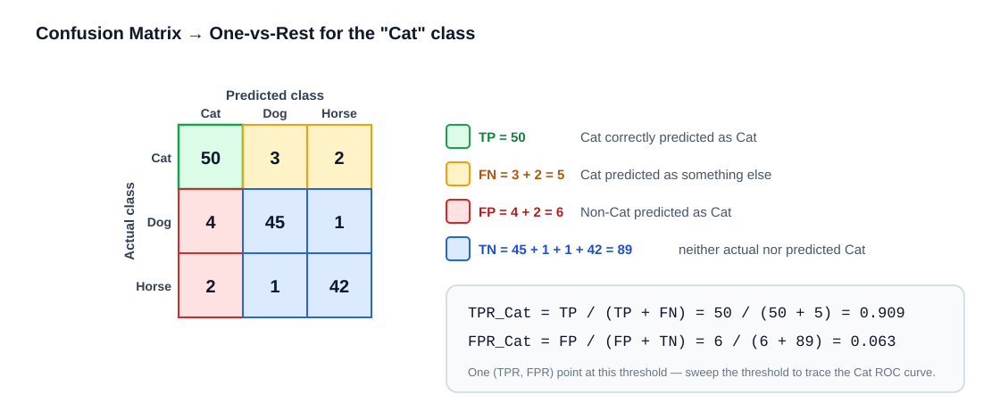
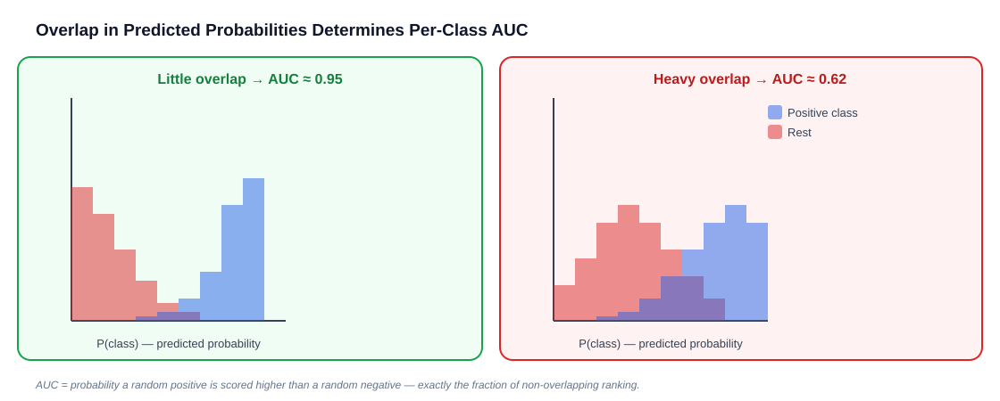
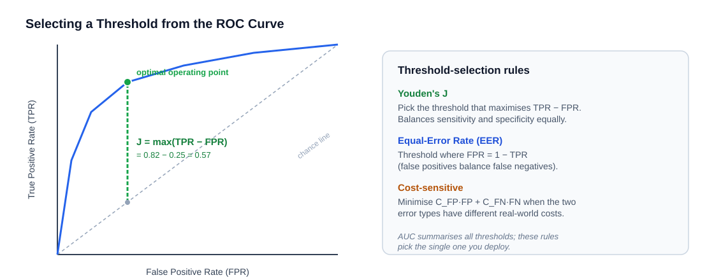
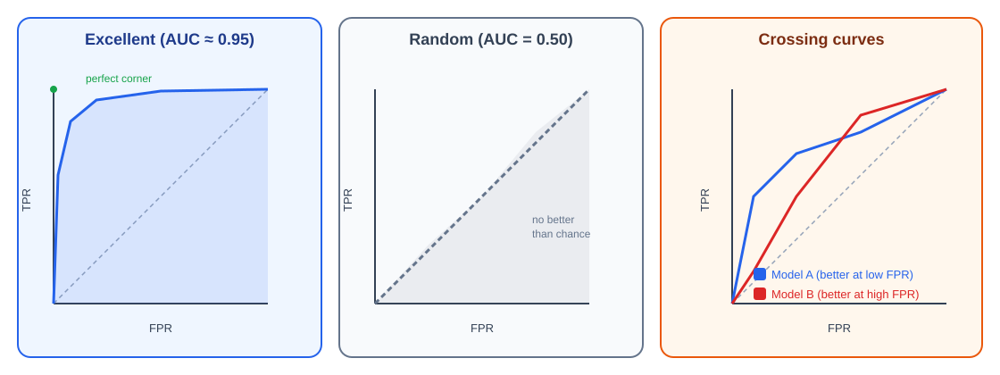
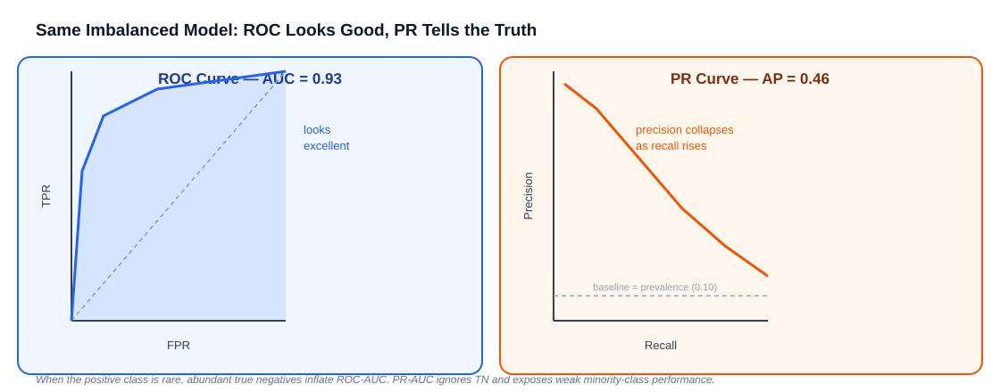

# Multiclass ROC-AUC (OvR and OvO)

## Table of Contents

- **[1. Quick Revision: Binary ROC-AUC](#1-quick-revision-binary-roc-auc)**
- **[2. Why Do We Need Multiclass ROC-AUC?](#2-why-do-we-need-multiclass-roc-auc)**
- **[3. Confusion Matrix → One-vs-Rest Bridge](#3-confusion-matrix--one-vs-rest-bridge)**
- **[4. One-vs-Rest (OvR) Approach](#4-one-vs-rest-ovr-approach)**
  - [4.1 Deriving OvR Mathematically](#41-deriving-ovr-mathematically)
  - [4.2 Probability Overlap and AUC](#42-probability-overlap-and-auc)
- **[5. Averaging Strategies in Multiclass ROC-AUC](#5-averaging-strategies-in-multiclass-roc-auc)**
  - [5.1 Macro-Average ROC-AUC](#51-macro-average-roc-auc)
  - [5.2 Weighted-Average ROC-AUC](#52-weighted-average-roc-auc)
  - [5.3 Micro-Average ROC-AUC](#53-micro-average-roc-auc)
  - [5.4 Comparing the Three Averaging Methods](#54-comparing-the-three-averaging-methods)
- **[6. One-vs-One (OvO) Approach](#6-one-vs-one-ovo-approach)**
  - [6.1 Hand-Till Multiclass AUC Formulation](#61-hand-till-multiclass-auc-formulation)
  - [6.2 Weighted OvO](#62-weighted-ovo)
  - [6.3 OvR vs OvO Comparison](#63-ovr-vs-ovo-comparison)
  - [6.4 When OvR and OvO Disagree](#64-when-ovr-and-ovo-disagree)
- **[7. Understanding ROC Curves for Individual Classes](#7-understanding-roc-curves-for-individual-classes)**
- **[8. Selecting a Classification Threshold](#8-selecting-a-classification-threshold)**
- **[9. Interpreting Multiclass ROC-AUC](#9-interpreting-multiclass-roc-auc)**
- **[10. The Gini Coefficient](#10-the-gini-coefficient)**
- **[11. Confidence Intervals for AUC](#11-confidence-intervals-for-auc)**
- **[12. Precision-Recall AUC for Multiclass](#12-precision-recall-auc-for-multiclass)**
- **[13. Implementation Using Python and Scikit-learn](#13-implementation-using-python-and-scikit-learn)**
- **[14. Multiclass ROC-AUC vs Accuracy vs F1-score](#14-multiclass-roc-auc-vs-accuracy-vs-f1-score)**
- **[15. Limitations of ROC-AUC in Multiclass Settings](#15-limitations-of-roc-auc-in-multiclass-settings)**
- **[16. Key Concepts Checklist](#16-key-concepts-checklist)**
- **[17. Final Summary: The Most Important Formulas](#17-final-summary-the-most-important-formulas)**
- **[References](#references)**

---

## Introduction

**Multiclass ROC-AUC** is an evaluation metric used to measure how well a classification model distinguishes between three or more classes.

You already know how ROC-AUC works in Binary Logistic Regression. We use:

- True Positive Rate (TPR / Sensitivity)
- False Positive Rate (FPR)
- Different classification thresholds
- ROC Curve
- Area Under the ROC Curve (AUC)

But there is one challenge when moving from binary to multiclass classification:

> A standard ROC curve compares only **two groups**: Positive and Negative. How do we calculate ROC-AUC when we have three or more classes?

The solution is to **convert the multiclass problem into multiple binary classification problems**.

There are three ideas you need to combine:

| Concept | Idea |
|---|---|
| **One-vs-Rest (OvR)** | Each class vs all other classes combined |
| **One-vs-One (OvO)** | Each pair of classes evaluated separately |
| **Averaging strategy** | How to combine the many AUC values into one score (macro / weighted / micro) |

---

## 1. Quick Revision: Binary ROC-AUC

Suppose we have a binary classification problem:

- **Class 0:** Negative
- **Class 1:** Positive

Our model predicts probabilities:

| Actual Class | Predicted Probability of Class 1 |
|:---:|:---:|
| 0 | 0.10 |
| 0 | 0.30 |
| 1 | 0.65 |
| 1 | 0.90 |

We vary the classification threshold and calculate:

```math
TPR = \frac{TP}{TP + FN}
```

```math
FPR = \frac{FP}{FP + TN}
```

**Sweeping the threshold** across the four samples above (2 positives, 2 negatives) produces the ROC coordinates:

| Threshold | Predicted Positive | TP | FP | FN | TN | TPR | FPR |
|:---:|:---:|:---:|:---:|:---:|:---:|:---:|:---:|
| > 0.90 | (none) | 0 | 0 | 2 | 2 | 0.00 | 0.00 |
| 0.90 | 0.90 | 1 | 0 | 1 | 2 | 0.50 | 0.00 |
| 0.65 | 0.90, 0.65 | 2 | 0 | 0 | 2 | 1.00 | 0.00 |
| 0.30 | 0.90, 0.65, 0.30 | 2 | 1 | 0 | 1 | 1.00 | 0.50 |
| 0.10 | all four | 2 | 2 | 0 | 0 | 1.00 | 1.00 |

Then we plot:

- **X-axis:** FPR
- **Y-axis:** TPR

The area under this curve is ROC-AUC. In this example the curve reaches (0, 1) before any false positives appear, so the AUC is a perfect **1.0** — the model ranks both positives above both negatives.

**The key probabilistic interpretation:**

```math
\boxed{
AUC = P(\text{a positive sample gets a higher score than a negative sample})
}
```

For multiclass classification, we extend this idea to each class.

---

## 2. Why Do We Need Multiclass ROC-AUC?

Suppose we have a multiclass classification problem with three classes:

- **Cat**
- **Dog**
- **Horse**

Our Softmax Regression model produces **three probabilities** for every observation.

For example:

| Actual Class | P(Cat) | P(Dog) | P(Horse) |
|:---:|:---:|:---:|:---:|
| Cat | 0.90 | 0.05 | 0.05 |
| Cat | 0.60 | 0.30 | 0.10 |
| Dog | 0.20 | 0.70 | 0.10 |
| Dog | 0.15 | 0.65 | 0.20 |
| Horse | 0.10 | 0.20 | 0.70 |
| Horse | 0.20 | 0.25 | 0.55 |

Our model generates **three probabilities per row**, rather than one.

So we need to evaluate how well it distinguishes:

1. Cat vs Not Cat
2. Dog vs Not Dog
3. Horse vs Not Horse

This leads us to the first approach — but first, let's connect it to something you already know: the confusion matrix.

---

## 3. Confusion Matrix → One-vs-Rest Bridge

Before computing ROC curves, it helps to see **where the per-class TP, FP, FN, and TN come from**. They are read directly off the multiclass confusion matrix.



Consider this confusion matrix (rows = actual class, columns = predicted class):

| Actual ↓ / Predicted → | Cat | Dog | Horse | Row Total |
|:---:|:---:|:---:|:---:|:---:|
| **Cat** | 50 | 3 | 2 | 55 |
| **Dog** | 4 | 45 | 1 | 50 |
| **Horse** | 2 | 1 | 42 | 45 |

To evaluate **Cat as the positive class** (One-vs-Rest), read the four quantities off the matrix:

| Quantity | Cells | Value |
|---|---|:---:|
| **TP** (Cat predicted Cat) | diagonal Cat cell | $50$ |
| **FN** (Cat predicted as something else) | rest of the Cat **row** | $3 + 2 = 5$ |
| **FP** (non-Cat predicted as Cat) | rest of the Cat **column** | $4 + 2 = 6$ |
| **TN** (neither actual nor predicted Cat) | the remaining $2\times2$ block | $45 + 1 + 1 + 42 = 89$ |

This gives **one** (TPR, FPR) point:

```math
TPR_{\text{Cat}} = \frac{50}{50 + 5} = 0.909, \qquad
FPR_{\text{Cat}} = \frac{6}{6 + 89} = 0.063
```

> [!NOTE]
> A confusion matrix is computed at **one fixed threshold** (the argmax decision). To build the full ROC curve we vary the threshold on $P(\text{Cat} \mid X)$ and recompute these four counts at every threshold — tracing out the whole curve rather than a single point.

---

## 4. One-vs-Rest (OvR) Approach

> [!NOTE]
> **One-vs-Rest** is the most commonly taught approach and the default in scikit-learn's `roc_auc_score`.

**One-vs-Rest** converts a multiclass classification problem into **$K$ separate binary classification problems**, one for each class.

For three classes, we construct three problems:

| Problem | Positive Class | Negative Class |
|:---:|:---:|:---:|
| 1 | Cat | Dog + Horse |
| 2 | Dog | Cat + Horse |
| 3 | Horse | Cat + Dog |

We calculate **three separate ROC curves** and **three AUC scores**, then combine them using an averaging strategy.

### 4.1 Deriving OvR Mathematically

Suppose we have $K = 3$ classes.

For each class $k$, we define a **binary indicator**:

```math
y_k =
\begin{cases}
1 & \text{if actual class is } k \\
0 & \text{otherwise}
\end{cases}
```

The model's score for class $k$ is the Softmax probability:

```math
s_k = P(Y = k \mid X)
```

So for our three classes:

```math
s_{\text{Cat}} = P(Y = \text{Cat} \mid X), \qquad
s_{\text{Dog}} = P(Y = \text{Dog} \mid X), \qquad
s_{\text{Horse}} = P(Y = \text{Horse} \mid X)
```

For each class, we calculate TPR and FPR by varying the threshold on $s_k$ (exactly as in Section 3). For Cat:

```math
TPR_{\text{Cat}} = \frac{TP_{\text{Cat}}}{TP_{\text{Cat}} + FN_{\text{Cat}}}
```

```math
FPR_{\text{Cat}} = \frac{FP_{\text{Cat}}}{FP_{\text{Cat}} + TN_{\text{Cat}}}
```

Each class's AUC is then the **area under its own binary ROC curve** — computed with the identical procedure used for binary classification. Repeating for all classes gives:

```math
AUC_{\text{Cat}}, \qquad AUC_{\text{Dog}}, \qquad AUC_{\text{Horse}}
```

We now have three AUC values. The next question is: **how do we combine them into one overall score?** That is handled by the averaging strategies in Section 5.

### 4.2 Probability Overlap and AUC

Why does one class get a higher AUC than another? It comes down to **how much the predicted-probability distributions overlap** between the positive class and the rest.



Recall that AUC equals the probability that a random positive is scored above a random negative. If the two histograms barely overlap, almost every positive outranks every negative → AUC near 1. If they overlap heavily, the model frequently scores a negative above a positive → AUC near 0.5.

> [!TIP]
> Plotting the per-class probability histograms is one of the fastest ways to **see** which classes your model struggles to separate — the overlap region is exactly the error the AUC penalises.

---

## 5. Averaging Strategies in Multiclass ROC-AUC

There are three important averaging methods:

| Method | Idea |
|---|---|
| **Macro** | Simple average across all class AUCs |
| **Weighted** | Weighted average by class sample count |
| **Micro** | Pool all predictions, compute one AUC |

### 5.1 Macro-Average ROC-AUC

**Macro averaging** calculates the AUC for every class separately and takes their **simple arithmetic mean**.

```math
\boxed{
AUC_{\text{macro}} = \frac{1}{K} \sum_{k=1}^{K} AUC_k
}
```

Suppose our results are:

| Class | AUC |
|:---:|:---:|
| Cat | 0.95 |
| Dog | 0.85 |
| Horse | 0.70 |

Substituting:

```math
AUC_{\text{macro}} = \frac{0.95 + 0.85 + 0.70}{3}
```

```math
\boxed{AUC_{\text{macro}} = 0.8333}
```

**Key characteristic:** Every class receives **equal importance**, regardless of how many samples it contains.

| Class | Number of Samples |
|:---:|:---:|
| Cat | 1,000 |
| Dog | 500 |
| Horse | 50 |

Even though Horse has only 50 observations, its AUC contributes exactly $\frac{1}{3}$ to the macro average.

> [!TIP]
> **When to use Macro:** When you want to evaluate performance **equally across all classes**, especially when minority classes are important (e.g., rare disease detection).

---

### 5.2 Weighted-Average ROC-AUC

**Weighted averaging** also calculates an AUC per class, but assigns a **weight proportional to the number of actual samples** in that class.

```math
\boxed{
AUC_{\text{weighted}} = \frac{\sum_{k=1}^{K} n_k \cdot AUC_k}{\sum_{k=1}^{K} n_k}
}
```

Where:

- $n_k$: Number of actual samples in class $k$
- $AUC_k$: AUC of class $k$

Using our previous dataset:

| Class | Samples | AUC |
|:---:|:---:|:---:|
| Cat | 1,000 | 0.95 |
| Dog | 500 | 0.85 |
| Horse | 50 | 0.70 |

Substituting:

```math
AUC_{\text{weighted}} = \frac{1000(0.95) + 500(0.85) + 50(0.70)}{1000 + 500 + 50}
```

```math
= \frac{950 + 425 + 35}{1550}
```

```math
\boxed{AUC_{\text{weighted}} \approx 0.9097}
```

**Notice the difference:**

| Method | AUC |
|---|:---:|
| Macro | 0.8333 |
| Weighted | 0.9097 |

Weighted AUC is **higher** because Cat has both the largest AUC *and* the most samples, so it contributes more.

> [!TIP]
> **When to use Weighted:** When you want an overall score that **reflects the actual class distribution** in your dataset — the overall model performance seen in practice.

---

### 5.3 Micro-Average ROC-AUC

**Micro averaging** is fundamentally different from Macro and Weighted.

Instead of calculating a separate AUC per class and then averaging, Micro averaging **combines all class predictions into one large binary classification problem** before computing a single ROC curve and AUC.

**Step 1 — Original labels:**

| Sample | Actual Class |
|:---:|:---:|
| 1 | Cat |
| 2 | Dog |
| 3 | Horse |

**Step 2 — Convert to one-hot encoding:**

```math
Y =
\begin{bmatrix}
1 & 0 & 0 \\
0 & 1 & 0 \\
0 & 0 & 1
\end{bmatrix}
```

**Step 3 — Predicted probabilities from Softmax:**

```math
\hat{Y} =
\begin{bmatrix}
0.8 & 0.1 & 0.1 \\
0.2 & 0.7 & 0.1 \\
0.1 & 0.2 & 0.7
\end{bmatrix}
```

**Step 4 — Flatten both matrices row-by-row:**

```math
Y_{\text{flat}} = [1, 0, 0, \; 0, 1, 0, \; 0, 0, 1]
```

```math
\hat{Y}_{\text{flat}} = [0.8, 0.1, 0.1, \; 0.2, 0.7, 0.1, \; 0.1, 0.2, 0.7]
```

Now we have **one binary classification problem** containing:

- **Positive entries ($1$):** Correct class indicators
- **Negative entries ($0$):** All other class indicators

We calculate **one ROC curve and one AUC:**

```math
\boxed{
AUC_{\text{micro}} = AUC\!\left(Y_{\text{flat}},\; \hat{Y}_{\text{flat}}\right)
}
```

**Key characteristic:** Every individual class–sample decision contributes **equally** — a single wrong prediction for the rare Horse class counts the same as one for the dominant Cat class.

**Balanced vs imbalanced — why Micro and Macro diverge:**

| Scenario | Class sizes | Macro AUC | Micro AUC | Behaviour |
|---|---|:---:|:---:|---|
| **Balanced** | 100 / 100 / 100 | 0.85 | ≈ 0.85 | Micro ≈ Macro — every class contributes the same number of pooled decisions |
| **Imbalanced** | 900 / 90 / 10 | 0.75 | ≈ 0.90 | Micro is pulled toward the dominant Cat class, which has most of the pooled decisions; Macro still weights the poorly-performing minority classes equally |

In the imbalanced case, a Micro AUC of 0.90 looks great, but the Macro AUC of 0.75 reveals the model is mediocre on the classes that aren't Cat.

> [!TIP]
> **When to use Micro:** When you want an **overall measure across all class decisions** and treat every individual binary decision equally, regardless of class.

> [!IMPORTANT]
> Micro averaging **calculates a new AUC from pooled predictions**. It does not average the per-class AUC values. For balanced datasets, Micro AUC ≈ Macro AUC; they diverge under class imbalance.

---

### 5.4 Comparing the Three Averaging Methods

| Property | Macro | Weighted | Micro |
|---|:---:|:---:|:---:|
| Calculation | Average class AUCs | Support-weighted class AUCs | Single AUC from pooled decisions |
| Equal class importance | Yes | No | No |
| Considers class frequency | No | Yes | Through pooled decisions |
| Minority class influence | Equal to majority | Proportional to support | Individual decisions pooled |
| Sensitive to class imbalance | Less | More | Yes (dominated by large classes) |
| Best for | Minority class evaluation | Dataset-level summary | Overall pooled performance |

> [!NOTE]
> **Key distinction:** Macro and Weighted **average the individual AUC scores**. Micro **calculates a new AUC** from the pooled predictions — these are fundamentally different operations.

---

## 6. One-vs-One (OvO) Approach

Instead of comparing each class against all remaining classes, **One-vs-One** compares **every possible pair** of classes.

For Cat, Dog, and Horse:

| Comparison | Positive Class | Negative Class |
|:---:|:---:|:---:|
| 1 | Cat | Dog |
| 2 | Cat | Horse |
| 3 | Dog | Horse |

The number of pairwise comparisons for $K$ classes is:

```math
\boxed{\frac{K(K-1)}{2}}
```

| Number of Classes $K$ | Number of OvO Comparisons |
|:---:|:---:|
| 3 | 3 |
| 5 | 10 |
| 10 | 45 |
| 20 | 190 |

Each pair gets its own AUC score. For example:

| Pairwise Comparison | AUC |
|:---:|:---:|
| Cat vs Dog | 0.95 |
| Cat vs Horse | 0.90 |
| Dog vs Horse | 0.80 |

The **macro pairwise average** is:

```math
AUC_{\text{OvO}} = \frac{0.95 + 0.90 + 0.80}{3}
```

```math
\boxed{AUC_{\text{OvO}} = 0.8833}
```

> [!NOTE]
> For each pair $(j, k)$, the evaluation only uses observations that belong to **class $j$ or class $k$** — not the full dataset. This makes OvO less sensitive to the composition of the "rest" group than OvR.

---

### 6.1 Hand-Till Multiclass AUC Formulation

The most widely cited formalization of OvO multiclass AUC is from **Hand and Till (2001)**.

For a pair of classes $(j, k)$, define:

```math
\hat{A}(j \mid k) = P\!\left(s_j(X) > s_j(X') \mid Y = j,\; Y' = k\right)
```

This is the probability that the model assigns a **higher score for class $j$** to an actual class-$j$ observation than to an actual class-$k$ observation — identical to the standard binary AUC interpretation.

The **symmetric pairwise AUC** averages both directions:

```math
\hat{A}(j, k) = \frac{\hat{A}(j \mid k) + \hat{A}(k \mid j)}{2}
```

The overall **Hand-Till multiclass AUC** is the macro average over all pairs:

```math
\boxed{
\hat{A} = \frac{2}{K(K-1)} \sum_{j < k} \hat{A}(j, k)
}
```

> [!NOTE]
> Scikit-learn's `roc_auc_score` with `multi_class='ovo'` implements this exact formulation.

---

### 6.2 Weighted OvO

Like OvR, the OvO pairwise AUCs can also be combined with a **prevalence weighting** instead of a simple average. Scikit-learn exposes this as `multi_class='ovo', average='weighted'`.

Each pair $(j, k)$ is weighted by the combined prevalence of the two classes:

```math
\boxed{
AUC_{\text{OvO, weighted}} = \frac{\sum_{j < k}\,(n_j + n_k)\,\hat{A}(j, k)}{\sum_{j < k}\,(n_j + n_k)}
}
```

Where $n_j$ and $n_k$ are the sample counts of the two classes in the pair. Pairs involving large classes contribute more to the final score, making the metric reflect the dataset's actual composition.

---

### 6.3 OvR vs OvO Comparison

| Property | OvR | OvO |
|---|---|---|
| Comparison | One class vs all others | One class vs one other class |
| Number of comparisons | $K$ | $K(K-1)/2$ |
| Training set per comparison | Full dataset | Only the two-class subset |
| Class imbalance sensitivity | Can be affected by "rest" composition | Evaluates pairs separately |
| Computational cost | Lower | Higher for large $K$ |
| Separate models needed? | Yes (for training) | No (uses existing Softmax scores) |
| Scikit-learn parameter | `multi_class='ovr'` | `multi_class='ovo'` |

> [!IMPORTANT]
> OvO ROC-AUC **can be calculated using the existing Softmax probabilities** from a multiclass model. You do **not** need to train separate pairwise binary models — the scores $P(Y = k \mid X)$ are used directly.

In practice OvR and OvO usually agree closely. For example, a RandomForest on a balanced three-class fruit dataset (apple, banana, orange) scores **OvR ≈ 0.9410** and **OvO ≈ 0.9409** — essentially identical (see [References](#references)). The next section shows the special case where they **disagree**.

---

### 6.4 When OvR and OvO Disagree

OvR and OvO can **rank two models differently**. This happens when a model is strong at separating *easy* class pairs but weak at a specific *hard* pair — OvR can hide that weakness because the "rest" group is dominated by easy classes.

Consider two models on the Cat / Dog / Horse problem:

**Model A** — great at easy pairs, poor at the hard Dog–Horse pair:

| | Per-class OvR AUC | | Pairwise OvO AUC |
|---|:---:|---|:---:|
| Cat vs rest | 0.90 | Cat vs Dog | 0.95 |
| Dog vs rest | 0.88 | Cat vs Horse | 0.93 |
| Horse vs rest | 0.86 | Dog vs Horse | 0.72 |
| **Macro OvR** | **0.880** | **Macro OvO** | **0.867** |

**Model B** — balanced across every pair:

| | Per-class OvR AUC | | Pairwise OvO AUC |
|---|:---:|---|:---:|
| Cat vs rest | 0.87 | Cat vs Dog | 0.89 |
| Dog vs rest | 0.86 | Cat vs Horse | 0.88 |
| Horse vs rest | 0.85 | Dog vs Horse | 0.87 |
| **Macro OvR** | **0.860** | **Macro OvO** | **0.880** |

**The verdict flips:**

| Metric | Model A | Model B | Winner |
|---|:---:|:---:|:---:|
| Macro OvR | **0.880** | 0.860 | Model A |
| Macro OvO | 0.867 | **0.880** | Model B |

OvR prefers **Model A** because "Dog vs rest" and "Horse vs rest" both benefit from the easy separation against the dominant Cat class — masking the fact that Dog and Horse are hard to tell apart (0.72). OvO exposes that weak pair directly, so it prefers the more balanced **Model B**.

> [!IMPORTANT]
> If your application cares about **discriminating specific confusable pairs** (e.g., two similar disease subtypes), prefer **OvO**. If it cares about **each class vs everything else** (e.g., "is this the fraud class or not"), prefer **OvR**.

---

## 7. Understanding ROC Curves for Individual Classes

Let's trace how the ROC curve is generated for one class step by step.

Suppose our model predicts the probability of **Cat** for five observations:

| Observation | Actual Class | P(Cat) | Binary Label (Cat = 1) |
|:---:|:---:|:---:|:---:|
| A | Cat | 0.95 | 1 |
| B | Cat | 0.80 | 1 |
| C | Dog | 0.70 | 0 |
| D | Horse | 0.40 | 0 |
| E | Dog | 0.20 | 0 |

We treat **Cat as positive** and everything else as negative (2 positives, 3 negatives).

By varying the threshold, we generate multiple (FPR, TPR) points:

| Threshold | Predicted Cat | TP | FP | FN | TN | TPR | FPR |
|:---:|:---:|:---:|:---:|:---:|:---:|:---:|:---:|
| 0.95 | A | 1 | 0 | 1 | 3 | 0.50 | 0.00 |
| 0.80 | A, B | 2 | 0 | 0 | 3 | 1.00 | 0.00 |
| 0.70 | A, B, C | 2 | 1 | 0 | 2 | 1.00 | 0.33 |
| 0.40 | A, B, C, D | 2 | 2 | 0 | 1 | 1.00 | 0.67 |
| 0.20 | A, B, C, D, E | 2 | 3 | 0 | 0 | 1.00 | 1.00 |

Plotting FPR on the x-axis and TPR on the y-axis gives the **ROC curve for Cat**.

We repeat this process for **Dog** and **Horse** to get three separate ROC curves.

> [!IMPORTANT]
> We use the **predicted probabilities** (or decision scores), **not** the final predicted class labels, to calculate ROC-AUC. Thresholding the final label would lose the ranking information that AUC measures.

---

## 8. Selecting a Classification Threshold

AUC summarises performance across **all** thresholds, but to deploy a model you must pick **one** operating threshold. The ROC curve itself tells you how.



| Rule | Definition | Use when |
|---|---|---|
| **Youden's J** | Pick the threshold maximising $J = TPR - FPR$ | You want to balance sensitivity and specificity equally |
| **Equal-Error Rate (EER)** | Threshold where $FPR = 1 - TPR$ (false positives balance false negatives) | Symmetric error costs; common in biometrics |
| **Cost-sensitive** | Minimise $C_{FP}\cdot FP + C_{FN}\cdot FN$ | The two error types have different real-world costs |

**Youden's J** is the most common default:

```math
\boxed{
J = \max_{\text{threshold}} \; \bigl(TPR - FPR\bigr)
}
```

Geometrically, $J$ is the **largest vertical gap** between the ROC curve and the chance diagonal — the point on the curve farthest from "random."

```python
import numpy as np
from sklearn.metrics import roc_curve

fpr, tpr, thresholds = roc_curve(y_true_binary[:, 0], y_score[:, 0])
youden_j = tpr - fpr
best_idx = np.argmax(youden_j)
best_threshold = thresholds[best_idx]
print(f"Optimal threshold (Youden's J): {best_threshold:.3f}")
print(f"  TPR = {tpr[best_idx]:.3f}, FPR = {fpr[best_idx]:.3f}, J = {youden_j[best_idx]:.3f}")
```

> [!IMPORTANT]
> The predicted **class label** from `argmax` corresponds to a fixed 0.5-style decision. Threshold tuning lets you trade recall for precision **without retraining** — valuable when one error type is far more costly than the other.

---

## 9. Interpreting Multiclass ROC-AUC

The interpretation is similar to binary ROC-AUC, but we must also consider **which averaging strategy** was used.

| AUC Score | General Interpretation |
|:---:|---|
| 1.00 | Perfect discrimination |
| 0.90 – 0.99 | Excellent discrimination |
| 0.80 – 0.89 | Good discrimination |
| 0.70 – 0.79 | Moderate discrimination |
| 0.60 – 0.69 | Weak discrimination |
| 0.50 | Random-ranking baseline (no better than chance) |

> [!NOTE]
> These are **informal guidelines**, not universal standards. The appropriate threshold depends on the domain (e.g., medical diagnosis vs product recommendation).

**The shape of the curve matters as much as the single AUC number:**



- A curve that **hugs the top-left corner** → strong at every threshold (high AUC).
- A curve **on the diagonal** → no better than random (AUC ≈ 0.5).
- A curve that **dips below the diagonal** → worse than random in that region (often a sign of flipped labels or a miscalibrated score).
- **Two curves that cross** → one model is better at low FPR, the other at high FPR. The AUC may be nearly equal, but which model you choose depends on **the operating region you care about**.

**Per-class example:**

```math
AUC_{\text{Cat}} = 0.95, \qquad AUC_{\text{Dog}} = 0.85, \qquad AUC_{\text{Horse}} = 0.60
```

This tells us:

- The model **distinguishes Cat very well**.
- The model **distinguishes Dog reasonably well**.
- The model **struggles to separate Horse** from the other classes.

> [!WARNING]
> An overall ROC-AUC of 0.85 can **hide poor performance on individual classes**. Always examine **per-class AUC values** when class-specific performance matters (e.g., when one class represents a rare but critical outcome).

---

## 10. The Gini Coefficient

In credit scoring, insurance, and many business settings, model discrimination is reported as the **Gini coefficient** rather than AUC. They are two views of the same quantity:

```math
\boxed{
\text{Gini} = 2 \times AUC - 1
}
```

| AUC | Gini |
|:---:|:---:|
| 1.00 | 1.00 |
| 0.90 | 0.80 |
| 0.85 | 0.70 |
| 0.75 | 0.50 |
| 0.50 | 0.00 |

Gini rescales AUC so that **0 = random** and **1 = perfect**. An AUC of 0.85 becomes a Gini of 0.70. Knowing this conversion lets you communicate with stakeholders who expect Gini, without changing any underlying computation.

---

## 11. Confidence Intervals for AUC

A single AUC number means little without an estimate of its **uncertainty** — especially on small test sets. Two standard approaches:

| Method | How it works | Notes |
|---|---|---|
| **Bootstrap** | Resample the test set with replacement $B$ times, recompute AUC each time, take the 2.5th–97.5th percentile | Simple, no distributional assumptions; works for any averaging strategy |
| **DeLong** | Analytical variance of AUC based on its Mann-Whitney U form | No resampling; standard in medical literature; binary/OvO per pair |

Scikit-learn has **no built-in CI**, but the bootstrap is a few lines:

```python
import numpy as np
from sklearn.metrics import roc_auc_score

rng = np.random.default_rng(42)
n_boot = 2000
scores = []

for _ in range(n_boot):
    idx = rng.integers(0, len(y_true), len(y_true))      # resample with replacement
    if len(np.unique(y_true[idx])) < n_classes:          # skip degenerate resamples
        continue
    scores.append(
        roc_auc_score(y_true[idx], y_score[idx], multi_class="ovr", average="macro")
    )

scores = np.array(scores)
lo, hi = np.percentile(scores, [2.5, 97.5])
print(f"Macro OvR AUC = {scores.mean():.3f}  95% CI [{lo:.3f}, {hi:.3f}]")
```

> [!TIP]
> Report AUC as **estimate ± interval** (e.g., "0.84, 95% CI [0.79, 0.89]"). Two models whose confidence intervals overlap heavily are **not** meaningfully different, no matter which point estimate is higher.

---

## 12. Precision-Recall AUC for Multiclass

For **highly imbalanced** problems, ROC-AUC can be misleadingly optimistic because the large number of true negatives suppresses the FPR. The **Precision-Recall (PR) curve** ignores true negatives entirely and focuses on the positive (often minority) class.



| Curve | X-axis | Y-axis | Baseline |
|---|---|---|---|
| **ROC** | FPR | TPR (Recall) | diagonal (0.5 AUC) |
| **PR** | Recall | Precision | positive-class prevalence |

The multiclass version follows the **same OvR one-hot pattern** used for ROC, but uses `precision_recall_curve` and `average_precision_score`:

```python
from sklearn.metrics import precision_recall_curve, average_precision_score
from sklearn.preprocessing import label_binarize
import matplotlib.pyplot as plt

y_true_binary = label_binarize(y_true, classes=[0, 1, 2])
classes = ["Cat", "Dog", "Horse"]

fig, ax = plt.subplots(figsize=(7, 5))
for i, class_name in enumerate(classes):
    precision, recall, _ = precision_recall_curve(y_true_binary[:, i], y_score[:, i])
    ap = average_precision_score(y_true_binary[:, i], y_score[:, i])
    ax.plot(recall, precision, lw=2, label=f"{class_name} (AP = {ap:.2f})")

# Macro-averaged Average Precision across all classes
macro_ap = average_precision_score(y_true_binary, y_score, average="macro")
print(f"Macro Average Precision: {macro_ap:.4f}")

ax.set_xlabel("Recall")
ax.set_ylabel("Precision")
ax.set_title("Multiclass Precision-Recall Curves (OvR)")
ax.legend(loc="lower left")
plt.tight_layout()
plt.show()
```

**Average Precision (AP)** summarises the PR curve as a single number — the PR analogue of AUC:

```math
\text{AP} = \sum_{n} (R_n - R_{n-1})\, P_n
```

where $P_n$ and $R_n$ are precision and recall at the $n$-th threshold.

> [!IMPORTANT]
> Rule of thumb: use **ROC-AUC** when classes are roughly balanced or you care about both classes equally; use **PR-AUC / Average Precision** when the positive class is **rare** and correctly retrieving it is what matters.

---

## 13. Implementation Using Python and Scikit-learn

```python
import numpy as np
from sklearn.metrics import roc_auc_score, roc_curve, auc
from sklearn.preprocessing import label_binarize
import matplotlib.pyplot as plt

# ── Data ──────────────────────────────────────────────────────────────────────
# Actual class labels (0 = Cat, 1 = Dog, 2 = Horse)
y_true = np.array([0, 0, 1, 1, 2, 2])

# Predicted probabilities from Softmax Regression
y_score = np.array([
    [0.90, 0.05, 0.05],
    [0.80, 0.15, 0.05],
    [0.10, 0.80, 0.10],
    [0.20, 0.70, 0.10],
    [0.10, 0.10, 0.80],
    [0.20, 0.20, 0.60],
])

classes = ["Cat", "Dog", "Horse"]
n_classes = len(classes)

# ── One-hot encode actual labels ───────────────────────────────────────────────
y_true_binary = label_binarize(y_true, classes=[0, 1, 2])

# ── Per-class AUC (OvR) ────────────────────────────────────────────────────────
print("Per-class AUC (OvR)")
print("-" * 30)
for i, class_name in enumerate(classes):
    class_auc = roc_auc_score(y_true_binary[:, i], y_score[:, i])
    print(f"  {class_name:6s}: {class_auc:.4f}")

# ── OvR averaging strategies ───────────────────────────────────────────────────
print("\nOvR Averaging Strategies")
print("-" * 30)
for avg in ["macro", "weighted", "micro"]:
    score = roc_auc_score(y_true_binary, y_score, average=avg)
    print(f"  {avg:8s}: {score:.4f}")

# ── OvO (Hand-Till) ────────────────────────────────────────────────────────────
ovo_macro = roc_auc_score(y_true, y_score, multi_class="ovo", average="macro")
ovo_weighted = roc_auc_score(y_true, y_score, multi_class="ovo", average="weighted")
print(f"\nOvO (Hand-Till) macro:    {ovo_macro:.4f}")
print(f"OvO (Hand-Till) weighted: {ovo_weighted:.4f}")

# ── Gini coefficient ───────────────────────────────────────────────────────────
macro_auc = roc_auc_score(y_true_binary, y_score, average="macro")
print(f"\nGini (from macro OvR AUC): {2 * macro_auc - 1:.4f}")

# ── Plot per-class ROC curves ──────────────────────────────────────────────────
fig, ax = plt.subplots(figsize=(7, 5))
colors = ["steelblue", "darkorange", "seagreen"]

for i, (class_name, color) in enumerate(zip(classes, colors)):
    fpr, tpr, _ = roc_curve(y_true_binary[:, i], y_score[:, i])
    class_auc = auc(fpr, tpr)
    ax.plot(fpr, tpr, color=color, lw=2,
            label=f"{class_name} (AUC = {class_auc:.2f})")

ax.plot([0, 1], [0, 1], "k--", lw=1, label="Random baseline")
ax.set_xlabel("False Positive Rate (FPR)")
ax.set_ylabel("True Positive Rate (TPR)")
ax.set_title("Multiclass ROC Curves (One-vs-Rest)")
ax.legend(loc="lower right")
plt.tight_layout()
plt.show()
```

**Key implementation details:**

| Detail | Explanation |
|---|---|
| `y_true` | Original integer class labels |
| `y_score` | Softmax probability matrix — shape `(n_samples, n_classes)` |
| `label_binarize` | Converts integer labels to one-hot matrix for per-class AUC |
| `average='macro'` | Equal weight per class |
| `average='weighted'` | Weight by class support |
| `average='micro'` | Pool all predictions before computing AUC |
| `multi_class='ovo'` | Uses Hand-Till pairwise formulation |
| `multi_class='ovr'` | Default; one class vs all others |

> [!NOTE]
> The reference article ([Grace Zhang, Towards Data Science](#references)) demonstrates this exact workflow on a three-class fruit dataset (apple, banana, orange) with a `RandomForestClassifier`, obtaining **OvR ≈ 0.9410** and **OvO ≈ 0.9409** — a concrete example of how closely the two strategies usually agree.

---

## 14. Multiclass ROC-AUC vs Accuracy vs F1-score

These metrics measure **different aspects** of classification performance.

| Metric | What It Measures | Requires Probabilities? |
|---|---|:---:|
| Accuracy | Proportion of correctly classified observations | No |
| Precision | Of predicted positives, how many are actually positive | No |
| Recall | Of actual positives, how many are correctly identified | No |
| F1-score | Harmonic mean of Precision and Recall | No |
| ROC-AUC | How well the model **ranks** positives above negatives | Yes |

**Example — why accuracy can mislead:**

Consider a dataset with:

| Class | Samples |
|:---:|:---:|
| Cat | 900 |
| Dog | 90 |
| Horse | 10 |

A model that **always predicts Cat** achieves 90% accuracy — yet it completely fails on Dog and Horse.

Multiclass ROC-AUC, especially with macro averaging, examines the model's ability to **distinguish each class**, even when the final prediction is wrong.

**When ROC-AUC is preferred over F1:**

- When **ranking confidence matters** (e.g., risk scoring, information retrieval)
- When **threshold selection** has not yet been made
- When class distributions differ between train and deployment

**When to prefer Precision-Recall AUC over ROC-AUC:**

- When classes are **highly imbalanced** (minority class is the important one)
- When **false positives are very costly** (e.g., spam filter, fraud detection)

---

## 15. Limitations of ROC-AUC in Multiclass Settings

> [!WARNING]
> Understanding these limitations helps you choose the right metric for your problem.

| Limitation | Explanation |
|---|---|
| **Probability calibration** | ROC-AUC measures ranking, not calibration. A well-ranked model may still produce poorly calibrated probabilities. |
| **Class imbalance masking** | Weighted or Micro AUC can be dominated by the majority class, hiding poor performance on minority classes. |
| **Threshold insensitivity** | AUC summarises across all thresholds; it does not tell you the optimal operating threshold for your application. |
| **OvO scalability** | With $K = 100$ classes, OvO requires $\frac{100 \times 99}{2} = 4950$ pairwise comparisons. |
| **Mutual exclusivity assumption** | OvR and OvO ROC-AUC assume mutually exclusive classes; they are not appropriate for multi-label classification. |

> [!TIP]
> For highly imbalanced datasets, examine **per-class Precision-Recall (PR) curves** and **PR-AUC** alongside ROC-AUC — especially for minority classes where the ROC curve can look deceptively good (see [Section 12](#12-precision-recall-auc-for-multiclass)).

---

## 16. Key Concepts Checklist

- [ ] **Confusion matrix → OvR** — Read per-class TP, FP, FN, TN off the matrix ([Section 3](#3-confusion-matrix--one-vs-rest-bridge))
- [ ] **One-vs-Rest (OvR)** — Convert each class into a positive vs remaining classes problem
- [ ] **One-vs-One (OvO)** — Evaluate every possible pair of classes
- [ ] **Macro-Average AUC** — Equal contribution from every class
- [ ] **Weighted-Average AUC** — Contribution proportional to class support
- [ ] **Micro-Average AUC** — Pool all class-level decisions before calculating AUC
- [ ] **When OvR and OvO disagree** — Hard confusable pairs can flip the verdict ([Section 6.4](#64-when-ovr-and-ovo-disagree))
- [ ] **Per-class ROC curves** — Evaluate the discrimination ability of each individual class
- [ ] **Threshold selection** — Youden's J, EER, cost-sensitive ([Section 8](#8-selecting-a-classification-threshold))
- [ ] **Hand-Till AUC** — Symmetric pairwise multiclass AUC formulation
- [ ] **Gini coefficient** — $2\,AUC - 1$; common in credit/business reporting ([Section 10](#10-the-gini-coefficient))
- [ ] **Confidence intervals** — Bootstrap or DeLong around the AUC estimate ([Section 11](#11-confidence-intervals-for-auc))
- [ ] **Multiclass PR-AUC** — Precision-Recall evaluation for individual classes ([Section 12](#12-precision-recall-auc-for-multiclass))
- [ ] **Probability calibration** — Determine whether predicted probabilities reflect actual frequencies

---

## 17. Final Summary: The Most Important Formulas

| Concept | Formula |
|---|---|
| TPR | $\dfrac{TP}{TP + FN}$ |
| FPR | $\dfrac{FP}{FP + TN}$ |
| Precision | $\dfrac{TP}{TP + FP}$ |
| OvR comparisons | $K$ |
| OvO comparisons | $\dfrac{K(K-1)}{2}$ |
| Macro AUC | $\dfrac{1}{K} \displaystyle\sum_{k=1}^{K} AUC_k$ |
| Weighted AUC | $\dfrac{\displaystyle\sum_{k=1}^{K} n_k \cdot AUC_k}{\displaystyle\sum_{k=1}^{K} n_k}$ |
| Micro AUC | $AUC\!\left(\operatorname{flatten}(Y),\; \operatorname{flatten}(\hat{Y})\right)$ |
| Hand-Till OvO AUC | $\dfrac{2}{K(K-1)} \displaystyle\sum_{j < k} \hat{A}(j, k)$ |
| Weighted OvO AUC | $\dfrac{\sum_{j<k}(n_j + n_k)\,\hat{A}(j,k)}{\sum_{j<k}(n_j + n_k)}$ |
| Youden's J | $\max\,(TPR - FPR)$ |
| Gini coefficient | $2 \times AUC - 1$ |

---

## References

- **Grace Zhang** — *Multiclass Classification Evaluation With ROC Curves and ROC-AUC*, Towards Data Science.
  [Read the article →](https://medium.com/data-science/multiclass-classification-evaluation-with-roc-curves-and-roc-auc-294fd4617e3a)
  Used for the OvR/OvO intuition, the probability-overlap histogram view, and the apple/banana/orange worked example (OvR ≈ 0.9410, OvO ≈ 0.9409).
- **D. J. Hand and R. J. Till (2001)** — *A Simple Generalisation of the Area Under the ROC Curve for Multiple Class Classification Problems*, Machine Learning, 45(2), 171–186. The pairwise OvO formulation implemented by scikit-learn.
- **scikit-learn developers** — [`roc_auc_score`](https://scikit-learn.org/stable/modules/generated/sklearn.metrics.roc_auc_score.html), [`precision_recall_curve`](https://scikit-learn.org/stable/modules/generated/sklearn.metrics.precision_recall_curve.html), and the [Multiclass ROC guide](https://scikit-learn.org/stable/auto_examples/model_selection/plot_roc.html).

---

## Recommendation

Since you have already studied Binary ROC-AUC, Softmax Regression, and Multinomial Logistic Regression, the next logical step is to understand how **multiclass classification metrics behave under class imbalance**.

In particular, study **Macro vs Micro vs Weighted averaging** across:

- Precision
- Recall
- F1-score
- ROC-AUC

This will help you understand why two models can have **similar overall accuracy but very different per-class performance** — and how to choose the right metric for your specific problem.
