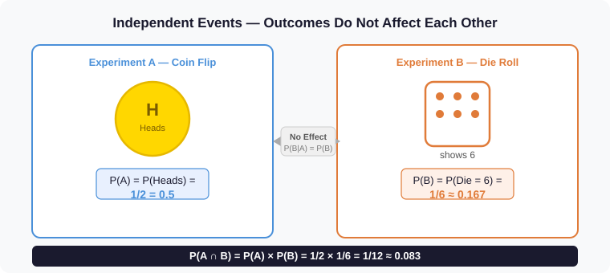
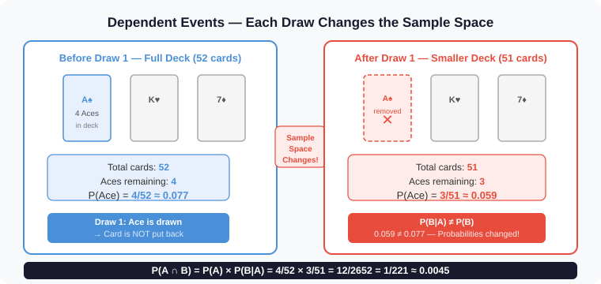
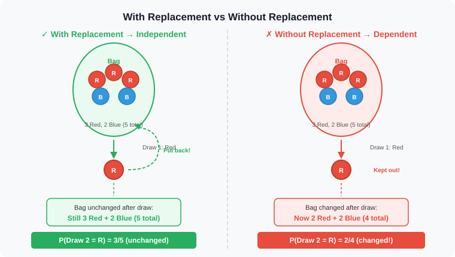

# Independent and Dependent Events in Probability

- In probability, two events can either **influence each other** or **have no effect** on one another.
- Understanding this distinction is essential for correctly applying probability rules — and is the foundation of the **Naive Bayes independence assumption**.

---

## Table of Contents

1. [Definitions](#1-definitions)
2. [Independent Events](#2-independent-events)
   - [Definition](#definition)
   - [Formula](#formula)
   - [Properties](#properties)
   - [Examples](#examples)
3. [Dependent Events](#3-dependent-events)
   - [Definition](#definition-1)
   - [Formula](#formula-1)
   - [Properties](#properties-1)
   - [Examples](#examples-1)
4. [Visual Intuition](#4-visual-intuition)
5. [Key Distinction — With vs Without Replacement](#5-key-distinction--with-vs-without-replacement)
6. [Comparison Table](#6-comparison-table)
   - [Key Differences](#key-differences)
   - [Detailed Comparison](#detailed-comparison)
7. [Worked Examples](#7-worked-examples)
   - [Example 1 — Coin and Die (Independent)](#example-1--coin-and-die-independent)
   - [Example 2 — Drawing Cards Without Replacement (Dependent)](#example-2--drawing-cards-without-replacement-dependent)
   - [Example 3 — Marbles Without Replacement (Dependent)](#example-3--marbles-without-replacement-dependent)
   - [Example 4 — Multiple Choice Test (Independent)](#example-4--multiple-choice-test-independent)
8. [How to Identify: Independent or Dependent?](#8-how-to-identify-independent-or-dependent)
9. [Practice Problems](#9-practice-problems)
10. [Quick Revision — Important Formulas](#10-quick-revision--important-formulas)
11. [Connection to Naive Bayes Classifier](#11-connection-to-naive-bayes-classifier)
12. [References](#12-references)

---

## 1. Definitions

| Term | Definition |
|---|---|
| **Independent Events** | Two events where the outcome of one **does not affect** the probability of the other. $P(B \mid A) = P(B)$ |
| **Dependent Events** | Two events where the outcome of one **does change** the probability of the other. $P(B \mid A) \neq P(B)$ |

> **Key test:** Compute $P(B)$ and $P(B \mid A)$. If they are equal, the events are independent. If they differ, the events are dependent.

---

## 2. Independent Events

### Definition

- Two events $A$ and $B$ are said to be ***independent*** if the occurrence of one event ***does not change*** the probability of the other event occurring.
- In other words, knowing that $A$ happened gives ***no information*** about whether $B$ will happen — and vice versa.

***Consider a simple example:*** You flip a coin and roll a die. The coin landing on **Heads** has absolutely no effect on which number the die shows. These two events are independent.

$$P(\text{Die} = 6 \mid \text{Heads}) = P(\text{Die} = 6) = \frac{1}{6}$$

The condition makes no difference — the probability stays the same.

> **Formal definition:** Events $A$ and $B$ are **independent** if and only if:
> $$P(A \cap B) = P(A) \cdot P(B)$$
> This is equivalent to saying $P(B \mid A) = P(B)$ whenever $P(A) > 0$.

---

### Formula

For two independent events $A$ and $B$:

$$\boxed{P(A \cap B) = P(A) \times P(B)}$$

This is the **Multiplication Rule for Independent Events** — the joint probability is simply the product of the individual probabilities.

**Equivalently**, the independence condition can be stated as:

$$\boxed{P(B \mid A) = P(B) \qquad \text{and} \qquad P(A \mid B) = P(A)}$$

Knowing that one event occurred gives **no new information** about the other.

### Properties

- **Symmetry:** If $A$ is independent of $B$, then $B$ is independent of $A$.
- **Complement:** If $A$ and $B$ are independent, then $A$ and $B'$ are also independent, and so are $A'$ and $B'$.
- **No overlap required:** Independent events can overlap in the sample space — independence is about probability, not geometry.
- **Mutual independence** (three events): $A$, $B$, $C$ are mutually independent if every pair and the triple satisfy:

$$P(A \cap B \cap C) = P(A) \cdot P(B) \cdot P(C)$$

### Examples

| Scenario | Why Independent |
|---|---|
| Tossing a coin then rolling a die | Coin result has no effect on the die |
| Drawing a card, replacing it, drawing again | The deck is reset — same probabilities each time |
| Answering two unrelated quiz questions | Each question is its own separate trial |
| Flipping two separate coins simultaneously | Two physically separate experiments |

---

## 3. Dependent Events

### Definition

- Two events $A$ and $B$ are said to be ***dependent*** if the occurrence of one event ***does change*** the probability of the other event occurring.
- When Event $A$ happens, it ***alters the sample space*** — meaning there are fewer (or different) outcomes left for Event $B$.

***Consider a simple example:*** You draw a card from a 52-card deck and **do not put it back**. Now only 51 cards remain. The probability of what you draw next has changed — these events are dependent.

$$P(\text{2nd Ace} \mid \text{1st Ace drawn}) = \frac{3}{51} \neq \frac{4}{52} = P(\text{Ace})$$

The condition **does** make a difference — the probability is different after the first event.

> **Formal definition:** Events $A$ and $B$ are **dependent** if and only if:
> $$P(A \cap B) \neq P(A) \cdot P(B)$$
> This is equivalent to saying $P(B \mid A) \neq P(B)$ — knowing $A$ occurred changes the probability of $B$.

---

### Formula

For two dependent events $A$ and $B$:

$$\boxed{P(A \cap B) = P(A) \times P(B \mid A)}$$

This is the **General Multiplication Rule** — it always holds, but for dependent events $P(B \mid A) \neq P(B)$, so the simple product rule does not apply.

**Equivalently**, using $B$ first:

$$\boxed{P(A \cap B) = P(B) \times P(A \mid B)}$$

### Properties

- The **sample space shrinks** after the first event — there are fewer outcomes available for the second event.
- $P(B \mid A)$ must be computed **given the new, reduced sample space**.
- Dependence is **not symmetric in magnitude**: $P(A \mid B)$ and $P(B \mid A)$ can be very different values.
- **Chain rule** for three dependent events:

$$P(A \cap B \cap C) = P(A) \cdot P(B \mid A) \cdot P(C \mid A \cap B)$$

### Examples

| Scenario | Why Dependent |
|---|---|
| Drawing two cards **without replacement** | First draw reduces the deck size and ace count |
| Picking two socks from a drawer without looking | First pick removes one sock, changing proportions |
| Weather on two consecutive days | Rain today makes rain tomorrow more likely |
| Drawing marbles from a bag without replacement | Bag contents change after each draw |

---

## 4. Visual Intuition

### Independent Events — Coin and Die

  

The coin flip and die roll are **completely separate experiments**. The result of one has absolutely no bearing on the other. $P(B \mid A) = P(B)$ — conditioning changes nothing.

---

### Dependent Events — Card Deck

  

- After drawing an Ace and **not replacing it**, the deck shrinks from 52 to 51 cards and the number of Aces drops from 4 to 3. 
- The probability of the second draw is **different** from the first. $P(B \mid A) \neq P(B)$.

---

## 5. Key Distinction — With vs Without Replacement

  

| | With Replacement | Without Replacement |
|---|---|---|
| **Event type** | Independent | Dependent |
| **Sample space** | Resets after each draw | Shrinks after each draw |
| **Formula** | $P(A \cap B) = P(A) \cdot P(B)$ | $P(A \cap B) = P(A) \cdot P(B \mid A)$ |
| **Clue phrase** | "put back", "replaced", "reset" | "keep", "without replacing", "one by one" |

> **Rule of thumb:** If you see *"with replacement"* in a problem → independent. If you see *"without replacement"* → dependent.

---

## 6. Comparison Table

### Key Differences

| Dependent Events | Independent Events |
|---|---|
| Events where the outcome of one event **affects** the outcome of another. | Events where the outcome of one event **does not affect** the outcome of another. |
| The occurrence of one event **influences** the probability of the other event. | The occurrence of one event has **no influence** on the probability of the other event. |
| Often occurs when sampling **without replacement**. | Typically occurs when sampling **with replacement**. |
| Conditional probability **differs** from marginal probability: $P(B \mid A) \neq P(B)$ | Conditional probability **equals** marginal probability: $P(B \mid A) = P(B)$ |
| **Example:** Drawing cards from a deck without replacement. | **Example:** Flipping a coin and rolling a die simultaneously. |

### Detailed Comparison

| Feature | Independent Events | Dependent Events |
|---|---|---|
| **Effect on other event** | None — $P(B \mid A) = P(B)$ | Changes it — $P(B \mid A) \neq P(B)$ |
| **Multiplication rule** | $P(A \cap B) = P(A) \cdot P(B)$ | $P(A \cap B) = P(A) \cdot P(B \mid A)$ |
| **Sample space after event** | Unchanged | Reduced / altered |
| **Common setup** | Separate trials, with replacement | Sequential draws, without replacement |
| **Conditional = Marginal?** | Yes: $P(B \mid A) = P(B)$ | No: $P(B \mid A) \neq P(B)$ |
| **Real-world examples** | Coin flips, dice rolls | Card draws, marble picks, weather |

---

## 7. Worked Examples

### Example 1 — Coin and Die (Independent)

**Setup:** Flip a fair coin and roll a standard 6-sided die. Let:
- $A$ = coin lands **Heads**
- $B$ = die shows **6**

**Are they independent?**

$$P(A) = \frac{1}{2}, \quad P(B) = \frac{1}{6}$$

The coin result does not affect the die result:

$$P(B \mid A) = P(B) = \frac{1}{6} \quad \checkmark \text{ Independent}$$

**Joint probability:**

$$P(A \cap B) = P(A) \times P(B) = \frac{1}{2} \times \frac{1}{6} = \frac{1}{12} \approx 0.083$$

---

### Example 2 — Drawing Cards Without Replacement (Dependent)

**Setup:** Draw two cards from a standard 52-card deck **without replacement**. Let:
- $A$ = first card is an **Ace**
- $B$ = second card is an **Ace**

**Step 1 — Find $P(A)$:**

$$P(A) = \frac{4}{52} = \frac{1}{13} \approx 0.077$$

**Step 2 — Find $P(B \mid A)$:** After drawing one Ace, 51 cards remain with only 3 Aces:

$$P(B \mid A) = \frac{3}{51} = \frac{1}{17} \approx 0.059$$

**Check independence:** $P(B \mid A) \neq P(B)$ → **Dependent**

$$P(B) = \frac{4}{52} = 0.077 \neq 0.059 = P(B \mid A)$$

**Step 3 — Joint probability:**

$$P(A \cap B) = P(A) \times P(B \mid A) = \frac{4}{52} \times \frac{3}{51} = \frac{12}{2652} = \frac{1}{221} \approx 0.0045$$

---

### Example 3 — Marbles Without Replacement (Dependent)

**Setup:** A bag contains **3 red** and **2 blue** marbles. Draw two marbles without replacement. Find $P(\text{both red})$.

**Step 1 — First draw:**

$$P(\text{1st Red}) = \frac{3}{5}$$

**Step 2 — Second draw given first was red:** Now 4 marbles remain, 2 of which are red:

$$P(\text{2nd Red} \mid \text{1st Red}) = \frac{2}{4} = \frac{1}{2}$$

**Step 3 — Joint probability:**

$$P(\text{both Red}) = \frac{3}{5} \times \frac{1}{2} = \frac{3}{10} = 0.3$$

---

### Example 4 — Multiple Choice Test (Independent)

**Setup:** A student guesses on two multiple-choice questions. Question 1 has **5 options**, Question 2 has **4 options**. Let:
- $A$ = guess Question 1 correctly
- $B$ = guess Question 2 correctly

The questions are **independent** — answering one does not affect the other.

$$P(A) = \frac{1}{5}, \quad P(B) = \frac{1}{4}$$

$$P(A \cap B) = \frac{1}{5} \times \frac{1}{4} = \frac{1}{20} = 0.05$$

---

## 8. How to Identify: Independent or Dependent?

Use this checklist when solving a problem:

| Question | If YES → | If NO → |
|---|---|---|
| Are items returned after each selection? | Likely **Independent** | Likely **Dependent** |
| Are the experiments physically separate? | Likely **Independent** | Check further |
| Does $P(B \mid A) = P(B)$? | **Independent** | **Dependent** |
| Does the sample space change after Event A? | **Dependent** | **Independent** |

**Common keyword clues:**

| Keyword | Event Type |
|---|---|
| "with replacement", "replaced", "reset" | Independent |
| "without replacement", "kept out", "one by one" | Dependent |
| "rolling a die and flipping a coin" | Independent |
| "drawing two cards from a deck" | Dependent (unless stated otherwise) |

---

## 9. Practice Problems

**Problem 1:** A jar has 4 red and 6 blue marbles. Two marbles are drawn **with replacement**. What is the probability that both are red?

Solution

With replacement → **Independent**.

$$P(\text{Red}) = \frac{4}{10} = \frac{2}{5}$$

$$P(\text{both Red}) = \frac{2}{5} \times \frac{2}{5} = \frac{4}{25} = 0.16$$

---

**Problem 2:** A jar has 4 red and 6 blue marbles. Two marbles are drawn **without replacement**. What is the probability that both are red?

Solution

Without replacement → **Dependent**.

$$P(\text{1st Red}) = \frac{4}{10}$$

$$P(\text{2nd Red} \mid \text{1st Red}) = \frac{3}{9} = \frac{1}{3}$$

$$P(\text{both Red}) = \frac{4}{10} \times \frac{1}{3} = \frac{4}{30} = \frac{2}{15} \approx 0.133$$

---

**Problem 3:** A bag contains 5 green and 3 yellow balls. Two balls are drawn without replacement. What is $P(\text{1st Green and 2nd Yellow})$?

Solution

$$P(\text{1st Green}) = \frac{5}{8}$$

$$P(\text{2nd Yellow} \mid \text{1st Green}) = \frac{3}{7}$$

$$P(\text{Green then Yellow}) = \frac{5}{8} \times \frac{3}{7} = \frac{15}{56} \approx 0.268$$

---

**Problem 4 — Multiple Choice:** A box has 3 red and 2 white balls. Two balls are drawn without replacement. What is $P(\text{1st Red, 2nd White})$?

- A) 6/20
- B) 3/10
- C) 1/10
- D) 3/20

Solution

**Correct: B) 3/10**

$$P(\text{1st Red}) = \frac{3}{5}$$

$$P(\text{2nd White} \mid \text{1st Red}) = \frac{2}{4} = \frac{1}{2}$$

$$P(\text{Red then White}) = \frac{3}{5} \times \frac{1}{2} = \frac{3}{10}$$

---

**Problem 5 — Multiple Choice:** If $P(A) = 0.4$, $P(B) = 0.5$, and $P(A \cap B) = 0.2$, are $A$ and $B$ independent?

- A) Yes, because $P(A \cap B) = P(A) \times P(B)$
- B) No, because $P(A \cap B) \neq P(A) + P(B)$
- C) Yes, because $P(A) < P(B)$
- D) No, because $P(A \cap B)$ is too small

Solution

**Correct: A)**

Check: $P(A) \times P(B) = 0.4 \times 0.5 = 0.2 = P(A \cap B)$ ✓

Since $P(A \cap B) = P(A) \cdot P(B)$, the events are **independent**.

---

## 10. Quick Revision — Important Formulas

| Concept | Formula |
|---|---|
| **Independent — Multiplication Rule** | $P(A \cap B) = P(A) \cdot P(B)$ |
| **Dependent — General Multiplication Rule** | $P(A \cap B) = P(A) \cdot P(B \mid A)$ |
| **Independence Test** | $P(B \mid A) = P(B)$ |
| **Conditional Probability** | $P(B \mid A) = \dfrac{P(A \cap B)}{P(A)}$ |
| **Three Independent Events** | $P(A \cap B \cap C) = P(A) \cdot P(B) \cdot P(C)$ |
| **Three Dependent Events (Chain Rule)** | $P(A \cap B \cap C) = P(A) \cdot P(B \mid A) \cdot P(C \mid A \cap B)$ |
| **Complement (independent)** | $A$ and $B$ independent $\Rightarrow$ $A$ and $B'$ also independent |

---

## 11. Connection to Naive Bayes Classifier

The **Naive Bayes Classifier** is built entirely on the **independence assumption**. Given a data point $\mathbf{x} = (x_1, x_2, \ldots, x_n)$ and class $C$, the classifier assumes:

$$\boxed{P(x_1, x_2, \ldots, x_n \mid C) = \prod_{i=1}^{n} P(x_i \mid C)}$$

This is exactly the **multiplication rule for independent events** — applied to features given the class label.

| Without independence assumption | With independence assumption (Naive Bayes) |
|---|---|
| $P(\mathbf{x} \mid C) = P(x_1 \mid C) \cdot P(x_2 \mid x_1, C) \cdots$ | $P(\mathbf{x} \mid C) = P(x_1 \mid C) \cdot P(x_2 \mid C) \cdots P(x_n \mid C)$ |
| Requires knowing all joint conditional probabilities | Only requires per-feature conditional probabilities |
| Computationally intractable for many features | Computationally efficient — scales linearly with features |

> **Why does it work in practice?** Even when features are not truly independent (e.g., words in a sentence), the *ranking* of class probabilities is often preserved. The classifier gets the right answer even if the probabilities themselves are miscalibrated.

---

## 12. References

### Within This Module

- [Mutually Exclusive Events in Probability](Mutually%20Exclusive%20Events%20in%20Probability.md)
- [Conditional Probability](Conditional%20Probability.md)
- [Naive Bayes Classifier](Naive%20Bayes%20Classifier.md)
- [Intuition Behind Naive Bayes Classifier](Intuition%20Behind%20Naive%20Bayes%20Classifier.md)

### External References

- [GeeksforGeeks — Dependent Events](https://www.geeksforgeeks.org/maths/dependent-events/)
- [GeeksforGeeks — Dependent and Independent Events](https://www.geeksforgeeks.org/maths/dependent-and-independent-events-probability/)
- [Wikipedia — Independence (probability theory)](https://en.wikipedia.org/wiki/Independence_(probability_theory))

---

  ⬅️ <strong>Previous:</strong> <a href="Conditional%20Probability.md">Conditional Probability</a> &nbsp;&nbsp;|&nbsp;&nbsp; <strong>Next:</strong> <a href="Mutually%20Exclusive%20Events%20in%20Probability.md">Mutually Exclusive Events in Probability</a> ➡️

