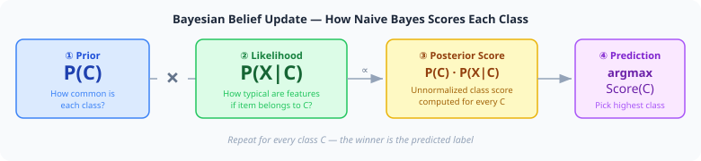
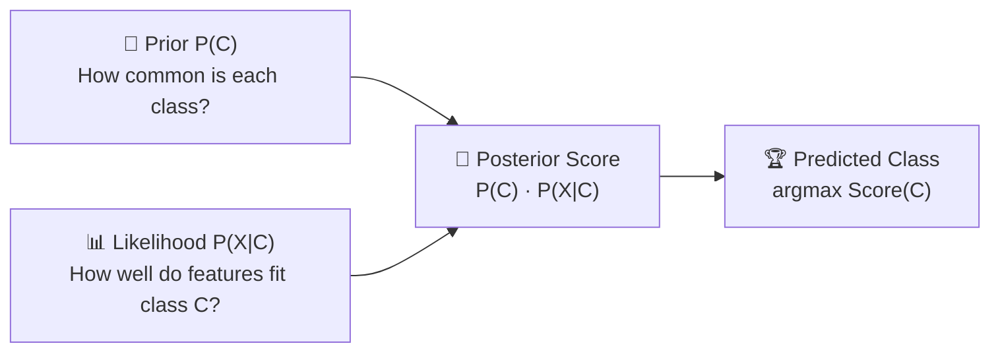
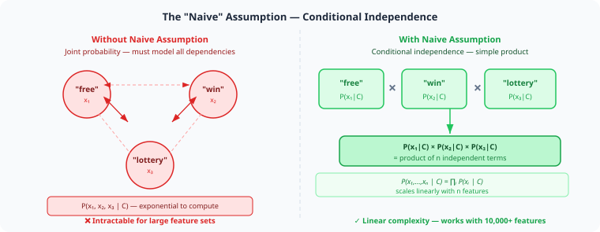
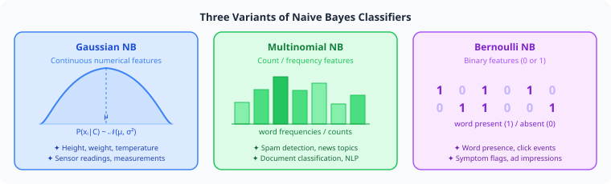
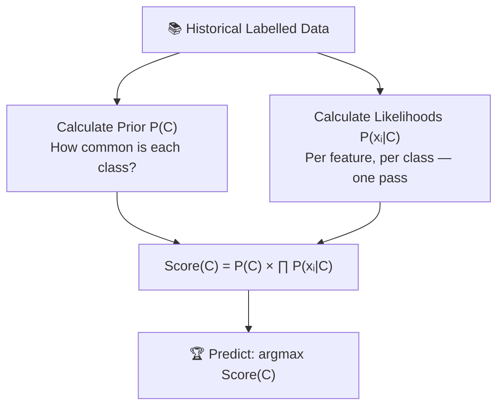

# Intuition Behind Naive Bayes Classifier

- The ***Naive Bayes classifier*** is built on a *simple but powerful idea*: use **past experience** and **observed clues** to estimate the ***most likely category*** for a new data point.
- Before jumping into **mathematical derivations**, this chapter develops the ***core intuition*** — why ***Bayes' Theorem*** is used, what the **"naive" assumption** really means, and why this *simple approach works so well in practice*.
- **Mathematical derivations** and *formal proofs* are covered in -> [***Naive Bayes Classifier — §2 Mathematical Derivation***](Naive%20Bayes%20Classifier.md#2-mathematical-derivation-of-naive-bayes-classifier).

---

## Table of Contents

1. [The Core Idea — "Flipping the Question"](#1-the-core-idea--flipping-the-question)
2. [Learning from Evidence — The Spam Email Analogy](#2-learning-from-evidence--the-spam-email-analogy)
3. [Training from Labelled Data](#3-training-from-labelled-data)
4. [The "Naive" Assumption — Conditional Independence](#4-the-naive-assumption--conditional-independence)
5. [Step-by-Step Numerical Example](#5-step-by-step-numerical-example)
6. [Why It Works Despite Being "Naive"](#6-why-it-works-despite-being-naive)
7. [Types of Naive Bayes Classifiers](#7-types-of-naive-bayes-classifiers)
8. [Advantages](#8-advantages)
9. [Limitations](#9-limitations)
10. [Final Mental Model](#10-final-mental-model)
11. [References](#11-references)

---

## 1. The Core Idea — "Flipping the Question"

- Suppose you want to know: 
**"Given a set of features $X$, what is the probability this item belongs to class $C$?"** 
- In probability notation, this is the **posterior probability** $P(C \mid X)$.

Directly computing this is hard — ***you would need labelled examples of every possible combination of features.*** 
- Bayes' Theorem provides a smarter path by **flipping the question**:

$$\boxed{P(C \mid X) \propto P(C) \cdot P(X \mid C)}$$

- Expanding the likelihood with the **naive independence assumption** gives the complete decision rule:

$$\boxed{\hat{C} = \arg\max_{C} \Bigl[ P(C) \cdot \prod_{i=1}^{n} P(x_i \mid C) \Bigr]}$$

> [!NOTE]
> **From Bayes' Theorem → Naive Bayes — the exact moment of conversion:**
>
> | Step | Formula | What it is |
> |---|---|---|
> | **①** | $P(C \mid X) \propto P(C) \cdot P(X \mid C)$ | Exact Bayes' Theorem — no assumption made yet |
> | **②** | Replace $P(X \mid C)$ with $\displaystyle\prod_{i=1}^{n} P(x_i \mid C)$ | **The "naive" step** — features assumed conditionally independent |
> | **③** | $\hat{C} = \arg\max_C \bigl[P(C) \cdot \prod P(x_i \mid C)\bigr]$ | Naive Bayes classifier — the final decision rule |
>
> The word **"naive"** refers specifically to Step ② — replacing one hard joint probability with a product of simple individual probabilities.

Instead of asking *"what class does this input belong to?"*, Bayes lets you ask two easier questions:

| Term | Symbol | Question it answers |
|---|---|---|
| **Prior** | $P(C)$ | How common is class $C$ in the training data? |
| **Likelihood** | $P(X \mid C)$ | If the item belongs to class $C$, how typical are these features? |
| **Posterior** | $P(C \mid X)$ | Updated belief about class $C$ after seeing the features |

  

You compute the posterior score for **every class**, then choose the one with the **highest score** — this is the $\arg\max$ decision rule.

> [!TIP]
> **Key insight:** We never directly compute $P(C \mid X)$. We compute the proportional score $P(C) \cdot P(X \mid C)$ for each class and pick the winner. The $P(X)$ denominator is the same for all classes, so it cancels when comparing.

---

## 2. Learning from Evidence — The Spam Email Analogy

The best way to understand Naive Bayes is to think like a human making a quick judgement call.

**Scenario:** You receive an email:

> [!NOTE]
> *Subject: Congratulations! You have won a lottery!*
>
> *"You are a lucky winner! Claim your FREE prize now. Click here to collect your reward."*

You want to decide: **Spam** or **Not Spam (Ham)**?

As a human, you instinctively scan for **clues**:

| Clue | What it suggests |
|---|---|
| Word **"FREE"** present | Strong spam indicator |
| Word **"WINNER"** present | Spam indicator |
| Word **"LOTTERY"** present | Spam indicator |
| Suspicious link present | Red flag |
| Word **"Meeting"** absent | Doesn't read like a work email |

You mentally **combine** all these clues and arrive at a decision.

**Naive Bayes does exactly this — mathematically.**

It uses the **frequency of features in past labelled data** to estimate $P(C \mid \text{features})$, then picks the most probable class.

> [!TIP]
> **The analogy in full:** Your brain is the trained model. Past email experience is the training data. Each word is a feature. Your gut feeling about how spam-like the email is = the posterior probability.

---

## 3. Training from Labelled Data

Consider a training set of **10,000 emails**: 4,000 Spam and 6,000 Ham.

From these, the model learns how often each word appears in each class:

| Word | Spam (of 4,000) | Ham (of 6,000) | $P(\text{word} \mid \text{Spam})$ | $P(\text{word} \mid \text{Ham})$ |
|---|:---:|:---:|:---:|:---:|
| **Free** | 3,200 | 600 | **0.80** | 0.10 |
| **Lottery** | 2,800 | 100 | **0.70** | 0.017 |
| **Winner** | 2,400 | 300 | **0.60** | 0.05 |
| **Meeting** | 100 | 2,000 | 0.025 | **0.33** |
| **Project** | 150 | 2,500 | 0.038 | **0.42** |

The probability columns are the **likelihoods** the model stores. Notice that "Free", "Lottery", and "Winner" have much higher likelihood in Spam — these become powerful indicators.

When a new email arrives containing *"Free", "Lottery", "Winner"*, it asks:

> [!NOTE]
> *"In training data, how often did Spam emails contain each of these words — versus Ham emails?"*

That question is the **likelihood** — and it is the key signal.

---

## 4. The "Naive" Assumption — Conditional Independence

Here is where the clever simplification happens.

### The Problem Without It

- To ***correctly compute $P(\text{free, lottery, winner} \mid \text{Spam})$***, you would need to know how these words **co-occur together** inside spam emails — ***not just each word individually***, but ***every possible combination***.

- With a ***vocabulary of $n$ words***, the ***number of combinations*** you would need to track is:

$$2^n \quad \Rightarrow \quad 2^{10{,}000} = \text{more combinations than atoms in the universe}$$

You could never collect enough training data to see all combinations even once. The joint probability table grows:

$$P(x_1, x_2, \ldots, x_n \mid C) \quad \leftarrow \text{exponentially complex in } n$$

This is computationally intractable for even a modest vocabulary.

### The Naive Shortcut
- Naive Bayes **assumes** all features are **conditionally independent given the class**:
- Naive Bayes **throws away combinations entirely**. 
- Instead of ***one impossible question about the combination***
- it ***asks $n$ easy separate questions — one per feature***:

| Question | Answer |
|---|:---:|
| How often does "free" appear in Spam? | **0.80** |
| How often does "lottery" appear in Spam? | **0.70** |
| How often does "winner" appear in Spam? | **0.60** |

Then simply multiply the answers: $0.80 \times 0.70 \times 0.60 = 0.336$

No co-occurrence tracking. No combinations. Each feature is looked up **independently** — which is exactly why it is called **"naive"**.

Formally, Naive Bayes **assumes** all features are **conditionally independent given the class**:

$$\boxed{P(x_1, x_2, \ldots, x_n \mid C) = \prod_{i=1}^{n} P(x_i \mid C)}$$

  

For the spam example:

$$P(\text{free, lottery, winner} \mid \text{Spam}) \approx P(\text{free} \mid \text{Spam}) \times P(\text{lottery} \mid \text{Spam}) \times P(\text{winner} \mid \text{Spam})$$

> [!IMPORTANT]
> **Why "naive"?** In reality, "free", "win", and "prize" often co-occur — they are correlated. The model ignores this dependency. It is a simplifying assumption, not a claim about reality.
>
> **Crucially**, the model does **not** assume features are always independent — only **conditionally independent given the class label**.

---

## 5. Step-by-Step Numerical Example

Using the training dataset from §3.

**New email contains:** *Free, Lottery, Winner*

### Step 1 — Prior Probabilities

$$P(\text{Spam}) = \frac{4{,}000}{10{,}000} = 0.4 \qquad P(\text{Ham}) = \frac{6{,}000}{10{,}000} = 0.6$$

### Step 2 — Likelihoods

**For Spam:**

$$P(\text{Free} \mid \text{Spam}) = \frac{3{,}200}{4{,}000} = 0.80$$

$$P(\text{Lottery} \mid \text{Spam}) = \frac{2{,}800}{4{,}000} = 0.70$$

$$P(\text{Winner} \mid \text{Spam}) = \frac{2{,}400}{4{,}000} = 0.60$$

**For Ham:**

$$P(\text{Free} \mid \text{Ham}) = \frac{600}{6{,}000} = 0.100$$

$$P(\text{Lottery} \mid \text{Ham}) = \frac{100}{6{,}000} \approx 0.0167$$

$$P(\text{Winner} \mid \text{Ham}) = \frac{300}{6{,}000} = 0.050$$

### Step 3 — Posterior Scores

Applying the naive independence assumption:

$$\text{Score}(\text{Spam}) = P(\text{Spam}) \times P(\text{Free} \mid \text{Spam}) \times P(\text{Lottery} \mid \text{Spam}) \times P(\text{Winner} \mid \text{Spam})$$

$$= 0.4 \times 0.80 \times 0.70 \times 0.60 = \boxed{0.1344}$$

$$\text{Score}(\text{Ham}) = P(\text{Ham}) \times P(\text{Free} \mid \text{Ham}) \times P(\text{Lottery} \mid \text{Ham}) \times P(\text{Winner} \mid \text{Ham})$$

$$= 0.6 \times 0.100 \times 0.0167 \times 0.050 \approx \boxed{0.00005}$$

### Step 4 — Normalize and Decide

$$P(\text{Spam} \mid \text{email}) = \frac{0.1344}{0.1344 + 0.00005} \approx 99.96\%$$

| Class | Score | Posterior Probability |
|---|:---:|:---:|
| **Spam** | 0.1344 | **99.96%** |
| Ham | 0.00005 | 0.04% |

**Prediction: Spam ✓**

### Before vs. After — The Bayesian Update

| | **Before seeing the email (prior)** | **After seeing Free + Lottery + Winner (posterior)** |
|---|:---:|:---:|
| Spam | 40% | **99.96%** |
| Ham | 60% | 0.04% |

> [!NOTE]
> The model started with a 40% prior on Spam (baseline from training data). After observing three strongly spam-associated words, it updated its belief to nearly 100%. **This is Bayesian reasoning — evidence shifts beliefs, it doesn't replace them.**

> [!NOTE]
> The model never explicitly learned that these three words equal spam. It inferred that from their **statistical patterns** in the training data alone.

---

## 6. Why It Works Despite Being "Naive"

The independence assumption is almost always violated in real data. Yet Naive Bayes still performs remarkably well. Here is why:

### It Only Needs to Win the Ranking Race

You don't need $P(\text{Spam} \mid X)$ to be the exact true probability — you only need it to be **larger than** all competitor class scores.

Even if the absolute numbers are wrong, the **relative ordering** of class scores is often preserved. The right class still wins.

### It Avoids the Curse of Dimensionality

Without independence, estimating $P(x_1, \ldots, x_n \mid C)$ requires seeing every feature combination in training data. With $n = 10{,}000$ words, that is impossible.

Independence reduces the problem from exponential to linear: just estimate each $P(x_i \mid C)$ separately.

### It Combines Weak Clues into a Strong Decision

Each individual word is a weak signal. Multiplying many likelihoods together **amplifies the combined evidence**. The more consistently spam-like the words are, the more the spam score dominates.

### It Is Blazing Fast

Training is a single pass to count frequencies. Prediction is a small number of multiplications. Naive Bayes scales to millions of documents.

### Practical Note — Log-Probabilities Prevent Underflow

Multiplying many small probabilities together causes a real problem on computers. For an email with 50 words, each probability around 0.01:

$$0.01^{50} = 10^{-100} \quad \leftarrow \text{rounds to zero on any computer}$$

The fix is to work in **log space** — add log-probabilities instead of multiplying raw probabilities:

$$\log \text{Score}(C) = \log P(C) + \sum_{i=1}^{n} \log P(x_i \mid C)$$

Since $\log$ is monotonically increasing, the $\arg\max$ result is identical — the winning class is the same. This is always done in practice.

---

## 7. Types of Naive Bayes Classifiers

The three main variants differ only in the assumed **distribution** of each $P(x_i \mid C)$:

  

| Variant | Feature Type | Distribution | Common Use Cases |
|---|---|---|---|
| **Gaussian NB** | Continuous numbers | Normal $\mathcal{N}(\mu, \sigma^2)$ | Medical data, height/weight, sensor readings |
| **Multinomial NB** | Counts / frequencies | Multinomial | Text classification, word counts, TF-IDF |
| **Bernoulli NB** | Binary (0 or 1) | Bernoulli | Word presence/absence, click data, symptom flags |

> [!NOTE]
> Each variant is covered in depth in [Naive Bayes Classifier](Naive%20Bayes%20Classifier.md).

---

## 8. Advantages

| Advantage | Why It Matters |
|---|---|
| **Fast training** | Single pass to count frequencies — no iterative optimization |
| **Fast prediction** | A handful of multiplications per example |
| **Handles high-dimensional data** | Works with thousands of text features efficiently |
| **Requires little training data** | Estimating each $P(x_i \mid C)$ independently is data-efficient |
| **Naturally probabilistic** | Outputs class probabilities, not just labels |
| **Multi-class by default** | No modification needed for more than two classes |
| **Interpretable** | Each $P(x_i \mid C)$ can be inspected to understand decisions |

---

## 9. Limitations

### 1. The Independence Assumption Is Often Wrong

Words like "free" and "win" co-occur. Symptoms like fever and fatigue are correlated. When the assumption is strongly violated, the model can produce **overconfident predictions** — probabilities pushed toward 0% or 100%.

### 2. Zero-Frequency Problem

If the word *"lottery"* never appeared in Spam emails during training:

$$P(\text{lottery} \mid \text{Spam}) = 0$$

This single zero **destroys the entire score**, no matter how strong the other evidence is:

$$\text{Score}(\text{Spam}) = 0.4 \times 0.80 \times \underbrace{0}_{\text{lottery}} \times 0.60 = \mathbf{0}$$

The classifier becomes blind to Spam for any email containing an unseen word — even if every other word screams spam.

The fix is **Laplace (additive) smoothing** — add a small constant $\alpha$ to every count so no probability is ever exactly zero:

$$P(x_i \mid C) = \frac{\text{count}(x_i, C) + \alpha}{\text{count}(C) + \alpha \cdot |V|}$$

where $|V|$ is vocabulary size and $\alpha = 1$ is the standard choice. Covered in detail in [Naive Bayes Classifier](Naive%20Bayes%20Classifier.md).

### 3. Probability Calibration

Naive Bayes probabilities are often **poorly calibrated**. A score of 99% does not mean 99 out of 100 such predictions are correct. Scores are reliable for ranking classes but should not be interpreted as true probabilities without post-hoc calibration.

### 4. Feature Interactions Are Ignored

Naive Bayes cannot learn that "not good" means something different from "good". For tasks requiring interaction modelling, logistic regression or decision trees may outperform it.

---

## 10. Final Mental Model

The entire intuition in one sentence:

> [!IMPORTANT]
> **Naive Bayes looks at how consistent the observed features are with each class (likelihood), combines that with how common each class is (prior), and picks the class whose combined evidence is strongest.**

**Covered in subsequent chapters — not here:**

> [!NOTE]
> - Formal MAP derivation and log-space computation
> - Laplace smoothing formulas and worked examples
> - Gaussian NB parameter estimation ($\mu$, $\sigma^2$ per feature per class)
> - Numerical implementation from scratch

---

## 11. References

### Within This Module

- [Problem Based upon Bayes Theorem](Problem%20Based%20upon%20Bayes%20Theorem.md)
- [Bayes Theorem in Probability](Bayes%20Theorem%20in%20Probability.md)
- [Conditional Probability](Conditional%20Probability.md)
- [Naive Bayes Classifier](Naive%20Bayes%20Classifier.md) — full mathematical Derivation and Theory

### External References

- [GeeksforGeeks — Naive Bayes Classifiers](https://www.geeksforgeeks.org/naive-bayes-classifiers/)
- [Wikipedia — Naive Bayes classifier](https://en.wikipedia.org/wiki/Naive_Bayes_classifier)

---

  ⬅️ <strong>Previous:</strong> <a href="Problem%20Based%20upon%20Bayes%20Theorem.md">Problem Based upon Bayes Theorem</a> &nbsp;&nbsp;|&nbsp;&nbsp; <strong>Next:</strong> <a href="Naive%20Bayes%20Classifier.md">Naive Bayes Classifier</a> ➡️

