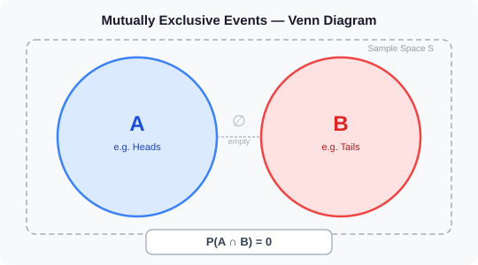
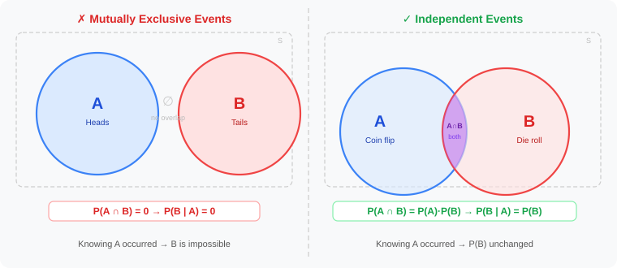

# Mutually Exclusive Events in Probability

- In probability, two events are **mutually exclusive** (also called **disjoint**) if they **cannot both occur** in the same trial or experiment.
- If one event occurs, the other is automatically impossible.
- This concept is fundamental to applying the **Addition Rule of Probability** correctly and underlies how class labels work in the **Naive Bayes Classifier**.

---

## Table of Contents

1. [What are Mutually Exclusive Events?](#1-what-are-mutually-exclusive-events)
2. [Intersection and Union of Sets](#2-intersection-and-union-of-sets)
3. [Key Properties](#3-key-properties)
4. [Key Formulas](#4-key-formulas)
5. [Visual Intuition — Venn Diagrams](#5-visual-intuition--venn-diagrams)
   - [Mutually Exclusive Events](#mutually-exclusive-events)
   - [Non-Mutually Exclusive Events](#non-mutually-exclusive-events)
   - [Annotated Venn Diagram](#annotated-venn-diagram)
6. [Everyday Examples](#6-everyday-examples)
7. [Probability Rules for Mutually Exclusive Events](#7-probability-rules-for-mutually-exclusive-events)
8. [Conditional Probability for Mutually Exclusive Events](#8-conditional-probability-for-mutually-exclusive-events)
9. [Mutually Exclusive vs Independent Events](#9-mutually-exclusive-vs-independent-events)
10. [Do Mutually Exclusive Events Add Up to 1?](#10-do-mutually-exclusive-events-add-up-to-1)
11. [Worked Examples](#11-worked-examples)
12. [Practice Problems](#12-practice-problems)
13. [Quick Revision — Important Formulas](#13-quick-revision--important-formulas)
14. [Connection to Naive Bayes Classifier](#14-connection-to-naive-bayes-classifier)
15. [References](#15-references)

---

## 1. What are Mutually Exclusive Events?

Two events $A$ and $B$ are **mutually exclusive** if they **cannot happen at the same time** in a single experiment or trial.

- Tossing a coin: you cannot get **Heads AND Tails** on the same flip.
- Rolling a die: you cannot roll a **2 AND a 5** on the same roll.
- Drawing a card: drawing a **Heart AND a Spade** in one draw is impossible.

> **Formal definition:** Events $A$ and $B$ are **mutually exclusive** (disjoint) if and only if:
> $$P(A \cap B) = 0$$
> The two events share **no outcomes** — their intersection is the empty set $\emptyset$.

### Key condition

$$\boxed{P(A \cap B) = 0}$$

In a **Venn diagram**, mutually exclusive events are represented by **circles that do not overlap** — there is a clear separation between them with no shared region.

---

## 2. Intersection and Union of Sets

Before working with mutually exclusive events, it is important to understand the two core set operations used in all probability formulas.

### Intersection (∩) — "AND"

The **intersection** $A \cap B$ contains all elements that belong to **both** sets:

$$A \cap B = \{x \mid x \in A \text{ and } x \in B\}$$

**Example:** $A = \{1, 2, 3, 4, 5, 6\}$, $B = \{2, 4, 6\}$. Then $A \cap B = \{2, 4, 6\}$.

For mutually exclusive events: $A \cap B = \emptyset$ — the intersection is the **empty set** (nothing in common).

### Union (∪) — "OR"

The **union** $A \cup B$ contains all elements that belong to **either** set (or both):

$$A \cup B = \{x \mid x \in A \text{ or } x \in B\}$$

**Example:** $A = \{1, 2, 3\}$, $B = \{4, 5, 6\}$. Then $A \cup B = \{1, 2, 3, 4, 5, 6\}$.

For mutually exclusive events, $P(A \cup B) = P(A) + P(B)$ — there is **no double-counting** because no element belongs to both.

---

## 3. Key Properties

| Property | Description |
|---|---|
| **Empty intersection** | $A \cap B = \emptyset$ — no outcome belongs to both events |
| **Zero joint probability** | $P(A \cap B) = 0$ — both cannot occur simultaneously |
| **Implication of occurrence** | If $A$ occurs, then $B$ cannot occur (and vice versa) |
| **Conditional probability** | $P(B \mid A) = 0$ and $P(A \mid B) = 0$ |
| **Dependence** | ME events are always **dependent** — knowing one occurred tells you the other did NOT |

> **Key insight:** Mutually exclusive events are **always dependent**. Knowing that one event occurred gives you definite information about the other — it cannot happen. This is the **opposite** of independence.

---

## 4. Key Formulas

### General Addition Rule (any two events)

$$P(A \cup B) = P(A) + P(B) - P(A \cap B)$$

### Addition Rule for Mutually Exclusive Events

Since $P(A \cap B) = 0$, the subtracted term vanishes:

$$\boxed{P(A \cup B) = P(A) + P(B)}$$

This is the **Special Addition Rule** — for mutually exclusive events, simply add the individual probabilities.

### Conditional Probability (mutually exclusive)

$$\boxed{P(B \mid A) = \frac{P(A \cap B)}{P(A)} = \frac{0}{P(A)} = 0}$$

Knowing that $A$ occurred makes $B$ **completely impossible**.

---

## 5. Visual Intuition — Venn Diagrams

### Mutually Exclusive Events

  

In a mutually exclusive Venn diagram, the circles for $A$ and $B$ are **completely separated**. There is **no overlap region** — the intersection $A \cap B = \emptyset$.

---

### Non-Mutually Exclusive Events

  

When events are **not** mutually exclusive, the circles **overlap**. The shaded intersection region represents outcomes where both $A$ and $B$ can occur simultaneously — meaning $P(A \cap B) > 0$.

---

### Annotated Venn Diagram

  

The gap between the two circles (containing only $\emptyset$) visually confirms that $P(A \cap B) = 0$ — no outcome belongs to both events.

---

## 6. Everyday Examples

| Scenario | Event A | Event B | Why Mutually Exclusive |
|---|---|---|---|
| Coin toss | Heads ($H$) | Tails ($T$) | A single flip gives exactly one outcome; $P(H \cap T) = 0$ |
| Rolling a die | Rolling a 2 | Rolling a 5 | One roll shows exactly one face; both cannot appear simultaneously |
| Drawing one card | Drawing a Heart | Drawing a Spade | One card belongs to exactly one suit |
| Exam result | Passing (≥ 50%) | Failing (< 50%) | A score is either passing or failing — it cannot be both |
| Traffic light | Red signal | Green signal | A light shows one colour at a time |

---

## 7. Probability Rules for Mutually Exclusive Events

If $A$ and $B$ are mutually exclusive, the following probability rules apply:

| Rule | Formula | Explanation |
|---|---|---|
| **Addition Rule** | $P(A \cup B) = P(A) + P(B)$ | No overlap — just add the probabilities |
| **Multiplication Rule** | $P(A \cap B) = 0$ | Both cannot occur simultaneously |
| **Conditional Probability** | $P(B \mid A) = 0$ | If $A$ happened, $B$ is impossible |
| **Complement of union** | $P((A \cup B)') = 1 - P(A \cup B)$ | Probability that neither event occurs |
| **Exhaustive + ME** | $P(A) + P(B) = 1$ | Only if $A$ and $B$ cover all outcomes |

> **Note:** Simple events — events with a single possible outcome — are **always** mutually exclusive with every other simple event in the same experiment.

---

## 8. Conditional Probability for Mutually Exclusive Events

Conditional probability asks: what is the probability of $B$ given that $A$ has **already occurred**?

$$P(B \mid A) = \frac{P(A \cap B)}{P(A)}$$

For mutually exclusive events, since $P(A \cap B) = 0$:

$$P(B \mid A) = \frac{0}{P(A)} = 0$$

$$\boxed{P(B \mid A) = 0 \quad \text{for any two mutually exclusive events}}$$

**Interpretation:** If you know that event $A$ happened, event $B$ is **completely impossible** on that same trial.

**Example:** Coin toss. If you know the result is Heads, the probability of Tails on that **same flip** is $P(\text{Tails} \mid \text{Heads}) = 0$.

---

## 9. Mutually Exclusive vs Independent Events

These two terms are **frequently confused** but describe fundamentally different relationships:

> **Mutually exclusive:** The events **cannot both occur** — if one happens, the other is **impossible** ($P(B \mid A) = 0$).
>
> **Independent:** The events **can both occur** — one happening gives **no information** about the other ($P(B \mid A) = P(B)$).

### Comparison Diagram

  

### Detailed Comparison Table

| Feature | Mutually Exclusive | Independent |
|---|---|---|
| **Can both occur together?** | No — $P(A \cap B) = 0$ | Yes — $P(A \cap B) = P(A) \cdot P(B) > 0$ |
| **Knowing $A$ happened...** | Makes $B$ **impossible**: $P(B \mid A) = 0$ | Does **not change** $P(B)$: $P(B \mid A) = P(B)$ |
| **Multiplication rule** | $P(A \cap B) = 0$ | $P(A \cap B) = P(A) \cdot P(B)$ |
| **Venn diagram** | Circles **do not overlap** | Circles **do overlap** |
| **Type of relationship** | Always **dependent** | **Independent** (by definition) |
| **Classic example** | Heads vs Tails on one coin flip | Flipping two separate coins |

> **Common mistake:** Thinking mutually exclusive means independent. They are actually **opposite extremes**:
> - ME events are **maximally dependent** — if one occurs, the other has probability **zero**.
> - Independent events have **no dependence** — one occurring tells you nothing about the other.
>
> The only edge case: two ME events can be independent only if at least one has probability 0 (a trivially impossible event).

---

## 10. Do Mutually Exclusive Events Add Up to 1?

Mutually exclusive events **do not automatically sum to 1**. Their probabilities sum to 1 only if they are also **exhaustive**.

| Condition | Meaning | Formula |
|---|---|---|
| **Mutually exclusive** | Cannot occur together | $P(A \cap B) = 0$ |
| **Exhaustive** | At least one must occur | $P(A \cup B) = 1$ |
| **Both (complete partition)** | Cannot occur together AND one must occur | $P(A) + P(B) = 1$ |

**Example 1 — ME and exhaustive (complement):**
- Coin flip: $P(\text{Heads}) = 0.5$, $P(\text{Tails}) = 0.5$.
- ME: $P(H \cap T) = 0$ ✓ &nbsp; Exhaustive: $P(H \cup T) = 1$ ✓
- Sum: $0.5 + 0.5 = 1$ ✓

**Example 2 — ME but not exhaustive:**
- Rolling a die: Event $A = \{1, 2\}$, Event $B = \{3, 4\}$.
- ME: $A \cap B = \emptyset$ ✓ &nbsp; But $P(A \cup B) = 4/6 \neq 1$ — outcomes $\{5, 6\}$ are excluded.
- Sum: $P(A) + P(B) = 1/3 + 1/3 = 2/3 \neq 1$ ✗

---

## 11. Worked Examples

### Example 1

**Problem:** If $P(A) = 0.20$, $P(A \cup B) = 0.51$, and $A$ and $B$ are mutually exclusive, find $P(B)$.

**Solution:**

Given: $P(A \cup B) = 0.51$ and $P(A) = 0.20$.

Since $A$ and $B$ are mutually exclusive:
$$P(A \cup B) = P(A) + P(B)$$
$$0.51 = 0.20 + P(B)$$

$$\boxed{P(B) = 0.51 - 0.20 = 0.31}$$

---

### Example 2

**Problem:** In a standard deck of 52 cards, find the probability of drawing either an even-numbered card or a face card in a single draw.

**Solution:**

Even-numbered cards: $\{2, 4, 6, 8, 10\}$ — 5 per suit × 4 suits = 20 cards.
$$P(\text{Even}) = \frac{20}{52} = \frac{5}{13}$$

Face cards: $\{\text{Jack, Queen, King}\}$ — 3 per suit × 4 suits = 12 cards.
$$P(\text{Face}) = \frac{12}{52} = \frac{3}{13}$$

Even-numbered cards and face cards are disjoint sets (a card cannot be both), so:
$$P(\text{Even or Face}) = P(\text{Even}) + P(\text{Face}) = \frac{5}{13} + \frac{3}{13}$$

$$\boxed{P(\text{Even or Face}) = \frac{8}{13} \approx 0.615}$$

---

### Example 3

**Problem:** If $P(B) = 0.35$, $P(A \cup B) = 0.65$, and $A$ and $B$ are mutually exclusive, find $P(A)$.

**Solution:**

Given: $P(A \cup B) = 0.65$ and $P(B) = 0.35$.

Since $A$ and $B$ are mutually exclusive:
$$P(A \cup B) = P(A) + P(B)$$
$$0.65 = P(A) + 0.35$$

$$\boxed{P(A) = 0.65 - 0.35 = 0.30}$$

---

## 12. Practice Problems

**Problem 1:** A fair die is rolled once. Let $A = \{1, 2\}$ and $B = \{5, 6\}$. Verify that $A$ and $B$ are mutually exclusive and find $P(A \cup B)$.

Solution

$A = \{1, 2\}$ and $B = \{5, 6\}$ share no elements, so $A \cap B = \emptyset$ → mutually exclusive ✓

$$P(A) = \frac{2}{6} = \frac{1}{3}, \quad P(B) = \frac{2}{6} = \frac{1}{3}$$

$$P(A \cup B) = P(A) + P(B) = \frac{1}{3} + \frac{1}{3} = \frac{2}{3}$$

---

**Problem 2:** In a class, the probability of getting grade A is $0.25$ and grade B is $0.35$. Assuming grades are mutually exclusive, find the probability of getting either an A or a B.

Solution

Since a student cannot receive both A and B for the same course (mutually exclusive):

$$P(\text{A or B}) = P(\text{A}) + P(\text{B}) = 0.25 + 0.35 = 0.60$$

There is a **60% probability** of getting either an A or a B.

---

**Problem 3:** Events $A$ and $B$ are mutually exclusive with $P(A) = 0.4$ and $P(B) = 0.3$. Find:
- (a) $P(A \cup B)$
- (b) $P(A \cap B)$
- (c) $P(B \mid A)$
- (d) $P(A' \cap B')$ — probability that neither event occurs.

Solution

**(a)** Since ME: $P(A \cup B) = P(A) + P(B) = 0.4 + 0.3 = \mathbf{0.7}$

**(b)** By definition of ME: $P(A \cap B) = \mathbf{0}$

**(c)** $P(B \mid A) = \dfrac{P(A \cap B)}{P(A)} = \dfrac{0}{0.4} = \mathbf{0}$

**(d)** By De Morgan's law: $A' \cap B' = (A \cup B)'$

$$P(A' \cap B') = 1 - P(A \cup B) = 1 - 0.7 = \mathbf{0.3}$$

---

**Problem 4 — Multiple Choice:** Events $A$ and $B$ are mutually exclusive. Which statement is TRUE?

- A) $P(A \cap B) = P(A) \times P(B)$
- B) $P(A \cap B) = 0$
- C) $P(A \cup B) = P(A) \times P(B)$
- D) $P(B \mid A) = P(B)$

Solution

**Correct: B)**

$P(A \cap B) = 0$ is the defining property of mutually exclusive events.

- **A** is wrong: $P(A \cap B) = P(A) \cdot P(B)$ is the rule for **independent** (not ME) events.
- **C** is wrong: The union uses addition: $P(A \cup B) = P(A) + P(B)$, not multiplication.
- **D** is wrong: For ME events $P(B \mid A) = 0$, not $P(B)$.

---

## 13. Quick Revision — Important Formulas

| Concept | Formula |
|---|---|
| **Definition** | $P(A \cap B) = 0$ |
| **Addition Rule (ME)** | $P(A \cup B) = P(A) + P(B)$ |
| **General Addition Rule** | $P(A \cup B) = P(A) + P(B) - P(A \cap B)$ |
| **Conditional Probability (ME)** | $P(B \mid A) = 0$ |
| **Complement of union** | $P((A \cup B)') = 1 - P(A \cup B)$ |
| **ME + Exhaustive (partition)** | $P(A) + P(B) = 1$ |
| **ME vs Independent** | ME: $P(A \cap B) = 0$ &nbsp;|&nbsp; Independent: $P(A \cap B) = P(A) \cdot P(B)$ |
| **Verification test** | Compute $P(A \cap B)$: if $= 0$ → ME; if $= P(A) \cdot P(B)$ → Independent |

---

## 14. Connection to Naive Bayes Classifier

Mutually exclusive events connect to the Naive Bayes Classifier in two important ways.

### Class Labels are Mutually Exclusive

In any classification problem, each data point belongs to **exactly one class**. The class labels $C_1, C_2, \ldots, C_k$ form a **mutually exclusive and exhaustive** partition of all possible outcomes:

$$P(C_i \cap C_j) = 0 \quad \text{for } i \neq j \qquad \text{and} \qquad \sum_{i=1}^{k} P(C_i) = 1$$

Predicting class $C_1$ for a data point automatically rules out all other classes.

### The Addition Rule and Probability Normalisation

Because class labels are mutually exclusive and exhaustive, the **evidence** (denominator in Bayes' Theorem) sums cleanly over all classes:

$$P(\mathbf{x}) = \sum_{i=1}^{k} P(\mathbf{x} \mid C_i) \cdot P(C_i)$$

This sum works precisely because the classes are **disjoint** — no double-counting occurs.

### ME vs Independence in Naive Bayes

| Aspect | What it applies to | Type |
|---|---|---|
| **Mutually exclusive** | Class labels $C_1, \ldots, C_k$ | Classes cannot co-occur |
| **Independence assumption** | Features $x_1, \ldots, x_n$ given a class | Features treated as independent given class |

$$\hat{C} = \arg\max_{C} \underbrace{P(C)}_{\text{prior}} \cdot \underbrace{\prod_{i=1}^{n} P(x_i \mid C)}_{\text{independence assumption}}$$

> **Key distinction:** Naive Bayes assumes features are **independent** (given class), while class labels are **mutually exclusive**. These are two separate probability concepts applied to two different parts of the model.

---

## 15. References

### Within This Module

- [Conditional Probability](Conditional%20Probability.md)
- [Independent and Dependent Events in Probability](Independent%20and%20dependent%20Events%20in%20Probability.md)
- [Bayes Theorem in Probability](Bayes%20Theorem%20in%20Probability.md)
- [Naive Bayes Classifier](Naive%20Bayes%20Classifier.md)
- [Intuition Behind Naive Bayes Classifier](Intuition%20Behind%20Naive%20Bayes%20Classifier.md)

### External References

- [GeeksforGeeks — Mutually Exclusive Events](https://www.geeksforgeeks.org/maths/mutually-exclusive-events/)
- [Wikipedia — Mutual exclusivity](https://en.wikipedia.org/wiki/Mutual_exclusivity)

---

  ⬅️ <strong>Previous:</strong> <a href="Independent%20and%20dependent%20Events%20in%20Probability.md">Independent and Dependent Events in Probability</a> &nbsp;&nbsp;|&nbsp;&nbsp; <strong>Next:</strong> <a href="Bayes%20Theorem%20in%20Probability.md">Bayes Theorem in Probability</a> ➡️

