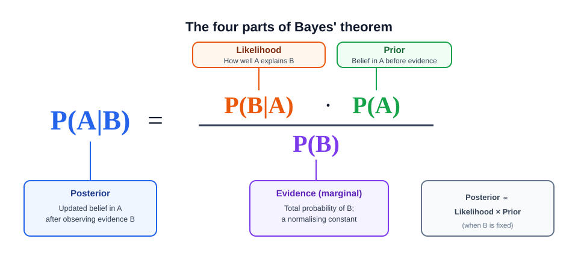
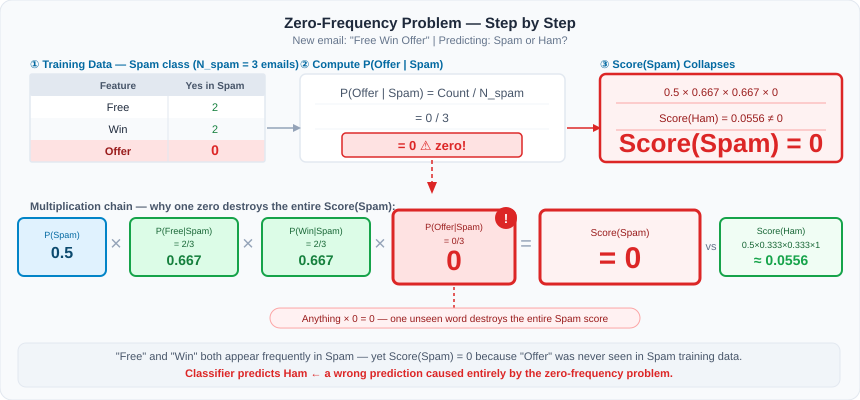
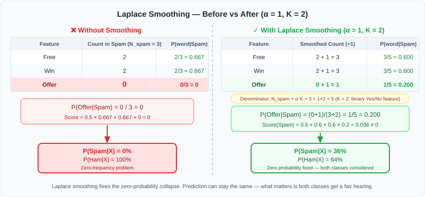

# Naive Bayes Classifier

- Naive Bayes is a **supervised machine learning algorithm** used for **classification tasks**, built on **Bayes' Theorem**. 
- It **predicts the probability** that a **given data point belongs to each class**, then **assigns it to the most probable one.**

- It is called **"Naive"** because of one strong simplifying assumption: 
> **all features are treated as completely independent of every other feature, given the class label.** 
- This assumption is almost always wrong in practice — yet the classifier still performs remarkably well.

For example, in **text classification**, it treats a document like a **"bag of words"** — it ignores word order and grammar entirely, and just asks: 
> *"How often does each word appear in each class?"*

---

## Table of Contents

0. [Prerequisites — Read These First](#-prerequisites--read-these-first)
1. [Bayes' Theorem — The Foundation](#1-bayes-theorem--the-foundation)
2. [Mathematical Derivation of Naive Bayes Classifier](#2-mathematical-derivation-of-naive-bayes-classifier)
   - [2.1 Expand with the Probability Chain Rule](#21-expand-with-the-probability-chain-rule)
   - [2.2 Apply the Conditional Independence Assumption](#22-apply-the-conditional-independence-assumption)
   - [2.3 Remove the Common Denominator](#23-remove-the-common-denominator)
3. [The Naive Bayes Decision Rule](#3-the-naive-bayes-decision-rule)
   - [Log-Space Form (used in practice)](#log-space-form-used-in-practice)
4. [The Four Components](#4-the-four-components)
5. [Learning the Parameters](#5-learning-the-parameters)
   - [5.1 Class Priors](#51-class-priors)
   - [5.2 Categorical Likelihoods](#52-categorical-likelihoods)
   - [5.3 Bernoulli Likelihoods](#53-bernoulli-likelihoods)
   - [5.4 Multinomial Likelihoods](#54-multinomial-likelihoods)
- [Types of Naive Bayes Classifiers](#types-of-naive-bayes-classifiers)
6. [Gaussian Naive Bayes](#6-gaussian-naive-bayes)
7. [Multinomial Naive Bayes](#7-multinomial-naive-bayes)
8. [Bernoulli Naive Bayes](#8-bernoulli-naive-bayes)
9. [The Zero-Frequency Problem & Laplace Smoothing](#9-the-zero-frequency-problem--laplace-smoothing)
   - [9.1 The Problem](#91-the-problem)
   - [9.2 Solution: Laplace (Additive) Smoothing](#92-solution-laplace-additive-smoothing)
   - [9.3 Choosing α](#93-choosing-α)
   - [9.4 Bayesian Interpretation](#94-bayesian-interpretation)
   - [9.5 Unknown Words at Prediction Time](#95-unknown-words-at-prediction-time)
10. [Choosing the Right Variant](#10-choosing-the-right-variant)
11. [Applications](#11-applications)
12. [Advantages and Limitations](#12-advantages-and-limitations)
    - [Advantages](#advantages)
    - [Limitations](#limitations)
13. [References](#13-references)
    - [Within This Module](#within-this-module)
    - [Websites / External References](#websites--external-references)
    - [Youtube References](#youtube-references)
14. [Detailed Numerical Example](#14-detailed-numerical-example)

---

## 📚 Prerequisites — Read These First

Before diving into this document, make sure you are comfortable with the following topics. Each one builds the foundation needed to fully understand the Naive Bayes Classifier:

| # | Topic | Why It Matters |
|---|---|---|
| 1 | [Conditional Probability](Conditional%20Probability.md) | The definition of $P(A \mid B)$ — the core of Bayes' Theorem |
| 2 | [Independent and Dependent Events](Independent%20and%20dependent%20Events%20in%20Probability.md) | Understanding when features can be treated as independent |
| 3 | [Mutually Exclusive Events](Mutually%20Exclusive%20Events%20in%20Probability.md) | Distinguishing between disjoint and overlapping classes |
| 4 | [Bayes Theorem in Probability](Bayes%20Theorem%20in%20Probability.md) | The exact formula this classifier is built on |
| 5 | [Problem Based upon Bayes Theorem](Problem%20Based%20upon%20Bayes%20Theorem.md) | Worked examples applying Bayes' Theorem manually |
| 6 | [Intuition Behind Naive Bayes Classifier](Intuition%20Behind%20Naive%20Bayes%20Classifier.md) | Conceptual understanding before the formal treatment here |

---

## 1. Bayes' Theorem — The Foundation

Bayes' Theorem, given by **Thomas Bayes (1763)**, provides a way to calculate the probability of an event given prior knowledge.

In plain English:

$$\boxed{\text{Posterior} = \frac{\text{Prior} \times \text{Likelihood}}{\text{Evidence}}}$$

For a class label $C_k$ and a feature vector $\mathbf{x}$:

$$\boxed{P(C_k \mid \mathbf{x}) = \frac{P(\mathbf{x} \mid C_k) \cdot P(C_k)}{P(\mathbf{x})}}$$

**Where:**

- $C_k$ = the $k$-th target class
- $\mathbf{x} = (x_1, \ldots, x_n)$ = input feature vector
- $P(C_k \mid \mathbf{x})$ = Probability of class $C_k$ given the features $\mathbf{x}$
- $P(\mathbf{x} \mid C_k)$ = Probability of observing features $\mathbf{x}$ given the class $C_k$
- $P(C_k)$ = Prior probability of the class
- $P(\mathbf{x})$ = Overall probability of observing the features

| Term | Name | Meaning |
|---|---|---|
| $P(C_k \mid \mathbf{x})$ | **Posterior** | Probability of class $C_k$ *after* seeing features $\mathbf{x}$ |
| $P(\mathbf{x} \mid C_k)$ | **Likelihood** | Probability of features $\mathbf{x}$ *given* class $C_k$ |
| $P(C_k)$ | **Prior** | Probability of class $C_k$ *before* seeing any features |
| $P(\mathbf{x})$ | **Evidence** | Total probability of features $\mathbf{x}$ across all classes (normalising constant) |

> [!TIP]
> **Key insight:** $P(\mathbf{x})$ is the same for every class comparison, so it cancels out when deciding which class scores highest.

<p align="center">
  
</p>

### The Four Components Explained

**1. Prior Probability — $P(A)$**

- The probability of an event **before** observing any new evidence. 
- It **reflects what we already know** about **how common each class is in the training data.**

**2. Likelihood — $P(B \mid A)$**

- The probability of observing the evidence $B$, **assuming** the event $A$ is true. 
- It answers: **"If this class is correct, how well do the observed features fit?"**

**3. Evidence — $P(B)$**
- The **overall probability** of **observing the evidence $B$,** **irrespective of the class**. 
- Since it is the **same for all classes** being compared, it **acts only as a normalising constant** and **is dropped during classification.**

**4. Posterior Probability — $P(A \mid B)$**

- The **probability of the event $A$ after observing the evidence** $B$ **has occurred**.
- This is **what we compute** — and the class with the highest posterior is the prediction.

> [!IMPORTANT]
> **This is the fundamental principle behind Naive Bayes:** combine the prior belief about a class with how well the observed features fit that class, and pick the winner.

---

## 2. Mathematical Derivation of Naive Bayes Classifier

- In general notation, ***Bayes' Theorem*** states:

$$\boxed{P(A \mid B) = \frac{P(B \mid A) \cdot P(A)}{P(B)}}$$

- For *classification*, let $C_k$ be a **class** and $\mathbf{x}$ be the observed **feature vector**:

$$\boxed{P(C_k \mid \mathbf{x}) = \frac{P(\mathbf{x} \mid C_k) \cdot P(C_k)}{P(\mathbf{x})}}$$

- Suppose an example has $n$ **features** $\mathbf{x} = (x_1, x_2, \ldots, x_n)$ and we want to **assign** it to one of $K$ **classes** $C_k$.

> [!NOTE]
> **Bayes' Theorem:**

$$P(C_k \mid x_1, \ldots, x_n) = \frac{P(x_1, \ldots, x_n \mid C_k) \cdot P(C_k)}{P(x_1, \ldots, x_n)}$$

**Where:**

- $C_k$ = the $k$-th *target class* ($k = 1, \ldots, K$)
- $\mathbf{x} = (x_1, \ldots, x_n)$ = *input feature vector* with $n$ features
- $P(C_k \mid \mathbf{x})$ = ***posterior***: probability of class $C_k$ *after seeing* the features
- $P(\mathbf{x} \mid C_k)$ = ***likelihood***: probability of *observing* the features *given* class $C_k$
- $P(C_k)$ = ***prior***: probability of class $C_k$ *before seeing* any features
- $P(\mathbf{x})$ = ***evidence***: *total probability* of observing $\mathbf{x}$ *across all classes*

The hard term is the **joint likelihood**:

$$P(x_1, \ldots, x_n \mid C_k)$$

Without a **simplifying assumption**, a categorical model may need a parameter for every possible feature combination in every class. The number of combinations grows **exponentially** with $n$ — ***computationally intractable*** for even a modest feature set.

### 2.1 Expand with the Probability Chain Rule

**Step 1 — Two features:**

$$P(x_1, x_2 \mid C_k) = P(x_1 \mid C_k) \cdot P(x_2 \mid x_1, C_k)$$

**Step 2 — Three features** *(apply the rule one more time)*:

$$P(x_1, x_2, x_3 \mid C_k) = P(x_1 \mid C_k) \cdot P(x_2 \mid x_1, C_k) \cdot P(x_3 \mid x_1, x_2, C_k)$$

**Step 3 — Four features** *(apply once more)*:

$$P(x_1, x_2, x_3, x_4 \mid C_k) = P(x_1 \mid C_k) \cdot P(x_2 \mid x_1, C_k) \cdot P(x_3 \mid x_1, x_2, C_k) \cdot P(x_4 \mid x_1, x_2, x_3, C_k)$$

**General form — $n$ features** *(repeat until all features are expanded)*:

$$\begin{aligned}
P(x_1, \ldots, x_n \mid C_k)
&= P(x_1 \mid C_k) \\
&\quad\cdot P(x_2 \mid x_1, C_k) \\
&\quad\cdot P(x_3 \mid x_1, x_2, C_k) \\
&\quad\cdots \\
&\quad\cdot P(x_n \mid x_1, \ldots, x_{n-1}, C_k)
\end{aligned}$$

> [!NOTE]
> This uses the ***chain rule of probability*** — a generalisation of the ***conditional probability*** (intersection) formula.
>
> The base rule you already know:
> $$P(A \cap B) = P(A, B) = P(A) \cdot P(B \mid A)$$
>
> The **comma notation** $P(A, B)$ is shorthand for ***joint probability*** — both notations mean the **same thing**:
> $$P(A \cap B) = P(A, B)$$
>
> The chain rule applies it ***$n$ times in a row***, peeling off **one variable at a time** — each factor conditioned on **all variables before it**:
> $$P(x_1, x_2, x_3 \mid C_k) = P(x_1 \mid C_k) \cdot P(x_2 \mid x_1, C_k) \cdot P(x_3 \mid x_1, x_2, C_k)$$
>
> They are the same idea — the chain rule is just the ***$n$-variable version*** of the intersection formula.

### 2.2 Apply the Conditional Independence Assumption

Naive Bayes assumes that once the class $C_k$ is **known**, learning the other features does **not** provide *additional information* about $x_i$:

> [!NOTE]
> **What is Conditional Independence?**
>
> Two events $A$ and $B$ are ***conditionally independent*** given a third event $C$ if:
>
> $$P(A \mid B, C) = P(A \mid C)$$
>
> In plain English: **once you know $C$, knowing $B$ gives you no extra information about $A$.**
>
> - **Without $C$ known:** $A$ and $B$ *may be related* — knowing $B$ *changes your belief* about $A$
> - **With $C$ known:** $A$ and $B$ *become irrelevant to each other* — knowing $B$ *adds nothing*
>
> **Example:** Let $C$ = a person has *flu*, $A$ = they have *fever*, $B$ = they have *cough*.
> Fever and cough are *correlated* in general. But **once you already know they have flu**, knowing they also cough tells you nothing new about whether they have a fever — the flu *explains both independently*.
>
> In Naive Bayes, $C = C_k$ (the **class**), $A = x_i$ (one **feature**), $B$ = all **other features**. Once the class is *fixed*, every feature is assumed to be ***independent*** of every other feature.

Now apply ***conditional independence*** to **each factor** of the ***chain rule*** **one by one:**

**Start — chain rule expansion:**

$$\begin{aligned}
P(x_1, \ldots, x_n \mid C_k)
&= P(x_1 \mid C_k) \\
&\quad\cdot P(x_2 \mid x_1, C_k) \\
&\quad\cdot P(x_3 \mid x_1, x_2, C_k) \\
&\quad\cdots \\
&\quad\cdot P(x_n \mid x_1, \ldots, x_{n-1}, C_k)
\end{aligned}$$

**Step 1 — Apply independence to the 2nd factor:**

$$P(x_2 \mid x_1, C_k) = P(x_2 \mid C_k) \qquad \leftarrow x_2 \text{ is independent of } x_1 \text{ given } C_k$$

$$\begin{aligned}
P(x_1, \ldots, x_n \mid C_k)
&= P(x_1 \mid C_k) \\
&\quad\cdot \mathbf{P(x_2 \mid C_k)} \\
&\quad\cdot P(x_3 \mid x_1, x_2, C_k) \\
&\quad\cdots \\
&\quad\cdot P(x_n \mid x_1, \ldots, x_{n-1}, C_k)
\end{aligned}$$

**Step 2 — Apply independence to the 3rd factor:**

$$P(x_3 \mid x_1, x_2, C_k) = P(x_3 \mid C_k) \qquad \leftarrow x_3 \text{ is independent of } x_1, x_2 \text{ given } C_k$$

$$\begin{aligned}
P(x_1, \ldots, x_n \mid C_k)
&= P(x_1 \mid C_k) \\
&\quad\cdot P(x_2 \mid C_k) \\
&\quad\cdot \mathbf{P(x_3 \mid C_k)} \\
&\quad\cdots \\
&\quad\cdot P(x_n \mid x_1, \ldots, x_{n-1}, C_k)
\end{aligned}$$

**Step 3 — Apply independence to every remaining factor** (same pattern repeats):

$$P(x_i \mid x_1, \ldots, x_{i-1}, C_k) = P(x_i \mid C_k) \qquad \leftarrow \text{for every } i$$

- ***Formally***, the ***conditional independence assumption*** states:

$$P(x_i \mid C_k, x_1, \ldots, x_{i-1}, x_{i+1}, \ldots, x_n) = P(x_i \mid C_k)$$

- Therefore the ***entire chain*** ***collapses*** to a ***simple product:***

$$\boxed{P(x_1, \ldots, x_n \mid C_k) = \prod_{i=1}^{n} P(x_i \mid C_k)}$$

- **Substituting the independence assumption into the Bayes' theorem expression:**

$$P(C_k \mid \mathbf{x}) = \frac{P(C_k) \displaystyle\prod_{i=1}^{n} P(x_i \mid C_k)}{P(\mathbf{x})}$$

### 2.3 Remove the Common Denominator

- For a fixed input $\mathbf{x}$, $P(\mathbf{x})$ is the ***same positive constant*** for every candidate class $C_k$. 
- It **cannot change** which class has the *largest score*:

$$P(C_k \mid \mathbf{x}) \propto P(C_k) \cdot \prod_{i=1}^{n} P(x_i \mid C_k)$$

This gives the **Naive Bayes decision rule** — derived fully in §3.

$$\boxed{\hat{y} = \arg\max_{C_k \in \mathcal{Y}} P(C_k) \cdot \prod_{i=1}^{n} P(x_i \mid C_k)}$$

> [!IMPORTANT]
> **This is the Naive Bayes Classification Formula.**

**Here:**
- $\arg\max$ means selecting the class that produces the **maximum value**
- $P(C_k)$ represents the **prior probability**
- $P(x_i \mid C_k)$ represents the **likelihood** of each feature given the class

> [!NOTE]
> We are not necessarily computing the final normalised probability. We are finding the **class with the highest probability score**.

Define the ***unnormalized score***:

$$s_k = P(C_k) \prod_{i=1}^{n} P(x_i \mid C_k)$$

If ***normalized posteriors*** are needed:

$$P(C_k \mid \mathbf{x}) = \frac{s_k}{\displaystyle\sum_{j=1}^{K} s_j}$$

---

## 3. The Naive Bayes Decision Rule

To *classify a new data point*, compute the **proportional score** for each class and **pick the winner**:

> [!IMPORTANT]
> **This is the Naive Bayes Classification Formula.**

$$\boxed{\hat{y} = \arg\max_{C_k \in \mathcal{Y}} P(C_k) \cdot \prod_{i=1}^{n} P(x_i \mid C_k)}$$

**Where:**
- $\arg\max$ means *selecting the class that produces the* ***maximum value***
- $P(C_k)$ represents the ***prior probability***
- $P(x_i \mid C_k)$ represents the ***likelihood*** *of each feature given the class*

> [!NOTE]
> We are not necessarily computing the *final normalised probability* — we are finding the **class with the highest probability score**.

- Define the ***unnormalized score***:

$$\boxed{s_k = P(C_k) \prod_{i=1}^{n} P(x_i \mid C_k)}$$

If ***normalized posteriors*** are needed:

$$\boxed{P(C_k \mid \mathbf{x}) = \frac{s_k}{\displaystyle\sum_{j=1}^{K} s_j}}$$

### Log-Space Form (used in practice)

***Multiplying*** hundreds or thousands of numbers smaller than one produces extremely tiny values. *Floating-point arithmetic* can round them to **zero**, causing ***numerical underflow***.

Because $\log$ is **strictly increasing**, the $\arg\max$ is preserved when we take the log of the score:

$$\boxed{\begin{aligned}
\hat{y}
&= \arg\max_k P(C_k) \cdot \prod_i P(x_i \mid C_k) \\
&= \arg\max_k \left[ \log P(C_k) + \sum_i \log P(x_i \mid C_k) \right]
\end{aligned}}$$

This converts *multiplication* into **addition** — far more **numerically stable**.

**Define the log score** for class $k$:

$$\boxed{g_k(\mathbf{x}) = \log P(C_k) + \sum_{i=1}^{n} \log P(x_i \mid C_k)}$$

The predicted class is $\hat{y} = \arg\max_k g_k(\mathbf{x})$.

For **Multinomial Naive Bayes** specifically, where $x_i$ is a word count and $\theta_{ki} = P(w_i \mid C_k)$:

$$\boxed{g_k(\mathbf{x}) = \log P(C_k) + \sum_i x_i \log \theta_{ki}}$$

#### Stable Normalization with Log-Sum-Exp

When *normalized posterior probabilities* are needed (not just the winning class), recovering them directly from $g_k$ risks **overflow** in $e^{g_k}$. The ***log-sum-exp*** trick avoids this:

$$\boxed{P(C_k \mid \mathbf{x}) = \exp\left[ g_k - \text{LSE}(g_1, \ldots, g_K) \right]}$$

where

$$\boxed{\text{LSE}(g_1, \ldots, g_K) = m + \log \sum_j e^{g_j - m}, \qquad m = \max_j g_j}$$

**Why subtract $m$?** Shifting every $g_j$ by the same constant $m$ does not change the result, but it guarantees the largest exponent is $e^0 = 1$ — ***preventing both overflow and underflow*** without altering the probabilities.

> [!NOTE]
> `scipy.special.logsumexp` and `torch.logsumexp` implement this trick. In practice, **always use log scores** — never multiply raw probabilities directly.

---

## 4. The Four Components

| Component | Symbol | How It Is Estimated from Training Data |
|---|---|---|
| **Prior** | $P(C_k)$ | $\dfrac{\text{count of class } C_k}{\text{total training samples}}$ |
| **Likelihood** | $P(x_i \mid C_k)$ | Depends on feature type — see §5–8 |
| **Posterior** | $P(C_k \mid \mathbf{x})$ | Proportional to Prior × Likelihood product |
| **Evidence** | $P(\mathbf{x})$ | Dropped during class comparison (constant) |

---

## 5. Learning the Parameters

Let the *training data* be:

$$\mathcal{D} = \{(\mathbf{x}^{(n)}, y^{(n)})\}_{n=1}^{N}$$

Training **estimates two things**:

1. ***Class priors*** $P(C_k)$
2. The ***parameters*** of every **feature likelihood** $P(x_i \mid C_k)$

### 5.1 Class Priors

- If $N_k$ *training examples* belong to $C_k$, the ***maximum-likelihood estimate*** is:

$$\boxed{\widehat{P}(C_k) = \frac{N_k}{N}}$$

- Priors may instead come from *domain knowledge*, be set *uniformly*, or be ***smoothed***:

$$\widehat{P}(C_k) = \frac{N_k + \alpha}{N + \alpha K}$$

- Priors are important when classes are ***imbalanced*** or the features provide only *weak evidence*.

### 5.2 Categorical Likelihoods

- Suppose feature $X_i$ has $M_i$ *categories*. Let $N_{kiv}$ count class-$C_k$ examples for which $X_i = v$. With ***additive smoothing***:

$$\boxed{\widehat{P}(X_i = v \mid C_k) = \frac{N_{kiv} + \alpha}{N_k + \alpha M_i}}$$

### 5.3 Bernoulli Likelihoods

- For a **binary feature** $X_i \in \{0, 1\}$, let $N_{ki}$ count class-$C_k$ examples with $X_i = 1$. Then:

$$\boxed{\widehat{\theta}_{ki} = \widehat{P}(X_i = 1 \mid C_k) = \frac{N_{ki} + \alpha}{N_k + 2\alpha}}$$

The ***complete feature likelihood*** includes both *presence* and *absence*:

$$P(x_i \mid C_k) = \theta_{ki}^{x_i} \cdot (1 - \theta_{ki})^{1 - x_i}$$

### 5.4 Multinomial Likelihoods

For **count data** such as *bag-of-words* text, let:

- $N_{ki}$ = *total count* of token $i$ in all class-$C_k$ documents
- $N_k^{(\text{tokens})} = \sum_i N_{ki}$ = *total number of tokens* in that class
- $V$ = the ***vocabulary size***

Then:

$$\boxed{\widehat{\theta}_{ki} = \widehat{P}(\text{token } i \mid C_k) = \frac{N_{ki} + \alpha}{N_k^{(\text{tokens})} + \alpha V}}$$

For a document represented by counts $\mathbf{x} = (x_1, \ldots, x_V)$, where $L = \sum_i x_i$:

$$P(\mathbf{x} \mid C_k) = \frac{L!}{\prod_i x_i!} \prod_{i=1}^{V} \theta_{ki}^{x_i}$$

> [!NOTE]
> The *multinomial coefficient* $\dfrac{L!}{\prod_i x_i!}$ is ***identical for every candidate class*** for a fixed document — it is **dropped during classification**.

---
## Types of Naive Bayes Classifiers

```mermaid
flowchart TD
    NB["🤖 Naive Bayes Classifier"]

    NB --> G["📈 Gaussian NB"]
    NB --> M["📝 Multinomial NB"]
    NB --> B["⚡ Bernoulli NB"]

    G --> GF["Feature type: Continuous numbers"]
    G --> GD["Distribution: Normal 𝒩(μ, σ²)"]
    G --> GU["Use case: Sensor data · biometrics · measurements"]

    M --> MF["Feature type: Counts / frequencies"]
    M --> MD["Distribution: Multinomial"]
    M --> MU["Use case: Spam filtering · word counts · NLP"]

    B --> BF["Feature type: Binary (0 or 1)"]
    B --> BD["Distribution: Bernoulli"]
    B --> BU["Use case: Word presence · click events · symptom flags"]

    style NB fill:#e0f2fe,stroke:#0284c7,color:#0c4a6e
    style G  fill:#dbeafe,stroke:#3b82f6,color:#1e3a8a
    style M  fill:#dcfce7,stroke:#22c55e,color:#14532d
    style B  fill:#fae8ff,stroke:#a855f7,color:#581c87
    style GF fill:#eff6ff,stroke:#93c5fd,color:#1e40af
    style GD fill:#eff6ff,stroke:#93c5fd,color:#1e40af
    style GU fill:#eff6ff,stroke:#93c5fd,color:#1e40af
    style MF fill:#f0fdf4,stroke:#86efac,color:#166534
    style MD fill:#f0fdf4,stroke:#86efac,color:#166534
    style MU fill:#f0fdf4,stroke:#86efac,color:#166534
    style BF fill:#fdf4ff,stroke:#d8b4fe,color:#6b21a8
    style BD fill:#fdf4ff,stroke:#d8b4fe,color:#6b21a8
    style BU fill:#fdf4ff,stroke:#d8b4fe,color:#6b21a8
```


## 6. Gaussian Naive Bayes

Used when features are **continuous** and assumed to follow a **Normal (Gaussian) distribution**.

For each feature $x_i$ in class $C_k$, the likelihood is modelled using the Gaussian probability density function:

$$\boxed{P(x_i \mid C_k) = \frac{1}{\sqrt{2\pi\sigma_{ki}^2}} \exp\left(-\frac{(x_i - \mu_{ki})^2}{2\sigma_{ki}^2}\right)}$$

| Parameter | Meaning | Estimated As |
|---|---|---|
| $\mu_{ki}$ | Mean of feature $x_i$ in class $C_k$ | Sample mean of $x_i$ values in class $C_k$ |
| $\sigma_{ki}^2$ | Variance of feature $x_i$ in class $C_k$ | Sample variance of $x_i$ values in class $C_k$ |

**Use cases:** Medical diagnosis, sensor readings, height/weight, any real-valued measurement.

---

## 7. Multinomial Naive Bayes

Used when features are **counts or frequencies** — the standard choice for **text classification**. It treats a document as a **"bag of words"**: word order and grammar are ignored; only the count (or frequency) of each word matters.

The likelihood of observing feature $x_i$ in class $C_k$ with Laplace smoothing:

$$\boxed{P(x_i \mid C_k) = \frac{N_{ki} + \alpha}{N_k + \alpha \cdot |V|}}$$

| Symbol | Meaning |
|---|---|
| $N_{ki}$ | Count of feature $i$ in class $C_k$ in training data |
| $N_k$ | Total count of all features in class $C_k$ |
| $\alpha$ | Laplace smoothing parameter (typically $\alpha = 1$) |
| $|V|$ | Vocabulary size — number of unique features |

> [!TIP]
> **Why Laplace smoothing?** Without it, any feature unseen during training gets $P(x_i \mid C_k) = 0$, which zeroes the entire class score. Adding $\alpha$ ensures no probability is ever exactly zero.

**Use cases:** Spam detection, news categorisation, document classification, TF-IDF text models.

---

## 8. Bernoulli Naive Bayes

Used when features are **binary** — each feature is either present ($x_i = 1$) or absent ($x_i = 0$).

$$\boxed{P(x_i \mid C_k) = P(i \mid C_k)^{x_i} \cdot \bigl(1 - P(i \mid C_k)\bigr)^{1 - x_i}}$$

| Symbol | Meaning |
|---|---|
| $P(i \mid C_k)$ | Probability that feature $i$ is present in class $C_k$ |
| $x_i = 1$ | Feature $i$ is present in this input |
| $x_i = 0$ | Feature $i$ is absent from this input |

> [!NOTE]
> **Key difference from Multinomial NB:** Bernoulli NB explicitly **penalises** a class when a feature it expects is *absent* — it contributes a $(1 - P(i \mid C_k))$ factor. Multinomial NB silently ignores absent features.

**Use cases:** Word presence/absence in short texts, click events, binary symptom flags, ad impression data.

---

## 9. The Zero-Frequency Problem & Laplace Smoothing

- The **zero-frequency problem** (also called the Zero Probability Problem) occurs when a **feature that appears in a test example** was **never seen during training** for a **particular class**. 
- Since ***Naive Bayes estimates probabilities*** by ***counting occurrences in training data***, an ***unseen feature gets a count of zero*** — and ***therefore a probability of zero***. 
- Because the ***classifier multiplies*** probabilities ***across all features***, that ***single zero*** **destroys the entire class score**, making the ***entire class appear impossible regardless of all other evidence.***

The fix is **Laplace smoothing**: add a small constant $\alpha$ to every count before computing probabilities, so no count stays at zero.

### 9.1 The Problem

- Without smoothing, a feature ***never seen in a class*** during training receives ***probability zero***.
- Because Naive Bayes ***multiplies*** probabilities across **all features**, a **single zero term** *collapses* the entire class score to zero — no matter how strong every other signal is.
- One *unseen feature* should **not** make a class ***impossible*** — it is simply *unobserved*, not **evidence against** it. This is the ***zero-frequency problem***.

---

#### Understanding the Problem with an Example

Suppose we are building an **Email Spam Classifier**.

**Training Dataset** (6 emails):

| Email | Contains *Free* | Contains *Win* | Contains *Offer* | Class |
|:---:|:---:|:---:|:---:|:---:|
| 1 | Yes | Yes | No | **Spam** |
| 2 | Yes | No | No | **Spam** |
| 3 | No | Yes | No | **Spam** |
| 4 | Yes | No | Yes | Ham |
| 5 | No | No | Yes | Ham |
| 6 | No | Yes | Yes | Ham |

**New email received:** *"Free Win Offer"*

**Objective:** Predict whether this email is **Spam** or **Ham** by computing:

$$P(\text{Spam} \mid \text{Free, Win, Offer}) \quad \text{vs} \quad P(\text{Ham} \mid \text{Free, Win, Offer})$$

---

#### Step 1 — Prior Probabilities

We have **6 emails**: 3 Spam, 3 Ham.

$$P(\text{Spam}) = \frac{3}{6} = 0.5 \qquad P(\text{Ham}) = \frac{3}{6} = 0.5$$

---

#### Step 2 — Conditional Probabilities

**For Spam** ($N_\text{Spam} = 3$):

| Feature | *Yes* count in Spam | $P(\text{feature} \mid \text{Spam})$ |
|---|:---:|:---:|
| Free | 2 | $2/3 \approx 0.667$ |
| Win | 2 | $2/3 \approx 0.667$ |
| **Offer** | **0** | $\boxed{0/3 = 0}$ |

$$P(\text{Free} \mid \text{Spam}) = \frac{2}{3} \qquad P(\text{Win} \mid \text{Spam}) = \frac{2}{3} \qquad \boxed{P(\text{Offer} \mid \text{Spam}) = \frac{0}{3} = 0}$$

> [!WARNING]
> **⚠ Zero Probability Detected**
>
> ***"Offer" has never appeared in any Spam email*** — its probability is **zero**. This is the trigger for the zero-frequency problem.

**For Ham** ($N_\text{Ham} = 3$):

| Feature | *Yes* count in Ham | $P(\text{feature} \mid \text{Ham})$ |
|---|:---:|:---:|
| Free | 1 | $1/3 \approx 0.333$ |
| Win | 1 | $1/3 \approx 0.333$ |
| Offer | 3 | $3/3 = 1.0$ |

$$P(\text{Free} \mid \text{Ham}) = \frac{1}{3} \qquad P(\text{Win} \mid \text{Ham}) = \frac{1}{3} \qquad P(\text{Offer} \mid \text{Ham}) = \frac{3}{3} = 1$$

---

#### Step 3 — Naive Bayes Scores

Using the classification formula $\text{Score}(C_k) = P(C_k)\cdot \prod_{i=1}^{n} P(x_i \mid C_k)$:

**Score for Spam:**

$$\text{Score(Spam)} = P(\text{Spam}) \times P(\text{Free} \mid \text{Spam}) \times P(\text{Win} \mid \text{Spam}) \times P(\text{Offer} \mid \text{Spam})$$

$$= 0.5 \times \frac{2}{3} \times \frac{2}{3} \times \underbrace{0}_{P(\text{Offer}|\text{Spam})} = \boxed{0}$$

**Score for Ham:**

$$\text{Score(Ham)} = 0.5 \times \frac{1}{3} \times \frac{1}{3} \times 1 = \boxed{0.0556}$$

---

#### Step 4 — Final Comparison

| Class | Score |
|---|:---:|
| **Spam** | **0** |
| Ham | 0.0556 |

**Prediction: Ham** ✗ *(incorrect — the email clearly looks like spam!)*

<p align="center">
  
</p>

> [!IMPORTANT]
> The email contains **"Free"** and **"Win"** — both *frequent in Spam*. Yet because **"Offer"** never appeared in Spam during training, the ***entire Spam score becomes zero***. The classifier is forced to predict Ham — a **catastrophic failure** from a single unobserved word.

---

#### Why Does This Happen Mathematically?

Naive Bayes **multiplies** individual feature probabilities:

$$P(\mathbf{x} \mid C_k) = P(x_1 \mid C_k) \times P(x_2 \mid C_k) \times \cdots \times P(x_n \mid C_k)$$

If **any single factor is zero**:

$$P(x_1 \mid C_k) = 0.8, \quad P(x_2 \mid C_k) = 0.7, \quad P(x_3 \mid C_k) = 0$$

$$\Rightarrow \quad P(\mathbf{x} \mid C_k) = 0.8 \times 0.7 \times 0 = \boxed{0}$$

- ***Regardless of how high the other probabilities are, the final result is always zero.*** 
- This is why we need a technique to **prevent zero probabilities** from ever appearing.


### 9.2 Solution: Laplace (Additive) Smoothing

#### What is Laplace Smoothing?
- ***Additive smoothing*** prevents **Naive Bayes** from assigning ***zero probability*** to a *feature* that was **never observed** in a *class*.
- **Laplace smoothing** (also called ***additive smoothing*** or ***add-one smoothing***) is a ***technique for handling*** ***zero-frequency counts*** when ***estimating probabilities from training data***. 
- It was introduced by the French mathematician **Pierre-Simon Laplace**.

**The core idea:** 
- Instead of using ***raw frequency counts***, add a **small constant $\alpha$** (the smoothing parameter) to **every count** — **ensuring no count stays at zero**.
- Therefore **no probability is ever exactly zero.**

**Intuition:** Imagine you haven't seen all possible outcomes yet. Laplace smoothing says:

> *"Assume we've seen each possible outcome at least* ***once*** *before training even began."*

With $\alpha = 1$, you start with ***1 pseudo-observation*** for each *possible feature value* in each *class* — a **gentle prior belief** that ***nothing is truly impossible***.

---

- ***Laplace smoothing*** solves the *zero-frequency problem* by adding a **small pseudocount $\alpha$** to every feature count — ensuring no probability is ever ***exactly zero***.

For **categorical features**:

$$\boxed{P(x_i = v \mid C_k) = \frac{\text{Count}(x_i = v, C_k) + \alpha}{\text{Count}(C_k) + \alpha \cdot K}}$$

**Where:**

| Symbol | Meaning |
|---|---|
| $\text{Count}(x_i = v, C_k)$ | Times feature $x_i$ had value $v$ in class $C_k$ |
| $\text{Count}(C_k)$ | Total observations in class $C_k$ |
| $\alpha$ | Smoothing parameter — for ***Laplace smoothing***: $\alpha = 1$ |
| $K$ | Number of possible feature values (vocabulary size for text) |

The **denominator must also increase** by $\alpha \cdot K$ — otherwise the probabilities would no longer **sum to one** across all feature values.

> [!NOTE]
> **About the $\alpha$ (alpha) notation**
>
> $\alpha$ (lowercase Greek letter ***alpha***) is the ***smoothing parameter*** — a small positive constant added to every feature count.
>
> | Value | Effect |
> |---|---|
> | $\alpha = 1$ | **Laplace smoothing** — the standard choice |
> | $0 < \alpha < 1$ | **Lidstone smoothing** — softer prior |
> | $\alpha = 0$ | No smoothing — zero-frequency problem remains |
>
> Unless stated otherwise, $\alpha = 1$ is assumed throughout this section.

> [!IMPORTANT]
> "***Laplace smoothing behaves as if every possible feature*** had already been ***observed once*** *before training began."*

#### Two Common Forms

The formula above is general. In practice, $K$ takes a different value depending on which Naive Bayes variant you are using:

| Variant | Formula | What $K$ means |
|---|---|---|
| **Bernoulli NB** | $P(x_i=v \mid C_k) = \dfrac{\text{Count}(x_i=v, C_k)+\alpha}{\text{Count}(C_k)+\alpha \cdot K}$ | $K = 2$ — binary feature (Yes / No) |
| **Multinomial NB** | $P(w \mid C) = \dfrac{\text{count}(w, C)+\alpha}{\text{total words in } C + \alpha \cdot V}$ | $V$ = vocabulary size (unique words) |

> [!NOTE]
> **Quick Multinomial example** — suppose there are **100 spam word-tokens** and a vocabulary of **V = 10** unique words. The word *"offer"* never appeared in Spam:
>
> $$P(\text{offer} \mid \text{Spam}) = \frac{0 + 1}{100 + 1 \times 10} = \frac{1}{110} \approx 0.009$$
>
> The probability is small but ***nonzero*** — the zero-frequency problem is solved.

---

**Step-by-step application** to the spam example ($\alpha = 1$, $K = 2$ possible values per binary feature — Yes / No, $N_\text{Spam} = 3$):

**Step 1 — Add $\alpha = 1$ to every count (Spam class):**

| Feature | Original Count | Smoothed Count | |
|---|:---:|:---:|---|
| Free | 2 | 2 + 1 = **3** | |
| Win | 2 | 2 + 1 = **3** | |
| **Offer** | **0** | **0 + 1 = 1** | ← *no longer zero!* |

**Step 2 — Update the denominator:**

$$\text{New denominator} = N_\text{Spam} + \alpha \cdot K = 3 + 1 \times 2 = 5$$

> **Why K = 2?** Each feature is **binary** (Yes / No), so there are ***K = 2 possible values*** per feature. This is the Bernoulli NB setting — K is the number of distinct values a feature can take, not the vocabulary size.

**Step 3 — Compute new smoothed probabilities for Spam and Ham:**

| Feature | Without Smoothing | Smoothed (Spam) | Smoothed (Ham) |
|---|:---:|:---:|:---:|
| Free | $2/3 \approx 0.667$ | $(2+1)/(3+2) = 3/5 = \mathbf{0.6}$ | $(1+1)/(3+2) = 2/5 = \mathbf{0.4}$ |
| Win | $2/3 \approx 0.667$ | $(2+1)/(3+2) = 3/5 = \mathbf{0.6}$ | $(1+1)/(3+2) = 2/5 = \mathbf{0.4}$ |
| **Offer** | $\mathbf{0/3 = 0}$ | $(0+1)/(3+2) = 1/5 = \mathbf{0.2}$ | $(3+1)/(3+2) = 4/5 = \mathbf{0.8}$ |

*(Ham training counts: Free=1, Win=1, Offer=3 — recall the 6-email table in §9.1)*

**Step 4 — Compute scores and posterior probabilities:**

$$\text{Score(Spam)} = 0.5 \times 0.6 \times 0.6 \times 0.2 = \boxed{0.036} \neq 0$$

$$\text{Score(Ham)} = 0.5 \times 0.4 \times 0.4 \times 0.8 = \boxed{0.064}$$

**Normalise to get posterior probabilities:**

```math
P(\text{Spam} \mid X) = \frac{0.036}{0.036 + 0.064} = \boxed{36\%} \qquad P(\text{Ham} \mid X) = \boxed{64\%}
```

| | Without Smoothing | With Laplace Smoothing |
|---|:---:|:---:|
| **Score(Spam)** | $\mathbf{0}$ *(zero — classifier blind)* | **0.036** |
| **Score(Ham)** | 0.0556 | **0.064** |
| $P(\text{Spam} \mid X)$ | **0%** | **36%** |
| $P(\text{Ham} \mid X)$ | **100%** | **64%** |

<p align="center">
  
</p>

> [!TIP]
> Smoothing ***corrects the zero-probability collapse*** and lets the classifier weigh **all evidence** — but it does **not** always flip the predicted class. Here the prediction stays Ham (because "Offer" is three times more common in Ham emails), yet the Spam probability rose from **0% → 36%**, which is a far more honest assessment of the evidence.

### 9.3 Choosing α

$\alpha$ is a **hyperparameter** — not always 1:

| Value | Name | Effect |
|---|---|---|
| $\alpha = 1$ | **Laplace smoothing** | Classic starting point; widely used |
| $0 < \alpha < 1$ | **Lidstone smoothing** | Softer regularisation; less prior weight |
| $\alpha = 0$ | No smoothing | Maximum likelihood — zero problem remains |

> [!TIP]
> Select $\alpha$ with validation data or cross-validation. Too little smoothing → unstable estimates for rare features. Too much smoothing → class differences are washed out and the model loses discriminative power.

### 9.4 Bayesian Interpretation

#### What is MAP Estimation?

- **MAP** stands for ***Maximum A Posteriori*** estimation. 
- It selects the ***most probable class*** after observing the features — combining the **evidence in the data** with a **prior belief** about how common each class is.

The MAP decision rule:

$$\boxed{\hat{y}_{\text{MAP}} = \arg\max_y P(y \mid x)}$$

Applying **Bayes' Theorem** to expand $P(y \mid x)$:

$$\boxed{\hat{y}_{\text{MAP}} = \arg\max_y P(x \mid y) \cdot P(y)}$$

| Term | Symbol | Role |
|---|---|---|
| ***Likelihood*** | $P(x \mid y)$ | How well the observed features match class $y$ |
| ***Prior*** | $P(y)$ | How common class $y$ is in the training data |
| ***Posterior*** | $P(y \mid x)$ | Updated belief about class $y$ after seeing the features |

**Example:**

$$P(\text{Spam} \mid \text{email}) = 0.9 \qquad P(\text{Ham} \mid \text{email}) = 0.1$$

MAP selects **Spam** — it has the highest posterior probability. The $P(x)$ denominator is identical for every class, so it cancels when comparing and can be dropped.

> In short: ***MAP chooses the most probable class after weighing both the observed evidence and the prior class frequencies.***

---

#### Connection to Laplace Smoothing

Additive smoothing is not just a numerical trick — it has a precise probabilistic meaning:

- For **Multinomial features**: corresponds to a symmetric **Dirichlet prior** over class-specific feature probabilities
- For **Bernoulli features**: corresponds to a **Beta distribution** prior

Pseudocounts encode **prior belief** about feature frequencies *before* seeing any training data. With $\alpha = 1$, you are implicitly saying: *"Assume every feature appeared once in every class before training began."*

This makes Laplace smoothing equivalent to ***Bayesian MAP estimation*** rather than maximum likelihood — it ***regularises*** estimates and prevents extreme probabilities from sparse data.

### 9.5 Unknown Words at Prediction Time

A word appearing at test time that was **never seen during training** (outside vocabulary) has no learned class probability. Common strategies:

| Strategy | Description | Use When |
|---|---|---|
| **Ignore it** | Skip the unseen feature entirely | Feature is genuinely rare / irrelevant |
| **Unknown token** | Map rare/unseen words to a special `<UNK>` category trained with data | Large-vocabulary NLP |
| **Feature hashing** | Hash all features into a fixed-size space | Very large or open vocabularies |

> [!WARNING]
> Do **not** silently add a new vocabulary column only at test time. The fitted denominators correspond to the original vocabulary size $V$ — adding a new column breaks the sum-to-one constraint for all existing probabilities.

---

## 10. Choosing the Right Variant

| Variant | Feature Type | Distribution | Typical Use Case |
|---|---|---|---|
| **Gaussian NB** | Continuous real numbers | $\mathcal{N}(\mu_{ki}, \sigma_{ki}^2)$ | Sensor data, biometrics, measurements |
| **Multinomial NB** | Counts / frequencies | Multinomial | Spam filtering, word counts, NLP |
| **Bernoulli NB** | Binary (0 or 1) | Bernoulli | Word presence, binary event flags |

---

## 11. Applications

Naive Bayes is widely used for:

| Application | How It Fits |
|---|---|
| **Spam filtering** | Classifies emails as spam/ham based on word likelihoods |
| **Document classification** | Assigns news articles, reviews, or posts to categories |
| **Sentiment analysis** | Positive / negative / neutral classification of text |
| **Language identification** | Detects language from character or word distributions |
| **Medical diagnosis** | Classifies patient risk from binary symptom flags |
| **Real-time classification** | Blazing fast — suitable for streaming and large-scale data |

---

## 12. Advantages and Limitations

### Advantages

| Advantage | Reason |
|---|---|
| **Fast training** | Single pass to count frequencies — no iterative optimisation |
| **Fast prediction** | A handful of multiplications per example |
| **Works with little data** | Estimating each $P(x_i \mid C_k)$ independently is data-efficient |
| **Handles high dimensions** | Linear complexity $O(n \cdot K)$ in features $n$ and classes $K$ |
| **Multi-class by default** | No structural change needed for $K > 2$ classes |
| **Probabilistic output** | Returns class scores, not just labels |
| **Interpretable** | Each $P(x_i \mid C_k)$ can be inspected directly |

### Limitations

| Limitation | Impact |
|---|---|
| **Independence assumption violated** | Correlated features cause overconfident predictions |
| **Zero-frequency problem** | A single unseen feature zeroes the entire class score — fixed by Laplace smoothing |
| **Poor probability calibration** | Scores are good for ranking classes but not as true probabilities |
| **Feature interactions ignored** | Cannot learn that "not good" $\ne$ "good" |

---

## 13. References

### Within This Module

- [Intuition Behind Naive Bayes Classifier](Intuition%20Behind%20Naive%20Bayes%20Classifier.md)
- [Bayes Theorem in Probability](Bayes%20Theorem%20in%20Probability.md)
- [Problem Based upon Bayes Theorem](Problem%20Based%20upon%20Bayes%20Theorem.md)

### Websites / External References

- [Analytics Vidhya — Naive Bayes Algorithm: A Complete Guide](https://www.analyticsvidhya.com/blog/2021/09/naive-bayes-algorithm-a-complete-guide-for-data-science-enthusiasts/)
- [Wikipedia — Naive Bayes classifier](https://en.wikipedia.org/wiki/Naive_Bayes_classifier)


### Youtube References
- [StatQuest with Josh Starmer — Naive Bayes](https://youtu.be/O2L2Uv9pdDA?si=1cUI5r0FaA-EUr4W)

---

## 14. Detailed Numerical Example
- [Numerical Example on Naive Bayes Classifier](Numerical%20Example%20on%20Naive%20Bayes%20Classifier.md)

---

<p align="center">
  ⬅️ <strong>Previous:</strong> <a href="Intuition%20Behind%20Naive%20Bayes%20Classifier.md">Intuition Behind Naive Bayes Classifier</a> &nbsp;&nbsp;|&nbsp;&nbsp; <strong>Next:</strong> <a href="Types%20of%20Naive%20Bayes%20Classifier.md">Types of Naive Bayes Classifier</a> ➡️
</p>
