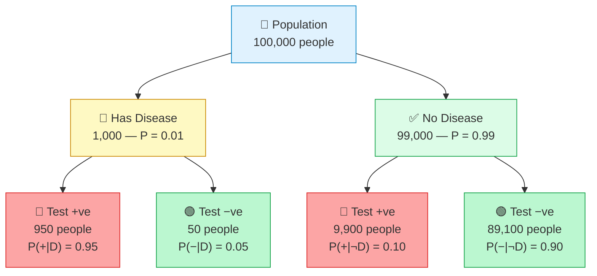
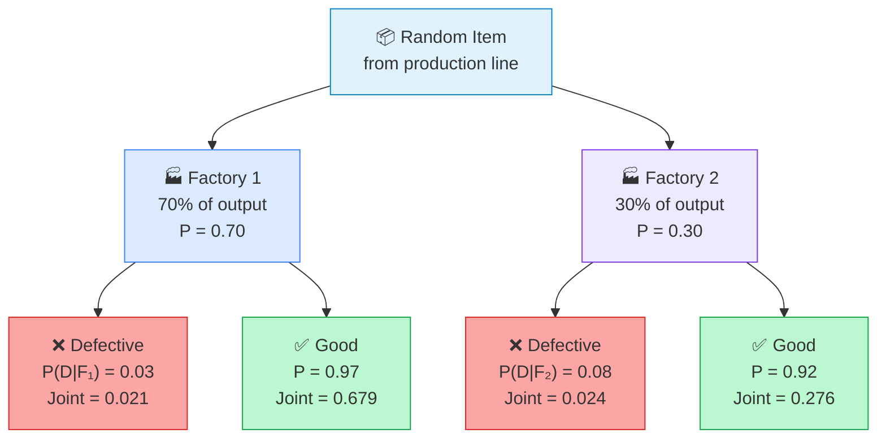
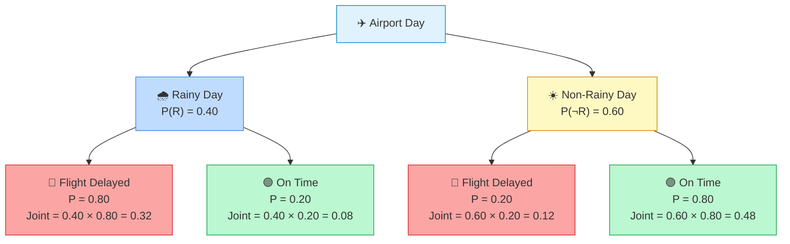
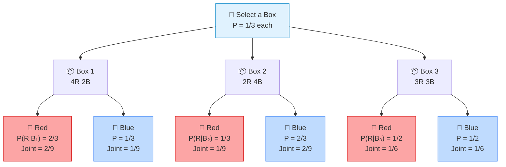
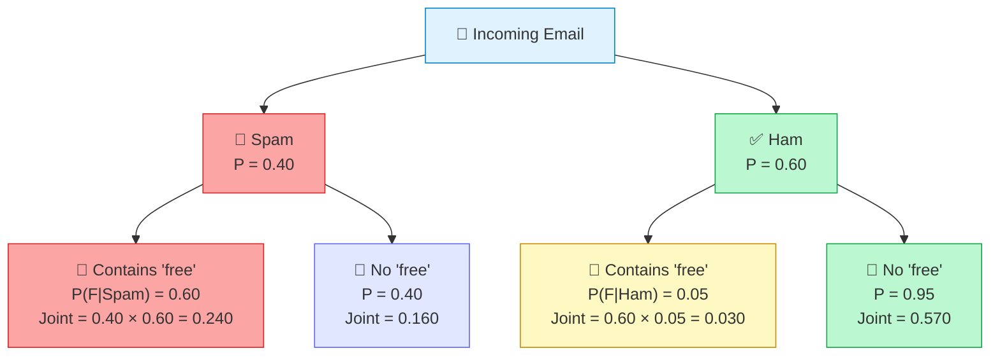

# Problems Based upon Bayes' Theorem

Numerical problems are the best way to build intuition for Bayes' theorem. Each problem below includes a **probability tree diagram**, a structured given-information table, and a full step-by-step derivation with verification.

---

## Table of Contents

1. [Problem 1 — Medical Diagnosis](#1-problem-1--medical-diagnosis)
2. [Problem 2 — Manufacturing Quality Control](#2-problem-2--manufacturing-quality-control)
3. [Problem 3 — Flight Delay Prediction](#3-problem-3--flight-delay-prediction)
4. [Problem 4 — Three Boxes (Multiple Hypotheses)](#4-problem-4--three-boxes-multiple-hypotheses)
5. [Problem 5 — Spam Email Detection](#5-problem-5--spam-email-detection)
6. [Key Observations](#6-key-observations)
7. [References](#7-references)

---

## 1. Problem 1 — Medical Diagnosis

**Problem Statement:** A rare disease affects **1%** of the population. A diagnostic test has:
- **95% sensitivity** — correctly identifies patients who *have* the disease
- **10% false-positive rate** — wrongly flags people who are *healthy*

A randomly chosen person tests **positive**. What is the probability they actually have the disease?

### Given Information

| Parameter | Symbol | Value |
|---|---|---|
| Disease prevalence (prior) | $P(D)$ | 0.01 |
| No disease | $P(\lnot D)$ | 0.99 |
| Sensitivity (true-positive rate) | $P(+ \mid D)$ | 0.95 |
| False-positive rate | $P(+ \mid \lnot D)$ | 0.10 |
| **Find** | $P(D \mid +)$ | **?** |

### Probability Tree

> [!NOTE]
> The two **red** leaves are all positive test results — one group truly has the disease, the other does not.

### Step-by-Step Solution

**Step 1 — Recall the two-term Bayes' formula:**

$$P(D \mid +) = \frac{P(+ \mid D) \cdot P(D)}{P(+ \mid D) \cdot P(D) + P(+ \mid \lnot D) \cdot P(\lnot D)}$$

**Step 2 — Compute the evidence $P(+)$ using the law of total probability:**

$$P(+) = P(+ \mid D) \cdot P(D) + P(+ \mid \lnot D) \cdot P(\lnot D)$$

$$= (0.95)(0.01) + (0.10)(0.99)$$

$$= 0.0095 + 0.0990 = 0.1085$$

**Step 3 — Compute the posterior:**

$$P(D \mid +) = \frac{0.0095}{0.1085} \approx 8.76\%$$
### Natural Frequency Table

Out of every **1,000** people tested:

| | Test +ve | Test −ve | Row Total |
|---|:---:|:---:|:---:|
| **Has Disease** | **9.5** | 0.5 | 10 |
| **No Disease** | **99** | 891 | 990 |
| **Column Total** | **108.5** | 891.5 | 1,000 |

$$P(D \mid +) = \frac{\text{True Positives}}{\text{All Positives}} = \frac{9.5}{108.5} \approx 8.76\%$$

> [!TIP]
> **Key insight:** Even with a 95% sensitive test, a positive result gives only **~8.76%** certainty of disease. Of all positive results, **~91% are false positives** from healthy people. The **low base rate (1%) dominates** — this is the **base-rate fallacy**.

---

## 2. Problem 2 — Manufacturing Quality Control

**Problem Statement:** A company has two factories:
- **Factory 1** produces **70%** of all items with a **3%** defect rate.
- **Factory 2** produces **30%** of all items with an **8%** defect rate.

A randomly selected item is found to be **defective**. What is the probability it came from each factory?

### Given Information

| Parameter | Symbol | Value |
|---|---|---|
| Factory 1 production share | $P(F_1)$ | 0.70 |
| Factory 2 production share | $P(F_2)$ | 0.30 |
| Defect rate — Factory 1 | $P(D \mid F_1)$ | 0.03 |
| Defect rate — Factory 2 | $P(D \mid F_2)$ | 0.08 |
| **Find** | $P(F_1 \mid D)$, $P(F_2 \mid D)$ | **?** |

### Probability Tree

### Step-by-Step Solution

**Step 1 — Total probability of a defective item:**

$$P(D) = P(D \mid F_1) \cdot P(F_1) + P(D \mid F_2) \cdot P(F_2)$$

$$= (0.03)(0.70) + (0.08)(0.30)$$

$$= 0.021 + 0.024 = \mathbf{0.045}$$

**Step 2 — Posterior for Factory 1:**

$$P(F_1 \mid D) = \frac{P(D \mid F_1) \cdot P(F_1)}{P(D)} = \frac{0.021}{0.045}$$

$$P(F_1 \mid D) \approx 46.7\%$$

**Step 3 — Posterior for Factory 2:**

$$P(F_2 \mid D) = \frac{P(D \mid F_2) \cdot P(F_2)}{P(D)} = \frac{0.024}{0.045}$$

$$P(F_2 \mid D) \approx 53.3\%$$

**Verification:** $46.7\% + 53.3\% = 100\%$ ✓

### Summary Table

| | $P(F_i)$ | $P(D \mid F_i)$ | Joint $P(D \cap F_i)$ | Posterior $P(F_i \mid D)$ |
|---|:---:|:---:|:---:|:---:|
| Factory 1 | 0.70 | 0.03 | 0.021 | **46.7%** |
| Factory 2 | 0.30 | 0.08 | 0.024 | **53.3%** |
| **Total** | 1.00 | — | **0.045** | **100%** |

> [!TIP]
> **Key insight:** Factory 1 produces 70% of all items but has only a 3% defect rate. Factory 2 produces just 30% but has a much higher 8% defect rate. When a defective item is found, Factory 2 becomes the slightly more likely source (53.3%) — **the higher defect rate outweighs the lower production share.**

---

## 3. Problem 3 — Flight Delay Prediction

**Problem Statement:** At an airport:
- **40%** of days are rainy.
- On a **rainy day**, there is an **80%** chance of a flight delay.
- On a **non-rainy day**, there is only a **20%** chance of a delay.

Your flight is **delayed**. What is the probability it was a rainy day?

### Given Information

| Parameter | Symbol | Value |
|---|---|---|
| Probability of rain | $P(R)$ | 0.40 |
| Probability of no rain | $P(\lnot R)$ | 0.60 |
| Delay given rain | $P(\text{Del} \mid R)$ | 0.80 |
| Delay given no rain | $P(\text{Del} \mid \lnot R)$ | 0.20 |
| **Find** | $P(R \mid \text{Del})$ | **?** |

### Probability Tree

### Step-by-Step Solution

**Step 1 — Total probability of a delay:**

$$P(\text{Del}) = P(\text{Del} \mid R) \cdot P(R) + P(\text{Del} \mid \lnot R) \cdot P(\lnot R)$$

$$= (0.80)(0.40) + (0.20)(0.60)$$

$$= 0.32 + 0.12 = \mathbf{0.44}$$

**Step 2 — Apply Bayes' theorem:**

$$P(R \mid \text{Del}) = \frac{P(\text{Del} \mid R) \cdot P(R)}{P(\text{Del})} = \frac{0.32}{0.44} = \frac{8}{11}$$

$$P(R \mid \text{Del}) \approx 72.7\%$$

**Step 3 — Posterior for non-rainy (verification):**

$$P(\lnot R \mid \text{Del}) = \frac{0.12}{0.44} = \frac{3}{11} \approx 27.3\%$$

$$72.7\% + 27.3\% = 100\% \checkmark$$

### Before vs. After Comparison

| | **Before delay observed (prior)** | **After delay observed (posterior)** |
|---|:---:|:---:|
| Rainy day | 40% | **72.7%** |
| Non-rainy day | 60% | **27.3%** |

> [!TIP]
> **Key insight:** Before observing anything, rain had a 40% probability. After learning the flight was delayed, the belief updates to **72.7%** — rain is the dominant cause of delays (80% rate vs 20%), so a delayed flight strongly suggests a rainy day.

---

## 4. Problem 4 — Three Boxes (Multiple Hypotheses)

**Problem Statement:** Three boxes contain coloured balls:

| Box | Red Balls | Blue Balls | Total |
|:---:|:---:|:---:|:---:|
| Box 1 | 4 | 2 | 6 |
| Box 2 | 2 | 4 | 6 |
| Box 3 | 3 | 3 | 6 |

A box is chosen **at random** (equal probability $\frac{1}{3}$ each), and one ball is drawn. It is **Red**. Find the probability the ball came from each box.

### Step-by-Step Solution

**Step 1 — Likelihoods:**

$$P(R \mid B_1) = \frac{4}{6} = \frac{2}{3}, \qquad P(R \mid B_2) = \frac{2}{6} = \frac{1}{3}, \qquad P(R \mid B_3) = \frac{3}{6} = \frac{1}{2}$$

**Step 2 — Total probability of drawing Red:**

$$P(R) = \sum_{i=1}^{3} P(R \mid B_i) \cdot P(B_i) = \frac{2}{3} \cdot \frac{1}{3} + \frac{1}{3} \cdot \frac{1}{3} + \frac{1}{2} \cdot \frac{1}{3}$$

$$= \frac{2}{9} + \frac{1}{9} + \frac{1}{6} = \frac{4}{18} + \frac{2}{18} + \frac{3}{18} = \frac{9}{18} = \frac{1}{2}$$

**Step 3 — Posteriors for each box:**

$$P(B_1 \mid R) = \frac{P(R \mid B_1) \cdot P(B_1)}{P(R)} = \frac{\frac{2}{3} \times \frac{1}{3}}{\frac{1}{2}} = \frac{\frac{2}{9}}{\frac{1}{2}} = \frac{4}{9} \approx \mathbf{44.4\%}$$

$$P(B_2 \mid R) = \frac{P(R \mid B_2) \cdot P(B_2)}{P(R)} = \frac{\frac{1}{3} \times \frac{1}{3}}{\frac{1}{2}} = \frac{\frac{1}{9}}{\frac{1}{2}} = \frac{2}{9} \approx \mathbf{22.2\%}$$

$$P(B_3 \mid R) = \frac{P(R \mid B_3) \cdot P(B_3)}{P(R)} = \frac{\frac{1}{2} \times \frac{1}{3}}{\frac{1}{2}} = \frac{\frac{1}{6}}{\frac{1}{2}} = \frac{1}{3} \approx \mathbf{33.3\%}$$

**Verification:** $\dfrac{4}{9} + \dfrac{2}{9} + \dfrac{3}{9} = \dfrac{9}{9} = 1$ ✓

### Summary Table

| Box | Prior $P(B_i)$ | Likelihood $P(R \mid B_i)$ | Joint $P(R \cap B_i)$ | Posterior $P(B_i \mid R)$ |
|:---:|:---:|:---:|:---:|:---:|
| Box 1 | 1/3 | 2/3 | 2/9 | **4/9 ≈ 44.4%** |
| Box 2 | 1/3 | 1/3 | 1/9 | **2/9 ≈ 22.2%** |
| Box 3 | 1/3 | 1/2 | 1/6 | **1/3 ≈ 33.3%** |
| **Total** | **1** | — | **1/2** | **100%** |

### Probability Tree

> [!TIP]
> **Key insight:** All boxes were equally likely *before* the draw (prior = 1/3 each). After observing a **Red** ball, Box 1 becomes the most probable source (44.4%) because it has the highest red proportion. Box 2 becomes the least probable (22.2%) because it has the fewest red balls. **The likelihood alone drives the update.**

---

## 5. Problem 5 — Spam Email Detection

**Problem Statement:** An email server classifies messages as **spam** or **ham** (legitimate). From historical data:
- **40%** of incoming emails are spam.
- The word *"free"* appears in **60%** of spam emails.
- The word *"free"* appears in only **5%** of legitimate emails.

A new email containing the word *"free"* arrives. What is the probability it is spam?

### Given Information

| Parameter | Symbol | Value |
|---|---|---|
| Prior probability of spam | $P(\text{Spam})$ | 0.40 |
| Prior probability of ham | $P(\text{Ham})$ | 0.60 |
| P("free" in spam) | $P(F \mid \text{Spam})$ | 0.60 |
| P("free" in ham) | $P(F \mid \text{Ham})$ | 0.05 |
| **Find** | $P(\text{Spam} \mid F)$ | **?** |

### Probability Tree

### Step-by-Step Solution

**Step 1 — Total probability of seeing the word "free":**

$$P(F) = P(F \mid \text{Spam}) \cdot P(\text{Spam}) + P(F \mid \text{Ham}) \cdot P(\text{Ham})$$

$$= (0.60)(0.40) + (0.05)(0.60)$$

$$= 0.240 + 0.030 = \mathbf{0.270}$$

**Step 2 — Posterior probability of spam:**

$$P(\text{Spam} \mid F) = \frac{P(F \mid \text{Spam}) \cdot P(\text{Spam})}{P(F)} = \frac{0.240}{0.270} = \frac{8}{9}$$

$$P(\text{Spam} \mid F) \approx 88.9\%$$

**Step 3 — Posterior probability of ham (verification):**

$$P(\text{Ham} \mid F) = \frac{0.030}{0.270} = \frac{1}{9} \approx 11.1\%$$

$$88.9\% + 11.1\% = 100\% \checkmark$$

### Before vs. After Comparison

| | **Before "free" seen (prior)** | **After "free" seen (posterior)** |
|---|:---:|:---:|
| Spam | 40% | **88.9%** |
| Ham | 60% | **11.1%** |

### Connection to Naive Bayes Classifier

This is exactly how a **Naive Bayes spam filter** operates. Using the proportional form to rank classes:

$$\hat{C} = \arg\max_{C} P(C) \cdot P(\text{"free"} \mid C)$$

| Class | $P(C)$ | $P(\text{"free"} \mid C)$ | Score $\propto$ Posterior |
|---|:---:|:---:|:---:|
| Spam | 0.40 | 0.60 | **0.240** |
| Ham | 0.60 | 0.05 | 0.030 |

Since $0.240 > 0.030$, the classifier predicts **Spam** — consistent with the 88.9% posterior.

In a real classifier, this multiplication runs for **every word** in the email. More features → sharper posteriors. See [Naive Bayes Classifier](Naive%20Bayes%20Classifier.md).

> [!TIP]
> **Key insight:** A single word "free" pushed spam probability from the prior **40%** to **88.9%**. This dramatic update reflects the large likelihood ratio: "free" is **12× more common** in spam than in ham (60% vs 5%) — a powerful signal.

---

## 6. Key Observations

| Observation | Problem | Explanation |
|---|---|---|
| **The prior matters enormously** | Problem 1 | A 1% disease prevalence means most positives are false, even with a 95%-sensitive test. |
| **Posteriors must sum to 1** | All | Mutually exclusive, exhaustive hypotheses → posteriors always add to exactly 100%. |
| **High rate can outweigh low volume** | Problem 2 | Factory 2's 8% defect rate made it the more probable source despite only 30% production share. |
| **Evidence shifts beliefs, not replaces them** | Problem 3 | Rain went from 40% prior to 72.7% posterior — it didn't become certain, just more likely. |
| **More hypotheses = same mechanics** | Problem 4 | Extended Bayes with 3 boxes works identically: compute all joint probabilities, then normalise. |
| **Bayes is the foundation of Naive Bayes** | Problem 5 | Spam detection is Bayes' theorem applied independently to each word feature. |

---

## 7. References

- [Bayes Theorem in Probability](Bayes%20Theorem%20in%20Probability.md)
- [Conditional Probability](Conditional%20Probability.md)
- [Mutually Exclusive Events in Probability](Mutually%20Exclusive%20Events%20in%20Probability.md)
- [Naive Bayes Classifier](Naive%20Bayes%20Classifier.md)
- [Bayes' Theorem — Full Reference](../Mathematics%20of%20Machine%20Learning/Bayes%27%20theorem/README.md)

---

  ⬅️ <strong>Previous:</strong> <a href="Bayes%20Theorem%20in%20Probability.md">Bayes Theorem in Probability</a> &nbsp;&nbsp;|&nbsp;&nbsp; <strong>Next:</strong> <a href="Intuition%20Behind%20Naive%20Bayes%20Classifier.md">Intuition Behind Naive Bayes Classifier</a> ➡️

