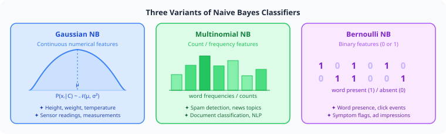

# Types of Naive Bayes Classifiers

All ***Naive Bayes variants*** share the same **Bayes decision rule** — they differ only in the ***assumed distribution*** of $P(x_i \mid C_k)$. Choosing the right variant means ***matching the distribution assumption to the nature of your features***.

---

## Table of Contents

1. [Overview](#1-overview)
2. [Gaussian Naive Bayes](#2-gaussian-naive-bayes)
   - [2.1 Likelihood Formula](#21-likelihood-formula)
   - [2.2 Parameter Estimation](#22-parameter-estimation)
   - [2.3 Log Discriminant](#23-log-discriminant)
   - [2.4 Alternative Approaches](#24-alternative-approaches)
3. [Multinomial Naive Bayes](#3-multinomial-naive-bayes)
   - [3.1 Likelihood Formula](#31-likelihood-formula)
   - [3.2 Log-Space Form — a Linear Classifier](#32-log-space-form--a-linear-classifier)
   - [3.3 Laplace and Lidstone Smoothing](#33-laplace-and-lidstone-smoothing)
4. [Bernoulli Naive Bayes](#4-bernoulli-naive-bayes)
   - [4.1 Likelihood Formula](#41-likelihood-formula)
   - [4.2 Parameter Estimation](#42-parameter-estimation)
   - [4.3 Key Difference from Multinomial NB](#43-key-difference-from-multinomial-nb)
5. [Categorical Naive Bayes](#5-categorical-naive-bayes)
   - [5.1 Parameter Estimation](#51-parameter-estimation)
6. [Complement Naive Bayes](#6-complement-naive-bayes)
   - [6.1 Parameter Estimation](#61-parameter-estimation)
7. [Other Likelihood Families](#7-other-likelihood-families)
8. [Semi-supervised Parameter Estimation](#8-semi-supervised-parameter-estimation)
9. [Comparison Table](#9-comparison-table)
10. [References](#10-references)

---

## 1. Overview

```mermaid
flowchart TD
    NB["🤖 Naive Bayes Classifier"]

    NB --> G["📈 Gaussian NB"]
    NB --> M["📝 Multinomial NB"]
    NB --> B["⚡ Bernoulli NB"]
    NB --> Cat["🗂️ Categorical NB"]
    NB --> Comp["⚖️ Complement NB"]

    G --> GF["Feature type: Continuous numbers"]
    G --> GD["Distribution: Normal 𝒩(μ, σ²)"]
    G --> GU["Use case: Sensor data · biometrics · measurements"]

    M --> MF["Feature type: Counts / frequencies"]
    M --> MD["Distribution: Multinomial"]
    M --> MU["Use case: Spam filtering · word counts · NLP"]

    B --> BF["Feature type: Binary (0 or 1)"]
    B --> BD["Distribution: Bernoulli"]
    B --> BU["Use case: Word presence · click events · symptom flags"]

    Cat --> CatF["Feature type: Finite unordered categories"]
    Cat --> CatD["Distribution: Categorical"]
    Cat --> CatU["Use case: Categorical tabular data · survey responses"]

    Comp --> CompF["Feature type: Non-negative counts"]
    Comp --> CompD["Distribution: Multinomial (complement)"]
    Comp --> CompU["Use case: Imbalanced text classification"]

    style NB    fill:#e0f2fe,stroke:#0284c7,color:#0c4a6e
    style G     fill:#dbeafe,stroke:#3b82f6,color:#1e3a8a
    style M     fill:#dcfce7,stroke:#22c55e,color:#14532d
    style B     fill:#fae8ff,stroke:#a855f7,color:#581c87
    style Cat   fill:#fef9c3,stroke:#ca8a04,color:#713f12
    style Comp  fill:#ffe4e6,stroke:#fb7185,color:#881337
    style GF    fill:#eff6ff,stroke:#93c5fd,color:#1e40af
    style GD    fill:#eff6ff,stroke:#93c5fd,color:#1e40af
    style GU    fill:#eff6ff,stroke:#93c5fd,color:#1e40af
    style MF    fill:#f0fdf4,stroke:#86efac,color:#166534
    style MD    fill:#f0fdf4,stroke:#86efac,color:#166534
    style MU    fill:#f0fdf4,stroke:#86efac,color:#166534
    style BF    fill:#fdf4ff,stroke:#d8b4fe,color:#6b21a8
    style BD    fill:#fdf4ff,stroke:#d8b4fe,color:#6b21a8
    style BU    fill:#fdf4ff,stroke:#d8b4fe,color:#6b21a8
    style CatF  fill:#fefce8,stroke:#fde047,color:#713f12
    style CatD  fill:#fefce8,stroke:#fde047,color:#713f12
    style CatU  fill:#fefce8,stroke:#fde047,color:#713f12
    style CompF fill:#fff1f2,stroke:#fda4af,color:#881337
    style CompD fill:#fff1f2,stroke:#fda4af,color:#881337
    style CompU fill:#fff1f2,stroke:#fda4af,color:#881337
```

  

> [!IMPORTANT]
> All variants use the **same decision rule**: $\hat{y} = \arg\max_k\, P(C_k) \prod_i P(x_i \mid C_k)$. The **only** difference between variants is the formula used to compute $P(x_i \mid C_k)$.

| Variant | Feature Type | Distribution | Common Use Cases |
|---|---|---|---|
| **Gaussian NB** | Continuous numbers | Normal $\mathcal{N}(\mu, \sigma^2)$ | Medical data, sensor readings, biometrics |
| **Multinomial NB** | Counts / frequencies | Multinomial | Spam filtering, document classification, NLP |
| **Bernoulli NB** | Binary (0 or 1) | Bernoulli | Word presence, click events, symptom flags |
| **Categorical NB** | Finite unordered categories | Categorical | Categorical tabular data, survey responses |
| **Complement NB** | Non-negative counts | Multinomial (complement) | Imbalanced text classification |

---

## 2. Gaussian Naive Bayes

Used when features are ***continuous*** and the *class-conditional distribution* of each feature is ***approximately Gaussian***.

Examples include *length*, *mass*, *temperature*, *laboratory measurements*, or any ***real-valued continuous feature***.

### 2.1 Likelihood Formula

For each feature $x_i$ in class $C_k$, the likelihood is modelled using the **Gaussian probability density function**:

$$\boxed{P(x_i \mid C_k) = \frac{1}{\sqrt{2\pi\,\sigma_{ki}^2}} \;\exp\!\left(-\frac{(x_i - \mu_{ki})^2}{2\sigma_{ki}^2}\right)}$$

| Parameter | Meaning |
|---|---|
| $\mu_{ki}$ | ***Mean*** of feature $x_i$ in class $C_k$ |
| $\sigma_{ki}^2$ | ***Variance*** of feature $x_i$ in class $C_k$ |

**Use cases:** Medical diagnosis, sensor readings, height and weight, any real-valued measurement.

### 2.2 Parameter Estimation

For feature $i$ among the $N_k$ training examples of class $C_k$, ***maximum-likelihood*** estimation gives:

$$\boxed{\widehat{\mu}_{ki} = \frac{1}{N_k} \sum_{n:\,y^{(n)} = C_k} x_i^{(n)}}$$

$$\boxed{\widehat{\sigma}_{ki}^2 = \frac{1}{N_k} \sum_{n:\,y^{(n)} = C_k} \left(x_i^{(n)} - \widehat{\mu}_{ki}\right)^2}$$

> [!NOTE]
> The **ML variance** uses denominator $N_k$. The ***Bessel-corrected*** (unbiased) sample variance uses $N_k - 1$. In practice, implementations (e.g. scikit-learn) add a small ***variance smoothing*** constant $\varepsilon$ to $\widehat{\sigma}_{ki}^2$ to prevent **division by zero** when a feature is constant within a class.

### 2.3 Log Discriminant

Substituting the Gaussian density and taking the logarithm converts the product into a sum — ***numerically stable*** and efficient:

$$\boxed{g_k(\mathbf{x}) = \log P(C_k) - \frac{1}{2}\sum_i \left[\log\!\left(2\pi\sigma_{ki}^2\right) + \frac{(x_i - \mu_{ki})^2}{\sigma_{ki}^2}\right]}$$

The predicted class is $\hat{y} = \arg\max_k\; g_k(\mathbf{x})$.

### 2.4 Alternative Approaches

When features are **not approximately Gaussian**, two alternatives exist:

- ***Binning:*** Discretise continuous values into intervals to create **Bernoulli-distributed** features. Simple, but *may discard discriminative information* at bin boundaries.
- ***Kernel Density Estimation (KDE):*** Replace the Gaussian with a *non-parametric density estimate*. Introduced by **John and Langley**, KDE can **boost classifier accuracy considerably** when class-conditional densities are *far from normal*.

---

## 3. Multinomial Naive Bayes

Used when features are ***counts or frequencies*** — the ***standard choice for text classification***. It treats a document as a ***"bag of words"***: word order and grammar are **ignored**; only the **count** of each word matters. *Repeated occurrences matter* — unlike Bernoulli NB.

A feature vector $\mathbf{x} = (x_1, \ldots, x_n)$ is a ***histogram***, with $x_i$ counting the number of times event $i$ was observed.

### 3.1 Likelihood Formula

The full multinomial likelihood of observing word-count histogram $\mathbf{x}$ given class $C_k$:

$$p(\mathbf{x} \mid C_k) = \frac{\left(\displaystyle\sum_{i=1}^n x_i\right)!}{\displaystyle\prod_{i=1}^n x_i!} \prod_{i=1}^n p_{ki}^{\,x_i}$$

where $p_{ki} := P(i \mid C_k)$ is the ***probability of feature $i$ given class $C_k$***.

> [!NOTE]
> The multinomial coefficient $\dfrac{(\sum_i x_i)!}{\prod_i x_i!}$ is **constant across all classes** for a fixed document — it **cancels** when comparing class scores. Classification requires only $\prod_i p_{ki}^{x_i}$.

With ***Laplace smoothing*** (parameter $\alpha$), the estimated parameter is:

$$\boxed{\widehat{p}_{ki} = \frac{N_{ki} + \alpha}{N_k + \alpha \cdot |V|}}$$

| Symbol | Meaning |
|---|---|
| $N_{ki}$ | Count of feature $i$ in class $C_k$ in training data |
| $N_k$ | Total count of all features in class $C_k$ |
| $\alpha$ | Smoothing parameter ($\alpha = 1$: Laplace; $0 < \alpha < 1$: Lidstone) |
| $|V|$ | Vocabulary size — number of unique features |

> [!TIP]
> **Why smoothing?** Without it, any feature **unseen during training** gets $p_{ki} = 0$, which **zeroes the entire class score** regardless of all other evidence. Adding $\alpha$ ensures *no probability is ever exactly zero*.

**Use cases:** Spam detection, news categorisation, document classification, TF-IDF text models.

### 3.2 Log-Space Form — a Linear Classifier

In log space, the Multinomial Naive Bayes classifier becomes a ***linear classifier***:

$$\boxed{\log p(C_k \mid \mathbf{x}) \;\propto\; \underbrace{\log p(C_k)}_{b} \;+\; \sum_{i=1}^n x_i \cdot \underbrace{\log p_{ki}}_{w_{ki}} \;=\; b + \mathbf{w}_k^\top \mathbf{x}}$$

where $b = \log p(C_k)$ is the ***bias*** (log-prior) and $w_{ki} = \log p_{ki}$ are the ***feature weights***.

> [!NOTE]
> Working with **log-probabilities** replaces multiplication with addition — far more **numerically stable** when multiplying many small values.

### 3.3 Laplace and Lidstone Smoothing

| Value of $\alpha$ | Name | Effect |
|---|---|---|
| $\alpha = 1$ | **Laplace smoothing** — the standard choice | Adds one ***pseudo-observation*** per feature |
| $0 < \alpha < 1$ | **Lidstone smoothing** | *Softer prior* — less regularisation |
| $\alpha = 0$ | No smoothing | ***Zero-frequency problem*** remains |

> [!TIP]
> **TF-IDF:** Rennie et al. found that *using TF-IDF weights instead of raw term frequencies*, combined with *document length normalisation*, makes Multinomial NB **competitive with support vector machines** on text benchmarks.

---

## 4. Bernoulli Naive Bayes

Used when features are ***binary*** — each feature is either **present** ($x_i = 1$) or **absent** ($x_i = 0$). Especially popular for ***short document classification*** using **binary term occurrence** features.

### 4.1 Likelihood Formula

$$\boxed{P(\mathbf{x} \mid C_k) = \prod_{i=1}^n P(i \mid C_k)^{\,x_i} \cdot \bigl(1 - P(i \mid C_k)\bigr)^{1-x_i}}$$

| Symbol | Meaning |
|---|---|
| $P(i \mid C_k)$ | Probability that feature $i$ is **present** in class $C_k$ |
| $x_i = 1$ | Feature $i$ is present in this input |
| $x_i = 0$ | Feature $i$ is absent from this input |

**Use cases:** Word presence/absence in short texts, click events, binary symptom flags, ad impression data.

### 4.2 Parameter Estimation

With ***Laplace smoothing***, the estimated probability that feature $i$ is **present** ($X_i = 1$) in class $C_k$:

$$\boxed{\widehat{P}(X_i = 1 \mid C_k) = \frac{N_{ki} + \alpha}{N_k + 2\alpha}}$$

| Symbol | Meaning |
|---|---|
| $N_{ki}$ | Number of training examples in class $C_k$ where feature $i$ is **present** |
| $N_k$ | Total number of training examples in class $C_k$ |
| $2\alpha$ | Denominator adds $\alpha \cdot K = \alpha \cdot 2$ — because $K = 2$ (binary: present / absent) |

### 4.3 Key Difference from Multinomial NB

> [!IMPORTANT]
> **Bernoulli NB ≠ Multinomial NB with counts truncated to 1.**
>
> When a feature is *absent* ($x_i = 0$), Bernoulli NB contributes a factor of $\bigl(1 - P(i \mid C_k)\bigr)$ — it ***explicitly penalises*** a class for an expected feature that is *missing*. Multinomial NB ***silently ignores*** absent features.
>
> This distinction makes Bernoulli NB **better suited for short texts** where *feature absence is informative*.

---

## 5. Categorical Naive Bayes

Used when each feature takes ***one value from a finite, unordered set*** — a ***categorical variable***:

- *Weather:* sunny, cloudy, rainy
- *Colour:* red, green, blue
- *Subscription plan:* basic, standard, premium

Each feature gets its own ***categorical distribution*** within every class, estimated from training data frequencies.

> [!NOTE]
> ***Integer-encoding categorical features*** (e.g. sunny=0, cloudy=1, rainy=2) does **not** make them ordered measurements. Applying Gaussian NB to integer-encoded categoricals implies a **wrong generative model** and may harm accuracy.

### 5.1 Parameter Estimation

For feature $X_i$ that takes $M_i$ possible values, the smoothed probability estimate for value $v$ in class $C_k$:

$$\boxed{\widehat{P}(X_i = v \mid C_k) = \frac{N_{kiv} + \alpha}{N_k + \alpha \cdot M_i}}$$

| Symbol | Meaning |
|---|---|
| $N_{kiv}$ | Count of examples in class $C_k$ where feature $i$ takes value $v$ |
| $N_k$ | Total training examples in class $C_k$ |
| $M_i$ | Number of possible values for feature $i$ |
| $\alpha$ | Smoothing parameter |

---

## 6. Complement Naive Bayes

***Complement Naive Bayes (CNB)*** was developed for ***imbalanced text data***. Instead of estimating $P(x_i \mid C_k)$ from examples *inside* class $C_k$, it uses **statistics from all examples outside** the class — the *"complement"*.

Those **complement statistics** are often more ***stable*** for minority classes, and CNB frequently ***outperforms Multinomial NB*** on imbalanced document classification benchmarks.

### 6.1 Parameter Estimation

For each class $C_k$, CNB estimates parameters from the **complement** — all training examples *not* in $C_k$:

$$\boxed{\hat{\theta}_{ki}^c = \frac{N_{ki}^c + \alpha}{N_k^c + \alpha \cdot |V|}}$$

| Symbol | Meaning |
|---|---|
| $N_{ki}^c$ | Count of feature $i$ across all training examples **not** in class $C_k$ |
| $N_k^c$ | Total feature count in all examples **not** in class $C_k$ |
| $|V|$ | Vocabulary size |

Classification uses **argmin** — the class whose *complement* least resembles the input:

$$\hat{y} = \arg\min_k \sum_{i=1}^n x_i \log \hat{\theta}_{ki}^c$$

---

## 7. Other Likelihood Families

The ***Naive Bayes framework is extensible*** — any parametric family can be plugged in as $P(x_i \mid C_k)$, as long as parameters can be **estimated separately per class**:

| Scenario | Recommended Likelihood |
|---|---|
| Count features with a known exposure (e.g. word count per document length) | ***Poisson*** |
| Non-normal continuous features | ***Kernel Density Estimation*** |
| Bounded continuous features in $[0, 1]$ | ***Beta distribution*** |

---

## 8. Semi-supervised Parameter Estimation

When ***labelled data is scarce*** but ***unlabelled data is abundant***, Naive Bayes can be trained in a ***semi-supervised loop*** using ***Expectation–Maximisation (EM)***.

**Setup:** Given a collection $\mathcal{D} = L \uplus U$ of *labelled samples* $L$ and *unlabelled samples* $U$, start by training a Naive Bayes classifier on $L$ alone, then iterate:

| Step | Name | Action |
|---|---|---|
| **E-step** | *Prediction* | Predict **class probabilities** $P(C \mid x)$ for **all** examples $x \in \mathcal{D}$ (labelled and unlabelled) |
| **M-step** | *Re-training* | Retrain the model using the **predicted probabilities** (not hard labels) from the E-step |

**Convergence** is determined by improvement in the model likelihood $P(\mathcal{D} \mid \theta)$, where $\theta$ denotes all Naive Bayes parameters.

> [!NOTE]
> This algorithm is formally justified by the assumption that data are generated by a ***mixture model*** whose **components are exactly the classes**. The E-step computes *soft class assignments*; the M-step *re-estimates parameters* from those soft counts.

---

## 9. Comparison Table

| Variant | Feature Type | Distribution | Models Absence | Typical Use |
|---|---|---|:---:|---|
| **Gaussian** | Continuous measurements | Normal $\mathcal{N}(\mu, \sigma^2)$ | — | Numerical tabular data, sensor readings |
| **Multinomial** | Non-negative counts | Multinomial | ✗ | Document classification, word counts |
| **Bernoulli** | Binary indicators | Bernoulli | ✓ | Presence/absence features, short text |
| **Categorical** | Finite unordered categories | Categorical | — | Categorical tabular data |
| **Complement** | Non-negative counts | Multinomial (complement) | ✗ | Imbalanced text classification |

---

## 10. References

### Within This Module

- [Naive Bayes Classifier](Naive%20Bayes%20Classifier.md) — full mathematical derivation and decision rule
- [Intuition Behind Naive Bayes Classifier](Intuition%20Behind%20Naive%20Bayes%20Classifier.md) — conceptual introduction

### External References

- [Wikipedia — Naive Bayes classifier](https://en.wikipedia.org/wiki/Naive_Bayes_classifier)
- [Rennie et al. — Tackling the Poor Assumptions of Naive Bayes Text Classifiers (ICML 2003)](https://people.csail.mit.edu/jrennie/papers/icml03-nb.pdf)

---

  ⬅️ <strong>Previous:</strong> <a href="Naive%20Bayes%20Classifier.md">Naive Bayes Classifier</a>
  &nbsp;&nbsp;|&nbsp;&nbsp;
  <strong>Next:</strong> <a href="Simple%20Code%20Example%20of%20Naive%20Bayes%20Classifier.ipynb">Simple Code Example</a>
  &nbsp;·&nbsp;
  <a href="Simple%20Code%20Example%20of%20Naive%20Bayes%20Classifier%20(Detailed%20Each%20Step).ipynb">Detailed Step-by-Step</a> ➡️

