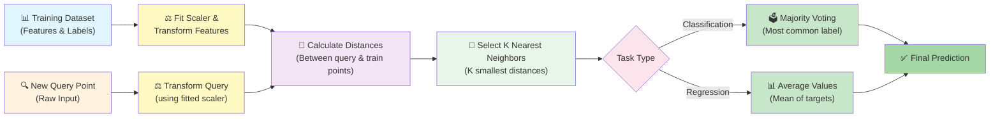

# KNN Algorithm and Working Step-by-Step

## Table of Contents

- [How KNN Works](#how-knn-works)
  - [Detailed Steps for One Query](#detailed-steps-for-one-query-mathbfx)
- [Generic Pseudocode](#generic-pseudocode)
  - [Note: Why Sorting Everything is Unnecessary](#note-why-sorting-everything-is-unnecessary)
- [Feature Scaling](#feature-scaling)
- [KNN Workflow Diagram](#knn-workflow-diagram)
- [The KNN Algorithm (Step-by-Step)](#the-knn-algorithm-step-by-step)
  - [Pseudocode: KNN Classification](#the-following-pseudocode-illustrates-knn-classification)
- [Time Complexity](#time-complexity)
  - [Training Time](#training-time)
  - [Prediction Time](#prediction-time)
  - [Space Complexity](#space-complexity)
  - [Summary](#summary)

---

## How KNN Works

The algorithm follows ***four main steps*** to evaluate a new, unseen data point:

- ***Choose the number of neighbors (K).*** You pick a positive integer ***K***, which determines how many nearby points will influence the decision. 

> [!IMPORTANT]
> ***K is a hyperparameter*** — a setting you choose ***before training*** that ***significantly affects*** model performance.

- ***Calculate distances.*** The algorithm ***measures*** the ***distance*** between the new data point and every existing point in the ***training dataset***.
- ***Identify the nearest neighbors.*** It ***sorts*** all calculated distances from smallest to largest and ***selects*** the top ***K closest points***.
- ***Make a prediction.*** For ***classification***, the new point receives the ***most common label*** among those K neighbors through ***majority voting***. For ***regression***, the algorithm calculates the ***average*** of the K neighbors’ values.

### Detailed Steps for One Query $\mathbf{x}$:

For a given ***query point*** $\mathbf{x}$, KNN executes the following steps:

1. ***Validate feature representation:*** Ensure that $\mathbf{x}$ has the ***same transformed feature representation*** as the training set.

2. ***Compute distances:*** Calculate $d_i=d(\mathbf{x},\mathbf{x}_i)$ for $i=1,\ldots,n$ to all training points.

3. ***Order by distance:*** ***Sort*** training indices so that the distances are ordered:

   $$
   d_{(1)}\le d_{(2)}\le\cdots\le d_{(n)}
   $$

4. ***Define neighborhood:*** Select the ***K nearest neighbors***:

   $$
   N_k(\mathbf{x})=\{(1),(2),\ldots,(k)\}
   $$

5. ***Aggregate predictions:*** ***Combine*** the ***target values*** $\{y_i:i\in N_k(\mathbf{x})\}$ according to the task (***majority vote*** for classification, ***average*** for regression).

## Generic Pseudocode

Here is a ***language-agnostic*** outline of the KNN algorithm:

```text
KNN_Train(X_train, y_train):
    Validate training data
    Fit feature scaler using training data only
    Transform training features using the fitted scaler
    Store transformed X_train and y_train
    Optionally build an exact or approximate search index

KNN_Predict(x_query, K):
    Validate K and query dimensions
    Transform x_query using the fitted scaler (from training)
    distances = distance from x_query to every training row
    neighbour_indices = indices of K smallest distances
    neighbour_targets = y_train[neighbour_indices]
    if classification:
        return most_common_label(neighbour_targets)
    if regression:
        return mean(neighbour_targets)
```

**Key points:**
- ***KNN_Train()*** is ***fast*** — it ***fits a feature scaler*** on training data, ***transforms*** the features, then ***stores*** the scaled data and optionally builds a ***search index*** (KD-tree, ball tree, etc.)
- ***KNN_Predict()*** does all the computational work: ***scale the query***, ***compute distances***, ***find K neighbors***, ***aggregate*** targets
- The final step returns the ***majority class*** (classification) or ***mean*** (regression)

> [!NOTE]
> ***Lazy Learning:*** KNN ***defers*** all ***computational work*** until ***prediction time***. Training is $O(nd)$, but prediction is ***$O(nd)$ per query*** without ***acceleration structures***.

### Note: Why Sorting Everything is Unnecessary

Only the ***smallest $k$ distances*** are needed. A ***full sort*** is $O(n\log n)$ time complexity, which is wasteful when you only need the top $k$. Better alternatives:

- ***Partial selection algorithm:*** Identify the lowest $k$ distances in ***expected*** $O(n)$ time (e.g. Quickselect), then optionally ***sort the subset*** in $O(k\log k)$ time. Note: worst-case complexity depends on the implementation — Introselect guarantees $O(n)$ worst-case
- ***Search trees:*** KD-trees and ball trees can ***reduce work further*** in favorable low-dimensional data by pruning branches that cannot contain neighbors

> [!TIP]
> ***Optimization Insight:*** ***Don't sort all distances!*** Use a ***partial selection algorithm*** or ***heap-based approach*** to find the ***K smallest distances*** in ***O(n) time*** instead of ***O(n log n)***. For ***large datasets***, this saves ***significant computation***.

This optimization is especially important for ***large datasets*** where computing distances to all $n$ training points already dominates the cost.

## Feature Scaling

Because KNN is a ***distance-based algorithm***, features with ***larger numerical ranges dominate the distance calculation***. Feature scaling must be applied ***before*** computing distances.

> [!IMPORTANT]
> ***Always scale your features before running KNN.*** Without scaling, features with large numerical ranges will dominate the distance metric and bias the results.

**Example — why scaling matters:**

| Feature | Range |
|---|---|
| Age | 18 – 60 |
| Salary | 20,000 – 200,000 |

Without scaling, Salary dominates Euclidean distance because its numerical values are orders of magnitude larger than Age, even if Age is equally important for the task.

**Standardization (Z-score normalization)** is the most common approach:

$$
z = \frac{x - \mu}{\sigma}
$$

where $\mu$ is the ***mean*** and $\sigma$ is the ***standard deviation*** of the feature, computed ***from the training set only***.

> [!CAUTION]
> ***Fit the scaler on training data only.*** Applying it to the full dataset (including test/query data) before splitting would cause ***data leakage*** — the scaler would have "seen" test statistics, inflating performance estimates.

**Correct workflow:**

1. Fit the scaler using ***training data only***
2. Transform ***training features*** using the fitted scaler
3. Transform ***query/test features*** using the ***same fitted scaler*** (do not refit)

> [!NOTE]
> For more information, please follow this document: [05 Feature scaling and preprocessing.md](05%20Feature%20scaling%20and%20preprocessing.md).

---

## KNN Workflow Diagram



This diagram shows the ***complete KNN prediction pipeline***:
- ***Training Dataset & Query Point*** are preprocessed using a single fitted scaler to prevent data leakage
- ***Feature Scaling*** puts all features on the same numerical scale before distance calculation
- ***Calculate Distances*** measures the distance between the transformed query point and all transformed training points
- ***Select K Neighbors*** finds the $K$ points with the smallest distances
- ***Task-dependent aggregation*** (majority voting for classification, mean for regression) produces the final prediction

## The KNN Algorithm (Step-by-Step)

- **Scale Features:** ***Before*** computing any distances, apply a ***feature scaler*** (fitted on training data only) to transform all features to a comparable scale. This prevents features with large numerical ranges from dominating the distance metric.

- **Compute Distances:** For a new query point $\mathbf{x}$, ***compute*** the ***distance*** $d(\mathbf{x}, \mathbf{x}_i)$ to each ***training point*** $\mathbf{x}_i$ using a chosen ***metric***. For example, using **Euclidean distance**:

  $$
  d(\mathbf{x}, \mathbf{x}_i) = \sqrt{\sum_{j=1}^{d}(x_j - x_{ij})^2}
  $$

  where $d$ is the ***number of features*** and $n$ is the ***number of training samples***. Using $d$ as the summation bound avoids confusion with $n$.

  

- **Find Neighbors:** ***Identify*** the set $\mathcal{N}_k(\mathbf{x})$ of the $k$ ***training points*** with the ***smallest distances*** to $\mathbf{x}$:
  - ***Select*** the **$k$ points** with the smallest computed distances
  - ***Handle ties*** using one of several policies: ***reducing $k$*** by one, applying ***distance-weighted voting*** (closer neighbors get more influence), using a ***deterministic class-priority rule***, or breaking ties ***randomly***

  Formally, $\mathcal{N}_k(\mathbf{x}) \subseteq \{(\mathbf{x}_i,y_i)\}$ such that $|\mathcal{N}_k|=k$ and any point outside $\mathcal{N}_k$ is at least as far as the farthest point in $\mathcal{N}_k$.

  
- **Aggregate Labels/Values:**
  - **Classification:** ***Take*** the ***labels*** of the $k$ ***neighbors*** and ***predict*** the ***majority class***. If $y_i$ are the labels of neighbors, the classifier is

    $$
    \hat{y}(\mathbf{x}) = \operatorname{mode}\{y_i : (\mathbf{x}_i,y_i)\in\mathcal{N}_k(\mathbf{x})\}
    $$

    (in other words, ***pick*** the ***label occurring most often*** in $\mathcal{N}_k$). In case of a ***tie***, common ***policies*** include: ***reducing $k$*** by one, ***distance-weighted voting*** (closer neighbors carry more weight), applying a ***deterministic class-priority rule***, or breaking ties ***randomly***.

  - **Regression:** ***Average*** the ***neighbors’*** ***target values***:

    $$
    \hat{f}(\mathbf{x}) = \frac{1}{k}\sum_{(\mathbf{x}_i,y_i)\in\mathcal{N}_k(\mathbf{x})} y_i
    $$

    (Alternatively, use a ***weighted average***, e.g. ***inverse-distance weighting***.)

  

- **Output Prediction:** ***Return*** the ***predicted label*** or ***value***. Optionally, for ***classification*** one can output ***class probabilities***:

  $$
  P(y=j \mid \mathbf{x}) = \frac{1}{k}\sum_{i\in\mathcal{N}_k} \mathbf{1}(y_i=j)
  $$

  For example, scikit-learn’s `predict_proba` reports exactly these proportions.

> [!NOTE]
> This formula applies to ***uniform (unweighted) KNN***. For ***weighted KNN***, each neighbor contributes proportionally to its weight (e.g. inverse distance), and the class scores must be ***normalized*** so they sum to 1.


#### The following pseudocode illustrates KNN classification:

```python
def knn_predict(x_query, X_train, y_train, k):
    # Compute (Euclidean) distance from query to all training points
    distances = [sqrt(sum((x_query[d] - X_train[i][d])**2 for d in range(len(x_query))))
                 for i in range(len(X_train))]
    # Sort by distance and take k nearest
    idx_sorted = sorted(range(len(distances)), key=lambda i: distances[i])
    neighbors = [y_train[i] for i in idx_sorted[:k]]
    # Majority vote (return most common label)
    return most_common_label(neighbors)
```

**Code Explanation:**

- **`x_query`** — the ***new data point*** we want to classify; it has the same number of features as the training data.
- **`X_train`** — the ***training feature matrix***; each row is one training example.
- **`y_train`** — the ***training labels***; one label per training row.
- **`k`** — the ***number of neighbors*** to consider.

**Line by line:**

- **`distances = [...]`** — computes the ***Euclidean distance*** from `x_query` to ***every training point*** using the formula $\sqrt{\sum(x_j - x_{ij})^2}$. The result is a list of $n$ distances, one per training row.
- **`idx_sorted = sorted(...)`** — ***sorts the indices*** of the training points by their distance to `x_query`, from ***closest to farthest***.
- **`neighbors = [...]`** — picks the ***labels of the K closest points*** using the first `k` indices from the sorted list.
- **`return most_common_label(neighbors)`** — applies ***majority voting*** and returns the ***label that appears most often*** among the K neighbors as the final prediction.

---

## Time Complexity

| Phase | Method | Time Complexity | Notes |
|---|---|---|---|
| **Training** | Brute force | $O(nd)$ | Just stores $n$ points in $d$ dimensions |
| **Prediction** | Brute force | $O(nd)$ per query | Computes distance to all $n$ training points |
| **Prediction** | KD-tree | $O(d \log n)$ avg per query | Favorable-case approximation; efficient in ***low dimensions*** ($d \lesssim 20$), degrades at higher $d$ |
| **Prediction** | Ball tree | $O(d \log n)$ avg per query | ***Can be*** better than KD-tree for high dimensions and non-Euclidean metrics; depends on data geometry |
| **Space** | Any | $O(nd)$ | Must store the entire training set in memory |

### Training Time

- **KNN has no real training phase** — ***KNN_Train()*** ***fits a feature scaler***, ***transforms*** training data, and ***stores*** the result
- Training cost is $O(nd)$ for scaling and storage — in practice, implementations may retain only a ***reference*** to the data rather than copying it
- Optionally, building a **KD-tree** costs $O(nd \log n)$ but pays off over many queries

### Prediction Time

- **Brute force:** computing distances to all $n$ points costs $O(nd)$ per query — ***slow for large datasets***
- **KD-tree:** partitions feature space into a binary tree; achieves $O(d \log n)$ ***average*** query time in ***favorable low-dimensional cases***, but this is ***not guaranteed*** — performance can approach brute force as $d$ grows (curse of dimensionality kicks in above $d \approx 20$)
- **Ball tree:** organizes data into nested hyperspheres; ***can*** handle ***high dimensions*** and ***non-Euclidean metrics*** better than KD-tree, but performance depends on ***data geometry***, ***dimensionality***, and the ***distance metric*** used — it is not universally superior
- For $q$ queries total, full prediction costs:
  - Brute force: $O(qnd)$
  - With tree index: $O(nd \log n + qd \log n)$ — index build cost amortized over queries

> [!WARNING]
> ***Curse of Dimensionality:*** ***KD-tree performance degrades significantly*** as the ***number of dimensions*** increases. ***Above $d \approx 20$***, ***KD-tree approaches brute force complexity***. Use ***Ball-tree*** or ***other methods*** for ***high-dimensional data***.

### Space Complexity

- KNN is ***memory-intensive*** — the entire training set $O(nd)$ must remain in memory at prediction time
- Unlike parametric models (e.g. linear regression stores only $d$ weights), KNN storage ***grows linearly with data***
- This is a key trade-off of ***lazy learning***

> [!CAUTION]
> ***Memory Trade-off:*** ***KNN requires storing*** the ***entire training dataset*** in ***memory***. For ***very large datasets*** (***millions of samples***), this can be a ***significant limitation***. Consider using ***tree-based acceleration structures*** to ***optimize both time and memory usage***.

### Summary

| | Parametric Model (e.g. Linear Regression) | KNN |
|---|---|---|
| **Train time** | Slow (optimization) | ***Fast*** (store data) |
| **Predict time** | ***Fast*** ($O(d)$) | Slow ($O(nd)$) |
| **Memory** | ***Small*** ($O(d)$) | Large ($O(nd)$) |
| **Flexibility** | Fixed boundary | ***Adapts to data*** |

---

## Further Reading

- ***[Feature Scaling and Preprocessing for KNN](05%20Feature%20scaling%20and%20preprocessing.md)*** — Detailed guide covering standardization, normalization, robust scaling, handling outliers, and building leakage-free pipelines.
- ***[KD-Tree: Data Structure for Efficient Nearest Neighbor Search](Other%20concept/KD-Tree.md)*** — Learn how KD-trees partition feature space into a binary tree to reduce KNN query time from $O(nd)$ to $O(d \log n)$ on average, including construction, search, and when to use them.

---

<p align="center">
  ⬅️ <strong>Previous:</strong> <a href="./00%20KNN%20Intro%20and%20Key%20Concept.md">00 KNN Intro and Key Concepts</a> &nbsp;&nbsp;|&nbsp;&nbsp; <strong>Next:</strong> <a href="./02%20Distance%20Metrics.md">02 Distance Metrics</a> ➡️
</p>
