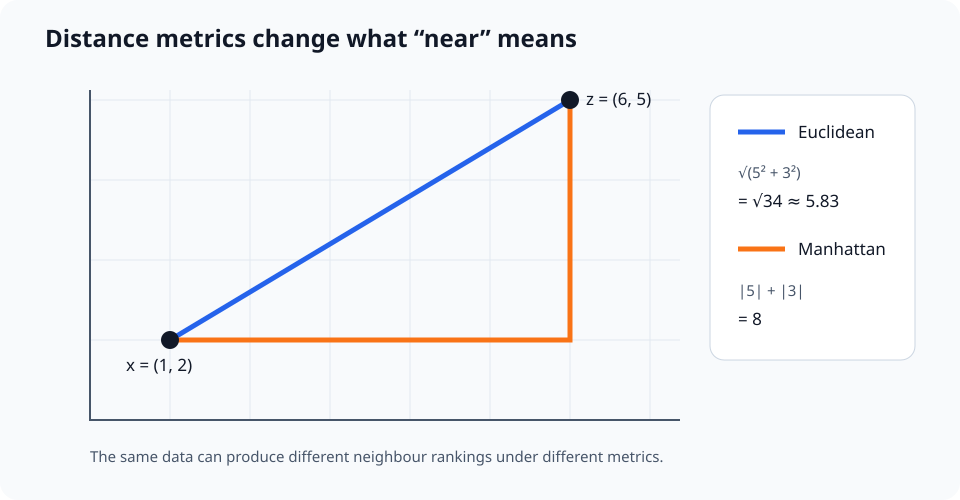
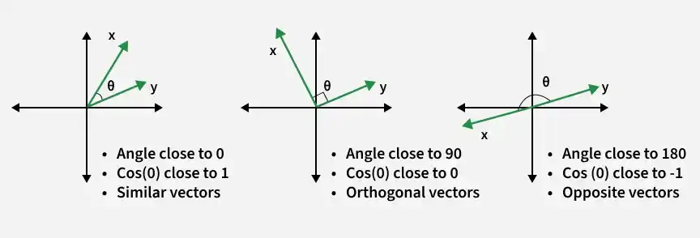
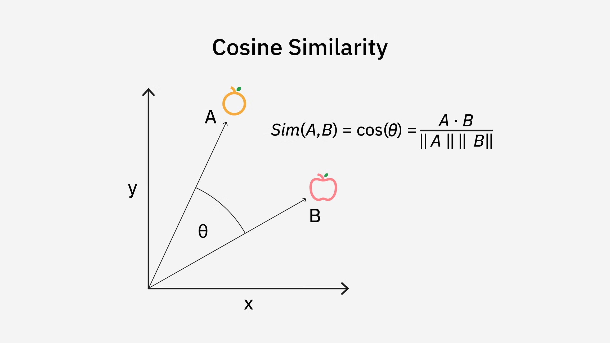
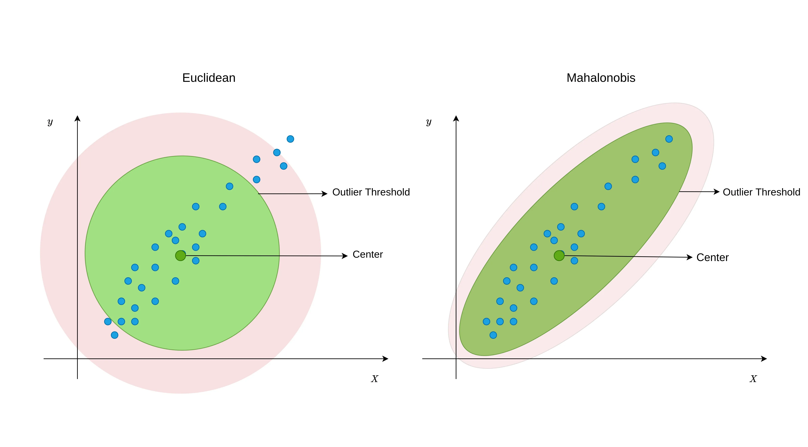
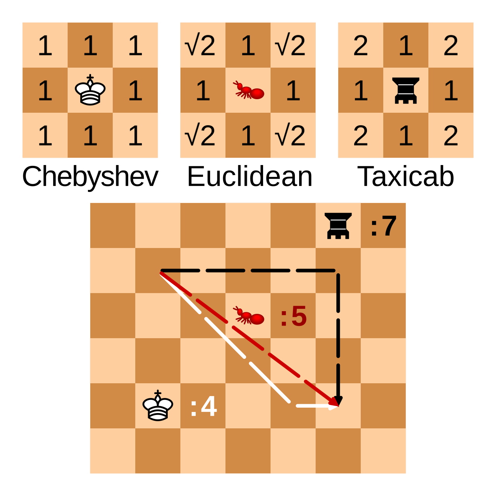
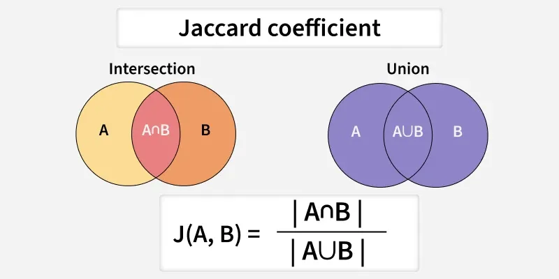

# Distance Metrics in Machine Learning

## Table of Contents

- [Introduction](#introduction)
- [What is a Distance Metric?](#what-is-a-distance-metric)
- [Types of Distance Metrics](#types-of-distance-metrics)
  - [1. Euclidean Distance](#1-euclidean-distance)
    - [General Formula (Minkowski / Lp Norm)](#general-formula-minkowski--lp-norm)
    - [Special Case: Euclidean Distance (L₂ Norm)](#special-case-euclidean-distance-l₂-norm)
    - [Formula in Different Dimensions](#formula-in-different-dimensions)
  - [2. Manhattan Distance (L₁ Norm)](#2-manhattan-distance-l₁-norm)
  - [3. Minkowski Distance (Lₚ Norm)](#3-minkowski-distance-lₚ-norm)
    - [Comparison Example: All Special Cases](#comparison-example-all-special-cases)
  - [4. Hamming Distance](#4-hamming-distance)
  - [5. Cosine Distance](#5-cosine-distance)
    - [Working / Steps](#working--steps)
    - [Detailed Example: Cosine Similarity Calculation](#detailed-example-cosine-similarity-calculation)
    - [Interpretation](#interpretation)
  - [6. Mahalanobis Distance](#6-mahalanobis-distance)
  - [7. Chebyshev Distance (L∞ Norm)](#7-chebyshev-distance-l∞-norm)
  - [8. Jaccard Distance](#8-jaccard-distance)
    - [Python Implementation](#python-implementation)
  - [9. Great-Circle / Haversine Distance](#9-great-circle--haversine-distance)
  - [10. Standardized Euclidean Distance](#10-standardized-euclidean-distance)
  - [11. Weighted Minkowski Distance](#11-weighted-minkowski-distance)
  - [12. Canberra Distance](#12-canberra-distance)
  - [13. Bray–Curtis Dissimilarity](#13-braycurtis-dissimilarity)
- [Mathematical Properties of Distance Metrics](#mathematical-properties-of-distance-metrics)
- [Distance Metrics Comparison](#distance-metrics-comparison)
- [Choosing the Right Distance Metric](#choosing-the-right-distance-metric)
- [References](#references)

---

## Introduction

- In machine learning, ***distance metrics*** are used to measure the ***similarity*** or ***dissimilarity*** between data points. 
- They are fundamental to many algorithms, especially ***K-Nearest Neighbors (KNN)***, where the choice of distance metric significantly impacts model performance.

> [!IMPORTANT]
> The ***distance metric*** you choose can ***dramatically affect*** the results of ***distance-based algorithms***. Selecting the appropriate metric depends on your ***data type***, ***feature scale***, and ***problem domain***.

<div align="center">


</div>

---

## What is a Distance Metric?

- A ***distance metric*** is a function that defines the distance between two points in a space. It measures how ***different*** or ***similar*** two data points are to each other.

### Properties of a True Distance Metric:

A valid distance metric $d(x, z)$ must satisfy:

1. ***Non-negativity:*** $d(x, z) \geq 0$ for all $x, z$
2. ***Identity:*** $d(x, z) = 0$ if and only if $x = z$
3. ***Symmetry:*** $d(x, z) = d(z, x)$
4. ***Triangle inequality:*** $d(x, y) + d(y, z) \geq d(x, z)$

> [!NOTE]
> ***Not all distance measures*** satisfy these properties. For example, ***cosine distance*** is popular but ***violates the triangle inequality***, so it's technically not a "true" metric.

---

## Types of Distance Metrics

### 1. Euclidean Distance

- ***Euclidean distance*** is the most common distance metric in machine learning.
- It measures the ***straight-line distance*** between two points in multidimensional space.

#### General Formula (Minkowski / Lp Norm)

Euclidean distance belongs to the **Minkowski / Lp Norm** family. The general formula for any Lp distance is:

$$
\boxed{d_{\text{Lp}}(\mathbf{x}, \mathbf{z}) = \left(\sum_{i=1}^{n} |x_i - z_i|^p\right)^{1/p}}
$$

Where:
- ***p*** = parameter that determines the type of distance metric
- ***n*** = number of dimensions
- ***$x_i$, $z_i$*** = coordinates of data points in dimension $i$
- $(...)^{1/p}$ = raise to the power of $\frac{1}{p}$

| p value | Norm Name | Distance Type |
|---------|-----------|---------------|
| $p = 1$ | **L₁ Norm** | Manhattan Distance |
| $p = 2$ | **L₂ Norm** | ***Euclidean Distance*** |
| $p = \infty$ | **L∞ Norm** | Chebyshev Distance |

#### Special Case: Euclidean Distance (L₂ Norm)

When we set ***p = 2*** in the general formula, we get **Euclidean distance** — which is why it is called the **L₂ Norm**:

$$
\boxed{d_{\text{Euclidean}}(P, Q) = \left(\sum_{i=1}^{n} (p_i - q_i)^2\right)^{1/2}}
$$

Where:
- ***n*** = number of dimensions
- ***$p_i$, $q_i$*** = coordinates of data points P and Q in dimension $i$
- $(...)^{1/2}$ = raise to the power of $\frac{1}{2}$ (same as square root)

**Why "L₂"?**
- **"L"** = family of norm types (L1, L2, L∞, Lp)
- **"₂"** = we use the ***2nd power*** $(p=2)$, then raise to $\frac{1}{p} = \frac{1}{2}$

#### Formula in Different Dimensions

##### 2-Dimensional

For two points $P = (x_1, y_1)$ and $Q = (x_2, y_2)$:

$$
\boxed{d = \left((x_1 - x_2)^2 + (y_1 - y_2)^2\right)^{1/2}}
$$

**Example:**
- Points: $P = (1, 2)$ and $Q = (4, 6)$
- Calculation: $d = \left((1-4)^2 + (2-6)^2\right)^{1/2} = (9 + 16)^{1/2} = (25)^{1/2} = 5$

##### 3-Dimensional

For two points $P = (x_1, y_1, z_1)$ and $Q = (x_2, y_2, z_2)$:

$$
\boxed{d = \left((x_1 - x_2)^2 + (y_1 - y_2)^2 + (z_1 - z_2)^2\right)^{1/2}}
$$

**Example:**
- Points: $P = (1, 2, 3)$ and $Q = (4, 5, 6)$
- Calculation: $d = \left((1-4)^2 + (2-5)^2 + (3-6)^2\right)^{1/2} = (9 + 9 + 9)^{1/2} = (27)^{1/2} \approx 5.196$

##### n-Dimensional

For two points $P = (p_1, p_2, \ldots, p_n)$ and $Q = (q_1, q_2, \ldots, q_n)$ in $n$-dimensional space:

$$
\boxed{d_{\text{Euclidean}}(P, Q) = \left(\sum_{i=1}^{n} (p_i - q_i)^2\right)^{1/2}}
$$

**Example (4D):**
- Points: $P = (1, 2, 3, 4)$ and $Q = (5, 6, 7, 8)$
- Calculation: $d = \left((1-5)^2 + (2-6)^2 + (3-7)^2 + (4-8)^2\right)^{1/2} = (16+16+16+16)^{1/2} = (64)^{1/2} = 8$

#### Use Cases

- Continuous numerical features
- Default metric for KNN
- Clustering algorithms (K-Means)
- When features are normalized

> [!TIP]
> ***Best Practice:*** Always ***normalize or standardize*** your ***features*** before using ***Euclidean distance***. Features with ***larger numerical ranges*** can ***dominate*** the distance calculation.

---

### 2. Manhattan Distance (L₁ Norm)

- ***Manhattan distance***, also called ***Taxicab*** or ***City Block distance***, measures the distance as if you're moving along city blocks (only horizontal and vertical movement). 
- It is a lightweight utility and reference guide for calculating distances across 2D, 3D, and $n$-dimensional spaces.

#### Mathematical Definition

For two points $P = (x_1, y_1)$ and $Q = (x_2, y_2)$, the Manhattan distance is the sum of the absolute differences of their Cartesian coordinates.

##### 2-Dimensions

$$
\boxed{\vert x_1 - x_2 \vert + \vert y_1 - y_2 \vert}
$$

##### 3-Dimensions

For points $P = (x_1, y_1, z_1)$ and $Q = (x_2, y_2, z_2)$:

$$
\boxed{\vert x_1 - x_2 \vert + \vert y_1 - y_2 \vert + \vert z_1 - z_2 \vert}
$$

##### $n$-Dimensions

For vectors $x = (x_1, x_2, \dots, x_n)$ and $y = (y_1, y_2, \dots, y_n)$:

$$
\boxed{\sum_{i=1}^{n} \vert x_i - y_i \vert = \vert x_1 - y_1 \vert + \vert x_2 - y_2 \vert + \dots + \vert x_n - y_n \vert}
$$

#### General Formula

$$
\boxed{d_{\text{Manhattan}}(\mathbf{x}, \mathbf{z}) = \sum_{r=1}^{d} |x_r - z_r|}
$$

#### Code Implementation

**Python:**

```python
def manhattan_distance(point_a, point_b):
    """
    Calculates the n-dimensional Manhattan distance between two points.
    
    Args:
        point_a: First point (tuple or list of coordinates)
        point_b: Second point (tuple or list of coordinates)
    
    Returns:
        The Manhattan distance as a numeric value
    """
    if len(point_a) != len(point_b):
        raise ValueError("Points must have the same dimensions.")
    
    return sum(abs(a - b) for a, b in zip(point_a, point_b))

# Example Usage:

# 2D Distance
p2d_1, p2d_2 = (1, 2), (4, 6)
print(f"2D Distance: {manhattan_distance(p2d_1, p2d_2)}")
# Output: 7 (|1-4| + |2-6| = 3 + 4 = 7)

# 3D Distance
p3d_1, p3d_2 = (1, 2, 3), (4, 6, 8)
print(f"3D Distance: {manhattan_distance(p3d_1, p3d_2)}")
# Output: 12 (|1-4| + |2-6| + |3-8| = 3 + 4 + 5 = 12)

# n-Dimensional Distance
pnd_1 = (1, 2, 3, 4)
pnd_2 = (5, 6, 7, 8)
print(f"4D Distance: {manhattan_distance(pnd_1, pnd_2)}")
# Output: 16 (|1-5| + |2-6| + |3-7| + |4-8| = 4 + 4 + 4 + 4 = 16)
```

#### Example Calculations

**2D Example:**
- Points: $P = (1, 2)$ and $Q = (4, 6)$
- Calculation: $\vert 1-4 \vert + \vert 2-6 \vert = 3 + 4 = 7$

**3D Example:**
- Points: $P = (1, 2, 3)$ and $Q = (4, 6, 8)$
- Calculation: $\vert 1-4 \vert + \vert 2-6 \vert + \vert 3-8 \vert = 3 + 4 + 5 = 12$

**n-Dimensional Example (from KNN context):**
- Points: $\mathbf{x} = (1, 2, 3)$ and $\mathbf{z} = (4, 5, 6)$
- Calculation: $\vert 1-4 \vert + \vert 2-5 \vert + \vert 3-6 \vert = 3 + 3 + 3 = 9$

#### Use Cases

- ***High-dimensional data*** — More stable than Euclidean in high dimensions
- ***When diagonal movement has no meaning*** — Only horizontal and vertical movement
- ***Robust to outliers*** — Compared to Euclidean distance
- ***City-based navigation problems*** — Actual street distances
- ***Discrete/grid-based systems*** — Where only axis-aligned movement is valid

#### Comparison with Euclidean Distance

For the same points $\mathbf{x} = (1, 2, 3)$ and $\mathbf{z} = (4, 5, 6)$:

| Metric | Distance | Formula |
|--------|----------|---------|
| ***Manhattan*** | 9 | $\vert 1-4 \vert + \vert 2-5 \vert + \vert 3-6 \vert$ |
| ***Euclidean*** | $\approx 5.196$ | $\sqrt{(1-4)^2 + (2-5)^2 + (3-6)^2}$ |

#### Visual Comparison: Manhattan vs Euclidean Distance

<div align="center">



</div>

This visualization shows:
- ***Red path (Manhattan):*** Moves only along horizontal and vertical axes (grid-like movement)
- ***Blue line (Euclidean):*** Direct straight-line distance between two points

> [!NOTE]
> The ***Manhattan distance*** (red path) is always ***greater than or equal to*** the ***Euclidean distance*** (blue line) between any two points, because it can only move along axes, never in a straight line.

---

### 3. Minkowski Distance (Lₚ Norm)

***Minkowski distance*** is a ***generalized*** distance metric that includes both Euclidean and Manhattan distances as special cases.

**Formula:**

$$
\boxed{d_{\text{Minkowski}}(\mathbf{x}, \mathbf{z}) = \left(\sum_{r=1}^{d} |x_r - z_r|^p\right)^{1/p}}
$$

Where $p$ is a parameter that determines the type of distance.

**Special Cases:**

- ***p = 1:*** Manhattan distance
$$d = \sum_{r=1}^{d} |x_r - z_r|$$

- ***p = 2:*** Euclidean distance
$$d = \left(\sum_{r=1}^{d} (x_r - z_r)^2\right)^{1/2}$$

- ***p → ∞:*** Chebyshev distance (maximum norm)
$$d = \max_{r=1}^{d} |x_r - z_r|$$

**Summary: Minkowski Parameter $p$**

| $p$ value | Distance Type | Valid Metric? | Notes |
|---|---|---|---|
| $0 < p < 1$ | Sub-Manhattan | ❌ No | Does ***not*** satisfy the triangle inequality — not a true metric |
| $p = 1$ | ***Manhattan distance*** | ✅ Yes | Sum of absolute differences |
| $p = 2$ | ***Euclidean distance*** | ✅ Yes | Standard geometric straight-line distance |
| $p \geq 1$ | ***Minkowski (general)*** | ✅ Yes | Satisfies all metric properties |
| $p \to \infty$ | ***Chebyshev distance*** | ✅ Yes | Maximum coordinate difference |

> [!IMPORTANT]
> For $p \geq 1$, Minkowski distance satisfies all four metric properties: ***non-negativity***, ***identity of indiscernibles***, ***symmetry***, and the ***triangle inequality***. For $0 < p < 1$, the triangle inequality is violated — it is ***not a true metric*** and should be used with caution in KNN.

**Example:**

For points $\mathbf{x} = (1, 2, 3)$ and $\mathbf{z} = (4, 5, 6)$ with $p = 3$:

$$
d = (|1-4|^3 + |2-5|^3 + |3-6|^3)^{1/3} = (27 + 27 + 27)^{1/3} = 81^{1/3} \approx 4.327
$$

#### Comparison Example: All Special Cases

For points $A = (2, 5, 8)$ and $B = (3, 1, 6)$:

| p value | Distance Type | Calculation | Result |
|---------|--------------|-------------|--------|
| $p = 1$ | ***Manhattan*** | $\|2-3\| + \|5-1\| + \|8-6\| = 1 + 4 + 2$ | $= 7$ |
| $p = 2$ | ***Euclidean*** | $\left((2-3)^2 + (5-1)^2 + (8-6)^2\right)^{1/2} = (1+16+4)^{1/2}$ | $\approx 4.583$ |
| $p \to \infty$ | ***Chebyshev*** | $\max(\|2-3\|, \|5-1\|, \|8-6\|) = \max(1, 4, 2)$ | $= 4$ |

> [!NOTE]
> As ***p increases***, the distance is increasingly ***dominated by the largest difference*** between coordinates. At $p \to \infty$, only the ***maximum difference*** matters.

## Mathematical Properties of Distance Metrics

1. **Non-negativity:** Distance is always non-negative
   $$D(A, B) \geq 0$$

2. **Identity of Indiscernibles:** Distance is zero only when points are identical
   $$D(A, B) = 0 \iff A = B$$

3. **Symmetry:** Distance is independent of direction
   $$D(A, B) = D(B, A)$$

4. **Triangle Inequality** (only for $p \geq 1$): Direct path is always shortest
   $$D(A, C) \leq D(A, B) + D(B, C)$$

5. **Generalization:** As $p \to \infty$, Minkowski approaches Chebyshev Distance
   $$\lim_{p \to \infty} d_{\text{Lp}}(A, B) = \max_i |A_i - B_i|$$

---

### 4. Hamming Distance

- ***Hamming distance*** measures the number of ***positions where corresponding elements differ***. 
- It's used for ***categorical*** or ***binary data***.

**Formula:**

$$
\boxed{d_{\text{Hamming}}(\mathbf{x}, \mathbf{z}) = \sum_{r=1}^{d} \mathbb{1}(x_r \neq z_r)}
$$

Where $\mathbb{1}(x_r \neq z_r)$ is 1 if $x_r \neq z_r$, else 0.

**Example:**

Comparing binary strings:
- String 1: `10101010`
- String 2: `10110010`
- Differences at positions: 3 and 6
- Hamming distance = 2

**Use Cases:**
- ***Binary or categorical data***
- ***DNA sequence comparison***
- ***Error detection and correction***
- ***One-hot encoded features***

> [!NOTE]
> ***Hamming distance*** only works for ***equal-length strings*** or ***fixed-size vectors***. The ***larger*** the Hamming distance, the ***more dissimilar*** the strings.

---

### 5. Cosine Distance

- ***Cosine distance*** measures the ***angle*** between ***two vectors rather than the magnitude.*** 
- It's particularly useful for ***text*** and ***high-dimensional sparse data***.

#### Visualization

<div align="center">



</div>

**Formula:**

***Cosine Similarity:***

$$
\boxed{\text{Cosine Similarity}(A, B) = \frac{A \cdot B}{|A| |B|} = \cos(\theta)}
$$

***Cosine Distance:***

$$
\boxed{d_{\text{Cosine}}(A, B) = 1 - \frac{A \cdot B}{|A| |B|} = 1 - \cos(\theta)}
$$

> [!NOTE]
> ***Cosine Similarity*** measures how similar two vectors are (range: -1 to 1). ***Cosine Distance*** converts it to a distance metric by subtracting from 1 (range: 0 to 2).

**Where:**
- ***A and B*** = two vectors
- ***A · B*** = dot product of vectors A and B
- ***|A| and |B|*** = magnitude (length) of vectors A and B
- ***θ*** = angle between the two vectors

#### Working / Steps

1. ***Convert*** the given data into ***numerical vectors***
2. ***Calculate*** the ***dot product*** of the two vectors
3. ***Calculate*** the ***magnitude*** of each vector
4. ***Multiply*** the magnitudes
5. ***Divide*** the dot product by the product of the magnitudes
6. ***Subtract*** from 1 to get cosine ***distance*** (or keep the result as ***cosine similarity***)

#### Detailed Example: Cosine Similarity Calculation

Consider two vectors:
- $A = (3, 2, 0, 5)$
- $B = (1, 0, 0, 0)$

<div align="center">



</div>

**Step 1: Calculate the dot product** $A \cdot B$

$$A \cdot B = (3 \times 1) + (2 \times 0) + (0 \times 0) + (5 \times 0) = 3$$

**Step 2: Calculate the magnitude of vector** $A$ — $|A|$

$$|A| = \sqrt{3^2 + 2^2 + 0^2 + 5^2} = \sqrt{9 + 4 + 0 + 25} = \sqrt{38} \approx 6.16$$

**Step 3: Calculate the magnitude of vector** $B$ — $|B|$

$$|B| = \sqrt{1^2 + 0^2 + 0^2 + 0^2} = \sqrt{1} = 1$$

**Step 4: Calculate Cosine Similarity**

$$\text{Cosine Similarity}(A, B) = \frac{A \cdot B}{|A| \times |B|} = \frac{3}{6.16 \times 1} = \frac{3}{6.16} \approx 0.487$$

**Step 5: Calculate Cosine Distance**

$$\text{Cosine Distance}(A, B) = 1 - \text{Cosine Similarity}(A, B) = 1 - 0.487 = 0.513$$

#### Interpretation

| Angle (θ) | Cosine Similarity | Meaning |
|-----------|-------------------|---------|
| $0°$ | $1$ | Vectors completely overlap; same direction |
| $90°$ | $0$ | Vectors are orthogonal; completely dissimilar |
| $180°$ | $-1$ | Vectors point in opposite directions |
| $0° < θ < 90°$ | $0 < \text{sim} < 1$ | Partially similar vectors |

**Use Cases:**
- ***Search Engines*** — Find relevant documents based on user queries
- ***Recommendation Systems*** — Recommend similar products, movies, and music
- ***Natural Language Processing*** — Compare similarity between words, sentences, and documents
- ***Document Similarity*** — Measure similarity between text documents
- ***Plagiarism Detection*** — Identify similarities and duplicate content
- ***Chatbots*** — Find the most relevant response based on user input
- ***Machine Learning*** — Measure similarity between data points in high-dimensional spaces
- ***Text Mining*** — Extract and analyze similar text patterns

> [!WARNING]
> ***Cosine distance*** is ***not a true metric*** — it ***violates the triangle inequality***. However, it's ***widely used*** despite this limitation due to its ***effectiveness*** in ***text*** and ***sparse data***.

---

### 6. Mahalanobis Distance

- ***Mahalanobis distance*** is a ***weighted Euclidean distance*** that accounts for ***feature correlations*** and ***different scales***.
- It is a ***multi-dimensional statistical measure*** that calculates the distance between a data point and a distribution by taking into account the data's ***correlations*** and ***variances***.
- Particularly useful for ***identifying outliers*** in multivariate data.

**Formula:**

$$\boxed{D^2 = (x - m)^T \cdot C^{-1} \cdot (x - m)}$$

**Alternative Notation** (commonly used in textbooks):

$$
\boxed{d_{\text{Mahalanobis}}(\mathbf{x}, \mathbf{z}) = \sqrt{(\mathbf{x} - \mathbf{z})^\top \Sigma^{-1} (\mathbf{x} - \mathbf{z})}}
$$

> [!NOTE]
> Both formulas are equivalent. The difference is:
> - **First formula**: $D^2$ = squared distance (distance is $D = \sqrt{D^2}$)
> - **Second formula**: Takes the square root directly to get distance
> - **Notation**: $(x - m)$ and $(x - z)$ represent differences; $C^{-1}$ and $\Sigma^{-1}$ both represent inverse covariance matrix

**Where:**
- ***$D^2$*** = square of the Mahalanobis distance
- ***$\mathbf{x}$*** = vector of the observation (row in a dataset)
- ***$\mathbf{m}$*** = vector of mean values of independent variables (mean of each column)
- ***$\Sigma^{-1}$ (or $C^{-1}$)*** = inverse covariance matrix of independent variables

> [!IMPORTANT]
> ***Covariance matrix invertibility:*** The covariance matrix $\Sigma$ ***must be invertible*** (full rank) to compute its inverse. A ***singular covariance matrix*** can occur when:
> - Features are ***perfectly correlated*** — one feature is a linear combination of others
> - There are ***insufficient independent observations*** — too few samples relative to features
>
> **Solutions for singular matrices:**
> - Use a ***pseudo-inverse*** (Moore-Penrose) instead of the ordinary inverse
> - Add ***regularization*** to the covariance estimate (add small constant to diagonal)
> - Reduce dimensionality via ***PCA*** or ***feature selection***

#### How Mahalanobis Differs from Euclidean Distance

| Step | Euclidean Distance | Mahalanobis Distance |
|------|-------------------|----------------------|
| **1. Features** | Use raw features as-is | Transform using ***covariance structure*** (whitening transformation) |
| **2. Correlation & Scaling** | Ignores correlations; treats all axes equally | Accounts for ***both correlation and variance*** between features |
| **3. Distance** | Calculate straight-line distance in original space | Calculate ***Euclidean distance*** in transformed (whitened) space |
| **Effect** | Features with high variance dominate; correlations ignored | ***Scale-invariant*** & ***correlation-aware*** |

**Simple Explanation:**

***Mahalanobis distance is equivalent to Euclidean distance after transforming the feature space using the covariance structure (whitening transformation).***

Concretely:
1. ***Whiten the data*** — Apply the inverse covariance matrix $\Sigma^{-1}$ to decorrelate features AND adjust for variance differences simultaneously
2. ***Measure*** — Calculate Euclidean distance on the transformed space

This ensures:
- Features with ***high variance don't dominate*** the distance
- ***Correlated features are properly weighted*** as a unit
- The distance reflects the ***actual statistical relationship*** between observations

#### Visualization

<div align="center">



</div>

The visualization shows:
- ***Euclidean distance*** — circular equal-distance contours (treats all axes equally)
- ***Mahalanobis distance*** — elliptical equal-distance contours (accounts for correlation and variance)

#### Key Characteristics

- ***Accounts for Correlation*** — Unlike Euclidean distance (which treats all axes equally and draws circular boundaries), Mahalanobis distance scales and rotates space using the inverse covariance matrix, creating ***elliptical equal-distance contours***
- ***Scale-Invariant*** — Measures how many ***standard deviations*** away a point is from the center, adjusting for the spread and scale of each feature
- ***Generalized Z-Score*** — In one dimension, it simplifies directly to the standard ***Z-score*** formula

#### Common Applications

- ***Multivariate Outlier Detection*** — Identifying data points with unusual combinations of values across multiple variables (fraud detection, health diagnostics)
- ***Classification and Clustering*** — Assigning unknown samples to known groups based on group covariances (e.g., Linear Discriminant Analysis)
- ***Machine Learning*** — Anomaly detection and quality control on correlated datasets

**Advantages:**
- Accounts for feature correlations
- Automatically scales by variance
- More robust to correlated features
- Handles different feature scales

**Use Cases:**
- Multivariate outlier detection
- When features are correlated
- Metric learning applications
- Quality control in manufacturing

---

### 7. Chebyshev Distance (L∞ Norm)

- ***Chebyshev distance*** (also called ***Chessboard distance***) measures the ***maximum absolute difference*** between coordinates in any direction, including diagonally.

**Formula:**

For two points $A = (x_1, x_2, \ldots, x_n)$ and $B = (y_1, y_2, \ldots, y_n)$ in an ***n-dimensional space***:

$$
\boxed{d_{\text{Chebyshev}}(\mathbf{x}, \mathbf{z}) = \max_{r=1}^{d} |x_r - z_r|}
$$

**Example:**

For points $\mathbf{x} = (1, 2, 3)$ and $\mathbf{z} = (4, 5, 6)$:

$$
d = \max(|1-4|, |2-5|, |3-6|) = \max(3, 3, 3) = 3
$$

#### Visualization

<div align="center">



</div>

#### Why It Is Called "Chessboard Distance"

On a standard chessboard, a ***king*** can move ***one square in any direction***: horizontally, vertically, or diagonally.

- The ***minimum number of moves*** a king needs to travel from one square to another equals the ***Chebyshev distance*** between the centers of those squares
- ***Diagonal moves*** simultaneously cover distance along both the row and column axes, meaning the ***smaller coordinate difference is "absorbed" by the larger one***

#### Key Characteristics & Connections

- ***Minkowski Limit*** — It is a ***special case*** of the ***Minkowski distance*** as the order ***p approaches infinity*** ($L_{\infty}$ norm)
- ***Square Shape*** — In a ***2D plane***, the set of points at a Chebyshev distance ***r*** from a center point forms a ***square*** of side length ***2r*** with edges aligned to the ***coordinate axes*** (unlike the circle formed by Euclidean distance)
- ***Manhattan Duality*** — Through a coordinate transformation $(x, y) \to (x+y, x-y)$, ***Manhattan distance problems*** can be mathematically ***mapped to and solved as Chebyshev distance problems***

#### Common Use Cases

- ***Grid-Based Pathfinding*** — Video games and simulations where characters or pieces can ***move freely in 8 directions*** (including diagonals) at uniform cost
- ***Data Science & Machine Learning*** — Used in ***k-NN algorithms*** or ***clustering*** when ***maximum-deviation features*** matter more than cumulative Euclidean distance
- ***Industrial & Logistics Operations*** — Determining the ***time or cost*** of ***robotic arms*** or ***gantry cranes*** that move independently along ***orthogonal axes*** simultaneously

**Use Cases:**
- ***Chess-like*** board movements
- ***Minimax*** optimization
- When only the ***largest difference*** matters

---

### 8. Jaccard Distance

- ***Jaccard distance*** measures the ***dissimilarity*** ***between sets by comparing*** their ***intersection*** and ***union***.

**Formula:**

$$
\boxed{d_{\text{Jaccard}}(A, B) = 1 - \frac{|A \cap B|}{|A \cup B|}}
$$

**Visualization:**

<div align="center">



</div>

Jaccard Similarity Between Two Sets

#### Python Implementation

Python sets provide built-in operations for finding intersections and unions:
- `&` operator gives the ***intersection***
- `|` operator gives the ***union***

```python
A = {1, 2, 3, 4}
B = {3, 4, 5, 6}

intersection = A & B
union = A | B

jaccard_similarity = len(intersection) / len(union)

print("Jaccard Similarity:", jaccard_similarity)
```

**Example:**

For sets $A = \{1, 2, 3, 4\}$ and $B = \{3, 4, 5, 6\}$:

- Intersection: $\{3, 4\}$ → size = 2
- Union: $\{1, 2, 3, 4, 5, 6\}$ → size = 6
- Jaccard distance: $1 - \frac{2}{6} = \frac{2}{3} \approx 0.667$

#### Important Edge Cases

> [!IMPORTANT]
> Jaccard distance must handle edge cases where sets are empty:
>
> ***Both sets empty:*** By convention:
> $$d_J(\emptyset, \emptyset) = 0$$
> (The formula $1 - \frac{0}{0}$ is undefined, so we define it as 0 — identical empty sets have zero distance.)
>
> ***One set empty, the other non-empty:*** If $A = \emptyset$ and $B \neq \emptyset$:
> $$d_J(\emptyset, B) = 1 - \frac{0}{|B|} = 1$$
> (Empty and non-empty sets are maximally dissimilar.)

#### Mathematical Properties

> [!NOTE]
> ***Jaccard distance is a true metric*** on the collection of finite sets. It satisfies all four metric properties:
> - ***Non-negativity:*** $d_J(A, B) \geq 0$
> - ***Identity of indiscernibles:*** $d_J(A, B) = 0 \iff A = B$
> - ***Symmetry:*** $d_J(A, B) = d_J(B, A)$
> - ***Triangle inequality:*** $d_J(A, C) \leq d_J(A, B) + d_J(B, C)$

**Use Cases:**
- ***Set similarity*** (tags, categories)
- ***Binary or categorical data***
- ***Comparing shopping baskets***
- ***Document similarity*** (bag-of-words)
- ***Text and document similarity***
- ***Recommendation systems***
- ***Duplicate and plagiarism detection***
- ***Clustering and classification***
- ***Binary data and image comparison***


---

### 9. Great-Circle / Haversine Distance

- ***Haversine distance*** measures the ***shortest distance between two points*** on a ***sphere*** (Earth's surface).
- Unlike ***Euclidean distance***, which operates on flat planes, Haversine accounts for the ***spherical geometry*** of geographic coordinates.
- Essential for ***geospatial applications***, GPS navigation, and clustering location-based data.

**Problem with Raw Euclidean Distance:**

Raw Euclidean distance applied directly to latitude-longitude degrees distorts physical distance because degrees are not uniform in length — distances become increasingly compressed near the poles.

**Formula:**

For two points with latitudes $\phi_1, \phi_2$, longitude difference $\Delta\lambda$, and latitude difference $\Delta\phi$ (all in ***radians***):

First, calculate the ***angular distance*** $a$:

$$
\boxed{a = \sin^2\frac{\Delta\phi}{2} + \cos\phi_1 \cos\phi_2 \sin^2\frac{\Delta\lambda}{2}}
$$

Then calculate the ***central angle*** $c$:

$$
\boxed{c = 2 \arctan2\left(\sqrt{a}, \sqrt{1-a}\right)}
$$

Finally, the ***great-circle distance*** is:

$$
\boxed{d_{\text{Haversine}} = R \cdot c}
$$

Where:
- ***$\phi_1, \phi_2$*** = latitudes of the two points in ***radians***
- ***$\Delta\lambda$*** = difference in ***longitude*** (in radians)
- ***$\Delta\phi$*** = difference in ***latitude*** (in radians)
- ***R*** = Earth's radius in the desired unit (e.g., 6,371 km, 3,959 miles)
- ***$\arctan2$*** = two-argument arctangent function (atan2 in most programming languages)

#### Conversion: Degrees to Radians

To convert from degrees to radians:

$$
\text{radians} = \text{degrees} \times \frac{\pi}{180}
$$

#### Example Calculation

**Two cities (degrees):**
- New York: $\phi_1 = 40.7128°\text{N}$, $\lambda_1 = 74.0060°\text{W}$
- Los Angeles: $\phi_2 = 34.0522°\text{N}$, $\lambda_2 = 118.2437°\text{W}$

**Convert to radians** ($\pi/180 \approx 0.01745$):
- $\phi_1 \approx 0.7114$ rad, $\phi_2 \approx 0.5942$ rad
- $\lambda_1 \approx -1.2915$ rad, $\lambda_2 \approx -2.0637$ rad
- $\Delta\phi \approx 0.1172$ rad, $\Delta\lambda \approx 0.7722$ rad

**Step 1: Calculate** $a$

$$
a = \sin^2(0.0586) + \cos(0.7114) \cos(0.5942) \sin^2(0.3861)
$$

$$
a \approx 0.00344 + 0.7602 \times 0.8322 \times 0.1479 \approx 0.0936
$$

**Step 2: Calculate** $c$

$$
c = 2 \arctan2(\sqrt{0.0936}, \sqrt{0.9064}) = 2 \arctan2(0.3059, 0.9519) \approx 2 \times 0.3111 \approx 0.6222 \text{ rad}
$$

**Step 3: Calculate distance** (using $R = 6,371$ km)

$$
d = 6,371 \times 0.6222 \approx 3,964 \text{ km}
$$

#### Key Characteristics

- ***Spherical accuracy:*** Accounts for Earth's curvature; much more accurate than flat-earth Euclidean distance
- ***Range-preserving:*** Distance remains valid for any two points on a sphere
- ***Numerically stable:*** The formula avoids precision loss common in naive implementations using the law of cosines
- ***Unit-independent:*** Result scales with Earth's radius R — use any consistent unit (km, miles, meters)

#### Python Implementation

```python
import math

def haversine_distance(lat1, lon1, lat2, lon2, R=6371):
    """
    Calculate great-circle distance between two points on Earth.
    
    Args:
        lat1, lon1: Latitude and longitude of point 1 (in degrees)
        lat2, lon2: Latitude and longitude of point 2 (in degrees)
        R: Earth's radius (default: 6371 km; use 3959 for miles)
    
    Returns:
        Distance in the same unit as R
    """
    # Convert to radians
    phi1, phi2 = math.radians(lat1), math.radians(lat2)
    delta_phi = math.radians(lat2 - lat1)
    delta_lambda = math.radians(lon2 - lon1)
    
    # Haversine formula
    a = math.sin(delta_phi / 2) ** 2 + math.cos(phi1) * math.cos(phi2) * math.sin(delta_lambda / 2) ** 2
    c = 2 * math.atan2(math.sqrt(a), math.sqrt(1 - a))
    
    return R * c

# Example: New York to Los Angeles
distance_km = haversine_distance(40.7128, -74.0060, 34.0522, -118.2437)
print(f"Distance: {distance_km:.2f} km")  # Output: ~3,964 km
```

#### Use Cases

- ***GPS navigation*** — Computing shortest paths on Earth's surface
- ***Geospatial KNN*** — Finding nearest cities, stores, or points of interest from a location
- ***Ride-sharing applications*** — Matching drivers and riders by geographic proximity
- ***Weather and climate modeling*** — Distance between observation stations
- ***Astronomy and satellite tracking*** — Distance between points on celestial spheres
- ***Spatial clustering*** — K-Means clustering with geographic coordinates
- ***Logistics and supply chain*** — Route optimization and delivery distance estimation

> [!NOTE]
> For ***high-precision geospatial work*** (surveying, geodesy), ***ellipsoidal distance*** formulas (e.g., Vincenty's) are more accurate than Haversine because Earth is not a perfect sphere but an oblate spheroid. Haversine is sufficient for most machine learning and navigational applications.

> [!TIP]
> When using haversine distance in KNN with geographic data, ***K is often small*** (3–10 neighbors) since nearby geographic points tend to share similar attributes (e.g., climate, demographics, amenities).


---

### 10. Standardized Euclidean Distance

- ***Standardized Euclidean distance*** is a variant of Euclidean distance that ***accounts for different variances across features***.
- Useful when numerical features are on different scales and the data has ***not already been standardized***.

**Formula:**

$$
\boxed{d(\mathbf{x}, \mathbf{y}) = \sqrt{\sum_{i=1}^{d} \frac{(x_i - y_i)^2}{s_i^2}}}
$$

**Where:**
- ***$d$*** = number of features
- ***$x_i, y_i$*** = feature values of the two points in dimension $i$
- ***$s_i^2$*** = variance of feature $i$, computed from the ***training set***

> [!NOTE]
> This is equivalent to applying ***per-feature variance normalization*** before computing standard Euclidean distance. If you divide by the ***standard deviation*** $s_i$ instead of the variance $s_i^2$, you get a standard ***Z-score-scaled*** Euclidean distance.

> [!TIP]
> Standardized Euclidean is a good choice when features have different units or spreads but are **not** correlated. For correlated features, prefer ***Mahalanobis distance***, which also accounts for covariance.

**Use Cases:**
- Numerical features with ***different variances***
- When standardization has ***not*** been applied as a preprocessing step
- As a lightweight alternative to Mahalanobis when features are ***uncorrelated***

---

### 11. Weighted Minkowski Distance

- ***Weighted Minkowski distance*** extends the standard Minkowski distance by assigning ***different importance weights*** to each feature.
- Useful when domain knowledge suggests that some features are ***more relevant*** than others for measuring similarity.

**Formula:**

$$
\boxed{d(\mathbf{x}, \mathbf{y}) = \left(\sum_{i=1}^{d} w_i \left|x_i - y_i\right|^p\right)^{1/p}}
$$

**Where:**
- ***$d$*** = number of features
- ***$w_i \geq 0$*** = non-negative weight for feature $i$ (higher = more important)
- ***$p$*** = Minkowski order ($p=1$ gives weighted Manhattan, $p=2$ gives weighted Euclidean)

> [!IMPORTANT]
> Weights ***$w_i$*** are typically normalized so that $\sum_i w_i = 1$ or $\sum_i w_i = d$. Setting all $w_i = 1$ recovers the standard Minkowski distance.

> [!TIP]
> Weights can be learned automatically via ***metric learning*** algorithms (e.g., LMNN, NCA) rather than set manually. This makes weighted Minkowski a foundation for learnable distance metrics in KNN.

**Use Cases:**
- When ***domain knowledge*** indicates some features are more discriminative
- ***Metric learning*** settings where weights are optimized on labeled data
- Situations requiring a ***tunable balance*** between feature contributions

---

### 12. Canberra Distance

- ***Canberra distance*** is a weighted version of Manhattan distance that ***normalizes each term*** by the sum of absolute values of the two coordinates.
- Particularly sensitive to ***small values close to zero*** — differences near the origin contribute more than differences at large magnitudes.

**Formula:**

$$
\boxed{d(\mathbf{x}, \mathbf{y}) = \sum_{i=1}^{d} \frac{|x_i - y_i|}{|x_i| + |y_i|}}
$$

**Where:**
- ***$d$*** = number of features
- Each term is the ***ratio*** of the absolute difference to the sum of absolute values

> [!IMPORTANT]
> When ***both $x_i = 0$ and $y_i = 0$***, the term is undefined ($0/0$). The standard convention is to define this term as ***0*** — two identical zero values contribute no distance.

> [!NOTE]
> Canberra distance is ***scale-invariant per feature*** — it automatically normalizes each dimension, so pre-scaling is less critical than with Euclidean distance.

**Use Cases:**
- Comparing ***non-negative numerical vectors*** (e.g., proportions, counts)
- Data where values are ***close to zero*** and small differences matter most
- ***Intrusion detection*** and ***anomaly detection*** on frequency data
- ***Ranking and information retrieval*** tasks

---

### 13. Bray–Curtis Dissimilarity

- ***Bray–Curtis dissimilarity*** measures the compositional dissimilarity between two samples based on ***absolute differences*** normalized by ***total abundance***.
- Commonly used in ***ecology*** and ***biology*** to compare species abundance data, but applicable to any non-negative count or proportion data.

**Formula:**

$$
\boxed{d(\mathbf{x}, \mathbf{y}) = \frac{\displaystyle\sum_{i=1}^{d} |x_i - y_i|}{\displaystyle\sum_{i=1}^{d} (x_i + y_i)}}
$$

**Where:**
- ***$d$*** = number of features
- ***$x_i, y_i \geq 0$*** = non-negative values (e.g., species counts, abundances)

> [!IMPORTANT]
> Bray–Curtis dissimilarity is ***not a true metric*** — it ***violates the triangle inequality*** in some cases. It is a ***dissimilarity measure*** bounded between 0 and 1, where:
> - ***0*** = identical compositions
> - ***1*** = completely different compositions (no overlap)

> [!NOTE]
> Bray–Curtis is closely related to ***Sorensen similarity*** and to the ***relative form of Manhattan distance***. When all values are binary (0 or 1), it reduces to Jaccard distance.

**Use Cases:**
- ***Ecological data*** — comparing species abundance across sampling sites
- ***Microbiome analysis*** — measuring community dissimilarity
- ***Any non-negative count data*** where relative composition matters more than absolute values


## Distance Metrics Comparison

| Metric | Formula | Best For | Range | Notes |
|--------|---------|----------|-------|-------|
| **Euclidean** | $\sqrt{\sum(x_i - z_i)^2}$ | Continuous data | $[0, \infty)$ | Most common; requires normalization |
| **Manhattan** | $\sum\|x_i - z_i\|$ | High dimensions | $[0, \infty)$ | More robust to outliers |
| **Minkowski** | $(\sum\|x_i - z_i\|^p)^{1/p}$ | General purpose | $[0, \infty)$ | Generalizes Euclidean & Manhattan |
| **Hamming** | Count mismatches | Categorical/binary | $[0, d]$ | Fixed-length only |
| **Cosine** | $1 - \frac{\mathbf{x} \cdot \mathbf{z}}{\vert\mathbf{x}\vert\vert\mathbf{z}\vert}$ | Text/NLP | $[0, 2]$ | Angle-based; not true metric |
| **Mahalanobis** | $\sqrt{(\mathbf{x}-\mathbf{z})^\top\Sigma^{-1}(\mathbf{x}-\mathbf{z})}$ | Correlated features | $[0, \infty)$ | Accounts for covariance |
| **Chebyshev** | $\max(\|x_i - z_i\|)$ | Chessboard movement | $[0, \infty)$ | Maximum difference |
| **Jaccard** | $1 - \frac{\|A \cap B\|}{\|A \cup B\|}$ | Set similarity | $[0, 1]$ | For sets; symmetric |
| **Haversine** | $R \cdot 2\arctan2(\sqrt{a}, \sqrt{1-a})$ | Geographic/spherical | $[0, \pi R]$ | Great-circle distance on Earth |
| **Std. Euclidean** | $\sqrt{\sum(x_i-y_i)^2/s_i^2}$ | Unscaled numerical data | $[0, \infty)$ | Per-feature variance normalization |
| **Weighted Minkowski** | $(\sum w_i|x_i-y_i|^p)^{1/p}$ | Feature-importance weighting | $[0, \infty)$ | Generalizes Minkowski with weights |
| **Canberra** | $\sum|x_i-y_i|/(|x_i|+|y_i|)$ | Near-zero numerical data | $[0, d]$ | Scale-invariant; sensitive near zero |
| **Bray–Curtis** | $\sum|x_i-y_i|/\sum(x_i+y_i)$ | Abundance / ecological data | $[0, 1]$ | Not a true metric; range 0–1 |

---

## Choosing the Right Distance Metric

> [!CAUTION]
> ***Choosing the wrong distance metric*** can ***significantly degrade*** model performance. ***Consider*** these ***factors***:

### Decision Matrix:

| Data Type | Recommended Metric | Reason |
|-----------|-------------------|--------|
| **Continuous numerical** | Euclidean | Default; interpretable; well-understood |
| **High-dimensional continuous** | Manhattan | More stable; less influenced by scale |
| **Binary/Categorical** | Hamming | Designed for discrete values |
| **Text/NLP** | Cosine | Focuses on document content; ignores magnitude |
| **Set/Collection data** | Jaccard | Measures overlap directly |
| **Correlated features** | Mahalanobis | Accounts for feature relationships |
| **Sparse high-dim data** | Cosine | Efficient; reduces computational load |

### Pre-processing Recommendations:

> [!TIP]
> ***Before choosing a metric:***
> 1. ***Normalize or standardize*** ***features*** to have ***similar scales***
> 2. ***Remove outliers*** that ***might distort distances***
> 3. ***Encode categorical variables*** ***appropriately*** (***one-hot***, ***ordinal***)
> 4. ***Test multiple metrics*** with ***cross-validation***
> 5. ***Evaluate performance*** on your ***specific task***

---

## References

- **[GeeksforGeeks: Measures of Distance](https://www.geeksforgeeks.org/dbms/measures-of-distance/)** — Comprehensive overview of distance metrics with formulas and use cases

- **[IBM: Distance Metrics](https://www.ibm.com/think/topics/distance-metrics)** — Detailed explanation of distance metric categories and their applications in machine learning

- **[Analytics Vidhya: 4 Types of Distance Metrics](https://www.analyticsvidhya.com/blog/2020/02/4-types-of-distance-metrics-in-machine-learning/)** — Practical guide to 4 main distance metrics with examples and comparisons

---

<p align="center">
  ⬅️ <strong>Previous:</strong> <a href="./01%20KNN%20Algorithm%20and%20Working%20Step-by-Step..md">01 KNN Algorithm and Working Step-by-Step</a> &nbsp;&nbsp;|&nbsp;&nbsp; <strong>Next:</strong> <a href="./03%20How%20to%20Choose%20K%20in%20KNN%3A%20Bias%2C%20Variance%20and%20Validation.md">03 How to Choose K in KNN</a> ➡️
</p>
