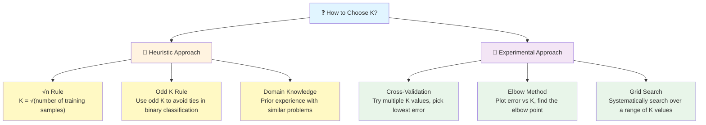
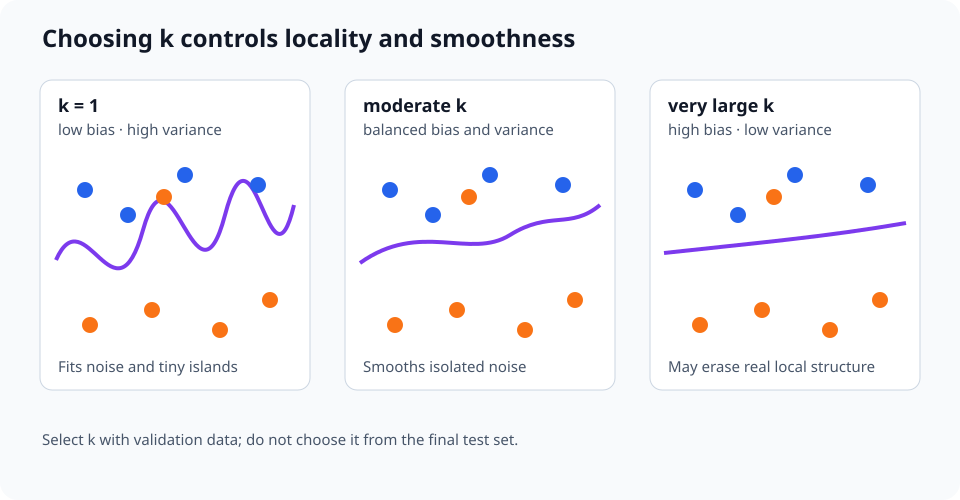

# How to Choose K in KNN

## Table of Contents

- [Overview](#overview)
- [Ways to Choose K](#ways-to-choose-k)
- [1. Heuristic Approach](#1-heuristic-approach)
- [2. Experimental Approach](#2-experimental-approach)
- [Comparison: Heuristic vs Experimental](#comparison-heuristic-vs-experimental)
- [Underfitting and Overfitting with K](#underfitting-and-overfitting-with-k)
- [Bias-Variance Tradeoff](#bias-variance-tradeoff)
- [Cross-Validation for K Selection](#cross-validation-for-k-selection)
  - [Standard Cross-Validation Procedure](#standard-cross-validation-procedure)
  - [Leave-One-Out Cross-Validation (LOOCV)](#leave-one-out-cross-validation-loocv)
  - [Stratified K-Fold](#stratified-k-fold)
  - [Data Leakage Prevention](#data-leakage-prevention)
- [Classification Ties and Odd K](#classification-ties-and-odd-k)
  - [Handling Ties](#handling-ties)
  - [Best Practice](#best-practice)
- [Classification vs Regression: Choosing K](#classification-vs-regression-choosing-k)
- [Class Imbalance and K Selection](#class-imbalance-and-k-selection)
- [Hyperparameter Tuning: K, Metric and Weights](#hyperparameter-tuning-k-metric-and-weights)
- [Neighbourhood Radius and K](#neighbourhood-radius-and-k)
- [Computational Considerations](#computational-considerations)
- [Mathematical Perspective](#mathematical-perspective)

---

## Overview

Choosing the right value of ***K*** is one of the most important decisions in KNN. A ***poor choice of K*** can lead to:

- **K too small** — model is too sensitive to noise, leads to ***overfitting***
- **K too large** — model becomes too simple, leads to ***underfitting***

We can select the ***optimal K value*** using two main approaches:

1. ***Heuristic approach*** — use rules of thumb based on the dataset size
2. ***Experimental approach*** — test multiple values of K and evaluate performance

---

## Ways to Choose K



---

## 1. Heuristic Approach

The ***heuristic approach*** uses ***rules of thumb*** to pick K without exhaustive testing.

### √N Rule

A commonly used heuristic is:

$$
K = \sqrt{N}
$$

Where:
- ***K*** = Number of nearest neighbors
- ***N*** = Total number of training samples

**Example:**

Suppose your training dataset contains 100 samples:

$$
K = \sqrt{100} = 10
$$

So, we can initially select ***K = 10***.

**Important:** These are only ***starting guidelines***, not guaranteed optimal values.

> [!IMPORTANT]
> The $\sqrt{N}$ rule is a ***rule of thumb only***. It has ***no mathematical guarantee*** of producing the optimal K. It does not account for:
> - ***Feature dimensionality*** — higher dimensions may require different K values
> - ***Noise level*** — noisy data may need a larger K to smooth predictions
> - ***Class imbalance*** — skewed class distributions affect the optimal K
> - ***Data distribution*** — the shape and density of data clusters matters
>
> ***Always validate the chosen K using cross-validation.***

### Odd K Rule

Choosing an ***odd K*** helps avoid voting ties — but only under specific conditions:

- ***Binary classification with uniform voting:*** Odd K guarantees a strict majority. For example:
  - K = 3: a 2–1 vote cannot tie ✅
  - K = 5: a 3–2 vote cannot tie ✅
  - K = 4: a 2–2 vote can tie ❌
- ***Multiclass classification:*** Odd K does ***not*** guarantee tie-free voting. Three or more classes can still tie even with an odd K.
- ***Distance-weighted voting:*** Odd K does ***not*** eliminate ties when weights are involved.
- ***Regression:*** Odd K is ***not relevant*** — there is no voting in regression.

> [!NOTE]
> Odd K is a useful default for ***binary classification with uniform voting***. For all other cases, implement an explicit tie-breaking policy.

### Domain Knowledge

Use ***prior experience*** or knowledge about the problem to estimate a reasonable K.

---

## 2. Experimental Approach

The ***experimental approach*** tests multiple K values and measures ***model performance*** to find the best one.

### Example: Testing Different K Values

Suppose we test K values from 1 to 15:

| K value | Accuracy |
|---------|----------|
| 1 | 85% |
| 3 | 89% |
| 5 | 92% |
| 7 | **95%** |
| 9 | 93% |
| 11 | 91% |
| 13 | 89% |
| 15 | 87% |

***Best K = 7*** gives the highest accuracy of ***95%***.

### Methods

- **Cross-Validation** — split data into folds, train and evaluate KNN for each K value, pick the K with the ***lowest validation error***.
- **Elbow Method** — plot ***error vs K*** values and look for an ***"elbow"*** — the point where error stops decreasing significantly. However, this elbow may be ***unclear, noisy, or absent*** for KNN — the error curve may be U-shaped, relatively flat, or irregular. Treat this as an ***optional visual heuristic***, not a reliable primary method.
- **Grid Search** — systematically test a range of K values (e.g. K = 1 to 30) and select the one with the ***best performance metric*** (accuracy, F1, RMSE, etc.).

**Important:** We can use ***cross-validation*** to evaluate different K values more reliably rather than relying on a ***single train-test split***.

> [!TIP]
> ***Cross-validation or grid search*** is the recommended primary approach for K selection. The elbow method is a supplementary visual tool — it does not always produce a clear elbow for KNN.

---

## Comparison: Heuristic vs Experimental

| Aspect | Heuristic | Experimental |
|--------|-----------|--------------|
| **Approach** | Uses ***rules of thumb*** | Uses ***actual model evaluation*** |
| **Speed** | ***Faster and simpler*** | Requires ***more computation*** |
| **Purpose** | Gives an ***initial K estimate*** | Helps identify a ***suitable K*** |
| **Example** | $K = \sqrt{N}$ | ***Cross-validation*** |

---

## Underfitting and Overfitting with K

The choice of K greatly affects whether KNN ***underfits*** or ***overfits***:

### Small K (Overfitting)

- Model becomes ***sensitive to noise***
- ***Decision boundary*** can become irregular
- Example: ***K = 1***

### Optimal K (Balanced Model)

- Captures the ***underlying patterns***
- ***Balances bias and variance***
- Achieves best ***generalization*** performance

### Large K (Underfitting)

- Model becomes ***too generalized***
- May ***ignore local patterns***
- Example: ***K = N*** (predicts majority class)

---

## Bias-Variance Tradeoff

The choice of $k$ is a ***hyperparameter*** that greatly affects KNN's ***bias-variance tradeoff***:

***Choosing k: bias, variance, and validation***

The value ***$k$*** controls the ***size of the local sample***. The central trade-off is clear: ***small $k$ is flexible and noise-sensitive***; ***large $k$ is smoother and can miss local structure***.

### Small $k$ (e.g. $k=1$)

- ***Low bias*** — can fit very irregular boundaries
- ***High variance*** — very sensitive to noise and outliers
- Decision boundary is the ***Voronoi tessellation*** of the training set
- ***Risk:*** Overfitting to training noise

#### $k = 1$ (Single Nearest Neighbor)

Each query receives the target of its ***single closest training point***. Training classification accuracy can be perfect if every point is queried against a set containing itself and there are no contradictory duplicates. This apparent performance is not evidence of generalization.

**Properties:**

- ***Very low smoothing*** and ***low approximation bias***
- ***High sensitivity to noise***, ***mislabeled points***, and ***small sample changes***
- ***Highly irregular decision boundaries***
- ***Regression predictions jump*** between observed target values

### Large $k$

- ***High bias*** — predictions are smoother and less sensitive to individual points
- ***Low variance*** — approaching the majority class (classification) or global mean (regression) as $k$ grows
- Very large $k$ (e.g. $k=n$) simply predicts the ***most common class overall***
- ***Risk:*** Underfitting, ignoring local structure

#### Increasing $k$

As ***$k$ increases***:

- ***More observations*** contribute, ***reducing random variation***
- The ***effective neighbourhood radius*** generally grows
- ***Boundaries and regression surfaces*** become smoother
- ***Bias tends to increase*** because more distant cases influence the query
- ***Prediction may move*** toward ***global class proportions*** or the ***global target mean***

At ***$k = N$***, every query uses the entire training dataset:

**Classification** — predicts the ***globally most frequent class***:

$$
\hat{y} = \operatorname{mode}(y_1, y_2, \ldots, y_N)
$$

**Regression** — predicts the ***global mean*** of training targets:

$$
\hat{y} = \frac{1}{N}\sum_{i=1}^{N} y_i
$$

This is the most extreme case of ***underfitting*** — the model ignores all local structure and query point features entirely.

### Error vs $k$ Curve

The typical error vs $k$ curve is ***U-shaped***:

- Too-small $k$ → ***overfitting*** (high variance error)
- Too-large $k$ → ***underfitting*** (high bias error)
- ***Optimal $k$*** is at the bottom of the U-shape
- ***Cross-validation*** is often used to select $k$

### Bias-Variance Visualization

<div align="center">



</div>

This diagram shows the ***U-shaped error curve***:
- ***Left side*** (small K): High variance, low bias → overfitting
- ***Bottom*** (optimal K): Balanced bias and variance → best performance
- ***Right side*** (large K): Low variance, high bias → underfitting

### Mathematical Perspective

For ***uniform KNN regression***, the prediction at query point $\mathbf{x}$ is:

$$
\hat{f}(\mathbf{x}) = \frac{1}{k}\sum_{i\in N_k(\mathbf{x})} y_i
$$

**Weighted KNN regression** generalizes this by assigning weights $w_i$ to each neighbor:

$$
\hat{f}(\mathbf{x}) = \frac{\displaystyle\sum_{i\in N_k(\mathbf{x})} w_i\, y_i}{\displaystyle\sum_{i\in N_k(\mathbf{x})} w_i}
$$

For ***KNN classification***, the prediction is the majority class among the K neighbors:

$$
\hat{y}(\mathbf{x}) = \underset{c\,\in\, C}{\operatorname{argmax}} \sum_{i\in N_k(\mathbf{x})} \mathbf{1}(y_i = c)
$$

For ***distance-weighted classification***:

$$
\hat{y}(\mathbf{x}) = \underset{c\,\in\, C}{\operatorname{argmax}} \sum_{i\in N_k(\mathbf{x})} w_i\,\mathbf{1}(y_i = c)
$$

#### Variance of KNN Regression

If we model $y_i = f(\mathbf{x}_i) + \varepsilon_i$, the general variance of the KNN estimate (with the neighborhood treated as fixed) is:

$$
\operatorname{Var}\!\left[\hat{f}(\mathbf{x})\mid X\right] = \frac{1}{k^2}\sum_{i\in N_k(\mathbf{x})} \operatorname{Var}(\varepsilon_i)
$$

If errors are ***independent*** and all have equal variance $\sigma^2$, this simplifies to the familiar result:

$$
\operatorname{Var}\!\left[\hat{f}(\mathbf{x})\mid X\right] = \frac{\sigma^2}{k}
$$

> [!IMPORTANT]
> The simplified formula $\sigma^2/k$ holds only under these assumptions:
> 1. The ***neighbourhood is treated as fixed*** (not random)
> 2. Observation errors are ***independent***
> 3. All errors have ***equal variance*** $\sigma^2$
> 4. The prediction is an ***equally weighted average***
>
> For weighted KNN or correlated errors, use the general form above.

#### Bias–Variance Decomposition

The expected prediction error decomposes as:

$$
\text{Expected Error} = \text{Bias}^2 + \text{Variance} + \text{Irreducible Noise}
$$

This is the standard ***bias–variance trade-off*** under squared-error loss:
- ***Bias:*** $\mathbb{E}[\hat{f}(\mathbf{x})] - f(\mathbf{x})$ — tends to ***increase*** with larger $k$ as more distant neighbors are included
- ***Variance:*** $\sigma^2/k$ — ***decreases*** as $k$ grows
- ***Irreducible noise:*** $\sigma^2$ — cannot be reduced by any model

> [!NOTE]
> The statement that bias ***always*** increases monotonically with $k$ is a useful general intuition, but not a universal mathematical guarantee for every dataset and query point.

**In brief:**
- ***Small $k$*** = ***low bias***, ***high variance*** → risk of overfitting
- ***Large $k$*** = ***high bias***, ***low variance*** → risk of underfitting

### Why There Is No Universal Square-Root Rule

Rules such as ***$k \approx \sqrt{n}$*** are ***rough starting guesses***, not derivations of the optimum. The best value depends on:

- ***Dimension*** of feature space
- ***Sample density***
- ***Noise level***
- ***Class overlap***
- ***Distance metric*** choice
- ***Weighting scheme***
- ***Evaluation objective***

***Cross-validation*** is the usual empirical selection method. There is no one-size-fits-all formula — the relationship between sample size and optimal k is problem-dependent.

---

## Cross-Validation for K Selection

### Standard Cross-Validation Procedure

For candidate values ***$\mathcal{K} = \{k_1, k_2, \ldots, k_m\}$***:

1. ***Divide*** training data into folds (typically 5–10)
2. ***For each*** ***$k \in \mathcal{K}$***, fit every ***preprocessing step*** and ***KNN model*** on the fold's training portion
3. ***Score*** the held-out fold using your chosen metric (accuracy, F1, MAE, RMSE, etc.)
4. ***Average*** fold scores to get a cross-validated score for that ***k***
5. ***Choose a setting*** using the desired metric and, where appropriate, a ***simplicity*** or ***one-standard-error rule***
6. ***Refit*** on all training data with the selected ***k***
7. ***Evaluate*** once on the final test set

> [!IMPORTANT]
> ***Choose $k$ jointly*** with ***distance metric*** and ***weights***. A value optimal for ***unweighted Euclidean distance*** need not be optimal for ***distance-weighted Manhattan distance***.

### Leave-One-Out Cross-Validation (LOOCV)

***LOOCV*** holds out ***one training sample*** at a time:

- ***Advantage:*** Uses nearly all observations for each fit; most data-efficient
- ***Disadvantage:*** Can be ***computationally expensive*** and have ***high variance*** as an estimator of performance
- ***Optimization:*** For ***nearest-neighbor methods***, neighbor lists can sometimes be reused efficiently
- ***Critical:*** ***Exclude the query itself***; otherwise it has ***distance zero*** and contaminates validation

---

### Stratified K-Fold

For ***classification problems***, standard K-Fold may produce folds with noticeably different class distributions, making K selection unreliable. ***Stratified K-Fold*** addresses this by preserving the original class proportions in each fold.

**Example — imbalanced dataset:**
- Class A: 90% of samples
- Class B: 10% of samples

Standard K-Fold may assign all Class B samples to only a few folds. Stratified K-Fold ensures each fold contains approximately 90% Class A and 10% Class B.

> [!IMPORTANT]
> ***Use Stratified K-Fold for classification*** whenever classes are imbalanced. Standard K-Fold is appropriate for regression, where there are no class labels to stratify.

**scikit-learn usage:**

```python
from sklearn.model_selection import StratifiedKFold, cross_val_score
from sklearn.neighbors import KNeighborsClassifier

skf = StratifiedKFold(n_splits=5, shuffle=True, random_state=42)
knn = KNeighborsClassifier(n_neighbors=7)

scores = cross_val_score(knn, X_train, y_train, cv=skf, scoring='f1_weighted')
print(f"Mean F1: {scores.mean():.4f} ± {scores.std():.4f}")
```

---

### Data Leakage Prevention

> [!CAUTION]
> ***Never fit preprocessing steps (e.g. feature scaling) on the full dataset before cross-validation.*** This leaks information from validation folds into training, inflating performance estimates.

**Correct procedure — repeat for every fold:**

1. ***Fit*** the scaler on the ***fold's training data only***
2. ***Transform*** the fold's training data using the fitted scaler
3. ***Transform*** the validation fold using the ***same fitted scaler*** (do not refit)
4. ***Train*** KNN on the scaled training fold
5. ***Evaluate*** on the scaled validation fold

**Use a Pipeline to avoid leakage automatically:**

```python
from sklearn.pipeline import Pipeline
from sklearn.preprocessing import StandardScaler
from sklearn.neighbors import KNeighborsClassifier
from sklearn.model_selection import cross_val_score

pipeline = Pipeline([
    ('scaler', StandardScaler()),
    ('knn', KNeighborsClassifier(n_neighbors=7))
])

scores = cross_val_score(pipeline, X_train, y_train, cv=5, scoring='accuracy')
print(f"Mean Accuracy: {scores.mean():.4f} ± {scores.std():.4f}")
```

> [!TIP]
> A `Pipeline` automatically fits the scaler only on the training fold and applies it to the validation fold — making leakage-free cross-validation the default behavior.

---

## Classification Ties and Odd K

### Handling Ties

***Odd $k$*** helps reduce ties in ***binary uniform voting*** but does not completely solve tie-breaking:

- ***Multiclass ties:*** Three or more classes can still tie even with odd k
- ***Equal-distance ambiguity:*** When multiple points are equidistant at the $k$-th boundary
- ***Weighted vote ties:*** Distance-weighted voting can produce ties
- ***Duplicated points with conflicting labels:*** Identical feature vectors with different targets

### Best Practice

A ***documented deterministic rule*** is preferable to ***random tie-breaking*** for ***reproducibility***. Examples:

- Pick the class with the ***smallest index***
- Use ***distance weighting*** to resolve ties
- Prefer the class that matches the ***global prior probability***

---

## Classification vs Regression: Choosing K

The best evaluation metric for K selection depends on the ***task type***:

| Task | Recommended Metrics |
|---|---|
| **Classification (balanced)** | Accuracy, F1-score |
| **Classification (imbalanced)** | F1-score, Precision, Recall, ROC-AUC, PR-AUC |
| **Regression** | MAE, MSE, RMSE, $R^2$, Explained Variance |

> [!WARNING]
> ***Selecting K using accuracy on an imbalanced classification dataset can be misleading.*** If 95% of samples belong to Class A, a model that always predicts Class A achieves 95% accuracy while being completely useless. Use ***F1, Recall, Precision, or PR-AUC*** instead.

**Example — selecting K for regression using RMSE:**

```python
from sklearn.neighbors import KNeighborsRegressor
from sklearn.model_selection import cross_val_score
import numpy as np

k_values = [1, 3, 5, 7, 9, 11, 15]
for k in k_values:
    knn = KNeighborsRegressor(n_neighbors=k)
    rmse_scores = -cross_val_score(knn, X_train, y_train,
                                    cv=5, scoring='neg_root_mean_squared_error')
    print(f"K={k}: RMSE = {rmse_scores.mean():.4f} ± {rmse_scores.std():.4f}")
```

---

## Class Imbalance and K Selection

When one class dominates the dataset, increasing K can make KNN ***increasingly biased toward the majority class***.

**Example:**
- Class A: 950 samples (95%)
- Class B: 50 samples (5%)

As K grows, most neighbors in any neighborhood will belong to Class A. This can cause the classifier to systematically ignore Class B.

> [!WARNING]
> ***Large K values amplify the effect of class imbalance.*** The majority class dominates neighborhood voting, causing the minority class to be misclassified more frequently.

**Strategies to address class imbalance in KNN:**

1. ***Stratified K-Fold*** — ensures balanced class representation in each validation fold
2. ***Class-specific metrics*** — evaluate using F1, Recall, or PR-AUC rather than accuracy
3. ***Distance weighting*** — closer neighbors get more influence; can partially reduce majority-class dominance
4. ***Resampling*** — oversample the minority class (SMOTE) or undersample the majority class before training
5. ***Smaller K*** — may help the minority class be recognized in its local neighborhood

> [!NOTE]
> Distance weighting alone does ***not*** solve class imbalance. Resampling or metric-based evaluation strategies are typically needed alongside it.

---

## Hyperparameter Tuning: K, Metric and Weights

K should ***not be tuned in isolation***. The optimal K depends on the distance metric and weighting scheme used. Tune them ***jointly*** using a hyperparameter search.

**Parameter grid example:**

| Hyperparameter | Values to Try |
|---|---|
| `n_neighbors` (K) | 1, 3, 5, 7, 9, 11, 15 |
| `metric` | Euclidean, Manhattan, Minkowski |
| `weights` | uniform, distance |

**GridSearchCV implementation:**

```python
from sklearn.neighbors import KNeighborsClassifier
from sklearn.model_selection import GridSearchCV
from sklearn.pipeline import Pipeline
from sklearn.preprocessing import StandardScaler

pipeline = Pipeline([
    ('scaler', StandardScaler()),
    ('knn', KNeighborsClassifier())
])

param_grid = {
    'knn__n_neighbors': [1, 3, 5, 7, 9, 11, 15],
    'knn__metric': ['euclidean', 'manhattan', 'minkowski'],
    'knn__weights': ['uniform', 'distance']
}

grid_search = GridSearchCV(
    pipeline,
    param_grid,
    cv=5,
    scoring='accuracy',
    n_jobs=-1
)
grid_search.fit(X_train, y_train)

print("Best parameters:", grid_search.best_params_)
print("Best CV score:", grid_search.best_score_)
```

> [!IMPORTANT]
> The scaler is included ***inside the Pipeline*** so it is fitted correctly within each cross-validation fold, preventing data leakage.

> [!TIP]
> For large parameter grids, use `RandomizedSearchCV` instead of `GridSearchCV` to sample a fixed number of combinations rather than exhaustively testing all of them.

---

## Neighbourhood Radius and K

In KNN, the ***neighbourhood radius*** is defined as the ***distance to the K-th nearest neighbor*** — not a fixed value you set directly. It is determined implicitly by K and the data density.

| Factor | Effect on Radius |
|---|---|
| ***Larger K*** | Radius grows — more distant points are included |
| ***Sparse region*** | Radius may become very large even for small K |
| ***Dense region*** | Same K corresponds to a much smaller radius |
| ***Higher dimensions*** | Average distance between points increases (curse of dimensionality) |

**Key insight:** The same K value produces ***different effective neighborhood sizes*** in different parts of the feature space. In sparse regions, KNN may include very distant (and potentially irrelevant) neighbors to satisfy the K requirement.

> [!NOTE]
> This explains why KNN can behave inconsistently across different datasets and regions of the same dataset — the neighborhood radius is data-dependent, not fixed.

---

## Computational Considerations

> [!NOTE]
> Selecting K itself is cheap — once distances to all training points are computed, testing different K values just changes how many neighbors are included in the vote or average. The expensive part is ***computing the distances***, not varying K.

| Consideration | Detail |
|---|---|
| ***Testing more K values*** | Increases tuning time (more cross-validation runs) |
| ***Brute-force prediction*** | $O(nd)$ per query — computes distance to all $n$ training points |
| ***KD-tree / Ball Tree*** | $O(d \log n)$ average — effective in ***low dimensions*** ($d \lesssim 20$) |
| ***High-dimensional data*** | Tree-based search degrades toward brute force above $d \approx 20$ |
| ***LOOCV cost*** | $O(n^2 d)$ for brute force — expensive for large datasets |

> [!TIP]
> For large datasets, use `algorithm='kd_tree'` or `algorithm='ball_tree'` in scikit-learn's KNN to accelerate neighbor searches. For high-dimensional data, `algorithm='brute'` with optimized distance computations may be more reliable.

---

## Mathematical Perspective

See [Bias-Variance Tradeoff → Mathematical Perspective](#mathematical-perspective) for the full mathematical treatment, including:
- Uniform and weighted KNN regression formulas
- Classification argmax formulas (uniform and weighted)
- Variance derivation with assumptions
- Bias–variance decomposition

---

<p align="center">
  ⬅️ <strong>Previous:</strong> <a href="./02%20Distance%20Metrics.md">02 Distance Metrics</a> &nbsp;&nbsp;|&nbsp;&nbsp; <strong>Next:</strong> <a href="./04%20KNN%20Classification%20and%20Regression.md">04 KNN Classification and Regression</a> ➡️
</p>
