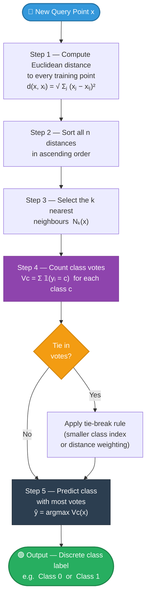
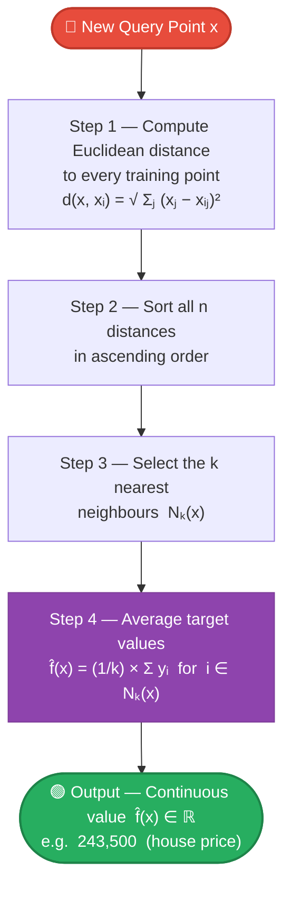
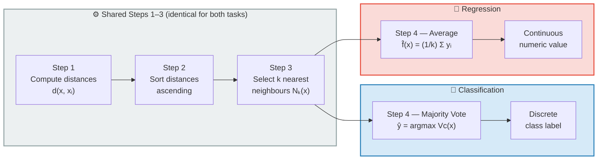
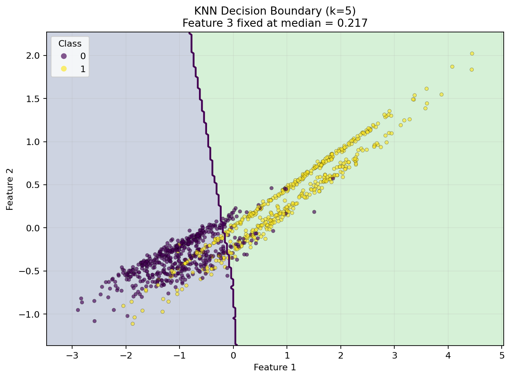
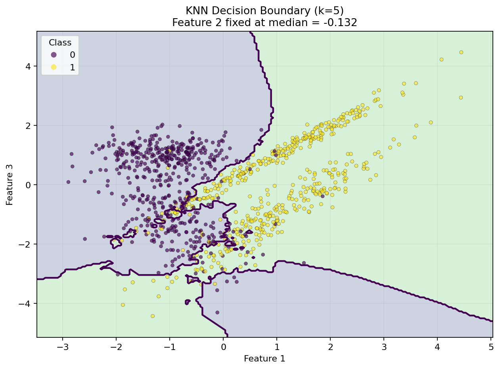
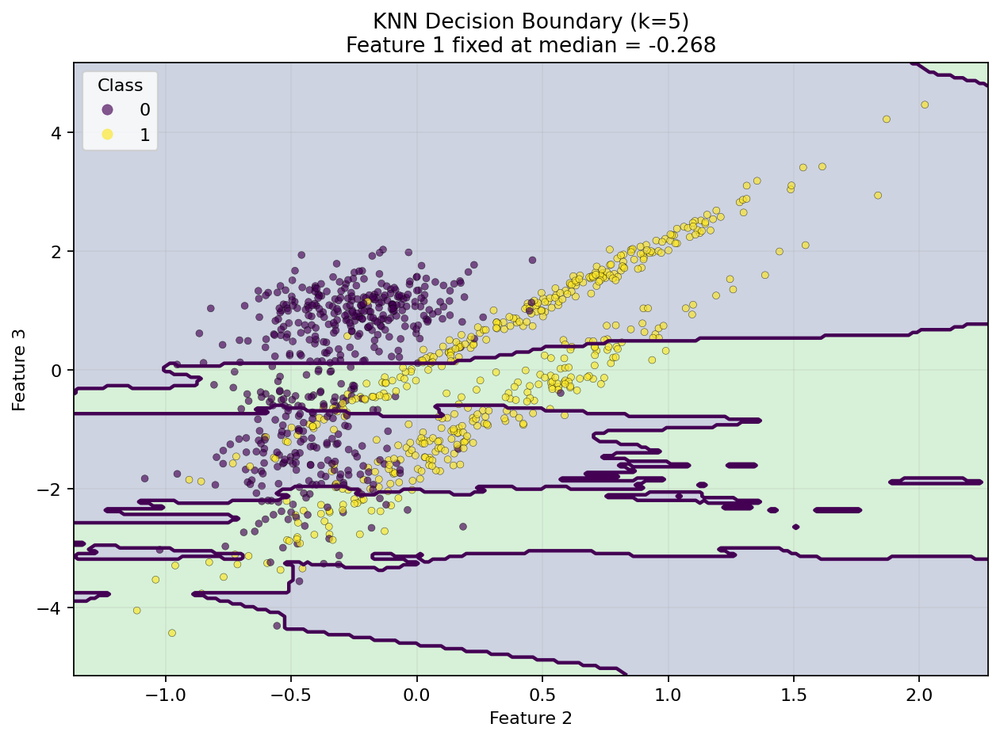
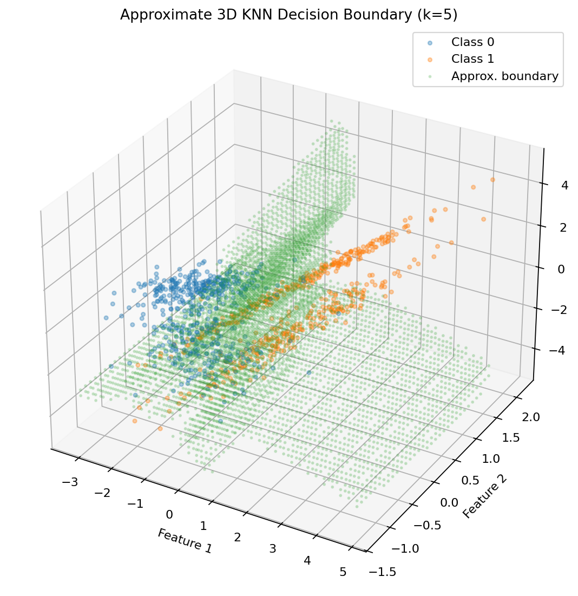

# KNN Classification and Regression

## Table of Contents

- [Overview](#overview)
- [KNN Classification vs Regression](#knn-classification-vs-regression)
- [Algorithm Walkthrough](#algorithm-walkthrough)
- [Decision Boundary vs Prediction Surface](#decision-boundary-vs-prediction-surface)
- [1. KNN Classification](#1-knn-classification)
  - [1.1 Estimated Class Probabilities](#11-estimated-class-probabilities)
  - [1.2 Binary Classification](#12-binary-classification)
  - [1.3 Multiclass Classification](#13-multiclass-classification)
  - [1.4 The Role of Class Priors](#14-the-role-of-class-priors)
- [2. KNN Regression](#2-knn-regression)
  - [2.1 Deriving the Local Mean from Squared Error](#21-deriving-the-local-mean-from-squared-error)
  - [2.2 Deriving the Weighted Mean](#22-deriving-the-weighted-mean)
  - [2.3 Local Median Regression](#23-local-median-regression)
  - [2.4 Interpolation and Extrapolation](#24-interpolation-and-extrapolation)
- [3. Deriving KNN from Local Estimation](#3-deriving-knn-from-local-estimation)
  - [3.1 Classification as Empirical Conditional Probability](#31-classification-as-empirical-conditional-probability)
  - [3.2 Regression as Conditional-Mean Estimation](#32-regression-as-conditional-mean-estimation)
  - [3.3 Why K Must Grow Carefully for Consistency](#33-why-k-must-grow-carefully-for-consistency)
  - [3.4 Kernel View of KNN](#34-kernel-view-of-knn)
- [4. Feature Scaling](#4-feature-scaling)
- [5. Computational Complexity](#5-computational-complexity)

---

## Overview

KNN can be used for two types of tasks:

- ***KNN Classification*** — predicts a ***class label*** by taking a ***majority vote*** among the ***K nearest neighbors***
- ***KNN Regression*** — predicts a ***continuous value*** by taking the ***average*** of the ***K nearest neighbors'*** target values

Both tasks follow the same core steps: find the ***K nearest neighbors***, then ***aggregate*** their outputs differently.

---

## KNN Classification vs Regression

| Aspect | KNN Classification | KNN Regression |
|--------|-------------------|----------------|
| **Predicts**/**Output** | **Discrete Classes** label (0 or 1) | **Continuous Numeric** values (any Number) |
| **Aggregation** | Majority voting | Average (or weighted average) |
| **Example** | Is this tumor malignant or benign? | What is the house price? |
| **Evaluation** | Accuracy, F1, Precision, Recall | MAE, MSE, RMSE, R² |
| **Ties** | Need tie-breaking rule | No tie issue (averaging) |
| **Visualization** | **Decision Boundary** — the boundary separating regions predicted as different classes; its shape and dimensionality depend on the number of features (a point in 1D, a curve in 2D, a surface in 3D, a hypersurface beyond) | **Prediction Surface** — a continuous-valued prediction map representing the estimated target value. With ***uniform KNN***, the surface is ***piecewise constant*** (predictions can jump as the neighbor set changes); with ***distance weighting***, predictions vary more gradually but are still not guaranteed to be smooth; **NO boundary line** |

> [!IMPORTANT]
> **KNN Regressor does NOT create a decision boundary.**
> - **Classifier** → discrete output → colors are fixed (e.g., blue or orange) → `plt.contour()` draws the boundary line *where the color changes*
> - **Regressor** → continuous output → `plt.contourf()` fills the surface with color-coded values; note that `contourf()` does **not** make predictions smooth — it simply displays the computed values. With uniform KNN the displayed surface is ***piecewise constant***.

---

## Algorithm Walkthrough

Both algorithms follow the **same first three steps** — they differ only in how they **aggregate** the neighbours' values in Step 4.

### KNN Classification — Step by Step

| Step | Action | Formula |
|---|---|---|
| 1 | Compute distance to every training point | $d(\mathbf{x}, \mathbf{x}_i) = \sqrt{\sum_j (x_j - x_{ij})^2}$ |
| 2 | Sort all distances ascending | — |
| 3 | Select $k$ nearest neighbours | $\mathcal{N}_k(\mathbf{x})$ |
| 4 | Count votes per class | $V_c = \sum_{i \in \mathcal{N}_k} \mathbb{1}(y_i = c)$ |
| 5 | Predict class with most votes | $\hat{y} = \arg\max_c\, V_c(\mathbf{x})$ |

---

### KNN Regression — Step by Step

| Step | Action | Formula |
|---|---|---|
| 1 | Compute distance to every training point | $d(\mathbf{x}, \mathbf{x}_i) = \sqrt{\sum_j (x_j - x_{ij})^2}$ |
| 2 | Sort all distances ascending | — |
| 3 | Select $k$ nearest neighbours | $\mathcal{N}_k(\mathbf{x})$ |
| 4 | Average their target values | $\hat{f}(\mathbf{x}) = \frac{1}{k}\sum_{i \in \mathcal{N}_k(\mathbf{x})} y_i$ |

> [!NOTE]
> There is **no Step 5** for regression — averaging never produces a tie. The result is always a unique continuous number.

---

### Key Difference — Steps 1–3 are Identical, Step 4 Diverges

---

## Decision Boundary vs Prediction Surface

The most visible difference between KNN Classification and KNN Regression is what gets drawn on the feature-space plot after the model is evaluated on a dense mesh grid.

---

### KNN Classification — Decision Boundary

The classifier assigns a **discrete class label** to every grid point. The colour of each region corresponds to one class. Where the predicted class *flips*, a **boundary line** (`plt.contour`) is drawn.

| | |
|---|---|
| **What it shows** | The line where majority vote switches from one class to another |
| **How it is drawn** | `plt.contour()` — draws only the boundary line |
| **Colour meaning** | Each filled region = one class (e.g., blue = Class 0, orange = Class 1) |
| **Effect of k** | Small $k$ → jagged, irregular boundary; Large $k$ → smoother boundary |

**Decision boundary across feature pairs:**

  

  

  

**3D view of the decision boundary (k = 5):**

  

> [!NOTE]
> The decision boundary is **not** a probability surface — it is a hard dividing line. Every point on one side gets the same class label; every point on the other side gets a different one.

---

### KNN Regression — Prediction Surface

The regressor assigns a **continuous numeric value** to every grid point. There is **no boundary line** — the entire feature space is filled with a smooth colour gradient where the colour encodes the predicted value.

| | |
|---|---|
| **What it shows** | The predicted target value at every location in the feature space |
| **How it is drawn** | `plt.contourf()` — fills the entire surface with colour |
| **Colour meaning** | Colour = predicted value (e.g., dark blue = low, bright yellow = high) |
| **Effect of k** | Small $k$ → jagged, patchy surface; Large $k$ → smoother gradient |

**Uniform KNN Regression — prediction surface (uniform weights):**

  

**Smooth KNN Regression — prediction surface (distance-weighted):**

  

> [!IMPORTANT]
> **No boundary line is ever drawn on the regression prediction surface.**
> The gradient itself IS the prediction — every location carries a unique continuous predicted value, not a class label.

---

### Side-by-Side Visual Summary

| | KNN Classification | KNN Regression |
|---|---|---|
| **Visual output** | Colour regions with a hard boundary line | Smooth continuous heatmap — no boundary |
| **Plot function** | `plt.contour()` | `plt.contourf()` |
| **Colour meaning** | Class identity — discrete | Predicted target value — continuous |
| **Is there a boundary?** | Yes — where majority class flips | No — values vary smoothly everywhere |
| **Step size h** | Controls boundary resolution | Controls surface resolution |
| **k effect on visual** | Small k → jagged boundary | Small k → patchy surface |

---

## 1. KNN Classification

In ***KNN classification***, the ***predicted class*** is determined by a ***majority vote*** among the ***K nearest neighbors***.

Let possible labels be $\mathcal{Y} = \{1, \ldots, C\}$. With uniform voting, the vote count for class $c$ is:

$$
V_c(\mathbf{x}) = \sum_{i \in N_k(\mathbf{x})} \mathbb{1}(y_i = c)
$$

The prediction is:

$$
\boxed{\hat{y}(\mathbf{x}) = \arg\max_{c \in \mathcal{Y}} V_c(\mathbf{x})}
$$

> [!NOTE]
> In plain terms: ***count how many neighbors belong to each class, then predict the class with the highest count.***

### 1.1 Estimated Class Probabilities

The ***local class frequency*** gives an ***estimated probability*** for each class:

$$
\boxed{\hat{P}(Y = c \mid \mathbf{x}) = \frac{1}{k} \sum_{i \in N_k(\mathbf{x})} \mathbb{1}(y_i = c)}
$$

These values are ***nonnegative*** and ***sum to one*** because each neighbour belongs to ***exactly one class***:

$$
\sum_{c=1}^{C} \hat{P}(Y = c \mid \mathbf{x})
= \frac{1}{k} \sum_{i \in N_k(\mathbf{x})} \sum_{c=1}^{C} \mathbb{1}(y_i = c)
= \frac{1}{k} \sum_{i \in N_k(\mathbf{x})} 1 = 1
$$

> [!NOTE]
> This is a ***local frequency estimate***, not a ***calibration guarantee***. With $k = 5$, probabilities can only be multiples of $0.2$ (e.g., 0.0, 0.2, 0.4, ...).

### 1.2 Binary Classification

For labels $y_i \in \{0, 1\}$:

$$
\hat{P}(Y = 1 \mid \mathbf{x}) = \frac{1}{k} \sum_{i \in N_k(\mathbf{x})} y_i
$$

> [!TIP]
> Using an ***odd K*** in binary classification prevents vote ties between two classes (e.g., K = 3, 5, 7). However, odd K does **not** prevent ties in ***multiclass*** problems.

### 1.3 Multiclass Classification

KNN handles multiple classes directly — it does ***not*** need one-vs-rest training:
- The winning class is the one with the ***largest local vote count***
- If counts tie, the implementation needs an ***explicit deterministic rule*** (e.g., pick the class with the smaller index, or use distance weighting)

### 1.4 The Role of Class Priors

Ordinary KNN does ***not*** explicitly multiply by ***global class priors***. The ***training density*** affects the ***local vote*** implicitly. Class imbalance can influence the composition of local neighborhoods, causing the majority class to be predicted more frequently — but KNN does ***not*** automatically choose the globally dominant class for every query. The extent of this effect depends on the ***data distribution***, ***neighborhood size***, ***distance metric***, and ***feature space***.

**Remedies:**
- ***Resampling*** within training folds
- ***Class-aware weights***
- ***Suitable distance metrics***
- Evaluating ***per-class recall*** rather than accuracy alone

---

## 2. KNN Regression

For a ***continuous target*** $y_i \in \mathbb{R}$, ***unweighted KNN regression*** returns the ***local mean***:

$$
\boxed{\hat{y}(\mathbf{x}) = \frac{1}{k} \sum_{i \in N_k(\mathbf{x})} y_i}
$$

For ***distance-weighted*** predictions, where $w_i(\mathbf{x}) \geq 0$:

$$
\boxed{\hat{y}(\mathbf{x}) = \frac{\sum_{i \in N_k(\mathbf{x})} w_i(\mathbf{x}) \, y_i}{\sum_{i \in N_k(\mathbf{x})} w_i(\mathbf{x})}}
$$

> [!NOTE]
> In plain terms: ***average the target values of the K nearest neighbors***. Closer neighbors can be given more weight using ***distance-based weighting***.

### 2.1 Deriving the Local Mean from Squared Error

Suppose a single value $a$ must represent the ***k local targets***. Minimize their ***local sum of squared errors***:

$$
L(a) = \sum_{i \in N_k(\mathbf{x})} (y_i - a)^2
$$

Differentiate:

$$
\frac{dL}{da} = -2\sum_i (y_i - a) = -2\sum_i y_i + 2ka
$$

Set the derivative to zero:

$$
-2\sum_i y_i + 2ka = 0 \quad \Longrightarrow \quad \boxed{a = \frac{1}{k} \sum_i y_i}
$$

The second derivative is $2k > 0$, confirming this is the ***unique minimum***. ***KNN's unweighted regression rule*** is the constant that ***minimizes squared error*** inside the ***neighborhood***.

### 2.2 Deriving the Weighted Mean

For ***weighted local squared error***:

$$
L(a) = \sum_i w_i (y_i - a)^2
$$

The derivative is:

$$
\frac{dL}{da} = -2\sum_i w_i y_i + 2a \sum_i w_i
$$

Setting it to zero gives:

$$
\boxed{a = \frac{\sum_i w_i y_i}{\sum_i w_i}}
$$

> [!NOTE]
> This requires $\sum_i w_i > 0$. If all weights are zero the weighted mean is undefined. In practice, inverse-distance weights are always positive for distinct points.

### 2.3 Local Median Regression

If ***absolute error*** is more appropriate, minimize:

$$
L(a) = \sum_i |y_i - a|
$$

Any ***median*** of the neighbor targets minimizes this objective. A ***local median KNN*** is therefore more ***resistant to extreme target values*** than ***the mean***, though it is not the ***default*** in most libraries.

### 2.4 Interpolation and Extrapolation

With ***nonnegative normalized weights***, the prediction is a ***convex combination*** of neighbor targets:

$$
\min_{i \in N_k} y_i \leq \hat{y}(\mathbf{x}) \leq \max_{i \in N_k} y_i
$$

> [!WARNING]
> ***KNN regression cannot extrapolate*** beyond the target range of the selected neighbors. Far outside the observed feature region, it still returns an average of the closest available points, which may be scientifically implausible.

---

## 3. Deriving KNN from Local Estimation

KNN can be understood as a ***local estimator*** of the conditional distribution of $Y$ near $\mathbf{x}$.

### 3.1 Classification as Empirical Conditional Probability

The ***ideal Bayes classifier*** chooses:

$$
y^*(\mathbf{x}) = \arg\max_c \, P(Y = c \mid X = \mathbf{x})
$$

The ***true conditional probability*** is unknown. Replace the infinitesimal event $X = \mathbf{x}$ with a ***small neighbourhood***, then estimate by ***sample proportion***:

$$
P(Y = c \mid X \approx \mathbf{x}) \approx \frac{\#\{i \in N_k(\mathbf{x}) : y_i = c\}}{k}
$$

Substituting this estimate into the ***Bayes decision rule*** produces the ***KNN vote***.

### 3.2 Regression as Conditional-Mean Estimation

Under ***squared-error loss***, the ***population-optimal predictor*** is the ***conditional mean***:

$$
f^*(\mathbf{x}) = E[Y \mid X = \mathbf{x}]
$$

KNN replaces the unavailable ***exact conditional distribution*** with the ***empirical distribution*** of targets in the ***local neighborhood***:

$$
E[Y \mid X = \mathbf{x}] \approx \frac{1}{k} \sum_{i \in N_k(\mathbf{x})} y_i
$$

### 3.3 Why K Must Grow Carefully for Consistency

***Classical asymptotic theory*** requires ***two competing conditions*** as $n \to \infty$:

$$
k \to \infty \qquad \text{and} \qquad \frac{k}{n} \to 0
$$

| Condition | Purpose |
|-----------|---------|
| $k \to \infty$ | Enough neighbors to ***reduce sampling noise*** |
| $k/n \to 0$ | Keeps the ***neighborhood local*** as data becomes denser |

> [!IMPORTANT]
> A ***fixed K*** does not average away all noise. Choosing K as a large fixed fraction of $n$ ***destroys locality***. These conditions express the ***essential balance***.

> [!NOTE]
> These two conditions are ***necessary but not sufficient*** on their own. Classical KNN consistency also depends on ***regularity assumptions*** about the underlying data distribution (e.g., continuity of the conditional distribution, bounded feature space). They should not be presented as a universal guarantee independent of such assumptions.

### 3.4 Kernel View of KNN

Let $r_k(\mathbf{x})$ be the distance from the query to its ***k-th nearest neighbor***. ***Uniform KNN regression*** can be written as:

$$
\hat{f}(\mathbf{x}) = \frac{\sum_{i=1}^{n} \mathbb{1}\{d(\mathbf{x}, \mathbf{x}_i) \leq r_k(\mathbf{x})\} \, y_i}{\sum_{i=1}^{n} \mathbb{1}\{d(\mathbf{x}, \mathbf{x}_i) \leq r_k(\mathbf{x})\}}
$$

This resembles ***kernel regression*** with a ***rectangular kernel***, except the ***bandwidth*** $r_k(\mathbf{x})$ ***adapts to local data density***:
- ***Dense regions*** → small radius (few points needed to find K neighbors)
- ***Sparse regions*** → large radius (must reach further to find K neighbors)

> [!NOTE]
> ***Distance-tie subtlety:*** If multiple training points share exactly the same distance as the $k$-th nearest neighbor, the radius-based formulation $d(\mathbf{x}, \mathbf{x}_i) \leq r_k(\mathbf{x})$ may include ***more than K points***. Implementations that strictly select K neighbors must decide which tied points to include — this policy is implementation-dependent and can affect results.

---

## 4. Feature Scaling

Because KNN is a ***distance-based algorithm***, the ***numerical scale*** of each feature acts as an ***implicit weight*** in the distance calculation. Features with larger numerical ranges will dominate the distance metric, regardless of their actual predictive importance.

**Example:**

| Feature | Range | Distance Contribution (unscaled) |
|---|---|---|
| Age | 18–60 | $(\Delta\text{age})^2 \approx 100$ |
| Salary | 20,000–2,00,000 | $(\Delta\text{salary})^2 \approx 10^{10}$ |

Without scaling, Salary dominates the distance calculation entirely. After standardization, both features contribute equally.

**Common scaling methods:**

| Method | Formula | Best For |
|---|---|---|
| ***Standardization*** | $(x - \mu) / \sigma$ | Roughly normal features, no extreme outliers |
| ***Min-Max*** | $(x - \min) / (\max - \min)$ | Fixed-range features, no outliers |
| ***Robust*** | $(x - q_{0.5}) / IQR$ | Real-world data with outliers |

> [!IMPORTANT]
> ***Always fit the scaler on training data only*** and apply the same fitted scaler to validation and test data. Fitting on the full dataset before splitting causes ***data leakage***.

> [!NOTE]
> For a comprehensive treatment of feature scaling — including all five scaling methods, distance metric compatibility, outlier handling, and pipeline implementation — see [05 Feature scaling and preprocessing.md](05%20Feature%20scaling%20and%20preprocessing.md).

---

## 5. Computational Complexity

| Phase | Brute Force | With KD-Tree / Ball Tree |
|---|---|---|
| ***Training*** | $O(nd)$ — stores $n$ points in $d$ dimensions | $O(nd \log n)$ — additional index build cost |
| ***Prediction (1 query)*** | $O(nd)$ — computes distance to all training points | $O(d \log n)$ avg — only in low dimensions ($d \lesssim 20$) |
| ***Prediction ($m$ queries)*** | $O(mnd)$ | $O(nd \log n + md \log n)$ — index cost amortized |
| ***Memory*** | $O(nd)$ — entire training set must stay in memory | $O(nd)$ — same storage requirement |

Where:
- ***$n$*** = number of training samples
- ***$d$*** = number of features
- ***$m$*** = number of query points

> [!NOTE]
> Testing different K values during tuning ***does not change prediction cost*** — once distances to all $n$ training points are computed, varying K simply changes how many neighbors are included in the vote or average. The expensive step is ***distance computation***, not K selection.

> [!WARNING]
> ***KD-tree and Ball Tree acceleration degrades in high dimensions*** (curse of dimensionality). Above approximately $d \approx 20$ features, their performance approaches brute-force $O(nd)$. Use `algorithm='brute'` or dimensionality reduction for high-dimensional data.

---

  ⬅️ <strong>Previous:</strong> <a href="./03%20How%20to%20Choose%20K%20in%20KNN%3A%20Bias%2C%20Variance%20and%20Validation.md">03 How to Choose K in KNN</a> &nbsp;&nbsp;|&nbsp;&nbsp; <strong>Next:</strong> <a href="./04.1%20KNN%20Classifier%20From%20Scratch.ipynb">04.1 KNN Classifier From Scratch</a> ➡️

