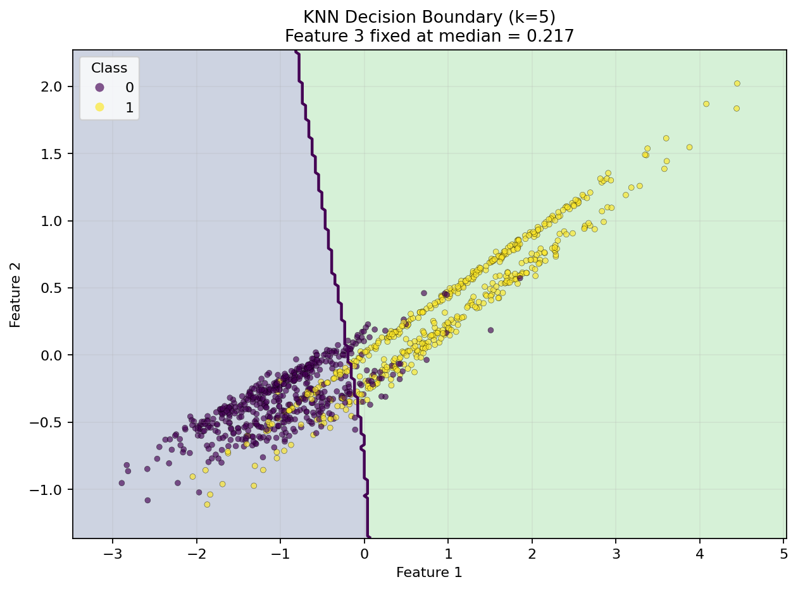
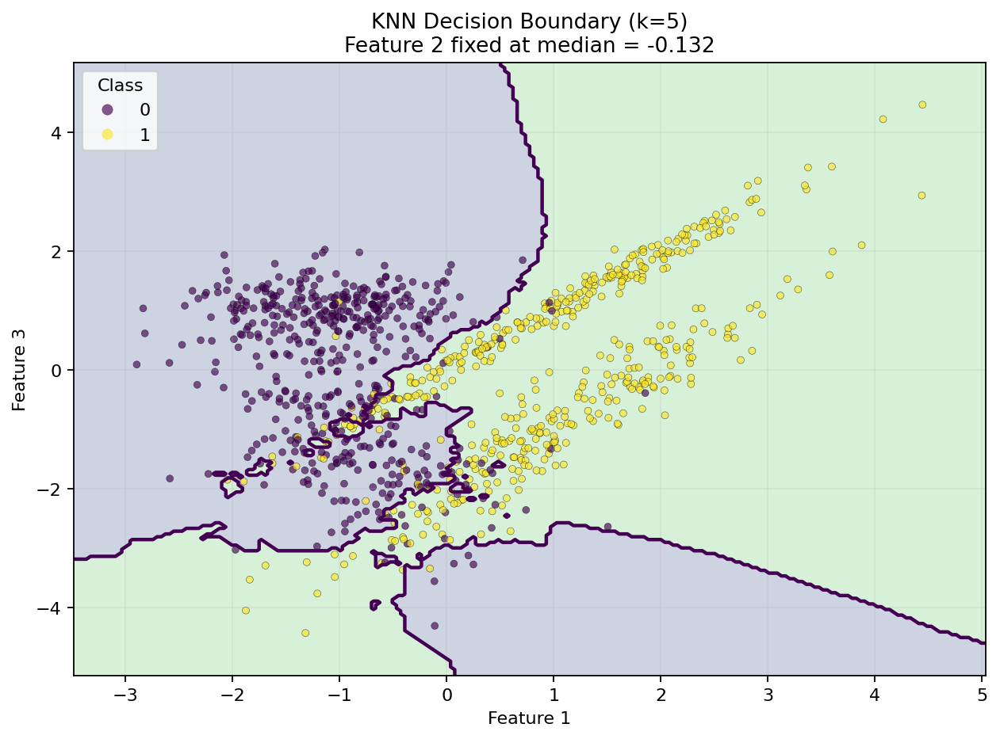
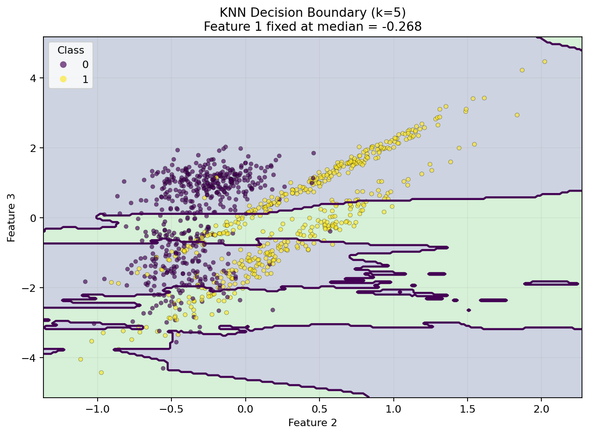
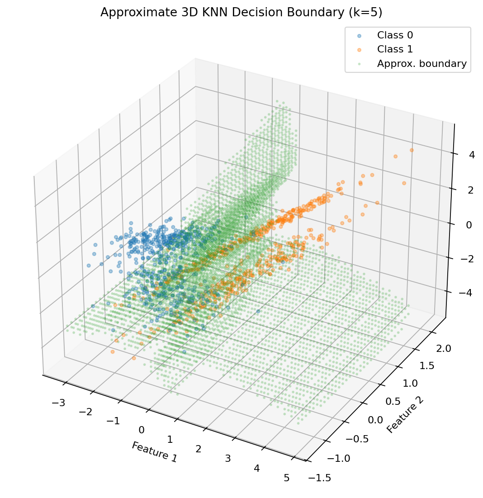

# KNN Decision Boundaries and Voronoi Geometry

## Table of Contents

- [Overview](#overview)
- [1. Decision Boundaries and Voronoi Geometry](#1-decision-boundaries-and-voronoi-geometry)
  - [1.1 Deriving a Two-Point Bisector](#11-deriving-a-two-point-bisector)
  - [1.2 Why Scaling Reshapes the Boundary](#12-why-scaling-reshapes-the-boundary)
  - [1.3 Piecewise-Constant Predictions](#13-piecewise-constant-predictions)
- [2. Decision Boundaries in Practice](#2-decision-boundaries-in-practice)
- [3. Effect of K on Decision Boundaries](#3-effect-of-k-on-decision-boundaries)
- [4. Feature Scaling and Boundary Shape](#4-feature-scaling-and-boundary-shape)
- [5. Prediction Surface in KNN Regression](#5-prediction-surface-in-knn-regression)
- [6. Decision Boundary vs Prediction Surface](#6-decision-boundary-vs-prediction-surface)

---

## Overview

KNN decision boundaries are entirely determined by the ***neighborhood structure*** in feature space. Unlike parametric models (e.g., logistic regression), KNN makes ***no assumptions*** about the decision boundary shape — it adapts directly to the local density and class distribution of the training data.

The ***geometric structure*** of KNN boundaries is intimately connected to ***Voronoi diagrams***, especially for 1-NN, and the ***smoothness*** of boundaries depends critically on the choice of $K$ and feature scaling.

---

## 1. Decision Boundaries and Voronoi Geometry

### 1.1 Deriving a Two-Point Bisector

For ***1-NN classification*** under ***Euclidean distance***, every training point ***owns the region*** closer to it than to any other training point. These regions form a ***Voronoi diagram***.

**Key insight:** A cell inherits its training point's label. ***Boundaries*** between differently labeled cells form the classifier's ***decision boundary***.

#### Mathematical Derivation

For training points $\mathbf{a}$ and $\mathbf{b}$, points that are ***equally distant*** from both satisfy:

$$\|\mathbf{x} - \mathbf{a}\|_2^2 = \|\mathbf{x} - \mathbf{b}\|_2^2$$

Expand both sides:

$$\mathbf{x}^\top\mathbf{x} - 2\mathbf{a}^\top\mathbf{x} + \mathbf{a}^\top\mathbf{a} = \mathbf{x}^\top\mathbf{x} - 2\mathbf{b}^\top\mathbf{x} + \mathbf{b}^\top\mathbf{b}$$

Cancel $\mathbf{x}^\top\mathbf{x}$ and rearrange:

$$2(\mathbf{b} - \mathbf{a})^\top\mathbf{x} = \mathbf{b}^\top\mathbf{b} - \mathbf{a}^\top\mathbf{a}$$

$$\boxed{(\mathbf{b} - \mathbf{a})^\top\mathbf{x} = \frac{\|\mathbf{b}\|^2 - \|\mathbf{a}\|^2}{2}}$$

This is a ***hyperplane perpendicular*** to the direction $\mathbf{b} - \mathbf{a}$ (the line connecting the two points).

> [!IMPORTANT]
> ***Euclidean 1-NN boundaries*** are assembled from pieces of ***perpendicular bisectors*** between pairs of training points. For $k > 1$, the geometry depends on sets of neighbors and relates to ***higher-order Voronoi diagrams***, which are more complex.

#### Example: 2D Voronoi Cells

In 2D with three training points:
- Point A (Red): (1, 1)
- Point B (Blue): (5, 1)
- Point C (Red): (3, 5)

The perpendicular bisector of A and B is vertical at $x = 3$. The perpendicular bisector of B and C is another line. Where these bisectors intersect, they form the ***decision boundary*** between regions.

---

### 1.2 Why Scaling Reshapes the Boundary

Multiplying one feature by a constant ***stretches the space*** along that axis.

**What happens:**

- ***Circles of equal Euclidean distance*** become ***ellipses*** in the original coordinates.
- ***Neighbor rankings change*** because distances are recomputed.
- ***Every Voronoi cell is reshaped***.
- The entire ***decision boundary shifts***.

#### Example: Scaling Effects

Original features: Age (1–100) and Income (10K–10M)

**Without scaling:**
- Distances are dominated by income differences.
- Voronoi cells are elongated along the income axis.
- The boundary is skewed toward age.

**After Min-Max scaling to [0, 1]:**
- Both features contribute equally to distance.
- Voronoi cells become more ***isotropic*** (similar in all directions).
- The boundary shifts to reflect true feature importance.

> [!WARNING]
> ***Forgetting to scale features*** is one of the most common mistakes in KNN. It silently changes the decision boundary without any error message — the model just produces poor predictions because one feature is dominating the geometry.

---

### 1.3 Piecewise-Constant Predictions

***Ordinary KNN classification*** and ***uniform KNN regression*** are ***piecewise constant***:

- Within a region where the ***nearest K neighbors remain unchanged***, the ***prediction stays constant***.
- Predictions only change when you cross a ***boundary*** where the neighbor set changes.

> [!NOTE]
> ***Distance weighting*** (e.g., inverse-distance weights) can vary ***continuously*** inside a fixed neighbor set, producing a smooth prediction within a Voronoi cell. However, the prediction may still change ***nonsmoothly*** (discontinuously) when the membership changes across a boundary.

---

## 2. Decision Boundaries in Practice

Graphically, ***KNN decision boundaries*** are:

1. ***Piecewise*** — assembled from hyperplane pieces (bisectors)
2. ***Adaptive*** — conform directly to the local class distribution in training data
3. ***Non-parametric*** — no underlying function assumed

### Boundary Shape by K Value

**For $K = 1$ (1-NN):**
- Boundary is the ***Voronoi tessellation*** of training points.
- Extremely detailed and intricate.
- Every training point has its own region.
- Highly prone to ***overfitting***.

**For $K = 3$ (3-NN):**
- Boundary smooths significantly.
- Small patches of one class surrounded by another class disappear.
- Regions of one class become more consolidated.
- More balanced bias-variance tradeoff.

**For Large $K$ (e.g., $K = N$):**
- Boundary becomes nearly linear or constant.
- The prediction approaches the ***global class prior*** (most common class).
- Extreme ***underfitting***.

> [!TIP]
> The ***rough rule***: as $K$ increases, boundaries become smoother and simpler. This is why cross-validation is essential — there's an optimal $K$ that balances local adaptation with global smoothing.

### Decision Boundary Visualizations

**Decision boundary across feature pairs (2D):**

  

  

  

**3D view of the decision boundary surface (k = 5):**

  

> [!NOTE]
> Each 2D plot slices the decision boundary across one pair of features while the others are held constant. The 3D view shows the full boundary surface simultaneously across all three dimensions.

---

## 3. Effect of K on Decision Boundaries

### Small K — Jagged, Overfit Boundaries

When $K$ is small (e.g., $K = 1$):

- The boundary ***closely follows individual points***.
- Tiny isolated regions belong to minority classes.
- The model is ***overly sensitive to noise***.
- Decision surfaces are ***extremely complex***.

$$K=1 \Rightarrow \text{Voronoi diagram (maximum complexity)}$$

### Large K — Smooth, Underfit Boundaries

When $K$ is large (e.g., $K = n$ or close to it):

- The boundary becomes ***nearly linear*** or ***constant***.
- Local structure is ***largely ignored***.
- The model predicts based on ***global statistics only***.
- The boundary is ***overly simple***.

$$K=n \Rightarrow \text{Constant prediction (minimum complexity)}$$

### Optimal K — Balanced Boundary

An optimal $K$ balances:
- ***Local adaptation*** (capturing real patterns in neighborhoods)
- ***Global smoothing*** (ignoring noise and isolated points)

> [!IMPORTANT]
> ***Cross-validation*** is the standard method to find the optimal $K$ that produces decision boundaries matching the true underlying data structure without overfitting.

---

## 4. Feature Scaling and Boundary Shape

The ***shape and orientation*** of decision boundaries depend critically on ***feature scaling***.

### Unscaled Features

With unscaled features where one dominates:
- Boundaries are ***nearly perpendicular*** to the dominant axis.
- Boundaries are ***nearly parallel*** to other axes.
- The geometry is ***anisotropic*** (distorted).

### Scaled Features (Same Scale)

After scaling all features to [0, 1]:
- Boundaries become more ***isotropic*** (balanced in all directions).
- Each feature has ***equal opportunity*** to influence neighbors.
- The geometry reflects ***true feature importance***.

$$\text{Boundary orientation} \propto \text{Feature scale} \quad (\text{before scaling})$$

$$\text{Boundary orientation} \propto \text{Feature importance} \quad (\text{after scaling})$$

> [!CAUTION]
> Boundaries derived from ***unscaled features*** do not represent ***true feature importance*** — they represent ***numerical scale artifacts***. Always inspect whether scaling changes your model's predictions. If it does, scaling was necessary.

---

## 5. Prediction Surface in KNN Regression

KNN Regression does **not** produce a decision boundary. Instead it produces a **prediction surface** — the entire feature space is filled with a smooth colour gradient where each point's colour encodes its predicted continuous value.

### How the Prediction Surface is Built

For every point in a dense mesh grid:
1. Compute Euclidean distance to all training points
2. Select the $k$ nearest neighbours
3. **Average** their target values: $\hat{f}(\mathbf{x}) = \frac{1}{k}\sum_{i \in \mathcal{N}_k(\mathbf{x})} y_i$
4. Assign a heatmap colour based on that continuous predicted value

The result is a smooth surface — **no line is ever drawn**. The gradient itself carries the full prediction.

### Effect of Weighting on the Surface

| Weighting scheme | Surface appearance | How neighbours contribute |
|---|---|---|
| **Uniform** | Blocky, stepped patches visible | All $k$ neighbours count equally |
| **Distance-weighted** | Smoother gradient transitions | Closer neighbours count more |

**Uniform KNN Regression — prediction surface:**

  

**Distance-weighted KNN Regression — prediction surface:**

  

> [!IMPORTANT]
> **No boundary line is ever drawn on the regression prediction surface.**
> The colour gradient IS the full prediction — every location carries a unique continuous predicted value, not a class label.

### Effect of K on the Prediction Surface

| $K$ value | Surface appearance | Model behaviour |
|---|---|---|
| Small $K$ (e.g., 1–3) | Jagged, patchwork, sharp jumps | High variance — overfitting |
| Medium $K$ | Smooth with visible structure | Good bias-variance balance |
| Large $K$ | Very smooth, nearly flat | High bias — underfitting |

> [!NOTE]
> The same bias-variance principle that governs decision boundary jaggedness in classification also governs surface smoothness in regression. Use cross-validation to select $K$.

---

## 6. Decision Boundary vs Prediction Surface

| | KNN Classification | KNN Regression |
|---|---|---|
| **Output per grid point** | Discrete class label (e.g., 0 or 1) | Continuous numeric value (e.g., 243,500) |
| **Visual output** | Colour regions with a hard boundary line | Smooth continuous heatmap — no boundary |
| **Plot function** | `plt.contour()` — draws the boundary line | `plt.contourf()` — fills the whole surface |
| **Colour meaning** | Class identity — discrete | Predicted target value — continuous |
| **Is there a boundary?** | Yes — where majority class flips | No — values vary smoothly everywhere |
| **Step size $h$** | Controls boundary resolution | Controls surface resolution |
| **Small $k$ effect** | Jagged, irregular boundary | Jagged, patchy surface |
| **Large $k$ effect** | Smooth, simple boundary | Smooth, nearly flat surface |

> [!IMPORTANT]
> The decision boundary is a **property of classification** — it only exists when the output is discrete.
> The prediction surface is a **property of regression** — it exists because the output is continuous and varies smoothly.

---

## Summary Table: K and Boundary Characteristics

| K Value | Boundary Type | Complexity | Bias | Variance | Risk |
|---------|---------------|-----------|------|----------|------|
| ***1 (1-NN)*** | Voronoi cells | ***Very high*** | Very low | ***Very high*** | ***Overfitting*** |
| ***3–5*** | Piecewise, moderate smoothing | Medium | Low–medium | Medium | Balanced |
| ***$\sqrt{n}$*** | Smooth, well-balanced | Medium–high | Medium | Medium | Good default |
| ***$n/2$*** | Large regions | Low | ***High*** | Low | Underfitting |
| ***$n$ (all)*** | Constant or nearly linear | ***Very low*** | ***Very high*** | Low | ***Underfitting*** |

---

## Related Concepts

- **Voronoi Diagrams:** See computational geometry references for detailed visualizations.
- **Higher-Order Voronoi:** For $k > 1$, the boundary topology is related to $k$-th order Voronoi diagrams.
- **Feature Scaling:** Decision boundaries depend on feature scale. See [Feature scaling and preprocessing.md](./Feature%20scaling%20and%20preprocessing.md) for comprehensive guidance.
- **K Selection:** See [How to Choose K in KNN](./03%20How%20to%20Choose%20K%20in%20KNN.md) for methods to find optimal $K$ using cross-validation.

---

  ⬅️ <strong>Previous:</strong> <a href="./06%20Numerical%20Example%20on%20KNN.md">06 Numerical Example on KNN</a> &nbsp;&nbsp;|&nbsp;&nbsp; <strong>Next:</strong> <a href="./08%20Weighted%20KNN.md">08 Weighted KNN</a> ➡️

---
