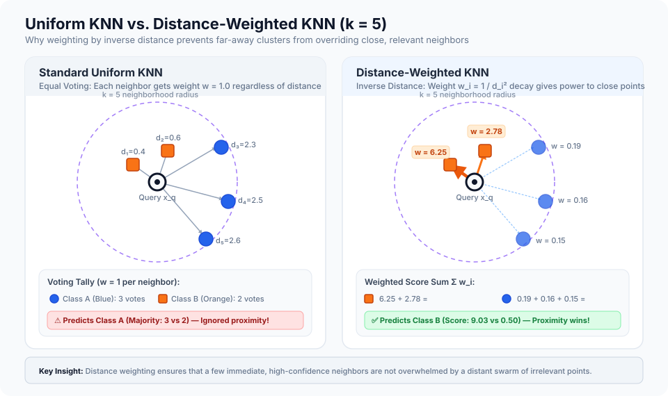
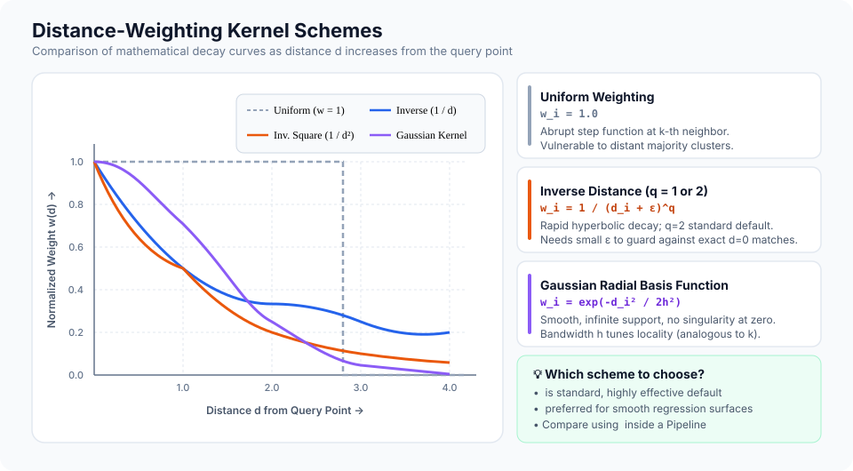

# Weighted KNN

## Table of Contents

- [Overview](#overview)
- [What is Weighted KNN?](#what-is-weighted-knn)
- [Uniform KNN vs Weighted KNN](#uniform-knn-vs-weighted-knn)
- [1. Weighted Classification](#1-weighted-classification)
  - [1.1 Weighted Score and Prediction](#11-weighted-score-and-prediction)
  - [1.2 Weighted Class Probabilities](#12-weighted-class-probabilities)
- [2. Weighted Regression](#2-weighted-regression)
- [3. Weighting Schemes](#3-weighting-schemes)
  - [3.1 Inverse-Distance Weights](#31-inverse-distance-weights)
  - [3.2 Gaussian Weights and Nadaraya-Watson Connection](#32-gaussian-weights-and-nadaraya-watson-connection)
  - [3.3 Weight Normalization](#33-weight-normalization)
- [4. Handling Exact Matches (Zero Distance)](#4-handling-exact-matches-zero-distance)
- [5. Bias-Variance and Choosing K](#5-bias-variance-and-choosing-k)
- [6. When Weighting Helps or Hurts](#6-when-weighting-helps-or-hurts)
- [7. Numerical Examples](#7-numerical-examples)
  - [7.1 Classification Example](#71-classification-example)
  - [7.2 Regression Example](#72-regression-example)
- [8. Python Implementation](#8-python-implementation)
  - [8.1 From-Scratch Implementation](#81-from-scratch-implementation)
  - [8.2 Scikit-Learn with Pipeline and GridSearchCV](#82-scikit-learn-with-pipeline-and-gridsearchcv)
- [9. Key Points and Applications](#9-key-points-and-applications)
- [References](#references)

---

## Overview

- ***Uniform KNN*** treats the ***first*** and ***k-th neighbors equally*** — every neighbor gets the same vote. ***Weighted KNN*** lets ***closer observations contribute more*** to the final prediction, giving a stronger influence to neighbors that are more similar to the query point.

- Formally, for a query point $\mathbf{x}_q$, let $\mathcal{N}_k(\mathbf{x}_q)$ be the indices of the $k$ nearest training points. Each neighbor $i \in \mathcal{N}_k(\mathbf{x}_q)$ is assigned a weight $w_i$ (e.g. $w_i = 1/d_i$ or a Gaussian function) that decays with distance.

> [!IMPORTANT]
> ***Weighted KNN is almost always preferable to uniform KNN*** when distances are meaningful. A neighbor at distance 0.01 should influence the prediction far more than one at distance 10.0, yet uniform voting treats them identically.

---

## What is Weighted KNN?

- ***Weighted k-Nearest Neighbors*** (Weighted k-NN) is a modified version of the standard k-NN algorithm that assigns ***higher importance to closer neighbors*** and ***lower importance to farther neighbors*** when making predictions.
- Instead of ***letting all $k$ nearest data points vote equally***, it ***scales each neighbor's contribution*** based on its **distance from the query point**.

### The Problem with Standard KNN

> [!WARNING]
> Two fundamental issues affect the performance of the standard KNN algorithm:
>
> 1. ***Choice of $k$:*** If $k$ is ***too small***, the algorithm becomes more ***sensitive to outliers*** — a single noisy point can dominate the prediction. If $k$ is ***too large***, the neighborhood may include too many points from other classes, pulling the prediction in the wrong direction.
>
> 2. ***Majority voting:*** The simplest method for combining class labels is a majority vote — but this is ***problematic when nearest neighbors vary widely in their distance***. The 10th neighbor (far away) gets the same vote as the 1st neighbor (very close), even though the closest neighbors more reliably indicate the true class.

### How Weighted KNN Resolves This

***Weighted KNN directly addresses both problems:***

- ***Outlier sensitivity:*** A distant noisy point receives a ***very small weight*** ($w_i = 1/d_i^2$ → near zero for large $d_i$), so it has minimal influence on the prediction even if it falls within the $k$ neighborhood.
- ***Majority vote problem:*** Instead of equal votes, ***each neighbor's contribution is proportional to its proximity***. The closest neighbors — which most reliably reflect the query point's true class — automatically dominate the prediction.

### How It Works

The algorithm follows ***four main steps*** to classify a new data point or predict a value:

1. ***Calculate distances.*** Measure the distance (typically Euclidean) from the new query point to every point in the training dataset.
2. ***Select the $k$ nearest neighbors.*** Sort the distances in ascending order and pick the top $k$ closest training points.
3. ***Assign distance weights.*** Compute a weight $w_i$ for each of the $k$ neighbors using a kernel function — most commonly:
   - ***Inverse distance:*** $w_i = \dfrac{1}{d_i}$
   - ***Inverse squared distance:*** $w_i = \dfrac{1}{d_i^2}$

   > [!NOTE]
   > A tiny constant $\varepsilon$ is often added to the denominator ($w_i = 1/(d_i + \varepsilon)$) to prevent division by zero when a distance is exactly 0.

4. ***Compute the final prediction.***
   - ***Classification:*** Sum the weights for each class and choose the class with the highest total weight.
   - ***Regression:*** Calculate the weighted average of the neighbors' target values.

---

## Uniform KNN vs Weighted KNN

<div align="center">



</div>

| Aspect | ***Uniform KNN*** | ***Weighted KNN*** |
|--------|-----------------|-----------------|
| **Neighbor Weights**/**Voting / Averaging** | Uniform — every neighbor gets an equal vote of 1 | Distance-weighted — closer points get larger weights |
| **Sensitivity to $k$** | ***High*** — a large $k$ pulls in distant, irrelevant points with equal weight | ***Lower*** — distant points naturally receive minimal weight |
| **Imbalanced Data** | Majority classes tend to dominate predictions | ***Better*** — a very close minority-class point can outweigh farther majority-class points |
| **Sensitivity to Noise**/**Outlier Impact** | Sensitive to any noisy point within the $k$ radius | More robust against ***distant*** noise; still sensitive to noise ***right next to*** the query point |
| **Tie-breaking** | Easier with odd $k$ | Weighted ties still possible |
| **Boundary shape** | Hard boundary | Smoother, more locally adaptive |
| **Variance** | Higher for small $k$ | ***Lower*** relative to uniform KNN |
| **Hyperparameters** | $k$ only | $k$ + weighting scheme + scheme parameters |
| **Best when** | All neighbors are equally relevant | Closer neighbors are more predictive |
| **sklearn** | `weights='uniform'` | `weights='distance'` or custom callable |

> [!NOTE]
> ***Neither is universally better.*** Compare both with ***cross-validation*** on your specific dataset and metric.

---

## 1. Weighted Classification

### 1.1 Weighted Score and Prediction

For ***nonnegative weights*** $w_i(\mathbf{x}) \geq 0$, the ***weighted vote score*** for class $c$ is:

$$
\boxed{S_c(\mathbf{x}) = \sum_{i \in \mathcal{N}_k(\mathbf{x})} w_i(\mathbf{x})\, \mathbb{1}(y_i = c)}
$$

The ***predicted class*** is the one with the ***highest weighted score***:

$$
\boxed{\hat{y}(\mathbf{x}) = \arg\max_{c \in \mathcal{Y}}\ S_c(\mathbf{x})}
$$

**Where:**
- ***$\mathcal{N}_k(\mathbf{x})$*** = set of $k$ nearest neighbors of query $\mathbf{x}$
- ***$w_i(\mathbf{x})$*** = weight assigned to the $i$-th neighbor
- ***$\mathbb{1}(y_i = c)$*** = indicator: 1 if neighbor $i$ belongs to class $c$, else 0
- ***$\mathcal{Y}$*** = set of all possible class labels

> [!TIP]
> The power of weighted KNN is visible when the ***closest neighbor disagrees*** with the majority. Weighting can correctly override the majority vote by giving more influence to the most similar neighbor. See [Section 7.1](#71-classification-example) for a step-by-step example.

### 1.2 Weighted Class Probabilities

***Weighted class probabilities*** normalize the weighted scores so they sum to 1:

$$
\boxed{\hat{P}(Y = c \mid \mathbf{x}) = \frac{\displaystyle\sum_{i \in \mathcal{N}_k(\mathbf{x})} w_i(\mathbf{x})\, \mathbb{1}(y_i = c)}{\displaystyle\sum_{i \in \mathcal{N}_k(\mathbf{x})} w_i(\mathbf{x})}}
$$

This guarantees:
- ***$\hat{P}(Y = c \mid \mathbf{x}) \geq 0$*** for all classes
- ***$\sum_c \hat{P}(Y = c \mid \mathbf{x}) = 1$*** (valid probability distribution)

> [!NOTE]
> Scikit-learn's `KNeighborsClassifier` handles probability normalization ***internally***. When passing a custom `weights=` callable, return ***raw non-negative weights*** — sklearn normalizes them automatically. You do ***not*** need to normalize yourself.

---

## 2. Weighted Regression

For a ***continuous target*** $y_i \in \mathbb{R}$, weighted KNN regression returns the ***weighted mean*** of neighbor targets:

$$
\boxed{\hat{y}(\mathbf{x}) = \frac{\displaystyle\sum_{i \in \mathcal{N}_k(\mathbf{x})} w_i(\mathbf{x})\, y_i}{\displaystyle\sum_{i \in \mathcal{N}_k(\mathbf{x})} w_i(\mathbf{x})}}
$$

**Why this formula?**

Minimize the ***weighted sum of squared errors*** inside the neighborhood:

$$
L(a) = \sum_{i \in \mathcal{N}_k(\mathbf{x})} w_i (y_i - a)^2
$$

Setting $\frac{dL}{da} = 0$ gives:

$$
-2\sum_i w_i y_i + 2a \sum_i w_i = 0 \quad \Longrightarrow \quad a = \frac{\sum_i w_i y_i}{\sum_i w_i}
$$

> [!NOTE]
> ***Unweighted regression is a special case*** of weighted regression where all $w_i = 1$, reducing the formula to the simple mean $\hat{y} = \frac{1}{k}\sum y_i$.

---

## 3. Weighting Schemes

<div align="center">



</div>

### 3.1 Inverse-Distance Weights

The most common weighting rule — weight is ***inversely proportional*** to the distance raised to a power $q$:

$$
\boxed{w_i = \frac{1}{(d_i + \varepsilon)^q}, \qquad q > 0}
$$

**Where:**
- ***$d_i$*** = distance from query to neighbor $i$
- ***$\varepsilon > 0$*** = small constant to prevent division by zero (e.g., $10^{-8}$)
- ***$q$*** = power parameter controlling decay rate

**Effect of $q$:**

| $q$ value | Behavior |
|-----------|----------|
| $q = 1$ | Linear inverse distance; moderate concentration |
| $q = 2$ | ***Quadratic inverse distance*** — very common default |
| $q \to 0$ | All weights approach equal (approaches uniform KNN) |
| $q \to \infty$ | Only the ***single closest neighbor*** matters |

> [!IMPORTANT]
> Both ***$q$ and $\varepsilon$*** affect predictions and should be treated as hyperparameters. ***Tune them with cross-validation*** rather than using arbitrary defaults.

---

### 3.2 Gaussian Weights and Nadaraya-Watson Connection

The ***Gaussian kernel*** assigns weight based on a smooth exponential decay:

$$
\boxed{w_i = \exp\left(-\frac{d_i^2}{2h^2}\right)}
$$

**Where:**
- ***$d_i$*** = distance from query to neighbor $i$
- ***$h > 0$*** = ***bandwidth*** controlling the rate of decay

**Properties:**
- ***Never reaches zero*** — all neighbors always have positive weight
- ***Smooth decay*** — no sharp cutoffs like inverse-distance
- ***No singularity at zero*** — safe when exact matches exist

**Effect of $h$:**

| $h$ value | Behavior |
|-----------|----------|
| ***Small $h$*** | Sharp decay — distant neighbors weighted near zero |
| ***Large $h$*** | Gentle decay — all neighbors contribute almost equally |
| ***$h \to \infty$*** | All weights approach 1 (uniform KNN) |

#### Connection to Nadaraya-Watson Kernel Regression

When $k = n$ (all training points as neighbors) with a Gaussian kernel, weighted KNN regression becomes the ***Nadaraya-Watson*** kernel estimator:

$$
\boxed{\hat{y}(\mathbf{x}) = \frac{\displaystyle\sum_{i=1}^{n} K_h(\mathbf{x} - \mathbf{x}_i)\, y_i}{\displaystyle\sum_{i=1}^{n} K_h(\mathbf{x} - \mathbf{x}_i)}}
$$

where $K_h(t) = \exp\!\left(-\dfrac{\|t\|^2}{2h^2}\right)$ is the Gaussian kernel with bandwidth $h$.

> [!TIP]
> The ***Gaussian bandwidth $h$*** plays a similar role to ***K in uniform KNN*** — it controls the effective size of the neighborhood. Tune $h$ with cross-validation just as you would tune $k$. Larger $h$ or larger $k$ gives more smoothing (higher bias, lower variance); smaller values give more local fits (lower bias, higher variance).

---

### 3.3 Weight Normalization

After computing raw weights, it is good practice to ***normalize*** them so they sum to 1:

$$
\boxed{\tilde{w}_i = \frac{w_i}{\displaystyle\sum_{j \in \mathcal{N}_k(\mathbf{x})} w_j}}
$$

**Why normalize?**

- ***Probability interpretation:*** Normalized weights act as a proper probability distribution over neighbors
- ***Regression stability:*** The weighted mean formula already divides by $\sum w_i$, so normalization is implicit — but making it explicit clarifies the math
- ***Consistent scale:*** Unnormalized weights change in scale as distances change; normalized weights remain on $[0, 1]$

> [!NOTE]
> For ***classification***, sklearn's `weights='distance'` uses unnormalized inverse-distance weights but normalizes internally when computing class probabilities. For a ***custom callable***, return raw weights — sklearn handles the normalization.

---

## 4. Handling Exact Matches (Zero Distance)

If one or more training observations have ***distance zero*** from the query, ***inverse-distance weights are undefined*** (division by zero, even with $\varepsilon$, makes these weights astronomically large).

**Sensible policies:**

| Policy | Description | When to Use |
|--------|-------------|-------------|
| ***Use only exact matches*** | Ignore all non-zero-distance neighbors; aggregate only exact matches | Clean, labeled data without duplicates |
| ***Add documented $\varepsilon$*** | Use $w_i = 1/(d_i + \varepsilon)^q$; exact match weight is $1/\varepsilon^q$ | When some noise expected; $\varepsilon$ should be deliberate |
| ***Detect contradictory duplicates*** | Same features, different labels → resolve the data issue | Data quality problems |
| ***Gaussian weights*** | Never reach zero; no singularity issue | When smooth behavior at zero distance is preferred |

> [!WARNING]
> ***Using only exact matches is often the clearest interpretation*** — an identical known input should dominate non-identical observations. Arbitrary small $\varepsilon$ can produce unpredictable behavior if not chosen carefully.

> [!CAUTION]
> If a neighbor has distance $d_i = 0$ and you use $w_i = 1/d_i^q$, its weight is mathematically infinite. A robust approach: ***if any exact match exists, set its weight to 1 and all others to 0***, so the prediction is the label of the duplicate point.

---

## 5. Bias-Variance and Choosing K

As with standard KNN, the choice of $k$ trades off ***bias and variance***:

| $k$ value | Bias | Variance | Risk |
|---|---|---|---|
| ***Small $k$*** (e.g., $k=1$) | Low | ***High*** | Overfitting — predictions can jump erratically |
| ***Large $k$*** | ***High*** | Low | Underfitting — predicts global mean or majority class |

**How weighting interacts with $k$:**

- ***Weighted KNN reduces variance*** relative to uniform KNN at the same $k$, because closer points are emphasized over distant ones
- A small $k$ can still overfit with distance weighting by giving too much weight to very local noise
- Cross-validation or a separate validation set is recommended to tune ***both*** $k$ and the weight function

> [!TIP]
> In practice, grid-search over $k$ (e.g., 1–20) and weight options (`'uniform'` vs `'distance'` vs custom callable) using cross-validation. Scikit-learn's `GridSearchCV` automates this without leaking test data when used inside a `Pipeline` — see [Section 8.2](#82-scikit-learn-with-pipeline-and-gridsearchcv).

> [!IMPORTANT]
> ***Distance weighting reduces variance compared with uniform-weight KNN***, especially for moderate $k$. Closer neighbors influence the prediction more heavily than distant ones, and uniform KNN's abrupt jumps (equal votes for the $k$-th neighbor) are damped. However, weighted KNN is ***not strictly always better*** — if the nearest neighbor is noisy or mislabeled, high weight amplifies the error.

---

## 6. When Weighting Helps or Hurts

### Weighting ***Helps*** When:

- ***Proximity strongly predicts relevance*** — closer neighbors are genuinely more similar
- The ***nearest neighbor is much closer*** than the $k$-th neighbor (large spread in distances)
- The ***decision boundary is smooth*** and local — weighting produces smoother boundaries
- ***Regression targets vary smoothly*** with feature distance

### Weighting ***Hurts*** When:

- The ***closest neighbor is noisy or mislabeled*** — high weight amplifies the error
- ***Distances are not meaningful*** (unscaled features, wrong metric)
- ***Data is very sparse*** — the nearest neighbor may still be far away, and extreme weights cause instability
- The ***decision boundary is sharp*** — weighting can blur it inappropriately

> [!WARNING]
> ***Weighting can increase variance*** when the closest case is noisy — it effectively undoes the smoothing benefit of using larger $k$. A model with $k=7$ and distance weighting may behave similarly to $k=1$ uniform KNN if the closest neighbor dominates.

> [!TIP]
> ***Always compare uniform and distance weighting with cross-validation.*** There is no theoretical guarantee that one is better; the winner depends on your data's local density structure and noise level.

---

## 7. Numerical Examples

### 7.1 Classification Example

**Dataset:** Three neighbors for query point $\mathbf{x}_q$:

| Neighbor | Distance $d_i$ | Class $y_i$ |
|---|---|---|
| 1 | 1.0 | A |
| 2 | 2.0 | B |
| 3 | 5.0 | A |

**Uniform KNN ($k=3$):**

Classes among neighbors: {A, B, A}. Majority vote → ***A*** (2 votes vs 1).

**Weighted KNN ($q=1$, $w_i = 1/d_i$):**

- $w_1 = 1/1.0 = 1.000$, $w_2 = 1/2.0 = 0.500$, $w_3 = 1/5.0 = 0.200$
- $S_A = 1.000 + 0.200 = 1.200$
- $S_B = 0.500$
- Prediction: ***Class A*** ($1.200 > 0.500$) — agrees with uniform here.

**What if the closest neighbor disagrees with the majority?**

New scenario — same distances, classes: Neighbor 1 = B, Neighbors 2,3 = A.

- Uniform vote: A=2, B=1 → ***A***
- Weighted sums: $S_B = 1.000$, $S_A = 0.500 + 0.200 = 0.700$
- Weighted prediction: ***Class B*** (closer neighbor wins, overriding majority)

> [!NOTE]
> Distance-weighting can ***reverse the majority decision*** when the closest neighbor belongs to a minority class. This is the intended behavior — proximity is treated as stronger evidence than raw count.

> [!CAUTION]
> ***Always check for exact matches.*** If $d_1 = 0$ and $y_1 = B$, predict ***B*** immediately — do not apply inverse-distance weights where the denominator is zero.

---

### 7.2 Regression Example

**Dataset:** Training points along a line:

| $x_i$ | $y_i$ |
|---|---|
| 0 | 0 |
| 1 | 1 |
| 2 | 4 |
| 3 | 9 |

**Query point:** $x_q = 1.5$, $k = 3$ neighbors.

**Step 1 — Compute distances:**

| Point | Distance $d_i = \|x_q - x_i\|$ |
|---|---|
| $(0, 0)$ | $1.5$ |
| $(1, 1)$ | $0.5$ |
| $(2, 4)$ | $0.5$ |
| $(3, 9)$ | $1.5$ → ***excluded*** (4th nearest) |

Three nearest neighbors: $(1, 1)$, $(2, 4)$, $(0, 0)$ with $y = 1, 4, 0$.

**Step 2 — Uniform KNN:**

$$\hat{y}_{\text{uniform}} = \frac{1 + 4 + 0}{3} = 1.67$$

**Step 3 — Weighted KNN ($q=1$, $w_i = 1/d_i$):**

- $w_{(0,0)} = 1/1.5 = 0.667$, $\quad w_{(1,1)} = 1/0.5 = 2.000$, $\quad w_{(2,4)} = 1/0.5 = 2.000$

$$\hat{y} = \frac{0 \times 0.667 + 1 \times 2.000 + 4 \times 2.000}{0.667 + 2.000 + 2.000} = \frac{10.000}{4.667} \approx \mathbf{2.14}$$

**Step 4 — Weighted KNN ($q=2$, $w_i = 1/d_i^2$):**

- $w_{(0,0)} = 1/1.5^2 = 0.444$, $\quad w_{(1,1)} = 1/0.5^2 = 4.000$, $\quad w_{(2,4)} = 4.000$

$$\hat{y} = \frac{0 \times 0.444 + 1 \times 4.000 + 4 \times 4.000}{0.444 + 4.000 + 4.000} = \frac{20.000}{8.444} \approx \mathbf{2.37}$$

**Summary:**

| Method | Prediction |
|---|---|
| Uniform ($w_i = 1$) | 1.67 |
| Inverse-distance $q=1$ | 2.14 |
| Inverse-distance $q=2$ | 2.37 |

> [!NOTE]
> As $q$ increases, ***closer points get even more emphasis***. Here, both neighbors at distance 0.5 have $y = 1$ and $y = 4$, while the far neighbor at distance 1.5 with $y = 0$ is down-weighted — so the prediction shifts upward toward the local cluster. This mirrors the intuition of kernel regression smoothing.

---

## 8. Python Implementation

### 8.1 From-Scratch Implementation

```python
import numpy as np

def weighted_knn_classify(X_train, y_train, x_query, k=3, q=1, eps=1e-8):
    """Weighted KNN classification from scratch."""
    # Distances from query to all training points
    dists = np.linalg.norm(X_train - x_query, axis=1)
    nn_idx = np.argsort(dists)[:k]

    # If any exact match exists, predict based on exact matches only
    zero_mask = dists[nn_idx] < eps
    if np.any(zero_mask):
        return y_train[nn_idx[zero_mask][0]]

    # Inverse-distance weights
    weights = 1.0 / (dists[nn_idx] + eps) ** q

    # Sum weights per class
    classes = np.unique(y_train[nn_idx])
    weight_sums = {c: weights[y_train[nn_idx] == c].sum() for c in classes}
    return max(weight_sums, key=weight_sums.get)


def weighted_knn_regress(X_train, y_train, x_query, k=3, q=2, eps=1e-8):
    """Weighted KNN regression from scratch."""
    dists = np.linalg.norm(X_train - x_query, axis=1)
    nn_idx = np.argsort(dists)[:k]

    # If any exact match exists, return its y value
    zero_mask = dists[nn_idx] < eps
    if np.any(zero_mask):
        return y_train[nn_idx[zero_mask][0]]

    weights = 1.0 / (dists[nn_idx] + eps) ** q
    return np.dot(weights, y_train[nn_idx]) / weights.sum()


# ── Classification example ─────────────────────────────────────────────────
X_train = np.array([[0, 0], [0, 1], [1, 0], [1, 1]])
y_train = np.array(['A', 'A', 'B', 'B'])
xq = np.array([0.9, 0.2])
print("Predicted class:", weighted_knn_classify(X_train, y_train, xq, k=3, q=1))

# ── Regression example ─────────────────────────────────────────────────────
X_reg  = np.array([[0], [1], [2], [3]])
y_reg  = np.array([0.0, 1.0, 4.0, 9.0])
xq_reg = np.array([1.5])
print("Weighted KNN regression (q=1):", weighted_knn_regress(X_reg, y_reg, xq_reg, k=3, q=1))
print("Weighted KNN regression (q=2):", weighted_knn_regress(X_reg, y_reg, xq_reg, k=3, q=2))
```

> [!NOTE]
> The `eps` term guards against division by zero when $d_i \approx 0$. In practice, ***always scale or normalize `X_train`*** before computing Euclidean distance — otherwise large-scale features dominate and the weighting becomes meaningless.

---

### 8.2 Scikit-Learn with Pipeline and GridSearchCV

```python
from sklearn.datasets import load_iris
from sklearn.model_selection import train_test_split, GridSearchCV, cross_val_score
from sklearn.preprocessing import StandardScaler
from sklearn.pipeline import Pipeline
from sklearn.neighbors import KNeighborsClassifier, KNeighborsRegressor
import numpy as np

# ── 1. Load and split ──────────────────────────────────────────────────────
iris = load_iris()
X, y = iris.data, iris.target
X_train, X_test, y_train, y_test = train_test_split(X, y, stratify=y, random_state=0)

# ── 2. Pipeline: StandardScaler + KNN ──────────────────────────────────────
pipeline = Pipeline([
    ('scaler', StandardScaler()),
    ('knn', KNeighborsClassifier())
])

# ── 3. GridSearchCV over k and weight options ──────────────────────────────
param_grid = {
    'knn__n_neighbors': [3, 5, 7, 9],
    'knn__weights': ['uniform', 'distance']
}
gs = GridSearchCV(pipeline, param_grid, cv=5)
gs.fit(X_train, y_train)

print("Best params:  ", gs.best_params_)
print("CV accuracy:  ", gs.best_score_)
print("Test accuracy:", gs.score(X_test, y_test))
# Example output:
# Best params:   {'knn__n_neighbors': 5, 'knn__weights': 'uniform'}
# CV accuracy:   0.98
# Test accuracy: 0.97

# ── 4. Custom weight functions ─────────────────────────────────────────────
def inv_distance_q(distances, q=2, eps=1e-8):
    """Inverse distance weight with configurable power q."""
    return 1.0 / (distances + eps) ** q

def gaussian_weights(distances, h=1.0):
    """Gaussian kernel weights with bandwidth h."""
    return np.exp(-(distances ** 2) / (2 * h ** 2))

clf_custom = KNeighborsClassifier(n_neighbors=5, weights=inv_distance_q)
clf_gauss  = KNeighborsClassifier(n_neighbors=5, weights=gaussian_weights)
clf_custom.fit(X_train, y_train)
clf_gauss.fit(X_train, y_train)

# ── 5. Quick uniform vs distance comparison ────────────────────────────────
for w in ['uniform', 'distance']:
    scores = cross_val_score(
        KNeighborsClassifier(n_neighbors=5, weights=w),
        X_train, y_train, cv=5, scoring='accuracy'
    )
    print(f"weights='{w}': {scores.mean():.4f} ± {scores.std():.4f}")

# ── 6. Weighted regression example ────────────────────────────────────────
reg_distance = KNeighborsRegressor(n_neighbors=5, weights='distance')
reg_distance.fit(X_train, y_train)
```

> [!IMPORTANT]
> ***Data leakage risk:*** Scaling must happen ***inside*** the cross-validation loop, not before it. Using a `Pipeline(StandardScaler, KNN)` with `GridSearchCV` ensures the scaler is fit only on training folds — never on the held-out fold. Fitting the scaler on the full dataset before CV is a common mistake that inflates performance estimates.

> [!TIP]
> When passing a ***custom callable*** to `weights=`, sklearn calls it with an array of shape `(n_queries, k)` and expects an array of ***non-negative weights*** with the same shape. Returning already-normalized weights is fine — sklearn uses them as-is for classification probabilities.

---

## 9. Key Points and Applications

### Advantages of Weighted KNN

- ***Reduces variance*** compared to uniform KNN, especially for moderate $k$
- Can ***break ties*** that uniform voting cannot
- ***Smoother, more locally adaptive*** decision boundaries
- Still ***lazy learning*** (zero training cost) — no parametric fitting required
- Works with ***any distance-compatible feature type*** (numeric, binary, mixed with Gower)

### Limitations

- Shares KNN's ***curse of dimensionality*** — distance becomes less discriminative in high dimensions
- ***Slow at query time*** for large datasets unless accelerated with KD-trees, Ball trees, or approximate methods
- ***More sensitive to outliers*** in the nearest neighborhood than uniform KNN
- ***Feature scaling is essential*** — without it, large-scale features dominate the distance

### Hyperparameters to Tune

| Hyperparameter | Options | How to Tune |
|---|---|---|
| $k$ | 1–20+ | Cross-validation |
| Weight function | `'uniform'`, `'distance'`, Gaussian, custom | Cross-validation |
| Distance metric | Euclidean, Manhattan, Minkowski, Cosine | Domain knowledge + CV |
| Power $q$ (inverse-distance) | 1, 2, or grid | Cross-validation |
| Bandwidth $h$ (Gaussian) | Real-valued | Cross-validation |

### Use Cases

- ***Spatial interpolation*** — geographic prediction where proximity is physically meaningful
- ***Recommender systems*** — users/items nearby in embedding space are most relevant
- ***Medical diagnosis*** — local similarity to known cases matters
- ***Simple regression baseline*** — often competitive with basic parametric models on small datasets

> [!TIP]
> Weighted KNN is popular as a ***simple, interpretable baseline***. It is useful when one expects gradual changes in the target (smooth regions) and when proximity strongly indicates similarity. Always benchmark it against a regularized linear model before concluding a more complex model is needed.

---

## References

- **[scikit-learn: KNeighborsClassifier](https://scikit-learn.org/stable/modules/generated/sklearn.neighbors.KNeighborsClassifier.html)** — `weights` parameter documentation; built-in `'uniform'` and `'distance'` options; custom callable interface
- **[scikit-learn: KNeighborsRegressor](https://scikit-learn.org/stable/modules/generated/sklearn.neighbors.KNeighborsRegressor.html)** — Weighted regression implementation
- **[scikit-learn: Nearest Neighbors User Guide](https://scikit-learn.org/stable/modules/neighbors.html)** — Weighting, bandwidth, and kernel smoothing connection
- **[GeeksforGeeks: Weighted K-NN](https://www.geeksforgeeks.org/machine-learning/weighted-k-nn/)** — Formulas and intuition
- **Nadaraya-Watson Kernel Regression** — Connection between Gaussian-weighted KNN ($k=n$) and non-parametric kernel estimation

---

<p align="center">
  ⬅️ <strong>Previous:</strong> <a href="./07%20Decision%20Surface%20and%20Boundaries.md">07 Decision Surface and Boundaries</a> &nbsp;&nbsp;|&nbsp;&nbsp; <strong>Next:</strong> <a href="./08.1%20Weighted%20KNN%20notebook.ipynb">08.1 Weighted KNN notebook</a> ➡️
</p>


