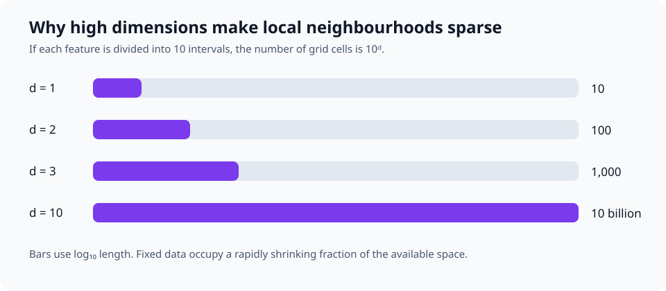
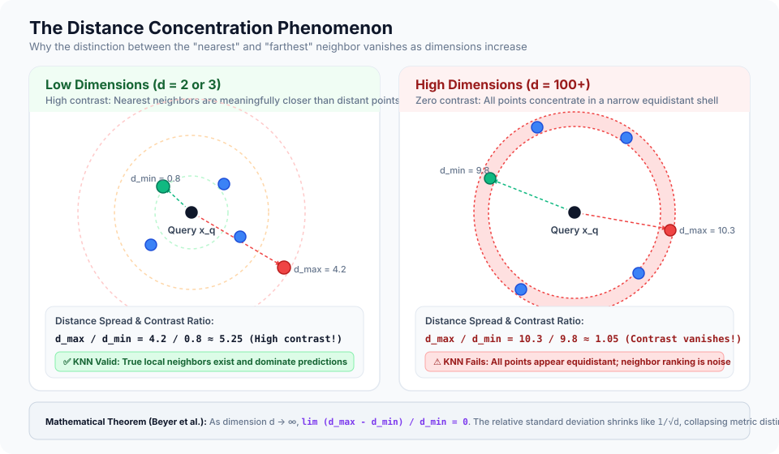
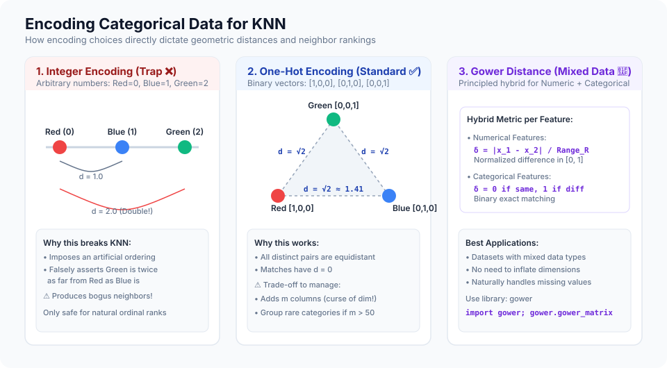
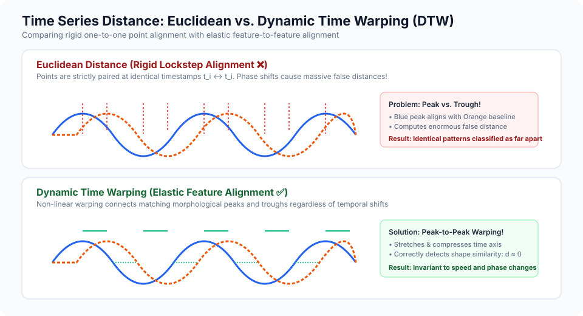
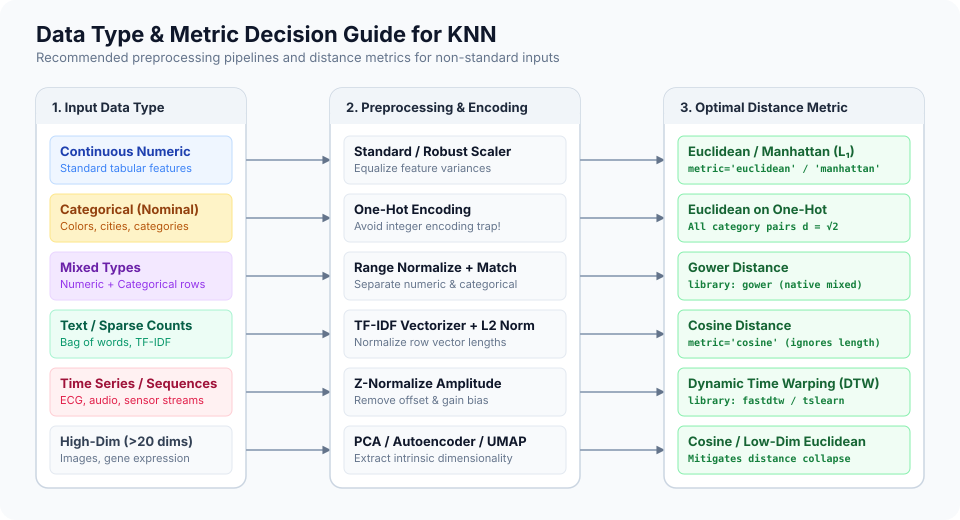

# KNN Limitations: Curse of Dimensionality and Special Data Types

## Table of Contents

- [Part 1: Curse of Dimensionality](#part-1-curse-of-dimensionality)
  - [1.1 Volume Grows Exponentially](#11-volume-grows-exponentially)
  - [1.2 Distance Concentration](#12-distance-concentration)
  - [1.3 Not Every Large D Is Equally Harmful: Ambient vs. Intrinsic Dimension](#13-not-every-large-d-is-equally-harmful-ambient-vs-intrinsic-dimension)
  - [1.4 Remedies](#14-remedies)
- [Part 2: Categorical, Binary, Missing, and Mixed Data](#part-2-categorical-binary-missing-and-mixed-data)
  - [2.1 Why Ordinary Integer Encoding Is Dangerous](#21-why-ordinary-integer-encoding-is-dangerous)
  - [2.2 One-Hot Encoding](#22-one-hot-encoding)
  - [2.3 Ordinal Features](#23-ordinal-features)
  - [2.4 Mixed Numeric and Categorical Features](#24-mixed-numeric-and-categorical-features)
  - [2.5 Missing Values](#25-missing-values)
  - [2.6 Text and Sparse Vectors](#26-text-and-sparse-vectors)
  - [2.7 Time Series and Sequences](#27-time-series-and-sequences)
- [Summary: Choosing Your Distance Metric](#summary-choosing-your-distance-metric)
- [Related Chapters in This Series](#related-chapters-in-this-series)

---

## Part 1: Curse of Dimensionality

- KNN relies on the fundamental assumption that points that are ***close in feature space*** have ***similar target values***. As dimensionality grows, this assumption deteriorates because neighborhoods stop being meaningfully ***local***. In high dimensions, data becomes exponentially sparse, and all pairwise distances tend to concentrate around a common average scale, undermining the very concept of a "nearest" neighbor.
> [!NOTE]
> The key insight is that in high dimensions, all points become roughly equidistant from each other, making the concept of "nearest" neighbors less meaningful.
### 1.1 Volume Grows Exponentially

To understand the geometry of high-dimensional space, consider an idealized model: a ***unit hypercube*** $[0,1]^d$ with ***uniformly distributed*** data.

A smaller axis-aligned hypercube of side length $r$ centered on a query point occupies the fraction:

$$\boxed{V = r^d}$$

of the total volume. To capture a target fraction $f \in (0, 1)$ of the data, the required side length of the neighborhood must be:

$$\boxed{r = f^{1/d}}$$

#### Example: Capturing 10% of Uniformly Spread Data

Suppose we wish to define a neighborhood containing just $10\%$ of our dataset ($f = 0.1$):

| Dimension $d$ | Required Side Length $r = 0.1^{1/d}$ | Geometric Interpretation |
|---:|---:|---|
| 1 | $0.100$ | ***Small, truly local neighborhood*** (10% of the line) |
| 2 | $0.316$ | Reasonably local window |
| 5 | $0.631$ | Spans over 63% of each feature's range |
| 10 | $0.794$ | Spans nearly 80% of each coordinate axis |
| 100 | $0.977$ | ***Almost entire feature range*** ($97.7\%$) |

> [!IMPORTANT]
> **Geometric Insight:** In 100 dimensions, a hypercube enclosing merely ***10% of uniformly distributed points*** must span $97.7\%$ of every single feature's range! What was intended to be a "local" neighborhood has become essentially ***global***. The query point's neighbors are no longer genuinely close to it along any individual coordinate.

> [!NOTE]
> **Assumption Qualification:** This exponential volume formula assumes data is uniformly distributed across the unit hypercube. It serves as a pure geometric baseline to illustrate why empty space explodes. In real-world datasets, data points are rarely uniformly distributed; they often concentrate along lower-dimensional manifolds or clusters.

#### Visualization

<div align="center">



</div>

If we partition each feature axis into just ***10 discrete intervals***, the total number of sub-cells in the space is $10^d$:
- In $d = 2$: $10^2 = 100$ cells (easily populated with moderate sample size)
- In $d = 10$: $10^{10} = 10,000,000,000$ cells (mostly completely empty)
- In $d = 100$: $10^{100}$ cells (vastly exceeds the number of atoms in the observable universe)

To maintain constant neighborhood sample density as dimension $d$ increases, the required sample size $n$ must grow ***exponentially***: $n = \mathcal{O}(c^d)$.

---

### 1.2 Distance Concentration

In high-dimensional spaces, a phenomenon known as ***distance concentration*** (formalized by Beyer et al., 1999) causes the contrast between nearest and farthest neighbors to vanish.

#### Mathematical Explanation

Consider two independent points $\mathbf{X}, \mathbf{Z} \in \mathbb{R}^d$. Under the assumption that the individual feature differences $(X_j - Z_j)^2$ are independent (or weakly correlated) random variables with comparable finite means and variances, the squared Euclidean distance is a sum of $d$ terms:

$$\boxed{D^2 = \sum_{j=1}^{d}(X_j - Z_j)^2}$$

By the ***Central Limit Theorem*** and the ***Law of Large Numbers***:
- **Expected Squared Distance:** $\mathbb{E}[D^2] = \sum_{j=1}^d \mathbb{E}[(X_j - Z_j)^2] \propto d$ (grows linearly with $d$)
- **Standard Deviation:** $\sigma(D^2) \propto \sqrt{d}$ (grows sub-linearly with $\sqrt{d}$)
- **Relative Variance / Contrast:**

$$\boxed{\frac{\sigma(D^2)}{\mathbb{E}[D^2]} \propto \frac{\sqrt{d}}{d} = \frac{1}{\sqrt{d}} \xrightarrow[d \to \infty]{} 0}$$

As dimensionality $d$ increases, the distribution of pairwise distances becomes tightly peaked around its mean relative to its scale. Formally:

$$\lim_{d \to \infty} \frac{D_{\max} - D_{\min}}{D_{\min}} = 0$$

> [!WARNING]
> When relative distance contrast approaches zero, the ***nearest neighbor is almost as far away as the farthest neighbor*** ($D_{\max} \approx D_{\min}$). Distances cluster around a single common value, making nearest-neighbor rankings highly sensitive to small perturbations, measurement noise, and irrelevant features.

#### When Distance Concentration Occurs (and When It Does Not)

- **Concentration is severe when:** Dimensions represent independent or weakly correlated features with similar variance (e.g., adding many uninformative noise features).
- **Concentration is mitigated when:** Features are highly correlated, when data lies on a low-dimensional manifold, or when data is concentrated in discrete, well-separated clusters.

#### Practical Consequence for KNN

1. **Unstable Rankings:** A tiny amount of sensor or measurement noise in a few features can completely flip which sample is retrieved as the 1st versus 20th neighbor.
2. **Degraded Voting:** In uniform voting, neighbors that are technically "nearest" may actually be nearly as distant as random training points, leading to noisy predictions.
3. **Distance Weighting Breakdown:** In distance-weighted KNN ($w_i = 1/d_i$), if all distances $d_i$ are roughly equal, the weights collapse back to uniform weighting.

<div align="center">



</div>

---

### 1.3 Not Every Large D Is Equally Harmful: Ambient vs. Intrinsic Dimension

High dimensionality is not fatal by default. What matters is the ***intrinsic dimensionality*** of the data manifold, not the ***ambient dimensionality*** (the raw number of columns in your table).

- **Ambient Dimensionality ($d$):** The number of measured coordinates or feature columns.
- **Intrinsic Dimensionality ($d^*$):** The minimum number of independent variables or latent factors required to describe the underlying data without significant information loss ($d^* \ll d$).

```
Ambient Dimension: d = 10,000 pixels (High)
                │
                ▼
   Intrinsic Manifold: d* ≈ 5 to 10 latent factors (Low)
   (Subject Identity, Head Pose, Lighting Angle, Expression)
```

**Real-World Examples:**
- ***Images (e.g., Face Recognition):*** A $100 \times 100$ grayscale photo lives in an ambient space of $d = 10,000$ dimensions. However, natural faces do not fill this space randomly. Their meaningful variations are governed by a small number of physical degrees of freedom (head yaw/pitch, lighting direction, facial expression, identity). They lie near a **lower-dimensional non-linear manifold** ($d^* \approx 10\text{--}50$).
- ***Correlated Sensor Telemetry:*** 1,000 temperature sensors along a pipeline may have $d = 1,000$, but because fluid thermodynamics couples adjacent readings, the intrinsic dimensionality may only be $d^* \approx 3$.
- ***Noisy Tabular Data (The Dangerous Case):*** 50 completely uncorrelated, noisy features with low sample size ($n = 200$) can be far more destructive to KNN than 5,000 highly correlated gene-expression features.

> [!NOTE]
> Distinguish between ***ambient dimensionality*** (raw column count) and ***intrinsic dimensionality*** (effective degrees of freedom). If the data manifold is intrinsically low-dimensional, appropriate projection or representation learning allows KNN to succeed even when raw $d$ is in the thousands.

---

### 1.4 Remedies

When facing the curse of dimensionality, apply these practical remedies:

1. ***Remove Irrelevant or Redundant Features*** — Uninformative noise features linearly inflate Euclidean distance variance without adding predictive signal, directly triggering distance concentration. Use domain expertise or mutual information filtering.
2. ***Use Domain-Informed Representations*** — Engineer compact summary features that capture semantic structure rather than feeding raw, high-dimensional observations.
3. ***Apply Dimensionality Reduction (PCA, UMAP, t-SNE)*** — Compress ambient dimensions into principal components:
   - *Linear:* PCA or TruncatedSVD.
   - *Non-linear:* Autoencoders, UMAP, or Isomap.
4. ***Use Pre-Trained Embeddings*** — Replace raw pixels or one-hot vocabulary vectors with dense embeddings from models trained on large datasets (e.g., Sentence-Transformers, ResNet/CLIP embeddings).
5. ***Try Fractional or Alternative Distance Metrics*** — Manhattan distance ($L_1$) and fractional metrics ($L_p$ with $p < 1$) suffer less from distance concentration than Euclidean ($L_2$) distance (Aggarwal et al., 2001). Cosine distance is effective for normalized directional data.
6. ***Collect More Training Data*** — While scaling $n$ exponentially to match ambient $d$ is impossible, increasing $n$ can adequately populate a lower-dimensional intrinsic manifold.
7. ***Compare with Alternative Model Families*** — If ambient dimensions cannot be compressed, evaluate models that natively handle high dimensions (e.g., L1-regularized Logistic Regression, ElasticNet, LightGBM, or linear SVMs).

> [!IMPORTANT]
> **Data Leakage Warning:** PCA preserves ***directions of maximum variance***, which are not necessarily the directions predictive of your target variable $y$. Any supervised feature selection or dimensionality reduction **must be fitted strictly inside cross-validation folds** (e.g. via `sklearn.pipeline.Pipeline`) to prevent data leakage into validation folds.

---

## Part 2: Categorical, Binary, Missing, and Mixed Data

KNN's mathematical foundation rests entirely on computing geometric distances between vectors. Standard distance metrics (Euclidean, Manhattan) implicitly assume that features are continuous, metric-scaled, and commensurable. Applying KNN to categorical, ordinal, missing, or mixed-type data requires deliberate encoding strategies.

### 2.1 Why Ordinary Integer Encoding Is Dangerous

Encoding ***nominal categorical features*** as arbitrary integers (e.g. `LabelEncoder`) introduces an artificial ordering and a fictitious Euclidean geometry that does not exist in the real world.

#### Example: Nominal Color Feature

Assigning integers to unordered colors:
$$\text{Red} = 0, \quad \text{Blue} = 1, \quad \text{Green} = 2$$

Under Euclidean distance:
$$d(\text{Red}, \text{Blue}) = |0 - 1| = 1$$
$$d(\text{Red}, \text{Green}) = |0 - 2| = 2$$
$$d(\text{Blue}, \text{Green}) = |1 - 2| = 1$$

This encoding falsely asserts to KNN that:
1. Colors possess a natural linear ordering: $\text{Red} < \text{Blue} < \text{Green}$.
2. Green is ***twice as far*** from Red as Blue is.
3. Blue is the "intermediate" compromise between Red and Green.

> [!CAUTION]
> For nominal (unordered) categories, integer encoding creates fictitious spatial relationships that corrupt nearest-neighbor rankings. KNN will find neighbors based on meaningless numerical proximity.

---

### 2.2 One-Hot Encoding

***One-hot encoding*** converts each category into a binary indicator column $[0, 1]$, treating all distinct categories as mutually orthogonal.

#### How It Works

For a categorical feature with $m$ unique levels:

| Color Level | Red Column ($x_{\text{red}}$) | Blue Column ($x_{\text{blue}}$) | Green Column ($x_{\text{green}}$) |
|---|:---:|:---:|:---:|
| **Red Sample** | 1 | 0 | 0 |
| **Blue Sample** | 0 | 1 | 0 |
| **Green Sample** | 0 | 0 | 1 |

#### Distance Properties

When computing Euclidean distance between two samples over these one-hot columns:
- **Same Category (e.g. Red vs. Red):**
  $$d = \sqrt{(1-1)^2 + (0-0)^2 + (0-0)^2} = 0$$
- **Different Categories (e.g. Red vs. Green):**
  $$d = \sqrt{(1-0)^2 + (0-0)^2 + (0-1)^2} = \sqrt{1 + 0 + 1} = \sqrt{2} \approx 1.414$$

Under Manhattan distance ($L_1$), the distance between any two distinct categories is $1 + 1 = 2$.

#### Pros and Cons

**Advantages:**
- Eliminates artificial ordering: every pair of distinct categories is equidistant ($\sqrt{2}$).
- Directly compatible with standard Euclidean and Manhattan metrics.

**Nuances & Disadvantages:**
- **Dimensionality Expansion:** High-cardinality features (e.g. Zip Code with 500 categories) inject 500 sparse dimensions, directly aggravating the curse of dimensionality.
- **Relative Distance Weight:** Because different categories always differ by $\sqrt{2}$, an unscaled one-hot categorical feature can exert more influence on Euclidean distance than a continuous feature with small variance.
- **Sparsity:** Produces sparse vectors where tree-based spatial indexes (KD-trees) degrade to brute-force search.

> [!TIP]
> When one-hot encoding categorical variables alongside numeric features, use `handle_unknown='ignore'` in scikit-learn's `OneHotEncoder` to prevent pipeline crashes during inference on unseen categories, and scale numerical features so their typical distances align with the $\sqrt{2}$ categorical penalty.

<div align="center">



</div>

---

### 2.3 Ordinal Features

***Ordinal features*** represent categories with a genuine, intrinsic ranking (e.g. Education Level, Customer Satisfaction, Severity Tier).

#### When Equal Integer Spacing Is Acceptable

Mapping ordered categories to evenly spaced integers ($1, 2, 3, \dots$) is valid **only when the perceptual or physical intervals between consecutive levels are roughly uniform**:
- **Likert Scale:** 1-Star, 2-Star, 3-Star, 4-Star, 5-Star $\to [1, 2, 3, 4, 5]$
- **T-Shirt Sizes:** Small, Medium, Large, X-Large $\to [1, 2, 3, 4]$

#### When Equal Integer Spacing Fails

When the difficulty, value, or physical gap between consecutive tiers is non-uniform, standard integer mapping distorts distance:
- **Education Level:** High School ($1$), Bachelor's ($2$), Master's ($3$), Ph.D. ($4$).
  - Is the educational distance from High School to Bachelor's ($4$ years) truly equal to Master's to Ph.D.?
- **Credit Risk Tiers:** Low ($1$), Medium ($2$), High ($3$), Default/Critical ($4$).
  - The jump from High to Default often reflects a catastrophic non-linear risk escalation.

> [!IMPORTANT]
> If the interval between levels is non-linear, use **domain-calibrated numerical scores** (e.g., mapping education to expected years of schooling: $[12, 16, 18, 22]$) or treat the feature with target encoding inside cross-validation.

---

### 2.4 Mixed Numeric and Categorical Features

Real-world tabular data frequently combines continuous numerical features (Age, Income, Blood Pressure) with categorical features (Gender, Smoker Status, City).

#### Strategies for Mixed Data

1. **Standardize and One-Hot (Common Baseline):**
   - Impute missing values.
   - Scale numeric features using `StandardScaler` or `RobustScaler`.
   - One-hot encode nominal categories.
   - Combine with `ColumnTransformer` inside a scikit-learn `Pipeline`.
2. ***Gower's General Dissimilarity Coefficient***:
   - Specifically designed for heterogeneous records combining continuous, ordinal, nominal, and binary features.
3. **Task-Specific Metric Learning:**
   - Learn a Mahalanobis distance metric matrix $\mathbf{M}$ using Large Margin Nearest Neighbor (LMNN) or Neighborhood Components Analysis (NCA).

#### Gower Distance Formulation

***Gower distance*** calculates the pairwise dissimilarity $D_{il} \in [0, 1]$ between observation vector $\mathbf{x}_i$ and $\mathbf{x}_l$:

$$\boxed{D_{il} = \frac{\sum_{j=1}^{d} w_j \cdot s_{ijl} \cdot \delta_{ijl}}{\sum_{j=1}^{d} w_j \cdot s_{ijl}}}$$

**Where:**
- $w_j \ge 0$ is the domain-assigned weight for feature $j$ (defaults to $1.0$).
- $s_{ijl} \in \{0, 1\}$ is an ***availability indicator***: $s_{ijl} = 1$ if feature $j$ is observed for both rows $i$ and $l$; $s_{ijl} = 0$ if missing in either row.
- $\delta_{ijl} \in [0, 1]$ is the feature-level dissimilarity score:

**1. For Continuous Numeric Features:**
$$\delta_{ijl} = \frac{|x_{ij} - x_{lj}|}{R_j}$$
where $R_j = \max(X_j) - \min(X_j)$ is the empirical range of feature $j$ in the training set.

> [!CAUTION]
> **Zero-Range Edge Case:** If a numeric feature is constant across the training set ($R_j = 0$), division by zero occurs. Constant features must either be filtered out during preprocessing or assigned $\delta_{ijl} = 0$.

**2. For Nominal Categorical Features:**
$$\delta_{ijl} = \begin{cases} 0 & \text{if } x_{ij} = x_{lj} \text{ (exact match)} \\ 1 & \text{if } x_{ij} \neq x_{lj} \text{ (mismatch)} \end{cases}$$

**3. For Binary Features:**
- Symmetric binary (e.g. Gender): matched = $0$, mismatched = $1$.
- Asymmetric binary (e.g. rare disease symptom present): mutual absence ($0-0$) sets $s_{ijl} = 0$ so it does not falsely count as a positive similarity.

---

### 2.5 Missing Values

Standard distance functions cannot compute $\sqrt{\sum (x_j - z_j)^2}$ when coordinates contain `NaN` or `null`.

#### Comparison of Handling Strategies

| Strategy | Mechanism | Key Advantage | Key Pitfall / Nuance |
|---|---|---|---|
| ***Median / Mode Imputation*** | Fill missing numeric with median; categorical with mode | Simple; maintains fixed dimensionality | Distorts variance; assumes data is ***Missing Completely at Random (MCAR)*** |
| ***Missingness Indicator Column*** | Impute value + add binary flag `is_missing_j` | Captures ***Missing Not at Random (MNAR)*** | Doubles feature count; adds sparse dimensions |
| ***Distance on Jointly Observed Features*** | Compute distance only over mutually non-missing features | Avoids inventing synthetic imputed values | **Requires normalization** by observed dimension count |
| ***KNN Imputer (`KNNImputer`)*** | Fills missing cells using nearest complete neighbors | Retains feature correlations | Expensive $\mathcal{O}(n^2)$; risk of circular dependency |

> [!WARNING]
> **Normalization Requirement for Jointly Observed Distances:**
> If row pair $(A, B)$ shares only $2$ features while pair $(A, C)$ shares $10$ features, raw Euclidean distance on $(A, B)$ will almost always be smaller simply because fewer terms are summed!
> To compare distances fairly, you must normalize by the fraction of observed overlap:
> 
> $$D_{\text{normalized}}(A, B) = \sqrt{\frac{d_{\text{total}}}{d_{\text{observed}}}} \cdot D_{\text{raw}}(A, B)$$

> [!IMPORTANT]
> **Leakage Rule:** All imputation statistics (medians, modes, ranges) must be calculated strictly from the **training folds** inside cross-validation. Computing imputation metrics over the full dataset before splitting leaks ground-truth target and feature distributions into the validation evaluation.

---

### 2.6 Text and Sparse Vectors

Text documents are commonly vectorized into high-dimensional vocabulary spaces ($d \approx 10,000\text{--}100,000$).

#### Why Raw Word Counts + Euclidean Distance Fails

Using raw term frequencies with Euclidean distance severely biases neighbor selection:
1. **Document Length Distortion:** A 5,000-word essay and a 100-word summary discussing the exact same topic will have widely different term counts. Euclidean distance between them will be massive purely due to document length.
2. **Stopword Dominance:** Frequent, uninformative words ("the", "is", "at") dominate Euclidean distance sums.

#### Solution: TF-IDF + Cosine Distance

To handle text correctly:
1. Apply ***TF-IDF Transformation*** (Term Frequency–Inverse Document Frequency) to downweight ubiquitous words and highlight informative terms.
2. Use ***L2 Vector Normalization*** ($\|\mathbf{x}\|_2 = 1$), which projects all documents onto the unit hypersphere, making distance independent of document length.

```
       Cosine Similarity:  cos(θ) = (u · v) / (||u|| ||v||)  ∈ [0, 1]
                                      │
                                      ▼
       Cosine Distance:    d_cos(u, v) = 1 - cos(θ)          ∈ [0, 1]
```

> [!IMPORTANT]
> **Cosine Similarity vs. Cosine Distance:**
> - ***Cosine Similarity*** measures directional alignment: $\text{sim}(\mathbf{u}, \mathbf{v}) = \frac{\mathbf{u} \cdot \mathbf{v}}{\|\mathbf{u}\|_2 \|\mathbf{v}\|_2}$. Higher values mean greater similarity ($1.0 = \text{identical}$).
> - Nearest-neighbor search algorithms require a **distance / dissimilarity metric** (where $0.0 = \text{identical}$). In KNN libraries, use ***Cosine Distance***:
> 
> $$\boxed{d_{\cos}(\mathbf{u}, \mathbf{v}) = 1 - \frac{\mathbf{u} \cdot \mathbf{v}}{\|\mathbf{u}\|_2 \|\mathbf{v}\|_2}}$$
> 
> For L2-normalized vectors ($\|\mathbf{u}\|_2 = \|\mathbf{v}\|_2 = 1$), squared Euclidean distance is directly proportional to cosine distance: $D_{\text{Euclidean}}^2 = 2(1 - \cos(\theta)) = 2 \cdot d_{\cos}(\mathbf{u}, \mathbf{v})$.

#### Indexing High-Dimensional Sparse Text

Standard spatial trees (KD-trees, Ball-trees) collapse in $d > 50$ sparse text spaces. For large-scale text KNN:
- Use inverted indexes (e.g. BM25 / Lucene).
- Use Approximate Nearest Neighbor (ANN) vector search indexes (e.g. HNSW, FAISS, ScaNN).

---

### 2.7 Time Series and Sequences

Standard distance metrics compare observations coordinate-by-coordinate: point $x_t$ is strictly paired with point $z_t$. In temporal data, this ***lock-step alignment*** often fails.

#### Aligned vs. Unaligned Time Series

1. **Strictly Synchronized Sequences (Aligned):**
   - Features represent fixed timestamps or sensor channels synchronized to an external clock (e.g. hourly temperature across 24 hours).
   - Standard **Euclidean ($L_2$) or Manhattan ($L_1$) distance** is computationally efficient and appropriate.
2. **Phase-Shifted or Variable-Speed Sequences (Unaligned):**
   - Two heartbeats (ECG) or speech audio waveforms may represent the exact same biological or acoustic pattern, but one occurred faster, slower, or with a slight time delay.
   - Euclidean distance matches peaks with troughs, yielding falsely massive distances.

<div align="center">



</div>

#### Dynamic Time Warping (DTW)

DTW solves phase distortion by finding an optimal non-linear warping path between time series $\mathbf{X} = (x_1, \dots, x_n)$ and $\mathbf{Y} = (y_1, \dots, y_m)$ that minimizes the cumulative distance:

$$\boxed{\text{DTW}(\mathbf{X}, \mathbf{Y}) = \min_{\pi} \sum_{(i,\,j)\,\in\,\pi} d(x_i,\, y_j)}$$

where $\pi = \bigl((i_1,j_1),\dots,(i_K,j_K)\bigr)$ is a ***warping path*** through the $n \times m$ cost grid, $d(x_i, y_j) = |x_i - y_j|$ is the pointwise cost, and the path must start at $(1,1)$, end at $(n,m)$, and advance by at most one step per dimension at each step.

#### Essential DTW Considerations & Constraints

1. **Pathological Warping:** Unconstrained DTW can over-align unrelated time series by stretching a single point in $\mathbf{X}$ to match an entire multi-point section of $\mathbf{Y}$ (singular alignment).
2. **Warping Windows (Sakoe-Chiba / Itakura):** Enforce a maximum allowable time lag $w$ ($|i - j| \le w$) so alignment cannot wander unrealistically far from the diagonal.
3. **Computational Complexity:**
   - Standard Euclidean distance: $\mathcal{O}(T)$ where $T$ is sequence length.
   - Standard DTW: $\mathcal{O}(T^2)$ dynamic programming cost per pair.
   - For a dataset of $n$ sequences, all-pairs DTW requires $\mathcal{O}(n^2 T^2)$, making exact KNN slow for long sequences without lower bounding (e.g., LB_Keogh) or fast approximations (FastDTW).
4. **Search Tree Incompatibility:** DTW does not strictly obey the triangle inequality; therefore, standard metric trees (KD-tree, Ball tree) cannot be used directly without specialized bounding envelopes.

---

## Summary: Choosing Your Distance Metric

<div align="center">



</div>

| Data Type | Primary Recommended Approach | Metric / Formulation | Practical Considerations & Caveats |
|---|---|---|---|
| **Continuous Numeric (Low $d \le 20$)** | Standardize or Robust-scale | Euclidean ($L_2$) or Manhattan ($L_1$) | Always scale features (`RobustScaler` if outliers exist); check distributions |
| **High-Dimensional Numeric ($d > 50$)** | Dimensionality reduction + Metric tuning | Manhattan ($L_1$) or Cosine distance | Apply PCA/UMAP first; Euclidean contrasts deteriorate via distance concentration |
| **Nominal Categorical Only** | One-Hot Encoding | Hamming distance or One-hot Euclidean | Watch cardinality; group rare levels into `'Other'` to prevent dimensional explosion |
| **Ordinal Categorical** | Domain-scored integer mapping | Manhattan distance ($L_1$) | Only use integer spacing if intervals are genuinely uniform; otherwise use custom score |
| **Mixed Numeric + Categorical** | Gower Distance / Pipeline | Gower Dissimilarity or ColumnTransformer | Handle constant features ($R_j = 0$); normalize scales between dummy and continuous features |
| **Text / High-Dimensional Sparse** | TF-IDF or Neural Embeddings | Cosine Distance: $d = 1 - \cos(\theta)$ | Normalize to unit length; use sparse matrices and ANN search (HNSW/FAISS) |
| **Synchronized Time Series** | Standard normalization | Euclidean ($L_2$) distance | Ensure uniform sample rates, identical lengths, and common origin |
| **Phase-Shifted Time Series** | Dynamic Time Warping (DTW) | DTW with Sakoe-Chiba constraint window | Constrain warping window to prevent pathological matches; use LB_Keogh for acceleration |

---

## Related Chapters in This Series

- [01 KNN Algorithm and Working Step-by-Step..md](./01%20KNN%20Algorithm%20and%20Working%20Step-by-Step..md) — Core mechanics, mathematical formulation, and nearest neighbor search
- [02 Distance Metrics.md](./02%20Distance%20Metrics.md) — Exhaustive analysis of Euclidean, Manhattan, Minkowski, Mahalanobis, and Cosine metrics
- [03 How to Choose K in KNN: Bias, Variance and Validation.md](./03%20How%20to%20Choose%20K%20in%20KNN%3A%20Bias%2C%20Variance%20and%20Validation.md) — Tuning $k$, bias-variance trade-off, and cross-validation strategies
- [05 Feature scaling and preprocessing.md](./05%20Feature%20scaling%20and%20preprocessing.md) — Comprehensive guide to StandardScaler, MinMaxScaler, RobustScaler, and leakage prevention
- [08 Weighted KNN.md](./08%20Weighted%20KNN.md) — Inverse-distance weighting and Gaussian kernel weighting schemes
- [10 Search algorithms and computational complexity.md](./10%20Search%20algorithms%20and%20computational%20complexity.md) — KD-Trees, Ball Trees, Hierarchical Navigable Small World (HNSW), and ANN
- [11 End-to-End KNN Modelling Workflow.md](./11%20End-to-End%20KNN%20Modelling%20Workflow.md) — Complete production workflow from split, pipeline encapsulation, OOD detection, to deployment
- [13 Class imbalance, ties, and edge cases.md](./13%20Class%20imbalance%2C%20ties%2C%20and%20edge%20cases.md) — Handling skewed classes, distance ties, and boundary anomalies

---

<p align="center">
  ⬅️ <strong>Previous:</strong> <a href="./08.1%20Weighted%20KNN%20notebook.ipynb">08.1 Weighted KNN notebook</a> &nbsp;&nbsp;|&nbsp;&nbsp; <strong>Next:</strong> <a href="./10%20Search%20algorithms%20and%20computational%20complexity.md">10 Search algorithms and computational complexity</a> ➡️
</p>

