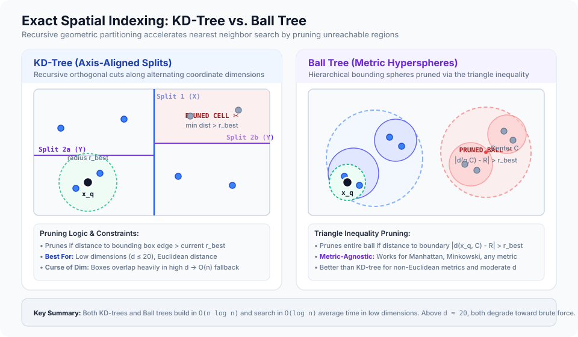
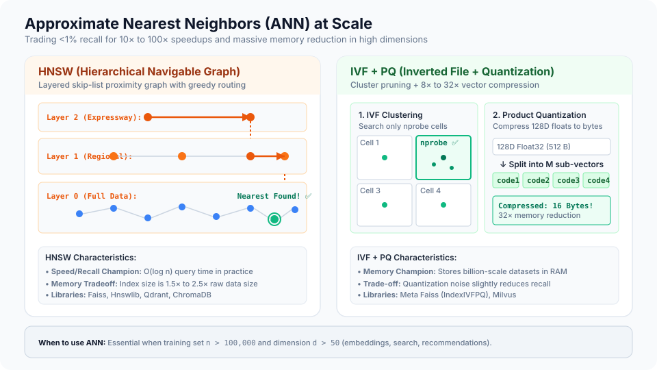
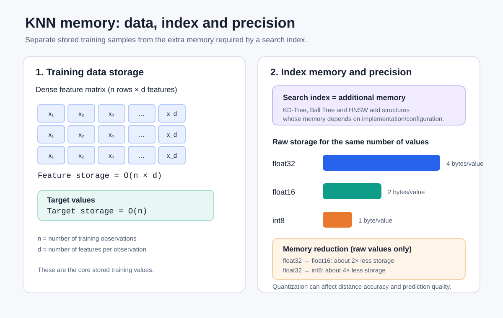
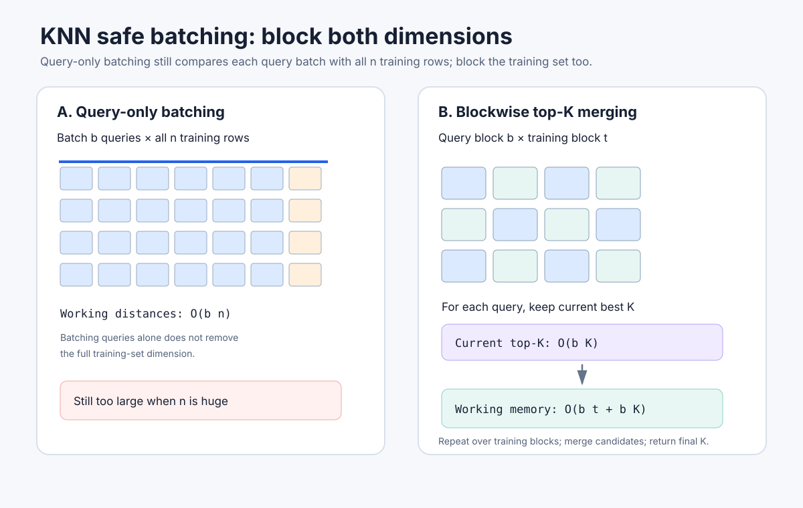
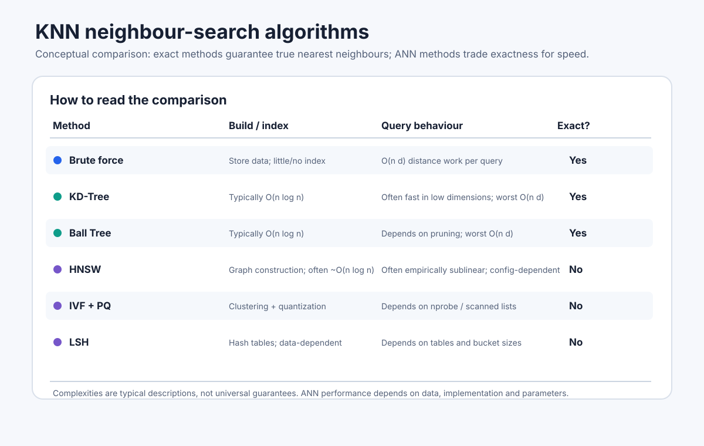
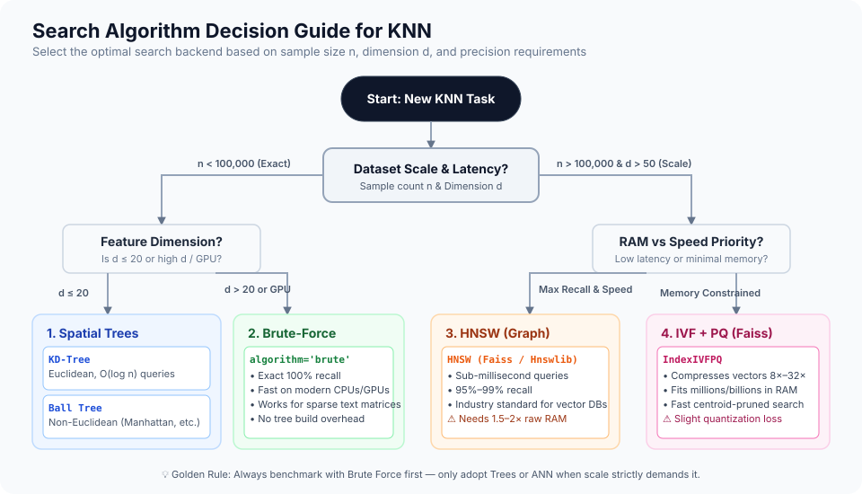
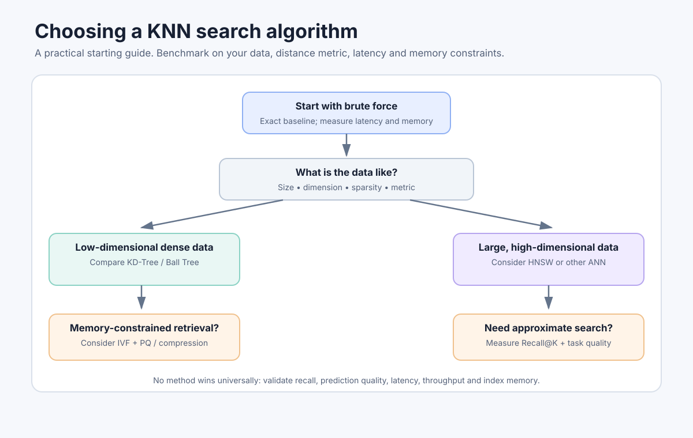

# Search Algorithms and Computational Complexity in KNN

## Table of Contents

- [1. Notation](#1-notation)
- [2. Brute-Force Exact Search](#2-brute-force-exact-search)
- [3. KD-Tree](#3-kd-tree)
  - [3.1 Branch Pruning: The Core Optimization Strategy](#31-branch-pruning-the-core-optimization-strategy)
  - [3.2 Triangle Inequality Pruning](#32-triangle-inequality-pruning)
- [4. Ball Tree](#4-ball-tree)
- [5. Approximate Nearest Neighbours (ANN)](#5-approximate-nearest-neighbours-ann)
- [6. Index / Search Hyperparameters](#6-index--search-hyperparameters)
- [7. Memory Considerations](#7-memory-considerations)
- [8. Safe Batching](#8-safe-batching)
  - [What is Safe Batching?](#what-is-safe-batching)
- [9. Complexity Comparison Table](#9-complexity-comparison-table)
- [10. When to Use Which Algorithm](#10-when-to-use-which-algorithm)
- [11. Important Topics for Advanced KNN Systems](#11-important-topics-for-advanced-knn-systems) — ⚠️ ***Subject to future updates***
  - [Exact versus Approximate Search](#exact-versus-approximate-search)
  - [Recall@K: Measuring ANN Retrieval Quality](#recall@k-measuring-ann-retrieval-quality)
  - [Exact Reranking: Combining ANN with Exact Search](#exact-reranking-combining-ann-with-exact-search)
  - [Intrinsic Dimensionality](#intrinsic-dimensionality)
  - [Query Latency versus Throughput](#query-latency-versus-throughput)
  - [Index Build Time and Update Cost](#index-build-time-and-update-cost)
- [12. Document Improvement Checklist](#12-document-improvement-checklist) — ⚠️ ***Subject to future updates***

---

## 1. Notation

Let:

- $n$ = training set size
- $d$ = feature dimension
- $m$ = number of query points

All complexities below are in terms of these three quantities.

---

## 2. Brute-Force Exact Search

***Brute-force search*** computes the distance from every query point to every training point — no shortcuts, no hierarchical tree, and no graph index.

### Cost Breakdown

| Operation | Complexity | Implementation Details |
|---|---|---|
| **Storage (dense features)** | $O(nd)$ | Stores full feature matrix in memory |
| **Model fit / initialization** | $O(1)$ to $O(nd)$ | $O(1)$ if storing a reference/pointer; $O(nd)$ if validating or copying array |
| **Distance calculation (1 query)** | $O(nd)$ | Compares query vector against all $n$ samples across $d$ features |
| **Full distance sorting to find K nearest neighbors** | $O(n \log n)$ | Sorts all $n$ distances completely (unnecessary waste) |
| **Bounded Max-Heap selection** | $O(n \log K)$ | Maintains a size-$K$ heap; processes streaming distances with $O(K)$ RAM |
| **Partial selection (Quickselect/faster)** | $O(n)$ average | Partitioning via `np.partition` / Introselect |
| **Total cost per query** | $O(nd + n \log K)$ | Distance calculation + top-$K$ selection |
| **Total batch prediction ($m$ queries)** | $O(mnd + mn \log K) \approx O(mnd)$ | Dominant cost is distance computation since $d \ge 1$ |

> [!NOTE]
> **Total Prediction Cost Breakdown:**
> The full prediction cost for $m$ query points consists of two distinct phases:
> 
> $$\text{Total Cost} = \underbrace{O(mnd)}_{\text{Distance Computation}} + \underbrace{O(mn \log K)}_{\text{Top-}K\text{ Selection (Heap)}} \quad \text{or} \quad \underbrace{O(mnd + mn)}_{\text{Quickselect}}$$
> 
> Because feature dimension $d \ge 1$ and typically $K \ll n$, the distance calculation term $O(mnd)$ asymptotically dominates the selection term $O(mn)$. For this reason, computational complexity in machine learning literature is standardly simplified to **$O(mnd)$**.

> [!TIP]
> **Model "Fit" Nuance:** In brute-force KNN, there is no spatial tree to construct. The `fit(X, y)` method is essentially an $O(1)$ pointer assignment if passing a contiguous array. It only takes $O(nd)$ time if the framework creates a defensive deep-copy or validates contiguous C-ordering (e.g. `np.ascontiguousarray`).

**When brute-force wins:**

> [!TIP]
> Brute-force is ***simple, exact, vectorizable***, and often the ***best practical choice*** for:
> - Modest $n$ (a few thousand to tens of thousands)
> - High $d$ (tree structures degrade; brute-force does not)
> - ***Sparse matrices*** (skip zero-valued entries efficiently)
> - ***GPU acceleration*** (massive parallelism for matrix operations)
> - ***Large query batches*** (optimized BLAS routines dominate)

---

## 3. KD-Tree

- A ***KD-tree*** (k-dimensional tree) ***recursively partitions*** the training points using ***axis-aligned splits*** at the median of each chosen dimension.

**How it works:**

1. At each node, split along the dimension with the **greatest spread**
2. **Recurse** on **left** and **right** halves
3. At query time, use ***lower bounds on distance*** to **prune branches** that cannot contain a **closer neighbour**

**Step 1 — Space Partitioning:** Each split divides the feature space with an ***axis-aligned hyperplane***. The image below shows a 2D example — first a vertical split at $x=5$, then horizontal splits within each half:

**Step 2 — Tree Structure:** Each split becomes a node in the tree. Points end up as ***leaf nodes***. The root splits on $x$, its children split on $y$, grandchildren split on $x$ again — ***alternating dimensions***:

**Step 3 — General Construction Example:** A larger, complete example showing how a full KD-tree is ***recursively constructed*** from a dataset, with all levels visible:

**Complexity:**

| Operation | Complexity |
|---|---|
| Construction | $O(n \log n)$ |
| Average query (low $d$) | $O(\log n)$ |
| Worst-case query | $O(n)$ |

> [!WARNING]
> KD-tree performance ***degrades sharply with dimension***. In **high dimensions**, the **bounding boxes** become large and **overlap heavily** — **pruning** stops working, and the search reverts toward **brute-force**. As a rule of thumb, KD-trees are effective only when $d \lesssim 20$.

**Why it degrades:**

- **Axis-aligned splits** create **bounding hyperrectangles**
- In **high dimensions**, every hyperrectangle is close to every **query point**
- **Pruning condition fails** → nearly all **branches** are explored

---

## 3.1 Branch Pruning: The Core Optimization Strategy

- At the heart of tree-based search lies ***pruning*** — the **strategic elimination** of **entire regions** without examining every point inside them.

### What is Pruning?

***Pruning*** means ***cutting away branches of the search space*** using **mathematical guarantees** that the answer **cannot possibly lie** within that region:

- **Core idea:** Instead of examining every **training point**, eliminate **entire regions** that are **provably irrelevant**
- **Analogy:** Searching a store for **ice cream** — if an aisle is labelled **"Electronics"**, **skip it entirely** without checking any shelf
- **Guarantee:** Pruning is only valid when **math** can **prove** the skipped region contains **no closer neighbour**

**Why it matters:**

| Scenario | Cost |
|---|---|
| **Brute force** (no pruning) | Check all $n = 1{,}000{,}000$ points → $1{,}000{,}000$ distance calculations |
| **With pruning** | Skip 99% of points using guarantees → only $10{,}000$ distance calculations |
| **Speedup** | 100× faster ✂️ |

### Pruning in KD-Trees: Lower Bound on Distance

In KD-trees, pruning uses a ***lower bound on distance*** to ***bounding boxes*** (***hyperrectangles***):

$$\text{min\_distance\_to\_box} = \text{distance to closest face of hyperrectangle}$$

**Pruning rule:** If `min_distance_to_box > current_k_th_nearest_distance`:

- Every point in this box is ***farther away*** than the current $k$-th nearest candidate
- ***Entire box is skipped*** — it **cannot improve** the top-$k$ list
- Pruning effectiveness depends on ***data distribution***, ***dimensionality***, and ***number of neighbours $k$***

The diagram below shows the full **5-step search process** — traversal to the leaf, checking candidates, backtracking, and pruning regions using the ***split-distance lower bound***:

The image below shows how the same construction relates to the nearest-neighbour candidate — highlighting which regions are searched and which are pruned:

### Why Pruning Fails in High Dimensions

In ***high-dimensional spaces***, axis-aligned bounding boxes become ***unavoidably large and overlapping***, making the lower bound ***weak***:

- ***Low dimension ($d=2$):*** Boxes are small and separated → effective pruning
- ***High dimension ($d=100$):*** Boxes are huge and nearly overlap → most boxes fail the pruning test → search approaches brute-force

---

## 3.2 Triangle Inequality Pruning

***Ball Trees*** use a different pruning strategy from KD-Trees, built on ***spheres*** and the ***triangle inequality***:

- **Core idea:** Organise training points into ***nested hyperspheres***; use geometry to skip entire ***balls*** that are too far away
- **Mathematical foundation:** For any three points $q$, $c$, $x$: $\;d(q, x) \geq d(q, c) - d(c, x)$
- **Minimum distance to a ball:** $d(q, c) - r$ — distance from query to ball center, minus ***ball radius*** $r$
- **Pruning rule:** If $d(q, c) - r > d_k$ (current $k$-th nearest), ***skip the entire ball*** ✂️
- **Requirement:** The metric must ***satisfy the triangle inequality*** — otherwise the pruning guarantee is **invalid**

> [!NOTE]
> See [Section 4 Ball Tree](#4-ball-tree) for the full derivation, worked numerical example, and list of valid vs. invalid metrics.

## 4. Ball Tree

A ***ball tree*** organizes training points into ***nested hyperspheres*** (balls) rather than axis-aligned boxes.

**Key difference from KD-tree:**

The distinction is not simply about metric support — both structures support non-Euclidean metrics. The real difference lies in their ***geometric organisation***:

- ***KD-Tree*** divides space using ***axis-aligned hyperrectangles***. In scikit-learn, `KDTree` supports: Euclidean, Manhattan, Chebyshev, and Minkowski distances.
- ***Ball Tree*** organises points into ***nested hyperspheres*** and supports a ***broader selection of metrics*** than KD-Tree — any metric that satisfies the ***triangle inequality*** qualifies.

**Visualization:** Ball Trees organize data into ***nested hyperspheres*** — concentric spheres with points grouped by proximity to a center:

### How Triangle Inequality Pruning Works

- Ball Trees use the ***triangle inequality*** to eliminate entire regions:

**Triangle Inequality (mathematical foundation):**

- For any three points $q$ (query), $c$ (***ball center***), and $x$ (any point inside the ball):

$$d(q, x) \geq d(q, c) - d(c, x)$$

- The ***minimum possible distance*** from query $q$ to any point in a ball with center $c$ and ***radius*** $r$ is:

$$\text{min\_distance} = d(q, c) - r$$

**Pruning rule:** If `min_distance_to_ball > current_k_th_nearest_distance`:

$$d(q, c) - r > d_k \implies \text{Prune entire ball}$$

- $d(q, c)$ = distance from ***query*** to ***ball center***
- $r$ = ***ball radius*** (maximum distance from center to any point inside the ball)
- $d_k$ = distance to ***current $k$-th nearest candidate*** (best threshold found so far)
- If the closest possible point in the ball is farther than the current best → ***skip the entire ball*** ✂️

**Worked Example:**

- Query $q$ at origin; ball centered at $c = (10, 0)$ with radius $r = 2$
- Current best distance: $d_k = 5$
- Minimum distance to any point in ball: $10 - 2 = 8$
- Since $8 > 5$: ***This ball cannot contain a top-$k$ neighbour*** → prune ✂️

### Why Triangle Inequality Matters

- The ***pruning guarantee works only when the distance metric satisfies the triangle inequality***:

$$d(a, c) + d(c, b) \geq d(a, b)$$

**Metrics that satisfy it:**
- ✅ ***Euclidean distance***
- ✅ ***Manhattan distance***
- ✅ ***Chebyshev distance***
- ✅ ***Minkowski distance*** ($L_p$ for $p \geq 1$)

**Metrics that violate it:**
- ❌ ***Cosine distance*** (on unnormalized vectors)
- ❌ ***Fractional norms*** ($L_p$ for $p < 1$)

> [!WARNING]
> If you use a metric that ***violates the triangle inequality***, Ball Tree's pruning guarantee **fails** — the algorithm may silently miss the true nearest neighbours.

**Complexity:**

| Operation | Complexity |
|---|---|
| Construction | $O(n \log n)$ |
| Average query | $O(\log n)$ (favorable cases) |
| Worst-case query | $O(n)$ |

> [!NOTE]
> Ball trees can outperform KD-trees for ***non-Euclidean metrics*** and ***moderately higher dimensions***, but they still suffer from ***weak pruning*** in truly high-dimensional spaces. Both tree structures share the same fundamental limitation: the curse of dimensionality erodes pruning efficiency.

---

## 5. Approximate Nearest Neighbours (ANN)

***Approximate Nearest Neighbour (ANN) methods*** trade exact retrieval guarantees for ***significantly faster search and scalable query latency***.

> [!NOTE]
> **Memory Trade-Off Nuance:**
> Speed improvements are universal across ANN methods, but **memory behavior varies fundamentally by indexing technique**:
> - **Graph-based indexes (HNSW):** Consume *additional* memory (often 1.5× to 3×+ the raw vector size) to store multi-layer graph adjacency lists.
> - **Quantization-based indexes (IVF + PQ):** Drastically *reduce* memory (often 4× to 16× compression) by encoding dense floating-point vectors into short quantized byte codes.
> - **Hash-based indexes (LSH):** Require additional memory to maintain multiple hash tables and collision buckets.

**Common ANN families:**

| Method | Core Idea | Memory Impact | Latency / Recall Profile |
|---|---|---|---|
| ***HNSW*** (Hierarchical Navigable Small World) | Graph-based multi-layer skip list; greedy traversal | ⚠️ Increases RAM (stores graph edges) | Industry standard; highest recall and speed |
| ***IVF + PQ*** (Inverted File + Product Quantization) | Coarse clustering into Voronoi cells; vector quantization | ✅ Drastically compresses RAM | High compression; slight loss in distance resolution |
| ***LSH*** (Locality-Sensitive Hashing) | Random projections hash similar points into same buckets | ⚠️ Extra RAM for hash tables | Fast sub-linear queries; sensitive to hash family |
| ***Random Projection Trees*** | Forest of random hyperplanes partitioning feature space | ⚠️ Extra RAM for tree ensemble | Moderate speed; ensemble improves recall |

> [!IMPORTANT]
> Evaluating ANN requires ***two separate layers*** of measurement:
>
> 1. ***Retrieval recall*** — How often does the ANN index return the true nearest neighbours?
> 2. ***Task quality*** — Classification, regression, or recommendation performance end-to-end.
>
> A small drop in retrieval recall may have ***no effect*** on task quality — or may ***flip a close vote***. Always measure ***both***, not just recall.

> [!CAUTION]
> When ***exact neighbour retrieval is a strict requirement***, use exact search (Brute-force, KD-Tree, or Ball Tree). For high-stakes or regulated applications (e.g. medical imaging, legal discovery, or safety-critical engineering), approximate search requires rigorous validation of both recall and task error bounds, along with safeguards (such as safety margins or hybrid fallback routines) appropriate to the consequences of retrieval errors.

---

## 6. Index / Search Hyperparameters

Index and search hyperparameters are ***engineering choices***, not statistical model choices. They govern the trade-off between:

- ***Query latency*** (speed per prediction)
- ***Memory footprint*** (RAM required to host the index)
- ***Approximation quality / Recall*** (for ANN methods)

### Common Hyperparameters by Method

| Method | Hyperparameter | Phase | What It Controls |
|---|---|---|---|
| **KD-tree / Ball tree** | `leaf_size` | Build & Query | Min points per leaf node (small = deeper tree, faster query, slower build; large = faster build, approaches brute force) |
| **HNSW** | `ef_construction` | **Build** | Size of dynamic candidate list during graph construction (higher = better graph connectivity & higher recall, but slower build time) |
| **HNSW** | `M` | **Build** | Maximum number of bidirectional connection links per node (higher = higher recall and higher memory usage) |
| **HNSW** | `ef` / `ef_search` | **Query** | Size of dynamic priority queue during search (higher = higher recall, higher query latency) |
| **IVF** | `nlist` | **Build** | Number of Voronoi centroid clusters to partition the space |
| **IVF** | `nprobe` | **Query** | Number of adjacent centroid cells to inspect at query time (higher = higher recall, higher latency) |

### Algorithmic Candidate Pool ($ef$) vs. Statistical Hyperparameter $k$

It is essential to distinguish between the **statistical model hyperparameter** and the **search index hyperparameter**:

- **Statistical Hyperparameter ($k$):** The number of nearest neighbors whose ground-truth labels or targets are aggregated to make the final prediction (e.g., $k = 5$ for a 5-NN classifier).
- **Search Candidate Pool (`ef` / `ef_search`):** The internal breadth of the graph traversal during search. 

> [!TIP]
> **Concrete Example:**  
> If you configure $k = 5$ and `ef_search = 100`, the HNSW algorithm traverses a candidate queue of **100 potential points** through the graph layers to ensure it does not get trapped in local graph minima, and then returns the **top 5 closest neighbors** from that explored pool to compute the KNN vote.  
> 
> A common production rule of thumb is setting $\text{ef\_search} \ge k$, typically tuning `ef_search` between $50$ and $200$ to achieve $> 98\%$ Recall@$k$.

> [!TIP]
> Tune these ***after*** you have validated your KNN model's predictive setup. Define a ***latency/quality requirement*** (e.g., "95% recall at <10 ms per query") and optimize toward it. Changing leaf size or search effort is ***cheap*** — changing your distance metric or feature representation is not.

---

## 7. Memory Considerations

KNN is a ***lazy learner***: it stores the entire training set and defers computation to query time. At scale, ***memory can dominate***.

**The full memory budget includes:**

- ***Training features:*** $O(nd)$ for dense storage
- ***Training targets:*** $O(n)$
- ***Index structure:*** varies by method and configuration — a ***graph-based index*** (e.g. ***HNSW***) can require ***substantial additional memory*** beyond raw vector storage, depending on ***graph connectivity*** ($M$), vector dimension, data type, and implementation

> [!NOTE]
> The often-cited *"HNSW can be 2–5× raw data size"* is a ***rough rule of thumb***, not a ***universal guarantee***. Actual overhead depends on `M` (***links per node***), vector dimension $d$, data type (***float32*** vs ***float16***), and the specific implementation. Always profile your actual index on representative data before capacity planning.

**Strategies to reduce memory:**

| Strategy | How It Helps | Trade-off |
|---|---|---|
| ***Lower-precision storage*** (***float16***) | ≈ 2× less raw vector memory | Slight reduction in distance precision |
| ***Lower-precision storage*** (***int8 quantization***) | ≈ 4× less raw vector memory | ***Quantization*** can affect distance accuracy and prediction quality |
| ***Feature dimensionality reduction*** (***PCA***, ***embeddings***) | Reduce $d$ | Loses information; validate task quality after reduction |
| ***Prototype selection / coreset*** | Keep only representative subset of training data | Approximate; may hurt recall on rare classes |
| ***Deduplication*** | Remove near-duplicate training points | Minor; only helps if data is noisy or repeated |
| ***Sharding*** | Split dataset across machines | Each query broadcasts to all shards — multiplies network cost |
| ***Approximate indexes*** (***IVF+PQ***) | Compress vectors with quantization | ***Approximate search***; validate recall and task quality |
| ***Parametric model*** | If memory is critical, switch to a model that discards training data | Different model family; not a KNN solution |

> [!WARNING]
> If you shard the training set across machines, each query must be broadcast to ***all shards*** and results merged — this multiplies network cost by the number of shards. Design the sharding strategy to minimize cross-shard traffic.

**Memory Budget Visualization:**

---

## 8. Safe Batching

### What is Safe Batching?

***Safe batching*** is a technique for processing large-scale KNN queries ***without exhausting RAM*** by breaking both the query set and the training set into smaller, manageable chunks and processing one chunk at a time.

**The core idea:**
- Instead of loading everything into memory at once and computing a massive $m \times n$ ***distance matrix***, you compute distances in small ***sub-matrices*** and keep only the best $K$ candidates found so far — discarding the rest immediately.
- It is called ***"safe"*** because it gives ***exact results*** (same as computing the full matrix) while using a fraction of the memory — there is ***no approximation*** or ***recall loss***.

**Why it is needed:**

Computing a full $m \times n$ distance matrix to process $m$ queries against $n$ training points uses $O(mn)$ memory — this ***will exhaust RAM*** for large datasets.

**Problem scenario:**

- $m = 100{,}000$ queries, $n = 1{,}000{,}000$ training points
- Full matrix = $10^{11}$ floats ≈ ***400 GB*** at float32

**Solution: Blockwise top-K merging**

Batching only the ***query points*** reduces one dimension but not the other — computing $b \times n$ distances still requires $O(bn)$ memory, not $O(bK)$. The correct approach batches ***both*** the ***query set*** and the ***training set***:

1. Split queries into ***batches*** of size $b$
2. Split training data into ***blocks*** of size $t$
3. For each query batch × training block pair: compute the $b \times t$ ***distance sub-matrix***
4. Keep only the ***top-K candidates*** per query from this block
5. Move to the next training block and ***merge*** its ***top-K candidates*** with the existing ***top-K***
6. After processing all training blocks, return the final $K$ ***nearest neighbours*** per query

> [!IMPORTANT]
> The correct working memory per step is:
> $$O(bt + bK)$$
> where $b$ = ***query batch size***, $t$ = ***training block size***, $K$ = ***neighbours retained***.
>
> This excludes the storage for the original training data and any search index. The $bt$ term covers the ***active distance sub-matrix***; the $bK$ term covers the ***top-K candidate list*** maintained across blocks.

**Safe Batching Strategy Visualization:**

---

## 9. Complexity Comparison Table

| Method | Build / Fit | Query (avg) | Query (worst) | Exact? | Works in High $d$? |
|---|---|---|---|---|---|
| ***Brute Force*** | $O(1)$ to $O(nd)$ (data storage) | $O(nd)$ per query + selection | $O(nd)$ | ✅ Yes | ✅ Yes |
| ***KD-Tree*** | $O(n \log n)$ typical | Often efficient in low $d$ | $O(nd)$ | ✅ Yes | ❌ No ($d \gtrsim 20$) |
| ***Ball Tree*** | $O(n \log n)$ typical | Depends on ***pruning effectiveness*** | $O(nd)$ | ✅ Yes | ⚠️ Partial |
| ***HNSW*** | $O(n \log n)$ typical | ***Empirically sub-linear***; worst-case guarantees vary by impl. | $O(n)$ | ❌ Approx | ✅ Yes |
| ***IVF + PQ*** | ***Depends on clustering + quantization*** | ***Depends on `nprobe`, `nlist`, scanned candidates*** | $O(n)$ | ❌ Approx | ✅ Yes |
| ***LSH*** | ***Depends on hash tables + data dimensions*** | ***Depends on hash tables, bucket sizes, search params*** | $O(n)$ | ❌ Approx | ✅ Yes |

> [!NOTE]
> ***"Works in high $d$"*** means the method does ***not degrade*** to ***brute-force behavior*** as dimension increases. Exact methods that exploit geometric structure (***KD-tree***, ***Ball tree***) all degrade. Methods that sacrifice exactness (***HNSW***, ***LSH***, ***IVF***) can maintain ***sub-linear query times***.

> [!WARNING]
> ***ANN query complexities are highly implementation- and parameter-dependent.*** Values like $O(\sqrt{n})$, $O(1)$, or $O(\log n)$ for ***HNSW***, ***IVF+PQ***, and ***LSH*** are ***common rules of thumb***, not ***universal guarantees***. Always benchmark on your own data with your chosen library before drawing conclusions about query speed.

**Algorithm Complexity Comparison Visualization:**

---

## 10. When to Use Which Algorithm

**Algorithm Selection Guides:**

| Scenario | Recommended Method | Why |
|---|---|---|
| Small dataset ($n < 10{,}000$) | ***Brute Force*** | Simple, exact, fast enough |
| Low dimension ($d \leq 20$), medium $n$ | ***Compare KD-Tree and Brute Force*** | ***KD-Tree*** offers ***log-time queries*** in low $d$; always benchmark both |
| Non-Euclidean metric supported by Ball Tree | ***Consider Ball Tree*** | ***Triangle inequality pruning*** works for valid metrics; ***verify metric compatibility*** |
| Large $n$, high $d$, speed matters | ***Consider HNSW or other ANN*** | ***Empirically strong recall/speed***; benchmark ***recall*** and ***task quality*** |
| Huge $n$, memory constrained | ***Consider IVF + PQ*** | ***Quantization*** compresses storage; ***validate recall*** after compression |
| Very high $d$, sparse data (text) | ***Sparse-aware brute force or specialized ANN*** | ***Standard dense trees*** exploit geometry that ***sparse data*** lacks |
| GPU available, large query batches | ***Brute Force (GPU)*** | ***Vectorized matrix multiply*** dominates; often faster than tree overhead |

> [!TIP]
> ***Always start with brute force*** as your baseline. It is trivial to implement, exact, and surprisingly fast on modern hardware. Switch to a tree or ANN method only when brute force is demonstrably too slow or too memory-intensive for your requirements.

---

## 11. Important Topics for Advanced KNN Systems

> [!NOTE]
> ***This section is subject to future updates and expansions.*** As the KNN learning materials evolve, additional topics, examples, and visualizations will be added to make these advanced concepts even more comprehensive and accessible.

### Exact versus Approximate Search

The fundamental trade-off in choosing an algorithm:

- ***Exact search*** (***Brute Force***, ***KD-Tree***, ***Ball Tree***): Guarantees the true $K$ nearest neighbours are returned. Slower but correct.
- ***Approximate search*** (***HNSW***, ***IVF+PQ***, ***LSH***): Returns candidates that are ***likely*** to be among the top-$K$, but may miss the true nearest neighbours. Much faster.

> [!IMPORTANT]
> There is ***no free lunch*** — you can have ***speed*** or ***exactness***, but rarely both at scale. Your choice depends on whether your application can tolerate approximate results.

### Recall@K: Measuring ANN Retrieval Quality

***Recall@K*** measures how often an ***ANN index*** successfully retrieves the ***true nearest neighbours***:

$$\text{Recall@K} = \frac{\text{Count of true top-}K\text{ in ANN's retrieved set}}{K}$$

**Example:** If ANN returns 100 candidates and 98 of them are in the true top-100 nearest neighbours, ***Recall@100 = 98 / 100 = 0.98 = 98%***.

> [!NOTE]
> ***Recall@K is measured at the index level***, not at the task level. High recall does ***not guarantee*** high classification accuracy or recommendation quality — task-level evaluation is also essential.

### Exact Reranking: Combining ANN with Exact Search

***Exact reranking*** improves final ranking by running ***exact distance calculations*** on the ***ANN-retrieved candidates***:

**Two-stage retrieval pipeline:**

1. ***Stage 1 — ANN retrieval (fast):*** Retrieve $c$ candidate vectors quickly using an approximate index
2. ***Stage 2 — Exact reranking (precise):*** Compute ***exact distances*** between the query and all $c$ candidates, then ***sort by true distance***
3. Return the top-$K$ neighbours from the reranked list

**Example workflow:**

- Training set: 1,000,000 vectors
- Query: 1 vector
- ***ANN step:*** Retrieve 100 candidates in ~10 ms
- ***Exact reranking:*** Calculate 100 exact distances + sort in ~5 ms
- ***Result:*** Top-5 true nearest neighbours in ~15 ms total

**Trade-off:**

- ***Pro:*** Recovers ***exactness among the retrieved candidates*** without sacrificing the speed of the ANN retrieval
- ***Con:*** If ANN misses the true nearest neighbour during retrieval, exact reranking ***cannot recover it***

> [!WARNING]
> Exact reranking ***guarantees exactness only among the retrieved candidates***. If the true top-1 nearest neighbour was not in the initial $c$ candidates retrieved by ANN, it will not appear in the final reranked results. Always validate both recall@K (how many true neighbours were retrieved) and final task quality.

**Common Use Cases:**

- ***Vector databases*** (Weaviate, Pinecone, Milvus) often use ANN + reranking internally
- ***Semantic search*** — retrieve candidate documents quickly, then rerank by relevance
- ***Recommendation systems*** — retrieve candidate items quickly, then rerank by predicted user preference

### Intrinsic Dimensionality

***Intrinsic dimensionality*** is the ***effective number of dimensions*** in your data — often ***much lower*** than the ***observed dimension***.

**Why it matters:**

- Tree structures degrade in ***high observed dimensions***, but may still work well in ***low intrinsic dimensions***
- Data with ***high redundancy*** or ***strong correlations*** has low intrinsic dimensionality
- ***PCA***, ***manifold learning***, and ***embeddings*** can reduce observed dimension while preserving intrinsic structure

**Example:**

- Image dataset: 28×28 pixels = ***784 observed dimensions***
- But most images lie on a low-dimensional ***manifold*** — intrinsic dimensionality ≈ 10–50
- KD-tree may work better on PCA-projected 20D data than on 784D raw pixels

### Query Latency versus Throughput

- ***Latency***: Time to answer ***one query*** (milliseconds)
- ***Throughput***: Number of ***queries per second*** the system can handle

**Trade-off:**

- ***Low latency (single-query optimization):*** Optimize for speed per query; often sacrifices parallelism
- ***High throughput (batch optimization):*** Process many queries at once; latency may be higher but overall system efficiency is better

**Production perspective:**

- ***API serving*** often prioritizes latency (user waits for one query result)
- ***Batch processing*** often prioritizes throughput (process 1 million queries in 1 hour)

### Index Build Time and Update Cost

When training data changes frequently:

- ***Build time***: How long to construct the index from scratch
- ***Update cost***: How expensive to add/remove/modify points in the existing index

**Trade-offs by method:**

| Method | Build Time | Incremental Update | Best For |
|---|---|---|---|
| ***Brute Force*** | $O(1)$ | $O(1)$ per point | Streaming / frequently changing data |
| ***KD-Tree*** | $O(n \log n)$ | ***Expensive*** — rebuild recommended | Static or infrequently changing data |
| ***Ball Tree*** | $O(n \log n)$ | ***Expensive*** — rebuild recommended | Static or infrequently changing data |
| ***HNSW*** | $O(n \log n)$ typical | $O(\log n)$ per point | Frequently updated but still indexed |
| ***IVF+PQ*** | Depends on clustering | $O(\log n)$ per point (reindex cluster) | Occasionally updated |

---

## 12. Document Improvement Checklist

> [!NOTE]
> ***This checklist will be updated as the document evolves.*** New topics, corrections, and visualizations will be tracked here to maintain transparency about the state of the documentation and planned improvements.

This document has been updated with the following corrections and improvements:

| Status | Priority | Topic | Coverage | Visualization | Format & Details | Notes |
|---|---|---|---|---|---|---|
| ✅ | Critical | Correct KD-Tree support for Manhattan and Minkowski distances | **Deep** | — | Section 4 with bullets, comparison, `> [!WARNING]` callout | Fully explained with metric compatibility details |
| ✅ | Critical | Clarify Ball Tree requires triangle inequality | **Deep** | — | Section 4 with full derivation, formula, worked example, callout | Formula + example with $c=(10,0)$, $r=2$, $d_k=5$ |
| ✅ | High | Qualify average KD-Tree and Ball Tree query complexity | **Deep** | ✅ | Section 9 complexity table with "Often efficient" language; SVG | Visualization: `03_knn_algorithm_comparison.svg` |
| ✅ | Medium | Clarify the high-dimensional threshold is a rule of thumb | **Medium** | ✅ | Sections 3 & 9 mention $d \lesssim 20$ as guideline | Could use more emphasis on "rule of thumb" nature |
| ✅ | High | Qualify ANN speed and memory trade-offs | **Deep** | ✅ | Section 7 with detailed table, trade-offs, `> [!NOTE]` | Visualization: `01_knn_memory.svg` covers memory breakdown |
| ✅ | Critical | Correct the safe-batching memory formula to $O(bt + bK)$ | **Deep** | ✅ | Section 8 with 6-step algorithm, formula box, visualization | Mathematical formula with $bt$ and $bK$ terms explained |
| ✅ | Critical | Revise universal ANN complexity claims | **Deep** | ✅ | Section 9 with `> [!WARNING]` callout + table softening | Visualization: `03_knn_algorithm_comparison.svg` |
| ✅ | Medium | Qualify HNSW memory estimates | **Medium** | ✅ | Section 7 with `> [!NOTE]` about graph connectivity | Included in `01_knn_memory.svg` visualization |
| ⏳ | High | Add recall@K and exact reranking | **Medium** | — | Section 11 with formula, 2-stage pipeline, example, use cases | Foundation added; needs deeper coverage + separate dedicated markdown file for comprehensive examples |
| ✅ | Medium | Add intrinsic dimensionality explanation | **Deep** | — | Section 11 with why-it-matters bullets, PCA example (784D → 20D) | Image dataset example with manifold learning |
| ✅ | Medium | Add query latency vs throughput | **Deep** | — | Section 11 with definitions, trade-offs, production perspective | API serving vs batch processing examples |
| ✅ | Medium | Add index build time and update cost | **Deep** | — | Section 11 with 5-method comparison table | Covers Brute Force, KD-Tree, Ball Tree, HNSW, IVF+PQ |
| ⏳ | High | Add GPU acceleration for brute force details | **Medium** | — | Mentioned in Section 10 ("GPU available, large query batches") | Section needs expansion with algorithm details, memory patterns, precision trade-offs |
| ⏳ | High | Add practical production deployment patterns | **Not Done** | — | — | Future topic: caching, batching strategies, failover, monitoring |
| ⏳ | Medium | Add real-world benchmark comparisons | **Not Done** | — | — | Future topic: compare methods on standard datasets (SIFT, GIST, etc.) |
| ⏳ | Medium | Add troubleshooting guide for slow queries | **Not Done** | — | — | Future topic: diagnose bottlenecks, profile options, optimization strategies |
| ⏳ | Medium | Add metric selection guidelines | **Not Done** | — | — | References Section 02 Distance Metrics but not deeply covered here |

**Progress Summary:**
- **✅ 11/12 planned topics: Fully implemented with proper depth** 
- **⏳ 1/12 planned topics: Foundation added, needs deeper exploration in dedicated markdown file** (Recall@K and Exact Reranking)
- **✅ All with font styling (`***term***`) for key concepts**
- **✅ 4/4 SVG visualizations added** (`01_knn_memory.svg`, `02_knn_safe_batching.svg`, `03_knn_algorithm_comparison.svg`, `04_knn_algorithm_selection.svg`)
- **✅ 4+ callouts used** (`> [!NOTE]`, `> [!WARNING]`, `> [!IMPORTANT]`, `> [!TIP]`)
- **⏳ 6 additional topics identified for future versions** (including expanded Recall@K / Exact Reranking coverage)

---

- [09 Curse of Dimensionality and Special Data Types](./09%20Curse%20of%20Dimensionality%20and%20Special%20Data%20Types.md) — why high dimensions make geometric search structures fail
- [Other concept/KD-Tree.md](./Other%20concept/KD-Tree.md) — KD-tree construction and search walkthrough with diagrams
- [02 Distance Metrics.md](./02%20Distance%20Metrics.md) — which metrics are compatible with each search structure
- [05 Feature scaling and preprocessing.md](./05%20Feature%20scaling%20and%20preprocessing.md) — scaling affects distance calculations and therefore search structure choice

---

  ⬅️ <strong>Previous:</strong> <a href="./09%20Curse%20of%20Dimensionality%20and%20Special%20Data%20Types.md">09 Curse of Dimensionality and Special Data Types</a> &nbsp;&nbsp;|&nbsp;&nbsp; <strong>Next:</strong> <a href="./11%20End-to-End%20KNN%20Modelling%20Workflow.md">11 End-to-End KNN Modelling Workflow</a> ➡️

