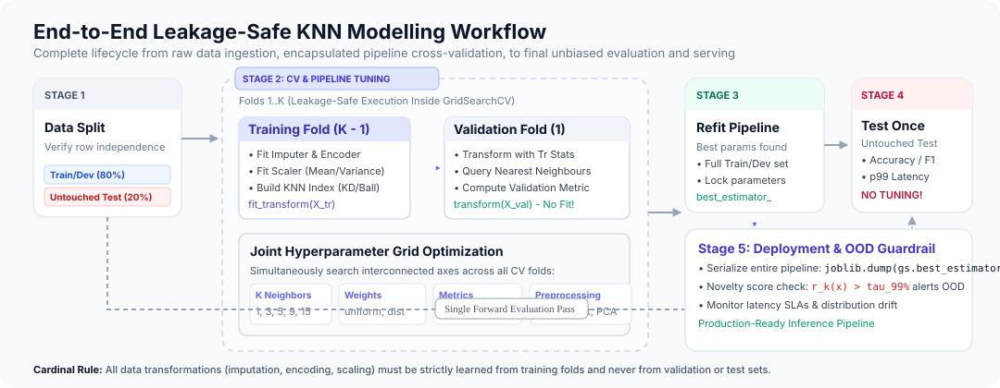
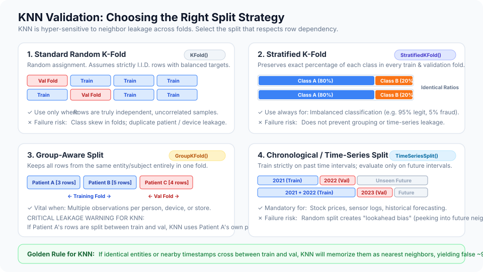
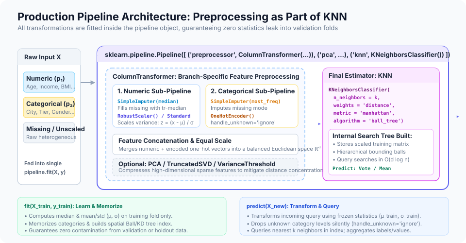
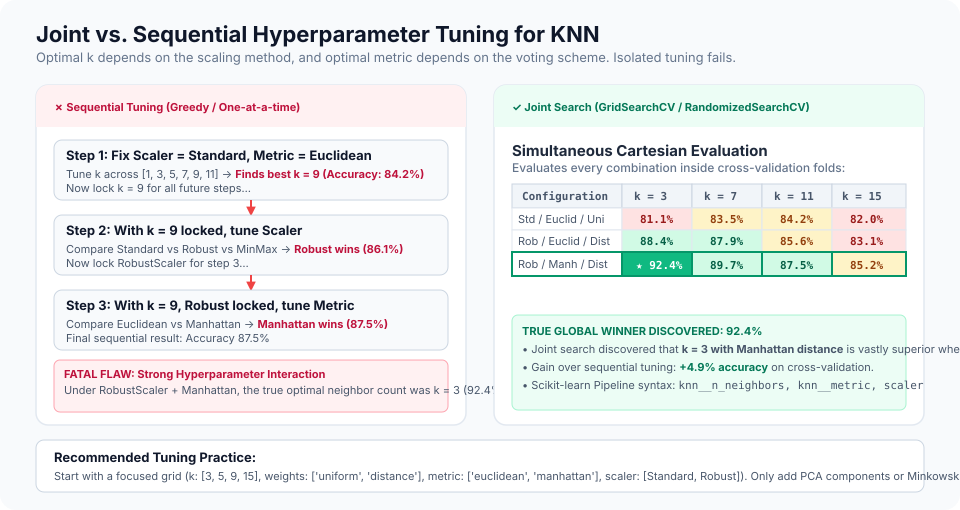
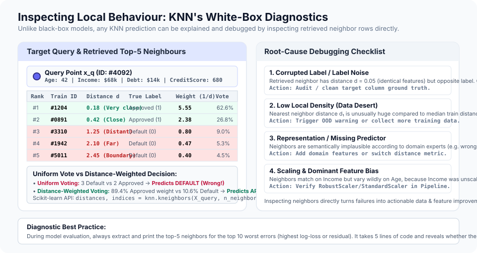
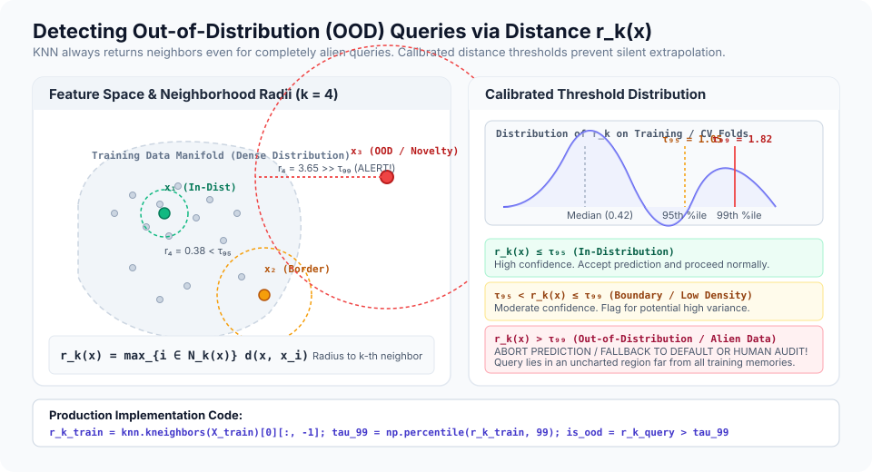
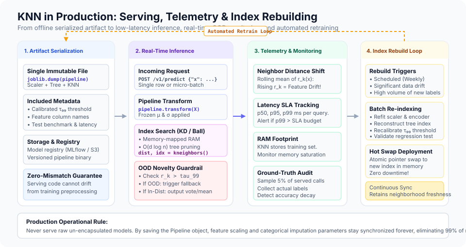

# End-to-End KNN Modelling Workflow

## Table of Contents

- [Workflow Overview](#workflow-overview)
- [1. Define the Prediction Unit and Split Strategy](#1-define-the-prediction-unit-and-split-strategy)
- [2. Build Preprocessing as Part of the Model](#2-build-preprocessing-as-part-of-the-model)
- [3. Establish Simple Baselines](#3-establish-simple-baselines)
- [4. Tune the Right Items Jointly](#4-tune-the-right-items-jointly)
- [5. Inspect Local Behaviour](#5-inspect-local-behaviour)
- [6. Detect Out-of-Distribution Queries](#6-detect-out-of-distribution-queries)
- [7. Final Evaluation and Deployment](#7-final-evaluation-and-deployment)
- [8. Complete End-to-End Python Reference Implementation](#8-complete-end-to-end-python-reference-implementation)
- [Related Concepts](#related-concepts)

---

## Workflow Overview

> [!NOTE]
> A ***leakage-safe workflow*** fits every preprocessing step ***inside cross-validation*** so that learned statistics (mean, variance, medians, PCA components, imputed values) never bleed from validation folds into training folds.

<div align="center">



</div>

The lifecycle of a production-grade KNN model consists of five distinct phases:
1. **Data Partitioning**: Splitting into a development/training pool and an untouched holdout test set using a dependency-aware splitting strategy.
2. **Encapsulated Cross-Validation**: Wrapping all feature transformations (imputation, encoding, scaling) together with the KNN estimator inside a scikit-learn `Pipeline` to prevent data leakage during CV evaluation.
3. **Joint Hyperparameter Optimization**: Jointly sweeping neighbor count $k$, distance metrics, weighting schemes, and scaling strategies across folds.
4. **Unbiased Holdout Evaluation**: Refitting the chosen pipeline once on all development data and evaluating single-pass on untouched test data with latency and memory benchmarking.
5. **Production Deployment & OOD Guardrails**: Serializing the pipeline artifact, indexing for fast search, screening incoming queries for out-of-distribution (OOD) novelty, and establishing telemetry and index-rebuild triggers.

---

## 1. Define the Prediction Unit and Split Strategy

Determine whether observations are ***statistically independent*** before choosing a split strategy. KNN makes predictions by memorizing and retrieving exact instances; if dependent or repeated observations from the same entity appear in both train and validation folds, KNN will retrieve those near-duplicate rows as nearest neighbors, producing artificially inflated, false $\approx 99\%$ validation scores.

<div align="center">



</div>

| Situation | Recommended Split | Scikit-Learn Class | Why It Is Critical for KNN |
|---|---|---|---|
| ***Imbalanced classification*** | ***Stratified splits*** | `StratifiedKFold` | Preserves exact class proportions in every fold; avoids folds with zero minority instances |
| ***Multiple rows per subject*** (patient, device, user, account) | ***Group-aware splits*** | `GroupKFold` / `StratifiedGroupKFold` | Keeps all rows from one entity in the same fold; prevents KNN from retrieving an entity's own past records |
| ***Future prediction*** from historical logs | ***Chronological splits*** | `TimeSeriesSplit` | Trains on past time horizons and validates on future intervals; avoids lookahead bias |
| ***Geospatial data*** | ***Spatial blocking*** | Spatial CV / Cluster Split | Prevents spatial autocorrelation leakage where nearby geographic coordinates artificially inflate proximity |
| ***Fully exchangeable rows*** | Ordinary ***random splits*** | `KFold` | Safe **only** when data rows are strictly independent, identically distributed (I.I.D.) samples |

> [!WARNING]
> ***Randomly splitting repeated observations from the same subject*** lets nearly identical records appear as neighbors across the train and validation sets, producing ***unrealistically optimistic evaluation metrics***. Always verify row-level independence and entity grouping before configuring cross-validation.

### Practical Implementation: Group and Stratified Splits

```python
from sklearn.model_selection import StratifiedKFold, GroupKFold, StratifiedGroupKFold

# Case A: Imbalanced target with independent rows
cv_stratified = StratifiedKFold(n_splits=5, shuffle=True, random_state=42)

# Case B: Multiple observations per patient / device (Entity Grouping)
cv_grouped = GroupKFold(n_splits=5)
# cv_grouped.split(X, y, groups=patient_ids)

# Case C: Both imbalanced target AND patient grouping
cv_strat_grouped = StratifiedGroupKFold(n_splits=5)
```

---

## 2. Build Preprocessing as Part of the Model

Wrap every preprocessing step inside the same ***pipeline*** as KNN so that all learned statistics are strictly confined to training folds.

A complete, production-grade pipeline includes:

1. ***Column selection*** — separating numerical features from categorical features
2. ***Imputation*** — filling missing numerical values with median and categoricals with mode
3. ***Categorical encoding*** — one-hot encoding with `handle_unknown='ignore'`
4. ***Scaling*** — standardizing or robust-scaling numeric dimensions to ensure equal distance weighting
5. ***Dimensionality reduction / selection (Optional)*** — PCA or variance thresholding to alleviate the curse of dimensionality
6. ***KNN estimator*** — the final distance-based classifier or regressor

<div align="center">



</div>

> [!IMPORTANT]
> ***Every learned component must be fitted separately within each training fold.*** Fitting a scaler or imputer on the full dataset — including validation rows — causes ***data leakage*** and inflates evaluation scores. Use scikit-learn `Pipeline` and `ColumnTransformer` to enforce this boundary automatically.

> [!TIP]
> When `GridSearchCV` or `cross_val_score` executes a `Pipeline`, it calls `pipeline.fit(X_train_fold, y_train_fold)` and `pipeline.predict(X_val_fold)` afresh for every fold. The validation fold is transformed solely using the statistics (means, standard deviations, medians, encoded categories) calculated from the training fold. Data leakage is structurally impossible.

### Production Pipeline Code Pattern

```python
from sklearn.pipeline import Pipeline
from sklearn.compose import ColumnTransformer
from sklearn.impute import SimpleImputer
from sklearn.preprocessing import StandardScaler, RobustScaler, OneHotEncoder
from sklearn.neighbors import KNeighborsClassifier
from sklearn.model_selection import GridSearchCV

# 1. Define feature subsets
numeric_features = ['age', 'income', 'debt', 'credit_score']
categorical_features = ['employment_type', 'education_level', 'home_ownership']

# 2. Build branch-specific transformers
numeric_transformer = Pipeline([
    ('imputer', SimpleImputer(strategy='median')),
    ('scaler', RobustScaler())  # Robust to outliers compared to StandardScaler
])

categorical_transformer = Pipeline([
    ('imputer', SimpleImputer(strategy='most_frequent')),
    ('encoder', OneHotEncoder(handle_unknown='ignore', sparse_output=False))
])

# 3. Combine into ColumnTransformer
preprocessor = ColumnTransformer(
    transformers=[
        ('num', numeric_transformer, numeric_features),
        ('cat', categorical_transformer, categorical_features)
    ]
)

# 4. Form complete pipeline with KNN
full_pipeline = Pipeline([
    ('preprocessor', preprocessor),
    ('knn', KNeighborsClassifier())
])
```

---

## 3. Establish Simple Baselines

***Never tune KNN before comparing it against trivial competitors.***

A machine learning model is only justified if its cross-validated performance significantly exceeds low-cost, trivial baselines on the metric that directly aligns with business goals.

| Baseline Estimator | Task | What It Predicts | Scikit-Learn Class | Purpose |
|---|---|---|---|---|
| ***Most-Frequent Class*** | Classification | Always predicts majority label | `DummyClassifier(strategy='most_frequent')` | Establishes the floor accuracy for imbalanced classes |
| ***Stratified Prior*** | Classification | Predicts labels proportional to training distribution | `DummyClassifier(strategy='stratified')` | Tests whether model understands label distribution |
| ***Global Mean / Median*** | Regression | Always predicts training set mean or median | `DummyRegressor(strategy='mean')` | Floor benchmark for RMSE / MAE |
| ***Logistic / Ridge Regression*** | Both | Linear boundary benchmark | `LogisticRegression()` / `Ridge()` | Checks if a cheap linear model suffices |
| ***Shallow Decision Tree*** | Both | Fast non-linear rules (depth 3) | `DecisionTreeClassifier(max_depth=3)` | Fast tree benchmark with zero scaling requirements |

> [!IMPORTANT]
> A complex hyperparameter search over KNN configurations provides ***zero value*** if the resulting model cannot decisively beat a trivial baseline on the metric that matters (e.g. F1-score, PR-AUC, or MAE). Establish and log baselines ***first*** — before running grid searches.

### Benchmark Code Snippet

```python
from sklearn.dummy import DummyClassifier
from sklearn.linear_model import LogisticRegression
from sklearn.model_selection import cross_val_score

# Baseline 1: Majority Class Floor
dummy = DummyClassifier(strategy='most_frequent')
dummy_score = cross_val_score(dummy, X_dev, y_dev, cv=5, scoring='f1_macro').mean()

# Baseline 2: Simple Linear Benchmark
linear_bench = Pipeline([
    ('preprocessor', preprocessor),
    ('clf', LogisticRegression(max_iter=1000))
])
linear_score = cross_val_score(linear_bench, X_dev, y_dev, cv=5, scoring='f1_macro').mean()

print(f"Majority Baseline F1: {dummy_score:.3f}")
print(f"Logistic Baseline F1: {linear_score:.3f}")
```

---

## 4. Tune the Right Items Jointly

Tune ***all interdependent choices simultaneously***, not sequentially. In KNN, optimal $k$ directly depends on the scaling strategy, and the optimal distance metric depends on the voting weights and feature distributions.

<div align="center">



</div>

### Why Sequential Tuning Fails

In sequential (greedy) tuning, a practitioner might:
1. Fix `scaler = StandardScaler()` and `metric = 'euclidean'`, then tune $k \in [1, 3, 5, 9, 15]$. Suppose $k=9$ wins.
2. Freeze $k=9$, and now test `StandardScaler` vs. `RobustScaler`. Suppose `RobustScaler` wins.
3. Freeze $k=9$ and `RobustScaler`, then test Euclidean vs. Manhattan.

**The failure:** Under `RobustScaler` and Manhattan distance, outliers are compressed and distances behave differently—the true global optimal neighbor count might be $k=3$ (achieving $92.4\%$ accuracy). However, step 1 prematurely froze $k=9$, trapping the model in a sub-optimal local plateau ($87.5\%$).

### Candidate Tuning Grid

| Hyperparameter | Scikit-Learn Parameter Path | Typical Values | Impact on Performance |
|---|---|---|---|
| ***Number of Neighbors ($k$)*** | `knn__n_neighbors` | 1, 3, 5, 7, 9, 11, 15, 21 | Controls bias-variance tradeoff ($k=1$ high variance; large $k$ high bias) |
| ***Voting Weighting*** | `knn__weights` | `'uniform'`, `'distance'` | Distance weighting downweights distant outliers in dense neighborhoods |
| ***Distance Metric*** | `knn__metric` | `'euclidean'`, `'manhattan'`, `'minkowski'` | Manhattan handles moderately high dimensions and sparse features better |
| ***Minkowski Power ($p$)*** | `knn__p` | 1 ($L_1$), 1.5, 2 ($L_2$) | Continuous tuning between city-block and straight-line geometry |
| ***Scaling Method*** | `preprocessor__num__scaler` | `StandardScaler()`, `RobustScaler()`, `MinMaxScaler()` | RobustScaler protects against outliers distorting distance axes |
| ***Dimensionality Reduction*** | `pca__n_components` | `None`, 10, 20, 50 | Alleviates distance concentration if $d > 30$ |
| ***Search Backend*** | `knn__algorithm` | `'ball_tree'`, `'kd_tree'`, `'brute'` | Engineering trade-off (query speed vs indexing RAM) |

> [!TIP]
> Start with a ***compact joint grid*** focusing on the highest-leverage axes: $k \in [3, 5, 9, 15]$, `weights` $\in$ `['uniform', 'distance']`, and `metric` $\in$ `['euclidean', 'manhattan']`. If the search space is large ($> 100$ combinations), use `RandomizedSearchCV` or `HalvingGridSearchCV` rather than evaluating every grid point exhaustively.

```python
param_grid = {
    'preprocessor__num__scaler': [StandardScaler(), RobustScaler()],
    'knn__n_neighbors': [3, 5, 7, 9, 11, 15],
    'knn__weights': ['uniform', 'distance'],
    'knn__metric': ['euclidean', 'manhattan']
}

grid_search = GridSearchCV(
    estimator=full_pipeline,
    param_grid=param_grid,
    cv=cv_stratified,
    scoring='f1_macro',
    n_jobs=-1,
    refit=True
)
grid_search.fit(X_dev, y_dev)

print("Best Parameters:", grid_search.best_params_)
print(f"Best CV F1-Score: {grid_search.best_score_:.4f}")
```

---

## 5. Inspect Local Behaviour

For representative queries and every misclassified sample, inspect the local neighborhood directly. Unlike black-box neural networks or ensemble models, **KNN is natively interpretable**: its prediction is entirely determined by the $k$ instances retrieved from memory.

<div align="center">



</div>

### What to Examine per Query

| Diagnostic Dimension | Extraction Method | What It Reveals |
|---|---|---|
| ***Neighbor Identities*** | `knn.kneighbors()` $\to$ `indices` | Whether retrieved training samples are semantically plausible according to domain experts |
| ***Neighbor Distances*** | `knn.kneighbors()` $\to$ `distances` | Local scale of feature space; whether query is in a dense cluster or data desert |
| ***Target Labels & Values*** | `y_train[indices]` | Coherence and consensus of neighbors' ground truth |
| ***Distance to $k$-th Neighbor ($r_k$)*** | `distances[:, -1]` | How far the neighborhood expands to find $k$ points |
| ***Vote Margin / Target Spread*** | Class probability vector | Confidence, ambiguity, and local target variance |
| ***Feature Differences*** | `X_train_proc[indices] - x_query_proc` | Which specific features contributed most to the distance |

> [!TIP]
> A bad prediction can almost always be traced to one of five root causes:
> 1. **Label noise** — a mislabelled training sample whose features match the query.
> 2. **Low local density** — query lies in a sparse region where even the closest neighbor is far away.
> 3. **Missing predictor** — points look identical in the existing feature set but differ in real life.
> 4. **Feature scale distortion** — an unscaled high-variance feature dominated Euclidean distance.
> 5. **Wrong distance metric** — Euclidean distance failing in high-dimensional sparse representations.

### Diagnostic Inspection Code

```python
import pandas as pd
import numpy as np

# Retrieve fitted transformer and KNN estimator from the pipeline
fitted_preprocessor = grid_search.best_estimator_.named_steps['preprocessor']
fitted_knn = grid_search.best_estimator_.named_steps['knn']

# Transform query sample into scaled feature space
X_query_proc = fitted_preprocessor.transform(X_query)

# Query distances and training row indices of nearest neighbors
distances, indices = fitted_knn.kneighbors(X_query_proc, n_neighbors=5)

# Build diagnostic inspection table for a single query
query_idx = 0
neighbor_ids = indices[query_idx]
neighbor_dists = distances[query_idx]
neighbor_targets = y_dev.iloc[neighbor_ids].values

diagnostics_df = pd.DataFrame({
    'Rank': range(1, len(neighbor_ids) + 1),
    'Train_Index': neighbor_ids,
    'Distance': np.round(neighbor_dists, 4),
    'True_Label': neighbor_targets,
    'Weight (1/d)': np.round(1.0 / np.maximum(neighbor_dists, 1e-6), 4)
})

print(diagnostics_df)
```

---

## 6. Detect Out-of-Distribution Queries

KNN ***always returns $k$ neighbors***, even for an anomalous query point that lies light-years away from all training data. Without an explicit guardrail, the model silently extrapolates using the least-bad training samples, emitting high-confidence, nonsensical predictions.

<div align="center">



</div>

### The $k$-th Neighbor Distance as Novelty Signal

The distance to the $k$-th nearest training neighbor serves as an intrinsic novelty metric:

$$
\boxed{r_k(\mathbf{x}) = \max_{i \in \mathcal{N}_k(\mathbf{x})} d(\mathbf{x}, \mathbf{x}_i)}
$$

**Where:**
- $r_k(\mathbf{x})$ — ***novelty score*** (neighborhood radius) for query $\mathbf{x}$
- $\mathcal{N}_k(\mathbf{x})$ — set of $k$ nearest training neighbors of $\mathbf{x}$
- $d(\mathbf{x}, \mathbf{x}_i)$ — distance from query $\mathbf{x}$ to the $i$-th neighbor $\mathbf{x}_i$

### Calibrating the Warning Threshold

> [!IMPORTANT]
> ***Calibrate the OOD warning threshold from the empirical training/validation distance distribution*** — never from an arbitrary rule-of-thumb constant. A threshold of $r_k > 2.0$ may be common in one dataset but catastrophic in another with different scale or intrinsic dimensionality.

Calculate $r_k$ for every point in the training/development set:
1. Compute vector $\mathbf{r}_k^{\text{train}} = [r_k(\mathbf{x}_1), r_k(\mathbf{x}_2), \dots, r_k(\mathbf{x}_n)]$.
2. Set threshold $\tau_{99} = \text{Percentile}(\mathbf{r}_k^{\text{train}}, 99)$ (or $95\text{th}$ percentile).
3. If an incoming query has $r_k(\mathbf{x}_{\text{query}}) > \tau_{99}$, flag it as **Out-of-Distribution (OOD)**.

> [!CAUTION]
> Do not interpret $r_k(\mathbf{x})$ as a probability. It is a distance metric whose scale depends on dimensionality and feature variance. Always evaluate it against the calibrated empirical percentile $\tau$.

### OOD Guardrail Implementation

```python
import numpy as np

# 1. Calculate distances to k-th neighbor on all training samples
X_dev_proc = fitted_preprocessor.transform(X_dev)
train_distances, _ = fitted_knn.kneighbors(X_dev_proc)
r_k_train = train_distances[:, -1]  # Distance to the k-th neighbor

# 2. Derive data-driven percentiles
tau_95 = np.percentile(r_k_train, 95)
tau_99 = np.percentile(r_k_train, 99)

def safe_knn_predict(X_new, pipeline, tau_ood):
    """
    Transforms query, checks OOD novelty threshold, and emits prediction with safety flag.
    """
    preproc = pipeline.named_steps['preprocessor']
    knn = pipeline.named_steps['knn']
    
    X_new_proc = preproc.transform(X_new)
    distances, _ = knn.kneighbors(X_new_proc)
    r_k_query = distances[:, -1]
    
    predictions = knn.predict(X_new_proc)
    probabilities = knn.predict_proba(X_new_proc) if hasattr(knn, 'predict_proba') else None
    
    is_ood = r_k_query > tau_ood
    return {
        'predictions': predictions,
        'probabilities': probabilities,
        'r_k_distances': r_k_query,
        'is_ood_alert': is_ood
    }
```

---

## 7. Final Evaluation and Deployment

After the optimal pipeline configuration is selected via cross-validation, execute these steps ***exactly once*** — no further tuning after inspecting held-out test results.

<div align="center">



</div>

### Deployment Checklist

1. ***Refit on all development data*** — train the optimal pipeline on the full development set ($100\%$ of non-test data) so all available training instances populate the search index.
2. ***Evaluate once on untouched test set*** — single unbiased forward pass; never loop back to tuning after observing test metrics.
3. ***Report operational performance*** — report statistical metrics (Accuracy, F1, PR-AUC, RMSE) alongside operational benchmarks:
   - **p50, p95, and p99 query latency** (ms per query)
   - **Peak memory footprint** (RAM in MB/GB)
   - **Index build time** (seconds)
4. ***Save preprocessing and model together*** — serialize the entire `Pipeline` object so that scalers, imputers, encoders, and tree structures remain synchronized:
   ```python
   import joblib
   joblib.dump(grid_search.best_estimator_, 'knn_production_pipeline.joblib')
   ```
5. ***Real-time production monitoring:***
   - **Neighbor distance drift** — a persistent upward drift in average $r_k(\mathbf{x}_{\text{query}})$ signals input distribution drift or data shift.
   - **Serving latency SLAs** — latency degrades as $n$ grows; monitor query latency against SLA budgets.
   - **Ground-truth audit sample** — sample $5\%$ of queries to audit accuracy decay as live ground truth becomes available.
6. ***Establish an index rebuild policy*** — specify how new labeled records are incorporated and when spatial search trees (KD-tree, Ball tree, HNSW) are reconstructed.

> [!WARNING]
> ***Never refit or tune after looking at the test set.*** Even a single hyperparameter tweak made after observing test results invalidates the holdout evaluation — the test set becomes contaminated and ceases to be an unbiased estimate of generalization error.

---

## 8. Complete End-to-End Python Reference Implementation

Here is a complete, copy-pasteable production script pulling all eight stages together:

```python
import numpy as np
import pandas as pd
import joblib

from sklearn.datasets import make_classification
from sklearn.model_selection import train_test_split, StratifiedKFold, GridSearchCV
from sklearn.pipeline import Pipeline
from sklearn.compose import ColumnTransformer
from sklearn.impute import SimpleImputer
from sklearn.preprocessing import RobustScaler, StandardScaler, OneHotEncoder
from sklearn.neighbors import KNeighborsClassifier
from sklearn.dummy import DummyClassifier
from sklearn.metrics import classification_report, roc_auc_score

# =====================================================================
# 1. DATA INGESTION & LEAKAGE-SAFE HOLD-OUT SPLIT
# =====================================================================
# Generate synthetic dataset with numerical and categorical features
X_raw, y = make_classification(
    n_samples=2500, n_features=6, n_informative=4, 
    weights=[0.85, 0.15], random_state=42
)
df = pd.DataFrame(X_raw, columns=[f'num_{i}' for i in range(4)] + ['cat_0', 'cat_1'])
# Convert last two columns into discrete string categories
df['cat_0'] = pd.qcut(df['cat_0'], q=3, labels=['low', 'medium', 'high']).astype(str)
df['cat_1'] = pd.qcut(df['cat_1'], q=2, labels=['type_A', 'type_B']).astype(str)

# Split holdout test set (20%) strictly before any preprocessing
X_dev, X_test, y_dev, y_test = train_test_split(
    df, y, test_size=0.20, stratify=y, random_state=42
)

# =====================================================================
# 2. ENCAPSULATED PIPELINE CONSTRUCTION
# =====================================================================
num_cols = [f'num_{i}' for i in range(4)]
cat_cols = ['cat_0', 'cat_1']

num_pipeline = Pipeline([
    ('imputer', SimpleImputer(strategy='median')),
    ('scaler', RobustScaler())
])

cat_pipeline = Pipeline([
    ('imputer', SimpleImputer(strategy='most_frequent')),
    ('encoder', OneHotEncoder(handle_unknown='ignore', sparse_output=False))
])

preprocessor = ColumnTransformer([
    ('num', num_pipeline, num_cols),
    ('cat', cat_pipeline, cat_cols)
])

full_pipeline = Pipeline([
    ('preprocessor', preprocessor),
    ('knn', KNeighborsClassifier())
])

# =====================================================================
# 3. ESTABLISH BASELINES FIRST
# =====================================================================
cv_strategy = StratifiedKFold(n_splits=5, shuffle=True, random_state=42)

dummy = DummyClassifier(strategy='most_frequent')
dummy.fit(X_dev, y_dev)
print(f"Majority Baseline Test Accuracy: {dummy.score(X_test, y_test):.4f}")

# =====================================================================
# 4. JOINT HYPERPARAMETER OPTIMIZATION INSIDE CROSS-VALIDATION
# =====================================================================
param_grid = {
    'preprocessor__num__scaler': [StandardScaler(), RobustScaler()],
    'knn__n_neighbors': [3, 5, 7, 11, 15],
    'knn__weights': ['uniform', 'distance'],
    'knn__metric': ['euclidean', 'manhattan']
}

grid = GridSearchCV(
    estimator=full_pipeline,
    param_grid=param_grid,
    cv=cv_strategy,
    scoring='roc_auc',
    n_jobs=-1,
    refit=True
)
grid.fit(X_dev, y_dev)
best_model = grid.best_estimator_
print("Best Hyperparameters:", grid.best_params_)
print(f"Best CV ROC-AUC: {grid.best_score_:.4f}")

# =====================================================================
# 5. CALIBRATE OUT-OF-DISTRIBUTION (OOD) THRESHOLD
# =====================================================================
fitted_preproc = best_model.named_steps['preprocessor']
fitted_knn = best_model.named_steps['knn']

X_dev_trans = fitted_preproc.transform(X_dev)
train_dists, _ = fitted_knn.kneighbors(X_dev_trans)
r_k_train = train_dists[:, -1]
tau_99 = float(np.percentile(r_k_train, 99))
print(f"Calibrated 99th-Percentile OOD Distance Threshold: {tau_99:.4f}")

# =====================================================================
# 6. UNBIASED EVALUATION ON TOUCHED-ONCE TEST SET
# =====================================================================
y_pred = best_model.predict(X_test)
y_prob = best_model.predict_proba(X_test)[:, 1]

print("\n--- FINAL TEST EVALUATION ---")
print(f"Test ROC-AUC: {roc_auc_score(y_test, y_prob):.4f}")
print(classification_report(y_test, y_pred))

# =====================================================================
# 7. SERIALIZATION & SERVING ARTIFACT
# =====================================================================
artifact = {
    'pipeline': best_model,
    'tau_99': tau_99,
    'feature_names': list(df.columns)
}
joblib.dump(artifact, 'knn_production_package.joblib')
print("Successfully serialized production artifact to knn_production_package.joblib")
```

---

## Related Concepts

- [01 KNN Algorithm and Working Step-by-Step..md](./01%20KNN%20Algorithm%20and%20Working%20Step-by-Step..md) — core algorithm, pseudocode, and mathematical mechanics
- [03 How to Choose K in KNN: Bias, Variance and Validation.md](./03%20How%20to%20Choose%20K%20in%20KNN%3A%20Bias%2C%20Variance%20and%20Validation.md) — bias-variance trade-off and cross-validation for $k$
- [05 Feature scaling and preprocessing.md](./05%20Feature%20scaling%20and%20preprocessing.md) — scaling pipelines, outlier treatment, and categorical distances
- [08 Weighted KNN.md](./08%20Weighted%20KNN.md) — distance-weighted voting schemes and hyperparameter pipelines
- [09 Curse of Dimensionality and Special Data Types.md](./09%20Curse%20of%20Dimensionality%20and%20Special%20Data%20Types.md) — high-dimensional geometry, distance concentration, and special data types
- [10 Search algorithms and computational complexity.md](./10%20Search%20algorithms%20and%20computational%20complexity.md) — KD-tree, Ball tree, HNSW, indexing costs, and memory batching

---

<p align="center">
  ⬅️ <strong>Previous:</strong> <a href="./10%20Search%20algorithms%20and%20computational%20complexity.md">10 Search algorithms and computational complexity</a> &nbsp;&nbsp;|&nbsp;&nbsp; <strong>Next:</strong> <a href="./12%20Evaluation%20in%20KNN.md">12 Evaluation in KNN</a> ➡️
</p>
