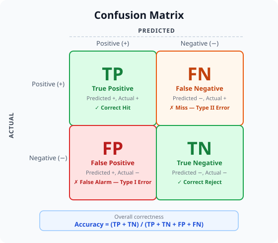
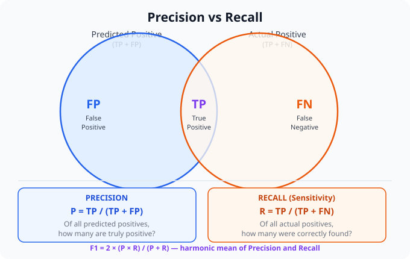
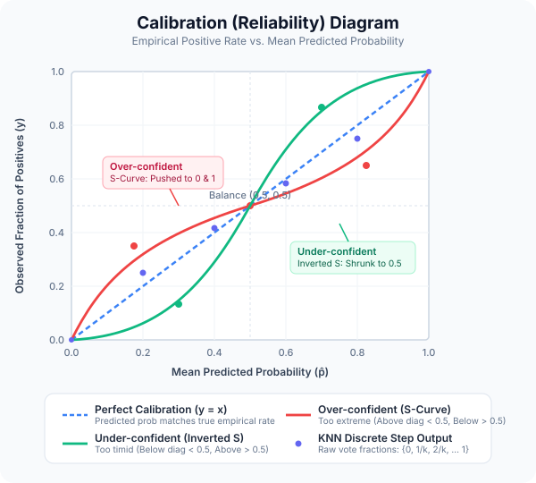
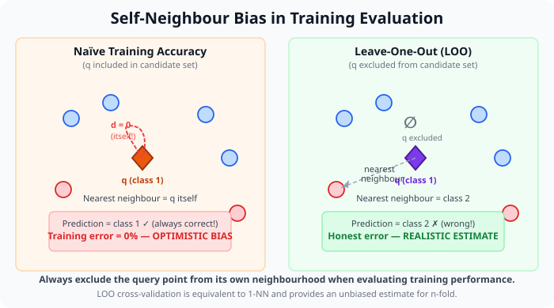
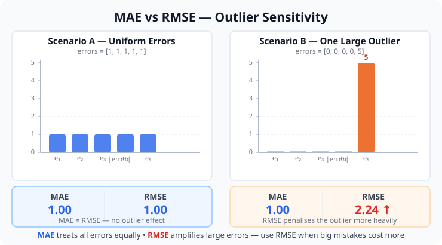

# Evaluation in KNN

Choosing the right evaluation metric is as important as tuning the model itself. KNN can be used for both **classification** and **regression**, so this chapter covers the full metric landscape: classification scores, probability quality, regression errors, and operational concerns that only appear at deployment time.

---

## Table of Contents

1. [Classification Metrics](#1-classification-metrics)
   - [1.1 Confusion Matrix](#11-confusion-matrix)
   - [1.2 Accuracy](#12-accuracy)
   - [1.3 Precision and Recall](#13-precision-and-recall)
   - [1.4 F1 Score and Fβ Score](#14-f1-score-and-fβ-score)
   - [1.5 Multi-class Averaging](#15-multi-class-averaging)
   - [1.6 ROC-AUC and PR-AUC](#16-roc-auc-and-pr-auc)
2. [Probability Quality and Calibration](#2-probability-quality-and-calibration)
   - [2.1 Log Loss](#21-log-loss)
   - [2.2 Brier Score](#22-brier-score)
   - [2.3 Calibration / Reliability Diagrams](#23-calibration--reliability-diagrams)
     - [Interpreting Calibration Curves](#interpreting-calibration-curves)
     - [Calibration Curves vs. Learning Curves](#calibration-curves-vs-learning-curves)
     - [How K Controls the Calibration Curve](#how-k-controls-the-calibration-curve)
   - [2.4 The Self-Neighbour Bias Trap in KNN Evaluation](#24-the-self-neighbour-bias-trap-in-knn-evaluation)
3. [Regression Metrics](#3-regression-metrics)
   - [3.1 MAE, MSE, RMSE](#31-mae-mse-rmse)
   - [3.2 R² (Coefficient of Determination)](#32-r²-coefficient-of-determination)
   - [3.3 Choosing the Right Metric](#33-choosing-the-right-metric)
4. [Statistical and Operational Evaluation](#4-statistical-and-operational-evaluation)
   - [4.1 Latency and Throughput](#41-latency-and-throughput)
   - [4.2 Memory and Index Build Time](#42-memory-and-index-build-time)
   - [4.3 Approximate-Search Recall](#43-approximate-search-recall)
   - [4.4 Subgroup and Fairness Evaluation](#44-subgroup-and-fairness-evaluation)
   - [4.5 Stability Under Perturbations](#45-stability-under-perturbations)
5. [Summary of Formulas](#5-summary-of-formulas)
6. [Related Chapters in This Series](#6-related-chapters-in-this-series)

---

## 1. Classification Metrics

### 1.1 Confusion Matrix

Before computing any single-number summary metric, construct the ***confusion matrix***. For a binary problem with a **positive class** and a **negative class**, every prediction falls into one of four mutually exclusive cells:

<div align="center">
  
</div>

| Symbol | Name | Meaning | Statistical Term |
|---|---|---|---|
| **TP** | True Positive | Predicted positive, actually positive | Correct Hit |
| **TN** | True Negative | Predicted negative, actually negative | Correct Rejection |
| **FP** | False Positive | Predicted positive, actually negative | **Type I Error** (False Alarm) |
| **FN** | False Negative | Predicted negative, actually positive | **Type II Error** (Miss) |

> [!IMPORTANT]
> The relative cost of FP vs. FN varies fundamentally across domains:
> - **Medical Diagnostics (e.g. Cancer Screening):** Missing a malignant tumor (**FN**) is catastrophic; a false alarm (**FP**) requires a follow-up test. **Optimize for Recall.**
> - **Spam Filtering / Fraud Blocking:** Flagging a critical client email as spam (**FP**) harms business; letting a junk email pass (**FN**) is an annoyance. **Optimize for Precision.**

---

### 1.2 Accuracy

***Accuracy*** is the fraction of all predictions that are strictly correct:

$$
\boxed{\text{Accuracy} = \frac{TP + TN}{TP + TN + FP + FN}}
$$

**When to use it:** Only when classes are roughly balanced and all misclassification errors carry equal cost.

> [!WARNING]
> **The Accuracy Paradox in Imbalanced Data:**  
> In a dataset where $98\%$ of transactions are legitimate and $2\%$ are fraudulent, a naive classifier that predicts "legitimate" every single time achieves **$98\%$ accuracy** while catching exactly zero fraud cases ($0\%$ recall). Never rely on accuracy when evaluating imbalanced datasets.

---

### 1.3 Precision and Recall

<div align="center">
  
</div>

***Precision*** answers: *"Of all instances the model predicted as positive, what fraction was actually positive?"*

$$
\boxed{\text{Precision} = \frac{TP}{TP + FP}}
$$

***Recall*** (also known as ***Sensitivity*** or ***True Positive Rate***) answers: *"Of all actual positive instances in reality, what fraction did the model successfully capture?"*

$$
\boxed{\text{Recall} = \frac{TP}{TP + FN}}
$$

#### The Precision–Recall Trade-Off

By default, KNN classifies a point as positive if $\hat{p} \ge 0.5$. Adjusting this decision threshold creates a fundamental trade-off:
- **Lowering the threshold (e.g. $\hat{p} \ge 0.2$):** Catches more positive cases $\implies$ **Recall increases**, but false alarms rise $\implies$ **Precision decreases**.
- **Raising the threshold (e.g. $\hat{p} \ge 0.8$):** Only flags high-confidence instances $\implies$ **Precision increases**, but more actual positives are missed $\implies$ **Recall decreases**.

---

### 1.4 F1 Score and Fβ Score

The ***F1 score*** is the **harmonic mean** of precision and recall. It penalizes severe imbalance between the two:

$$
\boxed{F_1 = 2 \cdot \frac{\text{Precision} \times \text{Recall}}{\text{Precision} + \text{Recall}} = \frac{2 \cdot TP}{2 \cdot TP + FP + FN}}
$$

The harmonic mean is used rather than the arithmetic mean because it is dominated by the smaller value. A model with $\text{Precision} = 1.0$ and $\text{Recall} = 0.02$ yields $F_1 = 0.039$ (reflecting poor utility), whereas an arithmetic mean would misleadingly report $0.510$.

#### Weighted Harmonic Mean: Fβ Score

When a domain values recall more than precision (or vice-versa), use the generalized **Fβ score**:

$$
\boxed{F_\beta = (1 + \beta^2) \cdot \frac{\text{Precision} \times \text{Recall}}{\beta^2 \cdot \text{Precision} + \text{Recall}}}
$$

- **$\beta = 1$ ($F_1$ Score):** Equal weighting between precision and recall.
- **$\beta = 2$ ($F_2$ Score):** Weights recall **twice as heavily** as precision. Ideal for medical screening and threat detection.
- **$\beta = 0.5$ ($F_{0.5}$ Score):** Weights precision **twice as heavily** as recall. Ideal for search results, spam filtering, and automated customer notifications.

---

### 1.5 Multi-class Averaging

When extending binary evaluation to $C > 2$ classes, per-class metrics are aggregated using one of three strategies:

| Strategy | Computation Method | When to Use |
|---|---|---|
| **Macro** | Computes metric independently for each class, then takes the unweighted arithmetic mean: $\frac{1}{C}\sum_{c=1}^C \text{Metric}_c$ | When all classes are equally important, regardless of support. Treats minority classes with equal weight. |
| **Weighted** | Computes metric per class, then weights by class frequency (support): $\sum_{c=1}^C \frac{n_c}{N} \text{Metric}_c$ | Reflects real-world dataset proportions; accounts for class imbalance without penalizing minority performance heavily. |
| **Micro** | Aggregates global $TP$, $FP$, and $FN$ across all classes before computing the formula | When overall sample-level correctness matters more than class equity. |

> [!NOTE]
> In single-label multi-class classification (where every sample belongs to exactly one class), **Micro-Precision = Micro-Recall = Micro-F1 = Overall Accuracy**.

---

### 1.6 ROC-AUC and PR-AUC

#### ROC Curve and ROC-AUC
The ***Receiver Operating Characteristic (ROC) curve*** plots **True Positive Rate (Recall)** against **False Positive Rate (FPR)** across all decision thresholds from $1.0$ down to $0.0$:

$$
\text{FPR} = \frac{FP}{FP + TN} = 1 - \text{Specificity}
$$

The **Area Under the ROC Curve (ROC-AUC)** measures ranking ability:
- **$\text{AUC} = 1.0$:** Perfect class separability.
- **$\text{AUC} = 0.5$:** No discriminative ability (equivalent to random guessing).
- **Interpretation:** The probability that the model ranks a randomly chosen positive sample higher than a randomly chosen negative sample.

#### PR Curve and PR-AUC (Average Precision)
On severely imbalanced datasets, **ROC-AUC can be deceptively optimistic** because $TN$ is large, keeping FPR small even when false positives surge.  
The **Precision-Recall (PR) Curve** plots Precision vs. Recall. Its area (PR-AUC / Average Precision) focuses exclusively on the positive minority class, making it the **gold standard for fraud, defect, and rare-disease evaluation**.

---

## 2. Probability Quality and Calibration

In classification, KNN produces estimated class probabilities from the vote fractions of the retrieved $k$ neighbors:

$$
\hat{p}(c \mid \mathbf{x}) = \frac{1}{k} \sum_{i \in \mathcal{N}_k(\mathbf{x})} \mathbb{I}(y_i = c)
$$

With small $k$, probabilities are **coarsely quantized** into only $k+1$ discrete steps (e.g. for $k = 5$: $0.0, 0.2, 0.4, 0.6, 0.8, 1.0$). These discrete fractions are often poorly calibrated.

### 2.1 Log Loss

***Log Loss*** (Cross-Entropy Loss) penalizes probabilistic uncertainty and heavily punishes confident wrong predictions:

$$
\boxed{\text{Log Loss} = -\frac{1}{n} \sum_{i=1}^{n} \left[ y_i \ln \hat{p}_i + (1 - y_i) \ln(1 - \hat{p}_i) \right]}
$$

- **Range:** $[0, \infty)$, where $0$ is perfect probability assignment.
- **Log Loss Trap in KNN:** If a model with $k=3$ outputs $\hat{p} = 1.0$ for an instance whose true label is $y = 0$, unclipped log loss evaluates to $-\ln(0) = \infty$. Standard libraries clip probabilities to $[\varepsilon, 1 - \varepsilon]$ (where $\varepsilon \approx 10^{-15}$), yielding a severe penalty of $\approx 34.5$ for a single confident error.

---

### 2.2 Brier Score

The ***Brier Score*** measures the mean squared error between predicted probabilities and binary target outcomes:

$$
\boxed{\text{Brier Score} = \frac{1}{n} \sum_{i=1}^{n} \left( \hat{p}_i - y_i \right)^2}
$$

- **Range:** $[0, 1]$, where $0$ represents perfect probability forecasting.
- **Decomposition:** The Brier score can be mathematically decomposed into three components:
  $$\text{Brier} = \text{Reliability (Calibration Error)} - \text{Resolution} + \text{Uncertainty}$$
- Unlike Log Loss, the Brier Score remains bounded and does not explode on extreme prediction errors.

---

### 2.3 Calibration / Reliability Diagrams

- A **calibration curve** (**reliability diagram**) evaluates whether a classifier's **predicted probabilities** match **actual real-world frequencies**, while **learning curves** are typically used to diagnose **underfitting** and **overfitting**. However, **underfitting** and **overfitting** create **distinct distortions** on a **calibration curve** because they affect how **confident** a model becomes.

<div align="center">
  
</div>

#### Interpreting Calibration Curves

| Geometric Pattern | Curve Shape | Meaning & Underlying Behavior |
|---|---|---|
| **On the Diagonal** | $y = x$ | **Perfect Calibration:** When the model predicts $70\%$ probability, exactly $70\%$ of those samples are positive. |
| **Sigmoidal S-Shape** | Above diagonal for $\hat{p} < 0.5$; Below diagonal for $\hat{p} > 0.5$ | **Over-confident:** The model pushes probabilities too close to $0$ and $1$. Predictions are more extreme than actual outcomes. |
| **Inverted S-Shape** | Below diagonal for $\hat{p} < 0.5$; Above diagonal for $\hat{p} > 0.5$ | **Under-confident:** Predictions cluster conservatively near $0.5$ while actual empirical outcomes are more polarized. |
| **Uniformly Below Diagonal** | $y < x$ everywhere | **Systematic Positive Bias:** The model consistently overestimates positive probability across all prediction ranges. |
| **Uniformly Above Diagonal** | $y > x$ everywhere | **Systematic Negative Bias:** The model consistently underestimates positive probability across all prediction ranges. |

#### Calibration Curves vs. Learning Curves

A ***calibration curve*** (reliability diagram) evaluates whether a classifier's ***predicted probabilities match actual real-world frequencies***, while a ***learning curve*** is typically used to diagnose ***underfitting and overfitting***.

| Concept | X-Axis | Y-Axis | Purpose |
|---|---|---|---|
| **Calibration Curve** | Mean Predicted Probability | Fraction of Positives (Observed) | Assess probability calibration quality; perfect model follows $y = x$ |
| **Learning Curve** | Training Set Size or Epochs | Error / Loss | Diagnose high bias (underfitting) vs high variance (overfitting) |

However, underfitting and overfitting create **distinct distortions on a calibration curve** because they affect how confident the model becomes:
- **Overfitting** → model becomes overconfident → S-shaped curve above diagonal
- **Underfitting** → model becomes underconfident → inverted-S curve below diagonal

---

#### How K Controls the Calibration Curve

In KNN, the hyperparameter ***k*** directly controls the shape of the calibration curve. Small values of $k$ produce coarse, overconfident probability estimates, while large values smooth them into underconfident predictions.

| ***K Value*** | ***Model State*** | ***Calibration Curve Shape*** | ***Position vs. Diagonal*** | ***Effect*** |
|---|---|---|---|---|
| **Small K** (e.g. 1, 3, 5) | Overfitting / Over-confident | Sigmoidal S-Curve | Above on left ($\hat{p} < 0.5$), Below on right ($\hat{p} > 0.5$) | Predictions pushed to extremes (0 or 1) |
| **Moderate K** (Tuned via CV) | Well-Calibrated | Diagonal | Directly on $y = x$ | Predicted probabilities match observed frequencies |
| **Large K** (e.g. $K \to N$) | Underfitting / Under-confident | Inverted S-Curve | Below on left ($\hat{p} < 0.5$), Above on right ($\hat{p} > 0.5$) | Predictions cluster conservatively near 0.5 |

> [!TIP]
> **Calibrating KNN Probabilities:**  
> To convert coarse KNN vote fractions into smooth, well-calibrated posterior probabilities, post-process them using **Platt Scaling** (logistic sigmoid) or **Isotonic Regression** via `sklearn.calibration.CalibratedClassifierCV`.  
> **Mandatory Rule:** Always fit the probability calibrator on a held-out validation set to avoid overfitting.

---

### 2.4 The Self-Neighbour Bias Trap in KNN Evaluation

The single most notorious evaluation pitfall in nearest neighbor modeling is evaluating the model on the training set:

<div align="center">
  
</div>

```
Training Evaluation (Flawed):       Query x_i matches itself at distance d = 0.0!
                                    Result: 100% Training Accuracy for k=1 (Illusory!)

Leave-One-Out / CV (Correct):       Query x_i is withheld; searches only j ≠ i.
                                    Result: Unbiased estimate of generalization error.
```

> [!CAUTION]
> If you evaluate a $1$-NN model on the training data using standard `model.score(X_train, y_train)`, every training point queries itself as its own nearest neighbor at distance $d = 0$.
> - Training Accuracy is artificially **$100\%$**.
> - Training MSE is artificially **$0.0$**.
> 
> **Solution:** Always evaluate KNN on an untouched test set, or use **Leave-One-Out Cross-Validation (LOOCV)** where the diagonal of the distance matrix (self-distances $d_{ii} = 0$) is masked out.

---

## 3. Regression Metrics

For regression tasks, let $y_i$ denote the true continuous target and $\hat{y}_i$ denote the predicted value across $m$ evaluation samples, with error $e_i = y_i - \hat{y}_i$.

### 3.1 MAE, MSE, RMSE

#### Mean Absolute Error (MAE)
$$
\boxed{\text{MAE} = \frac{1}{m} \sum_{i=1}^{m} |y_i - \hat{y}_i|}
$$
- Treats all residual errors linearly. Represents the median-preserving loss.
- **Robust to outliers:** An error of $10$ has exactly 10× the penalty of an error of $1$.

#### Mean Squared Error (MSE)
$$
\boxed{\text{MSE} = \frac{1}{m} \sum_{i=1}^{m} (y_i - \hat{y}_i)^2}
$$
- Squares each error, heavily penalizing large deviations. Represents the mean-preserving loss.
- Output is in squared units ($(\text{target})^2$), making practical interpretation difficult.

#### Root Mean Squared Error (RMSE)
$$
\boxed{\text{RMSE} = \sqrt{\text{MSE}} = \sqrt{\frac{1}{m} \sum_{i=1}^{m} (y_i - \hat{y}_i)^2}}
$$
- Returns the error metric back to the original target units while retaining quadratic sensitivity to large mistakes.

<div align="center">
  
</div>

| Metric | Units | Outlier Sensitivity | Best Used When... |
|---|---|---|---|
| **MAE** | Original units | **Low** (linear) | Outliers represent noise or erroneous sensor spikes that should not skew the model. |
| **MSE** | Squared units | **High** (quadratic) | Mathematical optimization; gradient calculations. |
| **RMSE** | Original units | **High** (quadratic) | Large errors are disproportionately disastrous in the real world (e.g. structural failure). |

---

### 3.2 R² (Coefficient of Determination)

***R²*** measures the proportion of variance in the target variable explained by the model relative to a trivial mean baseline:

$$
\boxed{R^2 = 1 - \frac{\sum_{i=1}^{m}(y_i - \hat{y}_i)^2}{\sum_{i=1}^{m}(y_i - \bar{y})^2} = 1 - \frac{\text{SS}_{\text{res}}}{\text{SS}_{\text{tot}}}}
$$

**Interpretation:**
- **$R^2 = 1.0$:** Perfect predictions; $\text{SS}_{\text{res}} = 0$.
- **$R^2 = 0.0$:** The model performs no better than simply predicting the training target mean $\bar{y}$.
- **$R^2 < 0.0$:** The model performs **worse than the horizontal mean baseline**. This frequently happens when evaluating an overfitted model on an unseen test set.

> [!WARNING]
> $R^2$ is a unitless relative measure. A high $R^2$ ($0.95$) does not guarantee that absolute dollar or temperature errors are small. Always report $R^2$ alongside MAE or RMSE.

---

### 3.3 Choosing the Right Metric

| Scenario | Recommended Metric | Why |
|---|---|---|
| Target has heavy-tailed noise or outlier spikes | **MAE** | Median regression; prevents isolated outliers from dominating evaluation. |
| Large errors are disproportionately costly | **RMSE** | Penalizes large deviations quadratically. |
| Percentage errors matter across scales (e.g. Sales) | **MAPE** | Mean Absolute Percentage Error: $\frac{100\%}{m}\sum |\frac{y_i - \hat{y}_i}{y_i}|$. |
| Target spans multiple orders of magnitude | **RMSLE** | Root Mean Squared Logarithmic Error: penalizes relative ratios. |
| Comparing models across different target scales | **$R^2$** | Scale-free variance explained. |

---

## 4. Statistical and Operational Evaluation

A complete evaluation of a KNN system must go beyond static test scores to address runtime constraints.

### 4.1 Latency and Throughput
- **Query Latency Profile:** Brute-force KNN requires $O(nd)$ operations per query. Always measure **p50, p95, and p99 query latency** under production batch sizes.
- **Serving SLA:** A model with $98\%$ accuracy that requires $450\text{ ms}$ per query will breach real-time e-commerce SLAs ($< 20\text{ ms}$).

### 4.2 Memory and Index Build Time
- **RAM Footprint:** KNN is a lazy learner storing the entire dataset in RAM ($O(nd)$).
- **Index Build Duration:** For KD-trees, Ball trees, or HNSW graph indexes, measure how long index reconstruction takes when ingesting new training batches.

### 4.3 Approximate-Search Recall
When deploying Approximate Nearest Neighbor (ANN) indexes (such as HNSW, ScaNN, or FAISS), quantify retrieval fidelity using **Recall@$k$**:

$$
\boxed{\text{ANN Recall@}k = \frac{|\mathcal{N}_k^{\text{approx}} \cap \mathcal{N}_k^{\text{exact}}|}{k}}
$$

Measure whether a drop in ANN Recall (e.g. from $100\%$ to $94\%$) actually degrades downstream classification accuracy or F1 score.

### 4.4 Subgroup and Fairness Evaluation
KNN relies on local density. If training data underrepresents specific demographic or geographic cohorts, query instances in those sparse regions will retrieve distant, irrelevant neighbors. **Audit performance partitioned by subgroup** to identify localized model failure.

### 4.5 Stability Under Perturbations
Small perturbations in input features should not cause wild swings in predicted labels. Evaluate **label stability** by adding $\varepsilon \sim \mathcal{N}(0, \sigma^2)$ Gaussian noise to test inputs and verifying that neighbor consensus remains robust.

---

## 5. Summary of Formulas

| Metric | Formula | Goal |
|---|---|---|
| **Accuracy** | $\frac{TP + TN}{TP + TN + FP + FN}$ | Maximize |
| **Precision** | $\frac{TP}{TP + FP}$ | Maximize |
| **Recall** | $\frac{TP}{TP + FN}$ | Maximize |
| **F1 Score** | $2 \cdot \frac{\text{Precision} \cdot \text{Recall}}{\text{Precision} + \text{Recall}}$ | Maximize |
| **Fβ Score** | $(1 + \beta^2) \cdot \frac{\text{Precision} \cdot \text{Recall}}{\beta^2 \text{Precision} + \text{Recall}}$ | Maximize |
| **Log Loss** | $-\frac{1}{n}\sum [y_i \ln \hat{p}_i + (1 - y_i)\ln(1 - \hat{p}_i)]$ | Minimize |
| **Brier Score** | $\frac{1}{n}\sum (\hat{p}_i - y_i)^2$ | Minimize |
| **MAE** | $\frac{1}{m}\sum |y_i - \hat{y}_i|$ | Minimize |
| **RMSE** | $\sqrt{\frac{1}{m}\sum (y_i - \hat{y}_i)^2}$ | Minimize |
| **R²** | $1 - \frac{\sum (y_i - \hat{y}_i)^2}{\sum (y_i - \bar{y})^2}$ | Maximize ($\le 1.0$) |

---

## 6. Related Chapters in This Series

- [01 KNN Algorithm and Working Step-by-Step..md](./01%20KNN%20Algorithm%20and%20Working%20Step-by-Step..md) — Core mechanics, distance computation, and neighbor aggregation
- [03 How to Choose K in KNN: Bias, Variance and Validation.md](./03%20How%20to%20Choose%20K%20in%20KNN%3A%20Bias%2C%20Variance%20and%20Validation.md) — Tuning $k$ via cross-validation and bias-variance curves
- [04 KNN Classification and Regression.md](./04%20KNN%20Classification%20and%20Regression.md) — Implementation details of KNNClassifier and KNNRegressor
- [08 Weighted KNN.md](./08%20Weighted%20KNN.md) — Distance-weighted voting and probability smoothing
- [10 Search algorithms and computational complexity.md](./10%20Search%20algorithms%20and%20computational%20complexity.md) — Tree search and ANN latency benchmarks
- [11 End-to-End KNN Modelling Workflow.md](./11%20End-to-End%20KNN%20Modelling%20Workflow.md) — Complete leak-free evaluation pipeline and deployment
- [13 Class imbalance, ties, and edge cases.md](./13%20Class%20imbalance%2C%20ties%2C%20and%20edge%20cases.md) — Evaluating models under severe class skew and voting ties

---

<p align="center">
  ⬅️ <strong>Previous:</strong> <a href="./11%20End-to-End%20KNN%20Modelling%20Workflow.md">11 End-to-End KNN Modelling Workflow</a> &nbsp;&nbsp;|&nbsp;&nbsp; <strong>Next:</strong> <a href="./13%20Class%20imbalance%2C%20ties%2C%20and%20edge%20cases.md">13 Class imbalance, ties, and edge cases</a> ➡️
</p>

