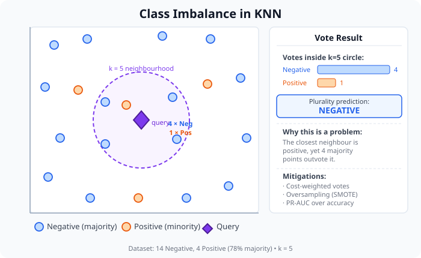
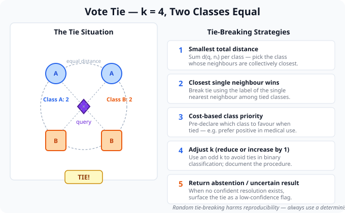
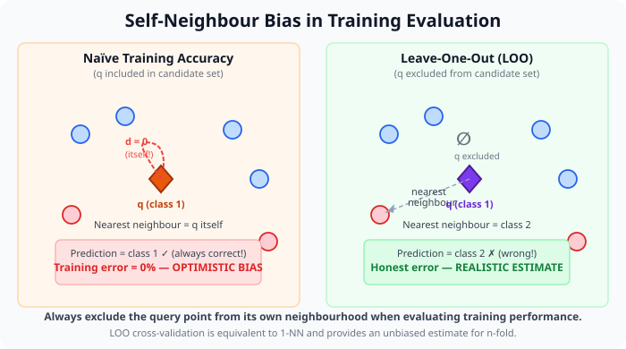

# Class Imbalance, Ties, and Edge Cases in KNN

Real-world KNN deployments regularly hit situations the basic algorithm description glosses over: skewed class distributions, decision ties, duplicate inputs with contradictory labels, and boundary conditions that can make predictions unstable or silently wrong. This chapter covers each of these **edge cases** systematically.

---

## Table of Contents

1. [Imbalanced Classes](#1-imbalanced-classes)
2. [Vote Ties](#2-vote-ties)
3. [Equal-Distance Boundary Ties](#3-equal-distance-boundary-ties)
4. [Duplicate Inputs with Conflicting Targets](#4-duplicate-inputs-with-conflicting-targets)
5. [k Larger Than Training Size](#5-k-larger-than-training-size)
6. [Self-Neighbours](#6-self-neighbours)
7. [Adversarial and Privacy Considerations](#7-adversarial-and-privacy-considerations)

---

## 1. Imbalanced Classes

### The Problem

***Class imbalance*** occurs when one class (the **majority class**) vastly outnumbers another (the **minority class**). In an extreme case — 99 % negative, 1 % positive — most k-neighbourhoods will be dominated by negative examples regardless of local structure. KNN silently inherits this bias through its plurality vote.

<div align="center">
  
</div>

The visualisation above shows a mild imbalance (78 % negative). With a 99/1 split the effect is far more severe — the minority class can be undetectable by standard KNN no matter how well it clusters.

### Why KNN Is Especially Sensitive

KNN's prediction is a **local** vote. If training data density is uneven, the minority class cannot "broadcast" its signal beyond its own immediate neighbourhood. Global models (e.g. logistic regression) can partially compensate through learned global weights; KNN has no such mechanism.

> [!IMPORTANT]
> Synthetic or duplicated minority points from resampling techniques (e.g. **SMOTE**) directly alter local density, which changes KNN predictions more dramatically than it would change most global models. Always resample **inside each training fold**, never on the full dataset before the train/test split.

### Mitigations

| Approach | How it helps | Caveat |
|----------|-------------|--------|
| **Cost-weighted votes** | Multiply minority-class votes by a weight $w > 1$ | Requires tuning $w$ on a validation set |
| **SMOTE / oversampling** | Synthetically increases minority density | Must be applied only within training folds |
| **Undersampling** | Removes majority examples to rebalance | Loses information; check for distributional shift |
| **Threshold selection** | Lower the classification threshold for the minority class | Select threshold from validation probabilities, not training |
| **PR-AUC instead of accuracy** | Precision-Recall AUC is not inflated by majority TN count | Report alongside ROC-AUC for complete picture |
| **Anomaly detection** | When positives are truly rare and structurally different | Different modelling paradigm — not strictly KNN |

> [!TIP]
> Always use **stratified cross-validation** (and group-aware splitting if the data has natural groups) so that each fold preserves the original class ratio. Standard random splits can produce folds with zero minority examples.

---

## 2. Vote Ties

### When a Tie Occurs

A ***vote tie*** happens when two or more classes receive exactly equal vote counts among the k nearest neighbours. This is most common with:

- **Even k** in binary classification (e.g. k=4, two classes, each gets 2 votes).
- **Multi-class problems** where k is a multiple of the class count.

<div align="center">
  
</div>

### Five Deterministic Tie-Breaking Strategies

> [!IMPORTANT]
> **Random tie-breaking harms reproducibility.** The same model on the same data can return different answers depending on a random seed. Always implement a deterministic rule and document it.

| # | Strategy | Description |
|---|----------|-------------|
| **1** | **Smallest total distance** | Sum $\sum d(q, n_i)$ for each tied class; pick the class whose neighbours are collectively closest |
| **2** | **Closest single neighbour** | Among the tied classes, return the label of the single nearest neighbour |
| **3** | **Cost-based class priority** | Pre-declare a priority order (e.g. in medical screening, prefer "positive" on a tie) |
| **4** | **Adjust k** | Use an odd k for binary problems to structurally prevent ties; document the adjustment procedure |
| **5** | **Abstain / flag as uncertain** | Return a low-confidence marker rather than a forced prediction when no confident resolution exists |

> [!TIP]
> The simplest structural fix is to **always use an odd k** for binary classification. Odd k guarantees a strict majority vote and eliminates ties entirely for two-class problems.

---

## 3. Equal-Distance Boundary Ties

### The Problem

A ***boundary tie*** (or ***distance tie***) occurs when two or more training points share exactly the same distance from the query. The question becomes: which $k$ points count as "the k nearest neighbours"?

Consider k=3 and four points at distance 1.0 (all sharing the third-nearest position). Different implementations resolve this differently:

- Some implementations include **all tied points** at the k-th distance (k grows above the requested value).
- Others take a **deterministic subset** based on data storage order (making predictions order-dependent).
- Others use a **secondary sort key** (e.g. feature value or index).

> [!WARNING]
> If your implementation resolves equal-distance ties by storage order, predictions can silently change when the training data is shuffled or re-indexed. This is a hidden source of irreproducibility — especially dangerous in production systems where data pipelines reorder rows.

### Recommended Approaches

1. **Include all tied boundary points.** This is the most principled choice but increases effective neighbourhood size.
2. **Define a secondary sort key.** Sort ties by a fixed secondary feature (or index) to ensure determinism.
3. **Aggregate exact duplicates before training.** Merge identical feature vectors into a single representative point with a combined label (majority vote or mean target).
4. **Document the behaviour of your library.** `sklearn.neighbors.KNeighborsClassifier` uses a deterministic but index-dependent tie-break; note this in your code.

---

## 4. Duplicate Inputs with Conflicting Targets

### What It Means

***Duplicate inputs with conflicting targets*** are training records with identical feature vectors but different class labels (classification) or different target values (regression).

### Common Causes

| Cause | Description |
|-------|-------------|
| **Label noise** | Annotators disagreed; one copy was labelled incorrectly |
| **Legitimate ambiguity** | The features genuinely do not contain enough information to determine the target |
| **Insufficient features** | A hidden variable drives the outcome but is not in the feature set |
| **Data integration errors** | Records merged from multiple sources with inconsistent labelling |

### How KNN Handles It

KNN **cannot separate** identical feature vectors. All duplicate copies will be in each other's k-nearest-neighbour set, and their conflicting labels will appear in the vote simultaneously. The resulting prediction is a probabilistic average of the conflicting labels.

> [!NOTE]
> When duplicate inputs with conflicting targets exist, returning a **local probability** (e.g. "60 % positive") or a **mean prediction** is more honest than outputting a forced deterministic label. It correctly signals that the features alone are insufficient to resolve the ambiguity.

### Recommended Actions

1. **Audit the duplicates** — determine whether they are labelling errors, genuine ambiguity, or integration bugs.
2. **Fix labelling errors** upstream if possible.
3. **For legitimate ambiguity,** aggregate conflicting records into a single row with a probabilistic target (fractional label or mean value).
4. **Document** the presence and resolution of duplicates as a data quality note.

---

## 5. k Larger Than Training Size

### The Constraint

The number of neighbours k must satisfy:

$$
1 \leq k \leq n_{\text{fit}}
$$

where $n_{\text{fit}}$ is the number of training examples available to the model at fit time.

> [!WARNING]
> In **cross-validation**, the effective training size per fold is smaller than the full dataset. If you have 100 samples and use 5-fold CV, each training fold contains only 80 samples. Setting k=90 will cause a runtime error on every fold — even though k=90 < 100 appears valid when inspecting the full dataset.

**Key rule:** When grid-searching over k, always set the upper bound of the search range to be **strictly less than the smallest training-fold size**, not the full dataset size.

```python
# safe upper bound for k in 5-fold CV on 100 samples
n_samples = 100
n_folds = 5
max_k = int(n_samples * (1 - 1 / n_folds)) - 1  # = 79
param_grid = {"n_neighbors": range(1, max_k + 1)}
```

---

## 6. Self-Neighbours

### The Problem

A ***self-neighbour*** occurs when a training point is included as one of its own k nearest neighbours during evaluation. Because $d(x, x) = 0$, the point will always be its own closest neighbour — and will trivially predict its own label correctly. This inflates training accuracy and k=1 training error to zero regardless of how noisy the data is.

<div align="center">
  
</div>

### When It Matters

| Evaluation type | Self-neighbour present? | Effect |
|-----------------|-------------------------|--------|
| Training accuracy (naïve) | Yes | Inflated — always 100 % for k=1 |
| **Leave-one-out (LOO)** | No — query excluded | Unbiased estimate |
| k-fold cross-validation | No — query is in validation fold | Unbiased estimate |
| Test-set evaluation | No — query not in training set | Correct |

> [!IMPORTANT]
> Never report **training accuracy** for a KNN model as a measure of generalisation performance. At k=1, training accuracy is always 100 % due to self-neighbours. Always use hold-out test sets or cross-validation.

### Leave-One-Out and Its Connection to 1-NN

***Leave-one-out cross-validation (LOO-CV)*** for KNN is equivalent to: for each training point $x_i$, exclude it from the candidate set and predict its label using the remaining $n-1$ points. For 1-NN, LOO-CV can be computed efficiently in $O(n^2 d)$ without re-fitting.

---

## 7. Adversarial and Privacy Considerations

### Data Poisoning

Because KNN predictions are determined directly by individual training records, a **malicious or mislabelled point** placed strategically in the training set can alter predictions for nearby queries. This is called a ***data poisoning*** attack.

Unlike parametric models (which diffuse the influence of any single point across learned weights), KNN gives each training point **direct local influence** over all future queries within its neighbourhood. A single poisoned point can corrupt all predictions in a region of feature space.

> [!WARNING]
> **Poisoning is local but persistent.** An attacker who can inject even one training record can silently flip all predictions in that neighbourhood. Use data validation and anomaly detection on incoming training data, especially in online-learning or continuously updated systems.

### Privacy Leakage

KNN explainability features (e.g. "these are the k training points most similar to your query") can expose individual training records directly. This is a form of ***membership inference*** — an observer can confirm whether a specific record was in the training set.

> [!IMPORTANT]
> **Mitigation steps for privacy-sensitive deployments:**
> - Restrict neighbour-identity explanations to aggregate statistics (e.g. "5 similar records") rather than raw records.
> - Minimise retained personal data; store only what is needed for prediction.
> - Apply access controls to the training store.
> - Consider **prototype-based** or **differential-privacy-compatible** alternatives (e.g. edited nearest neighbour, condensed NN) when regulatory requirements demand it.

### Practical Checklist

| Risk | Mitigation |
|------|-----------|
| Poisoned training points | Validate and anomaly-detect incoming data |
| Neighbour-identity leakage | Return only aggregate statistics, not raw records |
| Stored personal data | Apply data minimisation and retention policies |
| Reverse-engineering training data from predictions | Use prototype summaries or DP mechanisms |

---

> [!NOTE]
> **Quick-reference: edge case rules**
>
> | Edge case | Rule |
> |-----------|------|
> | Class imbalance | Resample inside folds only; use PR-AUC; consider cost weights |
> | Vote tie | Never use random tie-breaking; prefer odd k or distance-based rule |
> | Distance boundary tie | Document library behaviour; prefer including all tied points |
> | Duplicate conflicting targets | Audit and aggregate; return probability, not forced label |
> | k > fold size | Bound k to smallest training-fold size, not full dataset |
> | Self-neighbours | Exclude query from its own neighbourhood; never report training accuracy |
> | Adversarial / privacy | Validate inputs; restrict neighbour identity; minimise retained data |

---

<p align="center">
  ⬅️ <strong>Previous:</strong> <a href="./12.1%20Evaluation%20in%20KNN%20-%20implementation.ipynb">12.1 Evaluation in KNN - implementation</a> &nbsp;&nbsp;|&nbsp;&nbsp; <strong>Next:</strong> <a href="./14%20knn-on-breast-cancer-dataset.ipynb">14 KNN on Breast Cancer Dataset</a> ➡️
</p>
