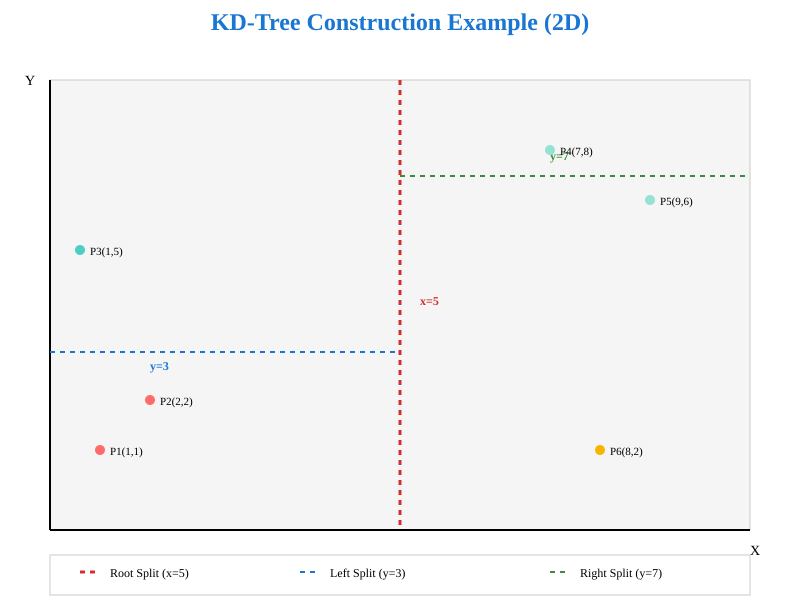
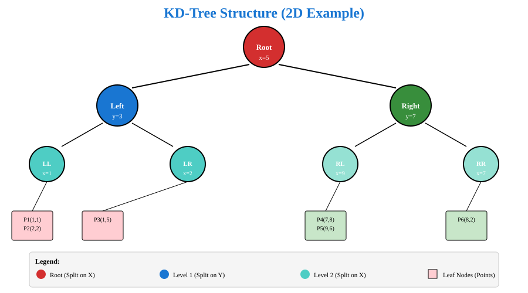
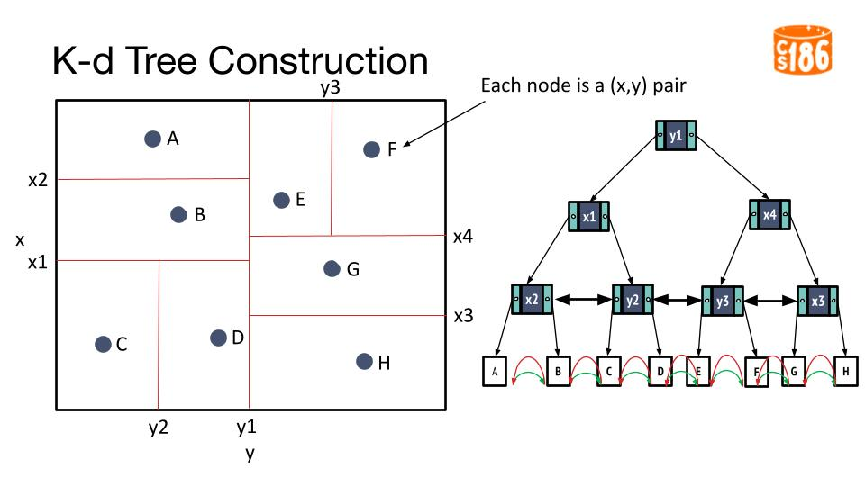
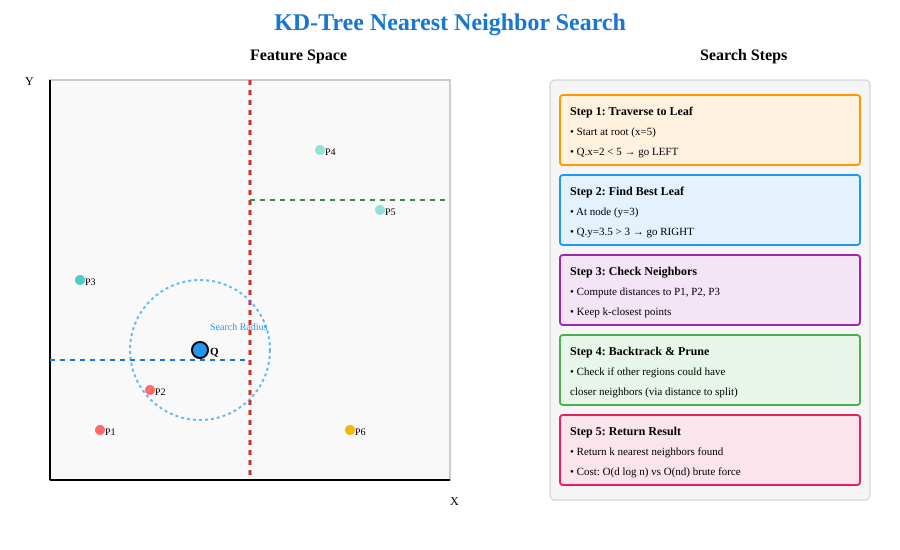
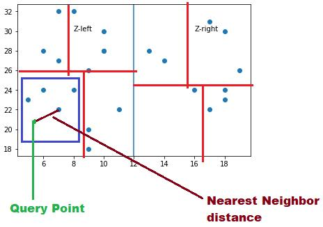

# KD-Tree: Data Structure for Efficient Nearest Neighbor Search

## Table of Contents

- [What is a KD-Tree?](#what-is-a-kd-tree)
  - [Key Characteristics](#key-characteristics)
  - [KD-Tree vs N-Tree: Important Distinction](#kd-tree-vs-n-tree-important-distinction)
  - [KD-Tree vs Balanced BST](#kd-tree-vs-balanced-bst)
  - [Example: 3-Dimensional KD-Tree (K=3)](#example-3-dimensional-kd-tree-k3)
- [How KD-Tree Works](#how-kd-tree-works)
  - [Construction Phase](#construction-phase)
  - [Search Phase](#search-phase)
- [KD-Tree Visualization](#kd-tree-visualization)
  - [Step 1 — Space Partitioning in 2D](#space-partitioning-in-2d)
  - [Step 2 — Tree Structure](#tree-structure)
  - [Step 3 — General Construction Example](#general-construction-example)
  - [Step 4 — Nearest Neighbor Search Process](#nearest-neighbor-search-process)
  - [Step 5 — Construction with Nearest Neighbour](#construction-with-nearest-neighbour)
  - [Real-World KD-Tree Example](#real-world-kd-tree-example)
- [Time Complexity](#time-complexity)
  - [Complexity Breakdown](#complexity-breakdown)
  - [Total Complexity Summary](#total-complexity-summary)
- [Advantages and Disadvantages](#advantages-and-disadvantages)
- [KD-Tree vs Ball-Tree](#kd-tree-vs-ball-tree)
- [When to Use KD-Tree](#when-to-use-kd-tree)
- [KD-Tree in KNN](#kd-tree-in-knn)
  - [Performance Impact](#performance-impact)
  - [Example: 1M Points](#example-1m-points)
- [References](#references)

---

## What is a KD-Tree?

- A **KD-tree** (***K-Dimensional tree***) is a ***binary search tree*** that ***partitions $d$-dimensional space*** into ***rectangular regions***. 
- It is ***used to organize and search multi-dimensional data points*** efficiently, particularly for ***nearest neighbor queries***.

### Key Characteristics

- **Binary tree structure** — each node has at most two children
- **Axis-aligned splits** — splits alternate between dimensions (x, y, z, ...)
- **Balanced partitioning** — divides space into two equal-sized regions at each level
- **Memory-efficient** — stores the same data as brute force but organizes it for faster queries

### KD-Tree vs N-Tree: Important Distinction

Many people confuse KD-tree with ***N-tree (N-ary tree)***. Here's the key difference:

| Aspect | N-tree | KD-tree |
|--------|--------|---------|
| **What N/K means** | ***Branching factor*** (max children per node) | ***Number of dimensions*** |
| **Children per node** | ***Variable*** (up to N) | ***Always 2*** (binary) |
| **Example: K/N = 2** | Binary tree (2 children per node) | Binary tree splitting 2D space (x-y) |
| **Example: K/N = 3** | Ternary tree (3 children per node) | Binary tree splitting 3D space (x-y-z) |

**Key Point:** A ***KD-tree is ALWAYS binary*** (exactly 2 children per node), regardless of the value of K:
- ***K=2*** → partitions ***2D space***, but still binary
- ***K=3*** → partitions ***3D space***, but still binary
- ***K=10*** → partitions ***10D space***, but still binary

The ***K represents dimensions being split***, not the number of branches!

### KD-Tree vs Balanced BST

A ***KD-tree*** is a ***multi-dimensional generalisation*** of a ***Balanced Binary Search Tree (BST)***. Understanding the connection clarifies why KD-trees behave the way they do.

| Aspect | ***Balanced BST*** | ***KD-Tree*** |
|--------|-------------------|---------------|
| **Number of dimensions** | ***1D*** — compares a single value | ***K-dimensional*** — compares across K dimensions |
| **Split criterion** | Always the ***same single key*** | ***Alternates across dimensions*** (depth mod K) |
| **Tree shape** | ***Binary*** | ***Binary*** (always 2 children) |
| **Split value** | ***Median*** of sorted keys | ***Median*** along the chosen dimension |
| **Traversal** | Go ***left*** if key < node, ***right*** if key ≥ node | Go ***left*** if coord < node on current axis, ***right*** otherwise |
| **Use case** | ***1D range queries*** and sorted lookups | ***K-dimensional nearest-neighbour*** and range queries |
| **Balance mechanism** | ***AVL / Red-Black rotations*** | ***Median splitting*** at build time (static) |

**Key insight:** Where a BST asks *"is my value smaller or larger than this node?"*, a KD-tree asks *"is my X-coordinate smaller or larger than this node?"*, then *"is my Y-coordinate…?"*, then back to X — cycling through all K axes as depth increases.

Both structures are ***binary trees built on median splits*** — the KD-tree simply extends the concept from one dimension to K dimensions by rotating which dimension is used at each level.

> [!NOTE]
> KD-trees are ***static*** structures — they are built once and not rebalanced when new points are inserted. If the dataset changes frequently, rebuilding the entire tree may be necessary.

### Example: 3-Dimensional KD-Tree (K=3)

<div align="center">


</div>

This diagram shows a ***K=3 (3-dimensional) KD-tree*** that partitions ***3D space (x-y-z)*** into rectangular regions. Notice that despite having 3 dimensions, it remains a ***binary tree structure*** with exactly 2 children per node — the K value determines the dimensionality of the space being partitioned, not the branching factor.


---

## How KD-Tree Works

### Construction Phase

Building a KD-tree involves ***recursively partitioning*** the feature space:

1. **Select a dimension** — cycle through dimensions (x → y → x → y → ..., etc.)
2. **Find the median** — find the median value along the chosen dimension
3. **Create a split node** — use the median as the ***split value***
4. **Partition points** — send points with coordinate ≤ median to ***left subtree***, others to ***right subtree***
5. **Recurse** — repeat for left and right subtrees until each leaf contains one point (or a threshold)

**Pseudocode:**

```
build_kd_tree(points, depth):
    if points is empty:
        return None
    
    axis = depth mod k  # k is the number of dimensions
    sorted_points = sort(points by axis)
    median_idx = len(sorted_points) / 2
    
    return Node:
        point = sorted_points[median_idx]
        left = build_kd_tree(sorted_points[0:median_idx], depth + 1)
        right = build_kd_tree(sorted_points[median_idx+1:], depth + 1)
```

**Time Complexity:** $O(nd \log n)$ — $O(n \log n)$ to sort all $n$ points in $d$ dimensions

### Search Phase

Finding the ***K nearest neighbors*** involves ***tree traversal*** and ***pruning***:

1. **Traverse to leaf** — recursively go left or right based on query point coordinates
2. **Initialize best list** — keep track of the K closest points found so far
3. **Backtrack and prune** — go back up the tree, checking if other regions could have closer neighbors
4. **Pruning rule** — if the ***distance to the split*** > ***distance to current K-th neighbor***, prune the other branch
5. **Return result** — return the K nearest neighbors

**Pseudocode:**

```
search_kd_tree(node, query, k, depth):
    if node is None:
        return []
    
    axis = depth mod d
    
    # Add current point to candidates
    candidates = [(distance(query, node.point), node.point)]
    
    # Determine which side to explore first
    if query[axis] < node.point[axis]:
        near_side = node.left
        far_side = node.right
    else:
        near_side = node.right
        far_side = node.left
    
    # Recursively search near side
    candidates.extend(search_kd_tree(near_side, query, k, depth + 1))
    
    # Check if we need to search far side (pruning)
    dist_to_split = abs(query[axis] - node.point[axis])
    if dist_to_split < distance_to_kth_neighbor:
        candidates.extend(search_kd_tree(far_side, query, k, depth + 1))
    
    # Keep only k nearest
    return sort_by_distance(candidates)[:k]
```

---

## KD-Tree Visualization

### Space Partitioning in 2D

**Step 1 — Space Partitioning:** Each split divides the feature space with an ***axis-aligned hyperplane***. The image below shows a 2D example — first a vertical split at $x=5$, then horizontal splits within each half:

<div align="center">



</div>

- ***Red dashed line (x=5)*** — ***root split*** on X-axis
- ***Blue dashed line (y=3)*** — left subtree split on Y-axis
- ***Green dashed line (y=7)*** — right subtree split on Y-axis
- ***Points (P1-P6)*** — data points organized by the splits

### Tree Structure

**Step 2 — Tree Structure:** Each split becomes a node in the tree. Points end up as ***leaf nodes***. The root splits on $x$, its children split on $y$, grandchildren split on $x$ again — ***alternating dimensions***:

<div align="center">



</div>

- ***Root node*** — splits first on X
- ***Level 1 nodes*** — split on Y
- ***Level 2 nodes*** — split on X again
- ***Leaf nodes*** — contain the actual data points

### General Construction Example

**Step 3 — General Construction Example:** A larger, complete example showing how a full KD-tree is ***recursively constructed*** from a dataset, with all levels visible:

<div align="center">



</div>

### Nearest Neighbor Search Process

**Step 4 — Search Process:** The diagram below shows the full **5-step search process** — traversal to the leaf, checking candidates, backtracking, and pruning regions using the ***split-distance lower bound***:

<div align="center">



</div>

- **Step 1 — Traverse to leaf:** Follow tree branches toward the query point, going left or right at each node based on the ***current split axis***
- **Step 2 — Set initial candidate:** The leaf node reached is the first ***nearest-neighbour candidate***; record its distance $d_k$
- **Step 3 — Backtrack:** Walk back up the tree, visiting each parent
- **Step 4 — Pruning check:** At each parent, compute ***distance to the split hyperplane***. If this distance $> d_k$, ***prune the sibling branch*** — it cannot contain a closer point
- **Step 5 — Update candidate:** If the sibling branch is not pruned, recurse into it and update $d_k$ if a closer point is found

### Construction with Nearest Neighbour

**Step 5 — Construction with Nearest Neighbour Highlighted:** The image below shows how the same construction relates to the nearest-neighbour candidate — highlighting which regions are searched and which are pruned:

<div align="center">



</div>

### Real-World KD-Tree Example

<div align="center">


</div>

This image shows a practical KD-tree example with real data points and how the tree structures the space.

---

## Time Complexity

| Operation | Complexity | Notes |
|-----------|-----------|-------|
| **Build KD-tree** | $O(nd \log n)$ | Sorting $n$ points in $d$ dimensions |
| **Single query (avg)** | $O(d \log n)$ | Best case: log n nodes visited |
| **Single query (worst)** | $O(nd)$ | Degrades in high dimensions |
| **K queries (total)** | $O(nd \log n + kd \log n)$ | Build + search amortized |
| **Brute force (K queries)** | $O(knd)$ | Compare: no tree building |
| **Space** | $O(nd)$ | Stores all n points + tree structure |

### Complexity Breakdown

- **Build phase:** $O(nd \log n)$ — sorting in each dimension
- **Search phase (avg):** $O(d \log n)$ — visit ~log n nodes, distance computation per node
- **High-dimensional degradation:** Approaches $O(nd)$ as $d$ increases (curse of dimensionality)

### Total Complexity Summary

Here's a ***quick reference*** comparing total complexity for KD-tree vs brute force across the entire operation:

**Variable Definitions:**
- ***n*** = number of training data points
- ***d*** = number of dimensions (features)
- ***q*** = number of queries (search operations / predictions)
- ***k*** = number of nearest neighbors to find

A ***query*** is a single search operation: finding K nearest neighbors for one new data point. Multiple queries means making predictions for multiple new data points.

| Scenario | KD-Tree | Brute Force | Winner |
|----------|---------|-------------|--------|
| **Build only** | $O(nd \log n)$ | $O(nd)$ | Brute Force |
| **1 query** | $O(d \log n)$ avg | $O(nd)$ | KD-Tree ✅ |
| **q queries** | $O(nd \log n + qd \log n)$ | $O(qnd)$ | KD-Tree ✅ (for many q) |
| **Many queries** | $\approx O(qd \log n)$ | $O(qnd)$ | **KD-Tree ~q× faster** ✅✅ |
| **Space** | $O(nd)$ | $O(nd)$ | Same |

**Key Insight:**
- ***KD-tree is worth it when making many queries*** ($q$ is large)
- ***Single query?*** Use brute force
- ***1000+ queries?*** KD-tree is dramatically faster (up to 50x+ speedup)
- ***High dimensions ($d > 20$)?*** Advantage decreases, consider ball-tree instead


---

## Advantages and Disadvantages

### ✅ Advantages

- **Fast queries** — $O(d \log n)$ average vs $O(nd)$ brute force
- **Low memory overhead** — same $O(nd)$ storage, organized for speed
- **Effective pruning** — eliminates entire branches that cannot contain neighbors
- **Simple to implement** — straightforward recursive construction
- **Works well in low dimensions** — especially for $d \lesssim 20$

### ❌ Disadvantages

- **Curse of dimensionality** — performance degrades as $d$ increases
  - Above $d \approx 20$, approaches brute force
- **Build cost** — $O(nd \log n)$ (higher than brute force)
  - Only worth it with many queries
- **Non-Euclidean metrics** — pruning is harder with Manhattan, Cosine distances

---

## KD-Tree vs Ball-Tree

| Feature | KD-Tree | Ball-Tree |
|---------|---------|-----------|
| **Optimal Dimensions** | $d \lesssim 20$ | $d \geq 20$ |
| **Partition Shape** | Axis-aligned rectangles | Hyperspheres |
| **Metrics** | Euclidean | Any metric |
| **Pruning** | Excellent in low-D | Consistent |

---

## When to Use KD-Tree

✅ **Good:** Low dimensions, Euclidean distance, many queries  
❌ **Poor:** High dimensions ($d > 20$), many repeated non-Euclidean metrics

---

## KD-Tree in KNN

### Performance Impact

**Without KD-tree (Brute Force):**
- Training: $O(nd)$
- Per query: $O(nd)$
- Total ($q$ queries): $O(qnd)$

**With KD-tree:**
- Training: $O(nd \log n)$
- Per query: $O(d \log n)$ avg
- Total ($q$ queries): $O(nd \log n + qd \log n)$

### Example: 1M Points

For $n=1M$, $d=10$, $q=1000$ queries:
- Brute force: $10^{10}$ operations
- KD-tree: $\sim 2 \times 10^8$ operations
- **Speedup: ~50x faster!**

---

## References

- **[Wikipedia: K-d tree](https://en.wikipedia.org/wiki/K-d_tree)** — Comprehensive overview of KD-tree data structure, history, construction, and applications
- **[GeeksforGeeks: Search and Insertion in K-Dimensional Tree](https://www.geeksforgeeks.org/dsa/search-and-insertion-in-k-dimensional-tree/)** — Detailed tutorial on KD-tree operations with code examples and visualizations

