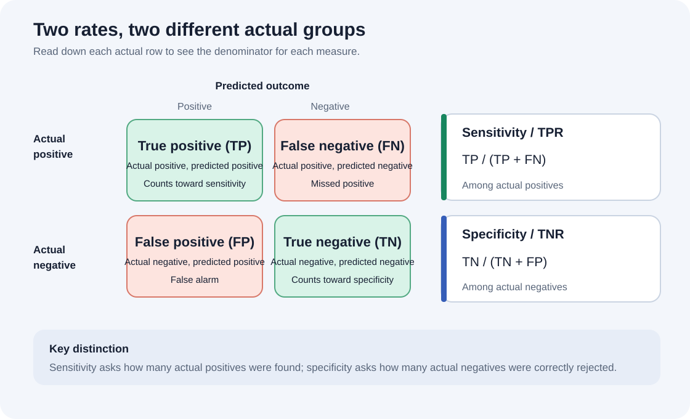

# Sensitivity and Specificity

## Table of Contents

- [What are sensitivity and specificity?](#what-are-sensitivity-and-specificity)
- [Confusion matrix and formulas](#confusion-matrix-and-formulas)
- [Worked example](#worked-example)
- [How to interpret the measures](#how-to-interpret-the-measures)
- [Sensitivity, specificity, and the decision threshold](#sensitivity-specificity-and-the-decision-threshold)
  - [Graphical illustration of the threshold trade-off](#graphical-illustration-of-the-threshold-trade-off)
  - [High sensitivity and low specificity](#high-sensitivity-and-low-specificity)
  - [Low sensitivity and high specificity](#low-sensitivity-and-high-specificity)
- [Sensitivity and specificity are not precision](#sensitivity-and-specificity-are-not-precision)
- [When to prioritize each measure](#when-to-prioritize-each-measure)

## What are sensitivity and specificity?

Sensitivity and specificity describe two different aspects of a binary test or classifier. First define which outcome is **positive** (for example, disease, fraud, or a customer who will churn). Then compare the model's predictions with the known actual outcomes.

- **Sensitivity**, also called the **true positive rate (TPR)** or **recall**, measures the share of actual positive cases that the classifier correctly identifies.
- **Specificity**, also called the **true negative rate (TNR)**, measures the share of actual negative cases that the classifier correctly identifies.

The first diagram shows how a score threshold separates predicted negatives from predicted positives:

- The **healthy** and **sick** curves show the score distributions for actual negative and actual positive cases. Their overlap means that some cases from each group receive similar scores.
- The **cutoff** divides predictions: scores on the positive side are classified as positive; scores on the negative side are classified as negative.
- Sick cases on the predicted-positive side are **true positives (TP)**; sick cases on the predicted-negative side are **false negatives (FN)**.
- Healthy cases on the predicted-negative side are **true negatives (TN)**; healthy cases on the predicted-positive side are **false positives (FP)**.
- Moving the cutoff changes these areas. Lowering it generally catches more sick cases (higher sensitivity) but also flags more healthy cases (lower specificity).

## Confusion matrix and formulas

| Actual outcome | Predicted positive | Predicted negative | Actual total |
|:---|---:|---:|---:|
| **Positive** | True positive (TP) | False negative (FN) | TP + FN |
| **Negative** | False positive (FP) | True negative (TN) | FP + TN |

The second diagram organizes those same outcomes by actual and predicted class, and highlights the denominator for each measure:

- The **top row** contains all actual positive cases: TP and FN. Sensitivity is the share of this row correctly classified as positive, **TP / (TP + FN)**.
- The **bottom row** contains all actual negative cases: FP and TN. Specificity is the share of this row correctly classified as negative, **TN / (TN + FP)**.
- The green cells are correct predictions (TP and TN); the red cells are errors (FN and FP).

The formulas are:

$$
\text{Sensitivity}
= \text{TPR}
= \frac{\text{TP}}{\text{TP}+\text{FN}}
= P(\text{predicted positive}\mid\text{actually positive})
$$

$$
\text{Specificity}
= \text{TNR}
= \frac{\text{TN}}{\text{TN}+\text{FP}}
= P(\text{predicted negative}\mid\text{actually negative})
$$

Sensitivity's denominator contains **all actual positives**. Specificity's denominator contains **all actual negatives**. These are conditional rates: each asks how the classifier behaves within one actual class.

Their complementary error rates are:

$$
\text{False negative rate (FNR)}=1-\text{Sensitivity}
=\frac{\text{FN}}{\text{TP}+\text{FN}}
$$

$$
\text{False positive rate (FPR)}=1-\text{Specificity}
=\frac{\text{FP}}{\text{TN}+\text{FP}}
$$

## Worked example

Suppose a screening test is evaluated on 300 people:

| Actual outcome | Test positive | Test negative | Total |
|:---|---:|---:|---:|
| Has the condition | TP = 90 | FN = 10 | 100 |
| Does not have the condition | FP = 20 | TN = 180 | 200 |

**Sensitivity** is calculated among the 100 people who actually have the condition:

$$
\text{Sensitivity}=\frac{90}{90+10}=\frac{90}{100}=0.90=90\%
$$

The test identifies 90% of the people with the condition; the remaining 10% are false negatives.

**Specificity** is calculated among the 200 people who actually do not have the condition:

$$
\text{Specificity}=\frac{180}{180+20}=\frac{180}{200}=0.90=90\%
$$

The test correctly returns a negative result for 90% of the people without the condition; the remaining 10% are false positives.

## How to interpret the measures

- **High sensitivity** means few actual positives are missed (a low false negative rate). It matters when missing a positive case has serious consequences.
- **High specificity** means few actual negatives are incorrectly flagged (a low false positive rate). It matters when false alarms lead to costly, stressful, or invasive follow-up.
- A value of **100%** means the classifier makes no errors of that type in the evaluated sample. It does not by itself guarantee the same performance on new data.
- Sensitivity and specificity are not overall accuracy. Accuracy divides all correct predictions by the total number of cases; sensitivity and specificity each use a different actual-class denominator.

## Sensitivity, specificity, and the decision threshold

For a score-based classifier, predict positive when the score is at least a chosen threshold. Lowering that threshold generally predicts more cases as positive: sensitivity tends to rise, while specificity tends to fall. Raising it generally predicts fewer cases as positive: specificity tends to rise, while sensitivity tends to fall.

This is a usual trade-off, not a guarantee that every threshold change produces a strict change in both metrics. Choose a threshold based on the consequences of false negatives and false positives, and evaluate it on data representative of the intended use.

### Graphical illustration of the threshold trade-off

The graph shows two overlapping score distributions:

- The **green curve** represents people without the disease (actual negatives).
- The **red curve** represents people with the disease (actual positives).
- Cases to the **left of a cutoff** are classified as negative; cases to the **right** are classified as positive.
- The overlap between the curves makes perfect classification impossible at an intermediate cutoff: some diseased cases become false negatives, while some healthy cases become false positives.

At cutoff **A**, every diseased case in the illustration lies to the right of the cutoff. Therefore, there are no false negatives:

$$
\text{Sensitivity}
=\frac{\text{TP}}{\text{TP}+\text{FN}}
=\frac{\text{TP}}{\text{TP}+0}
=1
$$

This gives **100% sensitivity**, but healthy cases to the right of A are false positives, so specificity is lower.

At cutoff **B**, every healthy case lies to the left of the cutoff. Therefore, there are no false positives:

$$
\text{Specificity}
=\frac{\text{TN}}{\text{TN}+\text{FP}}
=\frac{\text{TN}}{\text{TN}+0}
=1
$$

This gives **100% specificity**, but diseased cases to the left of B are false negatives, so sensitivity is lower. The dashed cutoff between A and B illustrates a compromise between the two measures.

### High sensitivity and low specificity

This image represents a more permissive test that classifies more cases as positive:

- **Few false negatives** means most actual positives are detected. Because FN is small, sensitivity is high:

  $$
  \text{Sensitivity}=\frac{\text{TP}}{\text{TP}+\text{FN}}\longrightarrow\text{high}
  $$

- **Many false positives** means more actual negatives are incorrectly classified as positive. Because FP is large, specificity is low:

  $$
  \text{Specificity}=\frac{\text{TN}}{\text{TN}+\text{FP}}\longrightarrow\text{low}
  $$

This operating point is useful when missing a true positive is especially harmful, such as an initial disease-screening test. The trade-off is that more healthy people may be sent for follow-up testing.

### Low sensitivity and high specificity

This image represents a stricter test that classifies fewer cases as positive:

- **Many false negatives** means more actual positives are missed. Because FN is large, sensitivity is low:

  $$
  \text{Sensitivity}=\frac{\text{TP}}{\text{TP}+\text{FN}}\longrightarrow\text{low}
  $$

- **Few false positives** means most actual negatives are correctly rejected. Because FP is small, specificity is high:

  $$
  \text{Specificity}=\frac{\text{TN}}{\text{TN}+\text{FP}}\longrightarrow\text{high}
  $$

This operating point is useful when a false positive would cause substantial cost or harm. The trade-off is that more genuinely positive cases may be missed.

## Sensitivity and specificity are not precision

Sensitivity and precision both involve true positives, but answer different questions:

| Measure | Formula | Question |
|:---|:---|:---|
| **Sensitivity / recall** | TP / (TP + FN) | Of all actual positives, what fraction did the classifier find? |
| **Specificity** | TN / (TN + FP) | Of all actual negatives, what fraction did the classifier correctly reject? |
| **Precision / positive predictive value (PPV)** | TP / (TP + FP) | Of all predicted positives, what fraction are actually positive? |

Sensitivity and specificity condition on the **actual class**. Precision conditions on the **predicted-positive group**. In particular, precision can change with the prevalence of the positive class even when sensitivity and specificity stay the same.

## When to prioritize each measure

Prioritize **sensitivity** when failing to detect a true positive is especially harmful, such as an initial screening step where missed cases should be minimized. Prioritize **specificity** when false alarms create substantial cost or harm, such as triggering expensive follow-up.

Most real decisions involve both kinds of error. Report both measures, state the decision threshold and evaluation population, and consider the application’s error costs. Predictive values such as precision also depend on how common the positive class is in the population where the test is used.

## References

- [Sensitivity and specificity — Wikipedia](https://en.wikipedia.org/wiki/Sensitivity_and_specificity)